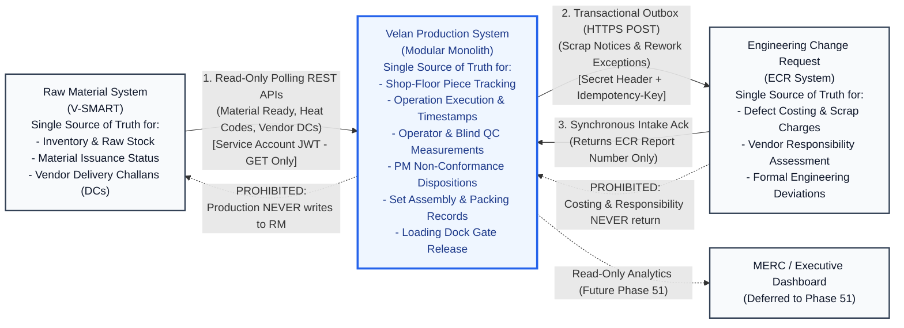
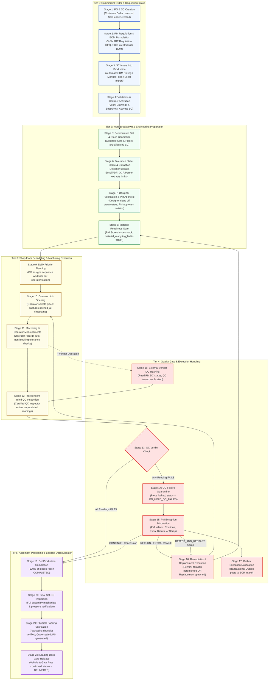
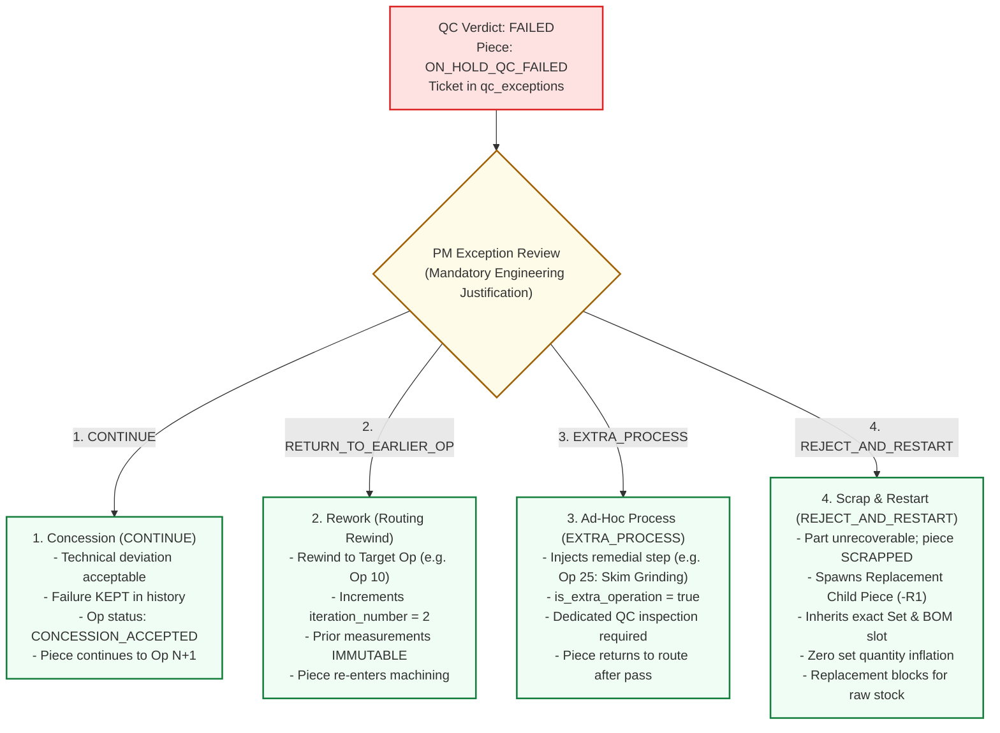
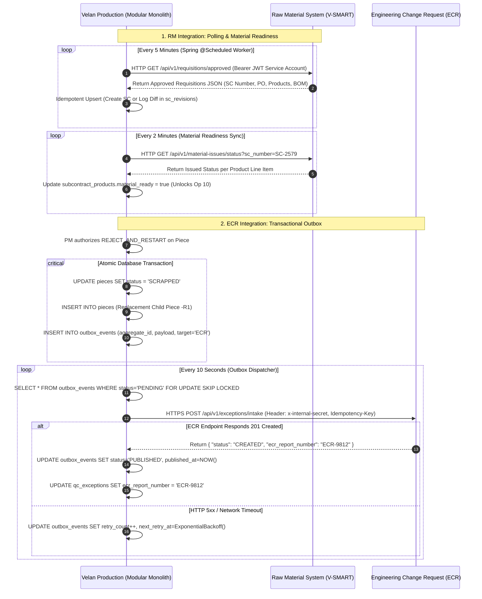

# Velan Production — Master Project Context and Technical Handoff Report for Claude AI

> **Document Type:** Master Architectural Handoff & Project Context Specification  
> **Target Audience:** Claude AI (Project Architect, Systems Analyst, Full-Stack Engineer)  
> **Status:** Authoritative Design Baseline (Phases 1 & 2 Approved / Frozen; Phase 2.6 Completed Awaiting Review)  
> **Target Roadmap Phase:** Transition to Phase 3 (Standards and Technical Specification)  
> **Repository Path:** `docs/PROJECT_CONTEXT_FOR_CLAUDE.md`  

---

## Executive Summary & Guide to this Document

This document is the **single, comprehensive, self-contained project reference** for the **Velan Production System**. It consolidates, explains, and cross-references everything specified, analyzed, and designed across **Phase 1 (Requirements Analysis)** and **Phase 2 (System Design, Parts 2.1 through 2.6)**.

### How Claude AI Must Use This Document:
1. **Primary Working Context:** Use this document as your primary brain and architectural reference when assisting with Velan Production. It defines the business domain, system boundaries, technical stack, domain models, state machines, business rules, and implementation constraints.
2. **Source of Truth Hierarchy:**
   - **Tier 1 (Supreme Controlling Authority):** `docs/phase-1/00_DECISION_LOG.md` (Decisions D-01 through D-19). Any statement in older working drafts that contradicts the Decision Log is superseded by D-01 through D-19.
   - **Tier 2 (Approved Phase 2 Detailed Designs):** Parts 2.1 through 2.6 under `docs/phase-2/`. These documents specify the concrete domain models, database schemas, state machines, and algorithms.
   - **Tier 3 (Phase 1 Foundational Requirements):** Documents 01 through 15 under `docs/phase-1/`.
3. **Strict Execution Rules:**
   - **Documentation Completed $\neq$ Software Implemented:** Phases 1 and 2 are purely requirements and system design phases. **No Java or TypeScript application code, no database tables, and no Flyway SQL migrations have been implemented yet.**
   - **Do Not Skip Phases:** Implementation follows the strict 51-phase development roadmap. Phase 3 (Standards and Technical Specification) must precede project foundation setup.
   - **Preserve System Boundaries:** Production never writes to the Raw Material (RM) system; Production never creates vendor Delivery Challans (DCs); Production never performs commercial billing; and ECR defect costing never returns to Production.
   - **Preserve Six Confirmed Roles:** Admin, PM, Designer, Operator, QC, and Management. Never invent additional primary system roles.

---

## Table of Contents

1. [Section 1 – Project Overview](#section-1--project-overview)
2. [Section 2 – Application Ecosystem and Boundaries](#section-2--application-ecosystem-and-boundaries)
3. [Section 3 – Complete Business Workflow](#section-3--complete-business-workflow)
4. [Section 4 – Product, BOM, Set, and Piece Structure](#section-4--product-bom-set-and-piece-structure)
5. [Section 5 – Six Roles and Permission Architecture](#section-5--six-roles-and-permission-architecture)
6. [Section 6 – Functional Modules Catalogue](#section-6--functional-modules-catalogue)
7. [Section 7 – Complete State Machine Reference](#section-7--complete-state-machine-reference)
8. [Section 8 – Manufacturing Completion Rules](#section-8--manufacturing-completion-rules)
9. [Section 9 – QC, Tolerances, and Exceptions](#section-9--qc-tolerances-and-exceptions)
10. [Section 10 – Integration Architecture](#section-10--integration-architecture)
11. [Section 11 – Architecture and Technology Decisions](#section-11--architecture-and-technology-decisions)
12. [Section 12 – Architecture Decision Records (ADRs)](#section-12--architecture-decision-records-adrs)
13. [Section 13 – Confirmed Business Rules and Constraints (BR-001 to BR-070)](#section-13--confirmed-business-rules-and-constraints)
14. [Section 14 – Current Development Status](#section-14--current-development-status)
15. [Section 15 – Open Questions, Assumptions, and Deferred Decisions](#section-15--open-questions-assumptions-and-deferred-decisions)
16. [Section 16 – Remaining 51-Phase Development Roadmap](#section-16--remaining-51-phase-development-roadmap)
17. [Section 17 – Instructions for Claude AI – How to Work on Velan Production](#section-17--instructions-for-claude-ai--how-to-work-on-velan-production)
18. [Section 18 – Source Document Index](#section-18--source-document-index)

---

## Section 1 – Project Overview

### 1.1 What Velan Production Is
**Velan Production** is a specialized, web-based Manufacturing Execution System (MES) and shop-floor tracking application designed specifically for precision engineering and industrial valve manufacturing. It tracks, coordinates, and audits the transformation of raw metal castings and forgings into completed, certified valve assemblies (e.g., Gate Valves, Globe Valves, Check Valves, Cryogenic Actuator Assemblies).

The system operates directly on the manufacturing shop floor, replacing paper travelers, informal whiteboards, and uncoordinated spreadsheets with an immutable, real-time digital execution platform.

### 1.2 Why the Application is Being Developed
Precision valve manufacturing requires absolute metallurgical and dimensional compliance. Valve assemblies are deployed in high-consequence environments such as nuclear power stations, offshore oil & gas platforms, and subsea pipelines. A dimensional error of 0.05 mm on a valve spindle or flange face can lead to catastrophic pressure failure or toxic chemical leakage.

Prior to Velan Production, the factory experienced:
1. **Paper Traveler Loss and Inaccuracy:** Paper routing sheets traveling with heavy steel components became oil-stained, torn, or misplaced.
2. **Data Falsification & "Pencil Whipping":** Operators under production pressure could write passing dimensions on paper without actually taking physical micrometer measurements.
3. **Quarantine Blind Spots:** When a part failed quality inspection, there was no digital mechanism to prevent a machine operator from continuing downstream machining on the defective part.
4. **Scrap and Replacement Confusion:** When an expensive valve body was scrapped, replacement parts were ordered informally, leading to lost customer contract linkage, inflated inventory demand, and broken assembly pairings.
5. **Lack of Real-Time Progress Visibility:** Plant managers could not answer simple customer inquiries regarding order status without walking the physical shop floor to find parts.

### 1.3 Business Problems Solved
* **Deterministic Traceability:** Every physical piece of steel receives an immutable digital identity linked to its customer Size Card (SC), parent assembly set, and Bill of Materials (BOM) slot from the moment of intake.
* **Guaranteed Raw Material Gating:** Machine operators cannot open a job or record machining cuts until raw material issuance is confirmed by the Raw Material warehouse.
* **Independent, Blind Quality Control:** Operators enter machining readings; QC inspectors perform independent physical measurements using calibrated tools without seeing operator numbers ("blind QC").
* **Formal Engineering Exception Governance:** Out-of-tolerance non-conformances trigger immediate physical and digital quarantine. Only the Project Manager (PM) can authorize remediation via four strict dispositions: Continue (Concession), Extra Process, Return to Earlier Operation (Rework), or Reject and Restart (Scrap).
* **Conserved Replacement Lineage:** Scrapped parts are permanently retired with full failure histories; replacement parts are spawned with linked genealogy without inflating customer order quantities.
* **Separation of Quality, Packing, and Dispatch:** Prevents shipping incomplete sets. Guarantees that passing machining does not equal passing final QC, passing final QC does not equal packed, and packing does not equal delivered.

### 1.4 Primary User Personas
The application is built for six specific, confirmed shop-floor personas:
1. **Admin (`ROLE_ADMIN`):** IT and systems administrator; manages user accounts, master data, security settings, and holds exclusive authority for contract cancellations.
2. **Project Manager (`ROLE_PM`):** Shop-floor operational commander; plans daily priorities, activates contracts, reviews tolerance sheets, decides quality non-conformances, and authorizes dock releases.
3. **Designer (`ROLE_DESIGNER`):** Engineering design authority; uploads CAD blueprints and tolerance sheets, selects process templates, and verifies extracted dimensional parameters.
4. **Operator (`ROLE_OPERATOR`):** Machinist on the factory floor (lathe, CNC mill, grinding, drilling); picks assigned work from a priority worklist, views CAD drawings, and enters bulk measurement readings.
5. **Quality Control Inspector (`ROLE_QC`):** Certified quality inspector; performs independent, blind dimensional and hydrostatic inspections using verified calibrated instruments.
6. **Management (`ROLE_MANAGEMENT`):** Plant directors and executives; views read-only dashboards, live bottleneck analytics, machine utilization metrics, and daily 9 AM progress reports.

### 1.5 Manufacturing Workflow in Simple Business Language
Before introducing technical terminology, the physical life of an order proceeds as follows:
1. **Order Receipt:** A customer places an order for 4 large industrial gate valves. The commercial contract enters the system as a Size Card (SC).
2. **Explosion into Parts:** The engineering catalog specifies that each valve "set" requires 1 Flange, 2 Spindles, 1 Valve Body, and 3 Jig Feet. The system generates 28 individual serialized metal pieces (7 pieces $\times$ 4 sets) and immediately assigns each piece to its specific valve set (Set #1 through Set #4).
3. **Material Arrival:** Raw steel bars and castings arrive at the factory stores. Stores confirms raw material has been issued. Only then are machine operators allowed to touch the parts.
4. **Machining Steps:** Each piece moves through ordered machining stations (e.g., Facing $\rightarrow$ Turning $\rightarrow$ Milling $\rightarrow$ Grinding). Operators execute cuts and enter their measurements on touch-screen terminals.
5. **Independent Inspection:** A QC inspector walks to the machine with a calibrated digital micrometer, takes measurements, and enters them. If dimensions pass, the piece moves to the next machine.
6. **Handling Defects:** If a spindle is machined 0.2 mm too thin, the system immediately flags the piece and locks downstream work. The piece is physically tagged with a red card and placed in a quarantine rack. The Project Manager inspects the defect on their screen and decides whether to salvage it, perform an extra skim cut, or scrap it and order a new piece of raw steel.
7. **Set Assembly:** When all 7 constituent pieces for Valve Set #1 are finished and passed, the parts are brought together in the final assembly bay. A comprehensive Final QC inspection verifies the complete valve.
8. **Packing & Shipping:** Set #1 is cleaned, boxed, and sealed in a wooden crate with protective end-caps. A packing slip is printed. When the customer's truck arrives at the loading dock, the shipping coordinator confirms vehicle departure and issues a gate pass. Set #1 is now marked Delivered. If Sets #2, #3, and #4 are still being machined, they remain in the factory without blocking Set #1's delivery.

### 1.6 In-Scope vs. Out-of-Scope Boundaries

| Functional Domain | In-Scope (Velan Production) | Out-of-Scope (External System / Excluded) |
| :--- | :--- | :--- |
| **Size Cards** | Manual SC creation, Excel bulk import, RM requisition sync, diff-based revisions. | Customer sales negotiation, credit checks, pricing. |
| **Inventory & Raw Materials** | Material readiness gating (yes/no flag per product line item), heat code viewing. | Inventory ledger, stock replenishment, bin locations, physical stock issues (**Owned by RM / V-SMART**). |
| **Component Fabrication** | Piece-level tracking, operation routing, operator measurement capture, priority lists. | Direct machine NC code generation (CAM), tool wear monitoring. |
| **Quality & Tolerances** | Tolerance extraction, independent blind QC data entry, calibrated tool validation. | Physical calibration laboratory management. |
| **Exceptions & Rework** | Quarantine locking, 4 PM dispositions, rework iteration increments, scrap replacement generation. | Financial responsibility assessment, customer penalty calculations, vendor defect chargebacks (**Owned by ECR**). |
| **Vendor Processing** | Tracking vendor stages, reading RM Delivery Challans, tagging inward returns. | Vendor DC generation, commercial logistics contracts, vendor invoice approval (**Owned by RM**). |
| **Logistics & Assembly** | BOM set pre-allocation, set completeness calculations, packing checklist, dock release gate pass. | Freight rate calculation, commercial invoicing, customer billing (**Strictly Outside Production**). |
| **Architecture Stack** | Java 25 LTS, Spring Boot 4, React, TypeScript, Neon PostgreSQL, Cloudflare R2, Render. | **No Redis, No RabbitMQ, No Kafka, No Microservices.** |

---

## Section 2 – Application Ecosystem and Boundaries

Velan Production does not operate in total isolation; it coordinates with two existing enterprise applications while strictly respecting defined data ownership boundaries:



### 2.1 The Raw Material Application (RM – V-SMART)
* **Identity:** Legacy enterprise inventory system governing raw steel bars, billets, castings, forgings, and warehouse stock.
* **Responsibilities:** RM owns stock receipts, physical store bin locations, mill test certificates (MTC), raw material issuance, and the creation, dispatch, and inward receipt of external Vendor Delivery Challans (DCs).
* **Communication Channel:** Velan Production connects to RM exclusively via **HTTP GET requests** using a dedicated, read-only service account (`ROLE_RM_CONNECTOR`).
* **Strict Non-Negotiable Boundary (`BR-020, BR-067, D-04, D-05`):**
  - **Velan Production never writes to RM.** It does not create inventory requisitions, update stock balances, or modify material records.
  - Velan Production reads material issuance status (yes/no per product line item), raw heat codes, and vendor DC return statuses.
  - Production never creates, modifies, dispatches, or inwards vendor Delivery Challans. All vendor logistics transactions are executed in RM.

### 2.2 The Engineering Change Request Application (ECR)
* **Identity:** Enterprise quality and non-conformance accounting application.
* **Responsibilities:** ECR investigates technical root causes, assesses commercial financial liability (determining whether operator error, machine fault, or vendor metallurgical defect caused scrap), and calculates scrap financial depreciation.
* **Communication Channel:** Velan Production transmits scrap and rework exceptions to ECR via an asynchronous **Transactional Outbox (`outbox_events`)** over HTTPS POST, authenticated via an internal shared secret header (`x-internal-secret`) and an idempotency key.
* **Strict Non-Negotiable Boundary (`BR-039, BR-062, D-09`):**
  - Production sends exception notifications to ECR once and only once.
  - ECR returns an immediate synchronous acknowledgment containing an **ECR Report Number** (e.g., `ECR-2026-0891`).
  - **Zero Costing Feedback:** ECR financial costing, employee blame, or vendor chargebacks **never return to Velan Production**. Production stores only the ECR ticket reference for audit linkage. Production shop-floor execution never blocks waiting for ECR.

### 2.3 Management Dashboards & MERC
* **Identity:** Centralized enterprise business intelligence portals.
* **Integration Boundary (`BR-057, D-12`):** Direct integration with MERC and the high-level Velan Dashboard is **strictly deferred to Phase 51**. In Phase 51, access will be read-only. Production will not depend on external analytics servers for operational execution.

### 2.4 Commercial Billing Boundary (`BR-056, D-10`)
* **Rule:** Commercial invoicing, customer billing, tax calculations, and accounts receivable are **100% external** to Velan Production.
* **Execution:** Production tracks manufacturing completion, physical packing verification, and factory gate release (`DELIVERED`). Once gate release is confirmed, external ERP/billing systems consume dispatch records to generate customer invoices.

---

## Section 3 – Complete Business Workflow

The end-to-end manufacturing workflow progresses through 22 sequential, audited stages across five distinct business tiers:



### 3.1 Step-by-Step Execution Responsibility Matrix

| Stage | Activity Description | Primary System / Actor | Precondition | State Mutation / Outcome |
| :---: | :--- | :--- | :--- | :--- |
| **1** | PO and SC Creation | Customer / RM (V-SMART) | Commercial contract signed | PO and SC record exist in commercial database. |
| **2** | RM Requisition & BOM Entry | RM Inventory Personnel | Engineering drawing approved | Requisition `REQ-XXXX` submitted in V-SMART with component ratios. |
| **3** | SC Intake into Production | System (`ROLE_RM_CONNECTOR`), PM, or Admin | Requisition approved or file uploaded | Subcontract record created in `subcontracts` (`status = 'DRAFT_INTAKE'` or `'ACTIVE'`). |
| **4** | SC Validation & Activation | Project Manager (`ROLE_PM`) | Active BOM and routing templates exist | Sets and physical pieces generated; `status = 'ACTIVE'`. |
| **5** | Set and Component Generation | Velan Production Backend | SC activated | Creates $N$ `assembled_sets` and pre-allocates pieces with unique serials. |
| **6** | Tolerance Sheet Upload | Engineering Designer (`ROLE_DESIGNER`)| Active SC | Uploads Excel/PDF tolerance sheet to Cloudflare R2; extracts dimensions. |
| **7** | Design Sign-Off & PM Approval | Designer & Project Manager | Extraction complete | Designer verifies parameters; PM approves revision. Status becomes `PM_APPROVED`. |
| **8** | Material Readiness Confirmation| RM Stores / PM Manual Override | Raw metal delivered to floor | `subcontract_products.material_ready = true`. Unlocks Op 10 for pieces. |
| **9** | Daily Priority Planning | Project Manager (`ROLE_PM`) | Material ready | Assigns pieces to operator worklists with target execution dates. |
| **10** | Operator Job Opening | Machine Operator (`ROLE_OPERATOR`) | Op status `READY` | Operator scans/clicks job. Captures `opened_at`; status = `OPENED`. |
| **11** | Machining & Measurement Entry | Machine Operator (`ROLE_OPERATOR`) | Machining completed | Operator enters readings in bulk grid. Captures `submitted_at`; status = `QC_PENDING`. |
| **12** | Independent Blind QC Inspection | Certified QC Inspector (`ROLE_QC`) | Op status `QC_PENDING` | Inspector measures parts with calibrated tool and enters readings in blank fields. |
| **13** | Automated QC Evaluation | Velan Production Backend | QC readings submitted | If all readings within tolerance $\rightarrow$ `PASSED`; if any out $\rightarrow$ `FAILED`. |
| **14** | Quarantine Lockdown | Velan Production Backend | QC verdict `FAILED` | Piece status becomes `ON_HOLD_QC_FAILED`; generates `qc_exceptions` record. |
| **15** | PM Non-Conformance Disposition | Project Manager (`ROLE_PM`) | Active exception case | PM selects 1 of 4 dispositions with mandatory engineering justification. |
| **16A**| Concession Handling (`CONTINUE`)| Project Manager (`ROLE_PM`) | Technical deviation acceptable | Op status = `CONCESSION_ACCEPTED`. Failure kept in history. Piece continues. |
| **16B**| Rework Handling (`RETURN` / `EXTRA`)| PM & Operator | Remediation feasible | Increments `iteration_number`. Op reopens in `READY`. Previous data immutable. |
| **16C**| Scrap & Replacement (`RESTART`) | PM & RM Stores | Part unrecoverable | Scraps parent piece; spawns child piece with same set slot; blocks for raw stock. |
| **17** | Transactional Outbox Dispatch | Background Worker (`@Scheduled`) | Scrap or rework disposition | Posts payload to external ECR intake endpoint with idempotency key. |
| **18** | Vendor DC Tracking | System / QC Inspector | Vendor route on op | Reads RM DC return status; QC inspects returned pieces; sequential routing resumes. |
| **19** | Set Production Completeness | Velan Production Backend | 100% of pieces `COMPLETED` | Assembled set status becomes `PRODUCTION_COMPLETE` (`is_production_complete = true`). |
| **20** | Final Assembly QC Certification | Certified QC Inspector (`ROLE_QC`) | Set `PRODUCTION_COMPLETE` | Mechanical assembly and pressure tests certified. Status = `FINAL_QC_PASSED`. |
| **21** | Physical Packing Verification | Packaging Personnel / Authorized PM| Set `FINAL_QC_PASSED` | Physical checklist submitted, crate sealed. Status = `DISPATCH_PENDING`. |
| **22** | Loading Dock Gate Release | Shipping Coordinator / PM | Set `DISPATCH_PENDING` | Gate pass & vehicle entered. Status = `DELIVERED`. Final commercial delivery. |

---

## Section 4 – Product, BOM, Set, and Piece Structure

### 4.1 Configurable Products and Engineering Components
Velan Production does not hardcode component part names or assembly structures. Everything is dynamically driven by relational entities:
* **Catalog Products (`products`):** The finished industrial good (e.g., `2" Class 600 Gate Valve`, `3" Class 300 Cryogenic Globe Valve`, `Pneumatic Actuator Assembly`).
* **BOM Lines (`bom_lines`):** The individual component specifications required to construct one complete unit of a product:
  - `component_code`: Standard engineering abbreviation (e.g., `ARG` for Flange, `SPG` for Spindle/Stem, `VBM` for Valve Body, `JIG` for Jig Foot, `APG` for Actuator Plate, `SRG` for Spring Rod, `EXT` for Extension).
  - `quantity_per_set`: The exact integer ratio required per assembled unit ($q_k \ge 1$).

### 4.2 Supported Product Composition Examples
The calculation engine dynamically evaluates diverse BOM configurations without code modification:

```
Example 1: Standard Valve Assembly
Product: 2" Class 600 Gate Valve (Order Quantity: 4 Sets)
├── Component 1: Flange (ARG)       --> Ratio: 1 per Set  --> Total Demand: 4 Pieces
├── Component 2: Spindle (SPG)      --> Ratio: 2 per Set  --> Total Demand: 8 Pieces
├── Component 3: Valve Body (VBM)   --> Ratio: 1 per Set  --> Total Demand: 4 Pieces
└── Component 4: Jig Foot (JIG)     --> Ratio: 3 per Set  --> Total Demand: 12 Pieces
Total Physical Pieces Created: 28 Pieces pre-allocated across Sets #1 through #4.

Example 2: Cryogenic Actuator Assembly
Product: High-Pressure Actuator (Order Quantity: 2 Sets)
├── Component 1: Actuator Plate (APG)    --> Ratio: 1 per Set  --> Total Demand: 2 Pieces
├── Component 2: Spring Return Rod (SRG) --> Ratio: 2 per Set  --> Total Demand: 4 Pieces
└── Component 3: Body Extension (EXT)    --> Ratio: 1 per Set  --> Total Demand: 2 Pieces
Total Physical Pieces Created: 8 Pieces pre-allocated across Sets #1 and #2.
```

### 4.3 The 10-Level Manufacturing Entity Hierarchy
The data architecture is structured across ten relational levels:
$$\text{Level 1: Purchase Order } (PO) \longrightarrow \text{Level 2: Size Card } (SC) \longrightarrow \text{Level 3: Subcontract Product Line Item}$$
$$\longrightarrow \text{Level 4: BOM Lines} \longrightarrow \text{Level 5: Assembled Sets} \longrightarrow \text{Level 6: Physical Pieces}$$
$$\longrightarrow \text{Level 7: Routing Operations} \longrightarrow \text{Level 8: Measurement Sessions}$$
$$\longrightarrow \text{Level 9: QC Inspection Records} \longrightarrow \text{Level 10: Non-Conformance Exceptions \& Dispositions}$$

### 4.4 Deterministic Pre-Allocation vs. Arbitrary Late-Stage Pairing (`BR-007, BR-008`)
* **Strict Manufacturing Invariant:** Set membership is **deterministic and pre-allocated upon SC activation**.
* Every physical piece instantiated in the database is immediately assigned:
  - `assembled_set_id`: Foreign key to its target `assembled_sets` record.
  - `set_sequence_number`: The target set number (`1, 2, 3...`).
  - `component_code`: Engineering code (e.g., `SPG`).
  - `component_sequence_in_set`: Unit index within set (e.g., `1` for the first spindle, `2` for the second spindle).
* **Prohibition:** Pieces are **never** manufactured as anonymous, loose bulk inventory and arbitrarily paired into sets at packing based on who finished first. A piece machined for Set #1 belongs to Set #1 throughout its entire life.

### 4.5 Unique Piece Identity and Serial Syntax (`BR-007, O-02`)
Every physical piece possesses an immutable, system-wide unique serial number. To ensure flexibility while business discussions finalize printed syntax (see Open Question O-02), the underlying data model stores the constituent attributes as discrete, indexed columns:
* Format Pattern: `[SC_NUMBER]-[SET_NUM] [PART_CODE]-[PART_SEQ][-REPLACEMENT]`
* **Concrete Examples:**
  - `SC002-1 ARG`: Flange for Set #1 of SC002 (Original piece).
  - `SC002-1 SPG-1`: First Spindle for Set #1 of SC002.
  - `SC002-1 SPG-2`: Second Spindle for Set #1 of SC002.
  - `SC002-2 SPG-1`: First Spindle for Set #2 of SC002.
  - `SC002-1 SPG-1-R1`: First replacement piece for Spindle #1 of Set #1 after the original was scrapped.

### 4.6 Sibling Component Independence
Although set membership is pre-allocated, physical pieces progress through machine shops **in parallel and completely independently**:
* In Set #1: The Flange (`SC002-1 ARG`) can complete all operations and wait in the assembly bay.
* In Set #1: Spindle 1 (`SC002-1 SPG-1`) can be undergoing CNC Turning on Operation 20.
* In Set #1: Spindle 2 (`SC002-1 SPG-2`) can be in rework undergoing a remedial grinding cut.
* Sibling pieces never block each other during machining. Synchronization occurs strictly at the **Set Assembly Gate** (all constituent pieces must reach `COMPLETED` before Final QC assembly testing).

### 4.7 Scrapped Piece Lineage and Replacement Neutrality (`BR-005, BR-012, BR-013`)
When a non-conforming piece is scrapped via PM disposition `REJECT_AND_RESTART`:
1. **Permanent History Retention:** The original piece transitions permanently to `status = 'SCRAPPED'`. Its serial number is retired, and all measurement readings and QC failure records remain permanently preserved for auditing.
2. **1:1 Slot Inheritance:** A new replacement piece is instantiated with:
   - Identical `assembled_set_id` and `set_sequence_number`.
   - Identical `bom_line_id` and `component_sequence_in_set`.
   - Incremented `replacement_sequence = 1` (e.g., `-R1`).
   - Foreign key linkage: `pieces.replaced_piece_id` pointing to the scrapped parent.
3. **Quantity Neutrality:** **A replacement piece replaces the retired parent 1:1. It never increases the contract's required set quantity or the required BOM component demand.**
4. **Material Gate for Replacements (`BR-061`):** A replacement piece does not automatically unlock for machining. It enters `status = 'AWAITING_MATERIAL'` until RM Stores confirms raw material has been issued against the ECR scrap requisition, or the PM releases it manually with a written reason.

---

## Section 5 – Six Roles and Permission Architecture

### 5.1 Confirmed Six-Role Structure (`D-03`)
The user has confirmed that Velan Production operates strictly on **six primary system roles**. Dedicated roles for "Stores", "Packing", "Dispatch", "Vendor Coordinator", or "Department Head" do not exist:

| Role Name | Database Role Code | Core Shop-Floor Responsibilities | Primary Boundaries & Authority |
| :--- | :--- | :--- | :--- |
| **Admin** | `ROLE_ADMIN` | System administration, user provisioning, role assignments, audit inspection, master data management. | **Exclusive Authority:** Sole role authorized to cancel or delete an SC, set, or piece (`BR-050`). Holds global permission override. |
| **Project Manager** | `ROLE_PM` | Operational shop-floor commander; contract activation, daily priority lists, tolerance approvals, dispatch releases. | **Exclusive Authority:** Sole role authorized to resolve QC exceptions via the 4 dispositions (`BR-033, BR-034`) and approve tolerance revisions. |
| **Designer** | `ROLE_DESIGNER` | Engineering drawings, CAD models, tolerance sheet uploads, process template mapping. | Selects routing templates; uploads and verifies extracted tolerance values. Cannot execute machining or approve exceptions. |
| **Operator** | `ROLE_OPERATOR` | Machinists, lathe operators, CNC programmers, deburring and grinding technicians. | Picks jobs from worklists, views CAD blueprints, and enters operational measurements. Cannot inspect own work or override tolerances. |
| **Quality Control**| `ROLE_QC` | Certified dimensional, mechanical, and pressure quality inspectors. | Performs independent, blind verification using calibrated instruments. Issues binary `PASSED` / `FAILED` verdicts. Cannot decide exceptions. |
| **Management** | `ROLE_MANAGEMENT` | Plant general managers, operations directors, and executive leadership. | Read-only visibility into live production KPIs, machine utilization, bottleneck alerts, scrap trends, and daily 9 AM reports. |

### 5.2 Permission Architecture and Access Control Rules
The security architecture enforces fine-grained, role-based access control (RBAC) evaluated at the Spring Security filter chain on every HTTP request:
1. **Configurable Permissions:** Permissions are modeled as discrete grant strings (e.g., `PERMISSION_EXECUTE_PACKING`, `PERMISSION_CONFIRM_DISPATCH`, `PERMISSION_TOLERANCE_VERIFY`).
2. **Multiple Roles per User:** A user may hold multiple roles (e.g., a Senior PM may hold `ROLE_PM` and `ROLE_ADMIN`).
3. **Deny-Wins Rule (`BR-053`):** In the event of conflicting permissions across multiple assigned roles, explicit `DENY` takes precedence unless an Admin override is active.
4. **No Grant Means Deny (`BR-052`):** Security is default-deny. If an endpoint does not explicitly match a user's granted permissions, HTTP 403 Forbidden is returned.
5. **Shop-Floor Logistics Mapping:** Tasks such as physical packing verification and loading dock release are governed via permissions (`PERMISSION_EXECUTE_PACKING` and `PERMISSION_CONFIRM_DISPATCH`), which are assigned to authorized users holding `ROLE_PM`, `ROLE_ADMIN`, or designated senior operators without creating separate redundant roles.

### 5.3 User Account Lifecycle and Auditability
* **Individual Logins (`D-03`):** Every shop-floor worker logs in using an individual employee account. Generic shared terminals (e.g., "LatheStation1") are prohibited.
* **Account Statuses:** `ACTIVE`, `SUSPENDED`, `DEACTIVATED`.
* **Tamper-Evident Audit Logging (`BR-054`):** Every administrative override, role modification, account suspension, and permission assignment is permanently recorded in `audit_logs` with actor ID, timestamp, prior state, and justification.

---

## Section 6 – Functional Modules Catalogue

The backend is architected as an internal **Modular Monolith** organized into 11 cohesive domain packages:

```
src/main/java/com/velan/production/
├── order/         <-- Commercial Purchase Orders, Size Cards, Line Items, RM Sync Intake
├── engineering/   <-- Products Catalog, BOM Lines, Routing Templates, Tolerances, Drawing Files
├── execution/     <-- Physical Pieces, Operations Progression, Operator Worklists, Bulk Data Capture
├── quality/       <-- Independent QC Inspection Sessions, Calibrated Instruments, Blind Verification
├── exception/     <-- QC Quarantine Cases, PM Dispositions, Rework Tracking, Scrap Lineage
├── vendor/        <-- External Vendor DC Tracking (Reading RM Challans), Inward Tagging
├── dispatch/      <-- Assembled Sets, Packing Verification Records, Loading Dock Gate Confirmations
├── integration/   <-- Read-Only RM Connector, Transactional Outbox Worker for ECR
├── audit/         <-- Centralized Immutable Audit Logger, Event Listeners
├── security/      <-- Authentication, JWT Validation, Role Hierarchy, Permission Evaluator
└── reporting/     <-- Dashboard Metrics, Daily 9 AM Progress Generator, Capacity Forecaster
```

### Module Specifications Summary

| Module Name | Domain Scope | Primary Users | Key Inputs | Key Outputs | Core Business Rules Enforced |
| :--- | :--- | :--- | :--- | :--- | :--- |
| **`order`** | PO & SC Intake | PM, Admin, RM Connector | RM JSON, Manual form, Excel file | `subcontracts`, `subcontract_products` | `UNIQUE(sc_number)`, line uniqueness `(sc_id, line_number)`. |
| **`engineering`** | BOM & Tolerances | Designer, PM | Drawing PDFs, Excel tolerance sheets | `products`, `bom_lines`, `tolerance_rules` | Designer verification & PM approval mandatory for tolerances. |
| **`execution`** | Shop-Floor Machining | Operator, PM | Measurement readings, job open events | `pieces`, `piece_operations`, timestamps | Material gate blocks Op 10; sequential progression; bulk grid entry. |
| **`quality`** | Quality Inspection | QC Inspector | Calibrated instrument readings | `qc_inspections`, `qc_measurements` | Blind entry (zero pre-fill); instrument calibration check. |
| **`exception`** | Non-Conformance | PM exclusively | QC failure verdicts, PM reasons | `qc_exceptions`, `pm_dispositions` | 4 PM dispositions; rework iteration increments; scrap replacement. |
| **`vendor`** | External Processing | PM, QC Inspector | RM DC reference numbers | `vendor_dc_trackers` | Production never creates DCs; tracks received status from RM. |
| **`dispatch`** | Packaging & Delivery | PM, Packaging, Dispatch | Packing checklists, vehicle gate passes | `assembled_sets`, `packing_records`, `dispatch_confirmations` | Set completeness required; packing $\ne$ delivered; dock gate release. |
| **`integration`** | External Protocols | System Background | RM polling events, Outbox queue | Outbox HTTPS payloads to ECR | Outbox pattern; idempotency key; dual outbox resilience; no RM writes. |
| **`audit`** | Audit & Compliance | Admin, Management | Domain events (`ApplicationEvent`) | `audit_logs` | Immutable records; capture user, timestamp, before/after JSON diffs. |
| **`security`** | Identity & RBAC | All Users | Login credentials, JWT tokens | User principals, granted authorities | 6 confirmed roles; deny-wins; individual logins. |
| **`reporting`** | KPIs & Forecasting | Management, PM | System transaction history | Live dashboards, Excel/PDF 9 AM reports| Real-time bottleneck alerts; scheduled 9 AM email dispatch. |

---


## Section 7 – Complete State Machine Reference

Velan Production is governed by ten interconnected, deterministic state machines. Each state machine manages a specific domain entity with explicit entry conditions, permitted transitions, and responsible actors.

### 7.1 Consolidated State Machine Summary Table

| State Machine Entity | Primary Owning Module | State Count | Complete State Catalogue | Source Document Reference |
| :--- | :--- | :---: | :--- | :--- |
| **1. Physical Piece** (`pieces`) | `execution` | 8 | `CREATED`, `AWAITING_MATERIAL`, `IN_PRODUCTION`, `ON_HOLD_QC_FAILED`, `IN_PRODUCTION_REWORK`, `IN_PRODUCTION_EXTRA_PROCESS`, `COMPLETED`, `SCRAPPED` | `docs/phase-2/2.3-piece-lifecycle-state-machine/01-piece-lifecycle-overview-and-states.md` |
| **2. Routing Operation** (`piece_operations`) | `execution` | 10 | `PENDING`, `READY`, `OPENED`, `QC_PENDING`, `QC_IN_PROGRESS`, `PASSED`, `FAILED`, `CONCESSION_ACCEPTED`, `BYPASSED`, `CANCELLED` | `docs/phase-2/2.4-operation-lifecycle-state-machine/01-operation-lifecycle-overview-and-states.md` |
| **3. Tolerance Revision** (`tolerance_revisions`) | `engineering` | 6 | `UPLOADED`, `EXTRACTED`, `DESIGN_VERIFIED`, `PM_APPROVED`, `SUPERSEDED`, `REJECTED` | `docs/phase-2/2.5-qc-and-exception-state-machines/02-qc-inspection-state-machine-and-tolerances.md` |
| **4. QC Inspection Session** (`qc_inspections`) | `quality` | 5 | `SCHEDULED`, `CLAIMED_IN_PROGRESS`, `SUBMITTED_PASSED`, `SUBMITTED_FAILED`, `CANCELLED` | `docs/phase-2/2.5-qc-and-exception-state-machines/02-qc-inspection-state-machine-and-tolerances.md` |
| **5. QC Exception Case** (`qc_exceptions`) | `exception` | 6 | `OPEN_UNDER_REVIEW`, `DISPOSITIONED_CONCESSION`, `DISPOSITIONED_REWORK`, `DISPOSITIONED_EXTRA_PROCESS`, `DISPOSITIONED_SCRAP`, `RESOLVED_CLOSED` | `docs/phase-2/2.5-qc-and-exception-state-machines/03-exception-lifecycle-and-pm-dispositions.md` |
| **6. Transactional Outbox Event** (`outbox_events`) | `integration` | 5 | `PENDING`, `IN_FLIGHT`, `PUBLISHED`, `RETRY_SCHEDULED`, `DEAD_LETTER` | `docs/phase-2/2.5-qc-and-exception-state-machines/04-ecr-outbox-integration-state-machine.md` |
| **7. Size Card (SC) Header** (`subcontracts`) | `order` | 7 | `DRAFT_INTAKE`, `ACTIVE`, `IN_PRODUCTION`, `PRODUCTION_COMPLETE`, `PARTIALLY_DELIVERED`, `DELIVERED`, `CANCELLED` | `docs/phase-2/2.6-sc-and-completion-state-machine/01-sc-lifecycle-overview-and-states.md` |
| **8. SC Product Line Item** (`subcontract_products`) | `order` | 7 | `PLANNED`, `IN_PRODUCTION`, `PRODUCTION_COMPLETE`, `DISPATCH_PENDING`, `PARTIALLY_DELIVERED`, `DELIVERED`, `CANCELLED` | `docs/phase-2/2.6-sc-and-completion-state-machine/01-sc-lifecycle-overview-and-states.md` |
| **9. Assembled Set** (`assembled_sets`) | `dispatch` | 7 | `BUILDING`, `PRODUCTION_COMPLETE`, `FINAL_QC_PASSED`, `PACKING_CONFIRMED`, `DISPATCH_PENDING`, `DELIVERED`, `CANCELLED` | `docs/phase-2/2.6-sc-and-completion-state-machine/03-packing-and-dispatch-state-machines.md` |
| **10. Packing Record** (`packing_records`) | `dispatch` | 2 | `ACTIVE`, `VOIDED` | `docs/phase-2/2.6-sc-and-completion-state-machine/03-packing-and-dispatch-state-machines.md` |

---

### 7.2 Detailed State Machine Specifications

#### 7.2.1 Physical Piece Lifecycle (`pieces.status`)
* **`CREATED`:** Initial transient state. Pre-allocated to an assembled set; operations generated in `PENDING`.
* **`AWAITING_MATERIAL`:** Gated state. Blocked from machining because parent product has `material_ready = false` or replacement piece is awaiting raw stock issue from RM.
* **`IN_PRODUCTION`:** Active machining state. Raw material is confirmed; operations are progressing through sequence.
* **`ON_HOLD_QC_FAILED`:** Suspended quarantine state. An operation failed QC inspection. Downstream routing is locked; piece is physically quarantined awaiting PM disposition.
* **`IN_PRODUCTION_REWORK`:** Active remediation state. PM issued `RETURN_TO_EARLIER_OPERATION`. Operation iteration counter is incremented (`iteration_number = 2, 3...`).
* **`IN_PRODUCTION_EXTRA_PROCESS`:** Active remediation state. PM issued `EXTRA_PROCESS`. An ad-hoc operation (`is_extra_operation = true`) is injected into the route.
* **`COMPLETED`:** Terminal successful manufacturing state. 100% of routing operations are certified (`PASSED` or `CONCESSION_ACCEPTED`). Staged in assembly bay.
* **`SCRAPPED`:** Terminal retired state. PM issued `REJECT_AND_RESTART`. Piece is permanently retired; failure history kept; spawns linked replacement child piece.

#### 7.2.2 Operation Lifecycle (`piece_operations.status`)
* **`PENDING`:** Initial locked state. Predecessor operation has not passed QC or material has not arrived.
* **`READY`:** Actionable worklist state. Preceding operation passed QC; operator station is unlocked.
* **`OPENED`:** Active workstation state. Operator scanned/clicked the job card; captures `opened_at` timestamp.
* **`QC_PENDING`:** Inspection backlog state. Operator submitted measurements; readings are locked; captures `submitted_at`.
* **`QC_IN_PROGRESS`:** Active inspection state. QC Inspector claimed the card; captures `qc_started_at`.
* **`PASSED`:** Terminal success state. QC certified all readings within approved tolerance limits.
* **`FAILED`:** Terminal non-conformance state. QC recorded an out-of-spec reading. Triggers quarantine.
* **`CONCESSION_ACCEPTED`:** Terminal accepted state. PM authorized concession (`CONTINUE`) with written reason.
* **`BYPASSED`:** Terminal skipped state. PM skipped operation with documented engineering justification.
* **`CANCELLED`:** Terminal retired state. Piece scrapped or contract cancelled.

#### 7.2.3 Tolerance Revision Lifecycle (`tolerance_revisions.status`)
* **`UPLOADED`:** Raw tolerance file (Excel/PDF) uploaded to Cloudflare R2 by Designer.
* **`EXTRACTED`:** System parser/OCR extracted dimensional parameters and tolerance limits.
* **`DESIGN_VERIFIED`:** Engineering Designer reviewed and verified 100% of extracted values against blueprints.
* **`PM_APPROVED`:** Project Manager approved the revision. This becomes the active baseline for unentered operations.
* **`SUPERSEDED`:** An older revision replaced by a newly approved revision. Completed operations retain historical links.
* **`REJECTED`:** Designer or PM rejected the uploaded file due to errors or drawing mismatches.

#### 7.2.4 QC Inspection Session Lifecycle (`qc_inspections.status`)
* **`SCHEDULED`:** Operation reached `QC_PENDING`. Added to certified QC Inspector inspection queue.
* **`CLAIMED_IN_PROGRESS`:** Inspector selected piece and verified calibrated instrument ID (`CAL-XXX`).
* **`SUBMITTED_PASSED`:** Inspector submitted readings; 100% of readings evaluated within tolerance.
* **`SUBMITTED_FAILED`:** Inspector submitted readings; one or more readings evaluated out-of-tolerance.
* **`CANCELLED`:** Inspection cancelled due to piece reassignment or admin override.

#### 7.2.5 QC Exception / NCR Lifecycle (`qc_exceptions.status`)
* **`OPEN_UNDER_REVIEW`:** Quality failure occurred; piece quarantined; ticket waiting on PM decision dashboard.
* **`DISPOSITIONED_CONCESSION`:** PM authorized `CONTINUE` with mandatory engineering rationale.
* **`DISPOSITIONED_REWORK`:** PM authorized `RETURN_TO_EARLIER_OPERATION`. Operation rewound with iteration increment.
* **`DISPOSITIONED_EXTRA_PROCESS`:** PM authorized `EXTRA_PROCESS`. Remedial operation injected.
* **`DISPOSITIONED_SCRAP`:** PM authorized `REJECT_AND_RESTART`. Piece marked `SCRAPPED`; replacement spawned.
* **`RESOLVED_CLOSED`:** Downstream remediation complete; ECR ticket reference linked; case archived.

#### 7.2.6 Transactional Outbox Event Lifecycle (`outbox_events.status`)
* **`PENDING`:** Exception payload inserted into PostgreSQL outbox table in same transaction as PM disposition.
* **`IN_FLIGHT`:** Background scheduler claimed event via `SELECT FOR UPDATE SKIP LOCKED` and initiated HTTPS POST.
* **`PUBLISHED`:** External system returned HTTP 200/201; ECR report number recorded; event archived.
* **`RETRY_SCHEDULED`:** HTTP timeout or 5xx error; exponential backoff applied (attempt $N \le 5$).
* **`DEAD_LETTER`:** Exceeded 5 retries; raised high-priority system administrator alert for manual re-drive.

#### 7.2.7 Size Card Header Lifecycle (`subcontracts.status`)
* **`DRAFT_INTAKE`:** Manual entry form or Excel import staged prior to formal activation.
* **`ACTIVE`:** Activated by PM or auto-synced from RM requisition; sets, pieces, and operations created.
* **`IN_PRODUCTION`:** Material issued for at least one line; machining actively underway on shop floor.
* **`PRODUCTION_COMPLETE`:** 100% of sets across all product lines have reached `FINAL_QC_PASSED`.
* **`PARTIALLY_DELIVERED`:** At least one set has been confirmed dispatched/delivered at the loading dock.
* **`DELIVERED`:** 100% of ordered sets across all product lines have confirmed dock dispatch gate release.
* **`CANCELLED`:** Administrative cancellation executed exclusively by `ROLE_ADMIN` (`BR-050`).

#### 7.2.8 Subcontract Product Line Item Lifecycle (`subcontract_products.status`)
* **`PLANNED`:** Target set quantity defined; awaiting raw material issuance (`material_ready = false`).
* **`IN_PRODUCTION`:** Material issued (`material_ready = true`); constituent pieces being machined.
* **`PRODUCTION_COMPLETE`:** 100% of target sets for this line have reached `FINAL_QC_PASSED`.
* **`DISPATCH_PENDING`:** 100% of completed sets have been verified and sealed in packing crates.
* **`PARTIALLY_DELIVERED`:** Subset of sets confirmed dispatched on loading dock gate passes.
* **`DELIVERED`:** 100% of target sets for this line confirmed dispatched and delivered.
* **`CANCELLED`:** Product line cancelled by Admin.

#### 7.2.9 Assembled Set Lifecycle (`assembled_sets.status`)
* **`BUILDING`:** Initial state. Constituent pieces undergoing machining, rework, or awaiting material.
* **`PRODUCTION_COMPLETE`:** 100% of pre-allocated physical pieces completed all machining operations (`is_production_complete = true`).
* **`FINAL_QC_PASSED`:** QC Inspector certified complete assembled valve mechanical and pressure tests (`is_final_qc_passed = true`).
* **`PACKING_CONFIRMED`:** Packaging checklist verified, crate sealed, and packing slip generated (`is_packed = true`).
* **`DISPATCH_PENDING`:** Sealed crate staged in warehouse shipping bay awaiting transport vehicle.
* **`DELIVERED`:** Vehicle loaded, carrier gate pass recorded in `dispatch_confirmations`, and crate released through factory gate (`is_delivered = true`).
* **`CANCELLED`:** Set retired due to contract cancellation or line quantity reduction.

#### 7.2.10 Packing Record Lifecycle (`packing_records.status`)
* **`ACTIVE`:** Valid packing record with unique `packing_slip_number` and JSONB verification checklist.
* **`VOIDED`:** Packaging slip voided by authorized PM for audit or unboxing/repacking; rewinds set to `FINAL_QC_PASSED`.

---

## Section 8 – Manufacturing Completion Rules

Completion in Velan Production is governed by a **strict, multi-tier aggregation hierarchy**. It eliminates ambiguity by ensuring that child entities roll up deterministically into parent milestones:

```
[ LEVEL 1: OPERATION COMPLETION ] (piece_operations.status IN ('PASSED', 'CONCESSION_ACCEPTED'))
               │
               ▼
[ LEVEL 2: PIECE COMPLETION ] (100% of operations complete; pieces.status = 'COMPLETED')
               │
               ▼
[ LEVEL 3: COMPONENT LINE COMPLETION ] (All required pieces for that BOM line complete in a set)
               │
               ▼
[ LEVEL 4: SET PRODUCTION COMPLETION ] (100% of pre-allocated pieces complete; is_production_complete = true)
               │
               ▼
[ LEVEL 5: SET FINAL QC CERTIFICATION ] (Independent full-assembly QC verification; is_final_qc_passed = true)
               │
               ▼
[ LEVEL 6: SC PRODUCT LINE COMPLETION ] (100% of target sets complete & QC certified for line item)
               │
               ▼
[ LEVEL 7: SC HEADER PRODUCTION COMPLETION ] (100% of lines complete; subcontracts.status = 'PRODUCTION_COMPLETE')
```

### 8.1 Detailed Completion Definitions

1. **Operation Completion:** An operation is complete if and only if its status is `PASSED` (certified by QC) or `CONCESSION_ACCEPTED` (authorized by PM with written rationale). Operations in `PENDING`, `READY`, `OPENED`, `QC_PENDING`, `QC_IN_PROGRESS`, `FAILED`, or `CANCELLED` are incomplete.
2. **Piece Completion:** A piece reaches `COMPLETED` if and only if 100% of operations generated from its frozen routing snapshot are complete, with zero unresolved QC failures or exceptions.
3. **Component Line Completion:** Within an assembled set, a component requirement is complete when all required pieces satisfying the BOM ratio are `COMPLETED`.
4. **Set Production Completion (`is_production_complete = true`):** An assembled set reaches production completion when 100% of its deterministically pre-allocated component pieces reach `COMPLETED`.
5. **Set Final QC Pass (`is_final_qc_passed = true`):** Independent QC verification certifying complete assembly alignment, pressure tightness, and traveler documentation.
6. **SC Product Line Completion:** A line item is complete when $\text{completed\_set\_qty} = \text{target\_set\_qty}$.
7. **SC Header Completion:** An SC reaches `PRODUCTION_COMPLETE` when 100% of product lines are complete.

### 8.2 Strict State Distinctions
To prevent logistics and revenue recognition errors, the system enforces strict boundaries between five distinct conditions:
$$\text{Production Complete} \neq \text{Final QC Passed} \neq \text{Packed} \neq \text{Dispatch Pending} \neq \text{Delivered}$$
* **Production Complete:** Machining of all pieces is finished. Does **not** mean Final QC has approved the set.
* **Final QC Passed:** Complete assembled set is technically certified. Does **not** mean the set is boxed or crated.
* **Packed:** Components verified, boxed, and crated. Does **not** mean the crate has left the factory.
* **Dispatch Pending:** Crate staged in shipping bay awaiting truck. Does **not** mean delivered.
* **Delivered:** Gate pass issued, carrier vehicle departed. The **single final status** representing physical release.

### 8.3 Handling Partial Dispatch and SC Status
* **Partial Dispatch Rule (`AC-005`):** Complete, packed sets can be dispatched independently. Incomplete sets cannot be dispatched.
* **SC Header State Derivation:**
  - If $\text{dispatched\_sets} = 0 \implies \mathbf{IN\_PRODUCTION}$ (or `PRODUCTION_COMPLETE` / `DISPATCH_PENDING`).
  - If $1 \le \text{dispatched\_sets} < \text{total\_target\_sets} \implies \mathbf{PARTIALLY\_DELIVERED}$.
  - If $\text{dispatched\_sets} = \text{total\_target\_sets} \implies \mathbf{DELIVERED}$.

---

## Section 9 – QC, Tolerances, and Exceptions

Quality Control is the central integrity boundary of Velan Production. Precision valve manufacturing mandates uncompromising dimensional adherence.

### 9.1 Static vs. Dynamic Tolerances
* **Static Limits:** Standard engineering dimensions and bilateral tolerances extracted from process routing templates (e.g., Nominal: 50.00 mm, Lower Limit: -0.05 mm, Upper Limit: +0.05 mm).
* **Dynamic Offsets:** Order-specific tolerances defined in customer engineering specifications or Design tolerance sheets (Excel/PDF) attached to the Size Card.

### 9.2 Tolerance Revision Intake and Approval (`BR-023 to BR-028`)
1. **Upload:** Designer uploads tolerance sheet (Excel or PDF blueprint) to Cloudflare R2.
2. **Extraction:** Backend parser extracts parameter codes, nominal dimensions, and tolerance bands into `tolerance_rules`.
3. **Designer Verification:** Designer reviews 100% of extracted values against blueprints and clicks "Verify".
4. **PM Approval Gate:** Project Manager reviews verified tolerances and formally approves the revision.
5. **Future Application Rule (`BR-028`):** Approved tolerance changes **apply only to future or unentered operations**.
6. **Measurement Immutability Rule (`BR-029`):** Completed operations permanently retain the tolerance revision active when they were measured. Existing measurements are **never retroactively recalculated or overwritten**.

### 9.3 Operator Capture vs. Independent Blind QC Capture
* **Operator Data Capture (`BR-023, BR-024`):**
  - Operators enter readings in a bulk grid interface.
  - Out-of-tolerance readings display **non-blocking amber warnings** (`SRS FR-010`). This encourages honest measurement entry rather than falsifying data to bypass software blocks.
* **Independent Blind QC Capture (`BR-030 to BR-032`):**
  - Quality inspection is performed by a certified user holding `ROLE_QC`.
  - **Zero Pre-Filling Invariant:** QC data entry fields are **never pre-populated** with operator readings. QC inspectors must perform physical measurements using calibrated tools and enter raw numbers into completely blank fields.
  - **Calibrated Tool Check:** Inspector must select a valid instrument (`calibrated_instrument_id`) where `calibration_valid_until >= NOW()`.
  - **Blocking QC Gate:** Any out-of-tolerance reading immediately triggers a `FAILED` verdict, locking the operation and quarantining the piece.

### 9.4 Physical Quarantine and the Four PM Dispositions (`BR-033 to BR-037`)
When an operation receives a `FAILED` verdict:
1. Piece status transitions immediately to `ON_HOLD_QC_FAILED`.
2. Downstream operations are locked. A red quarantine card is generated.
3. A `qc_exceptions` record is created and appears on the Project Manager's exception queue.
4. The Project Manager has **exclusive authority** to resolve the non-conformance via one of four strict dispositions:



* **Monotonically Incrementing Rework Iterations (`BR-035, BR-037`):** When a piece undergoes rework (`RETURN_TO_EARLIER_OPERATION`), prior measurement sessions are permanently preserved. The operation re-opens with `iteration_number = 2, 3...`. Measurements taken during rework are stored in distinct records tagged with the new iteration number.
* **Replacement Piece Integrity:** Under `REJECT_AND_RESTART`, the scrapped parent is retired, and a replacement piece (e.g., `SC002-1 SPG-1-R1`) is created with `replaced_piece_id`. It preserves the exact 1:1 set slot without inflating contract demand.

---

## Section 10 – Integration Architecture

Velan Production integrates with RM (V-SMART) and ECR while strictly adhering to unidirectional data ownership boundaries:



### 10.1 RM (V-SMART) Integration Reference
* **Direction:** Unidirectional incoming (RM $\rightarrow$ Production). **Production never writes to RM.**
* **Protocol:** HTTP GET requests authenticated via a read-only service account JWT.
* **Frequency:** Background polling every 2 to 5 minutes, supplemented by a manual "Refresh Now" button on PM screens.
* **13 Read Endpoints Handled:**
  1. `/api/v1/purchase_orders`: Read commercial PO headers.
  2. `/api/v1/subcontracts`: Read approved Size Cards.
  3. `/api/v1/subcontract_products`: Read product lines and target quantities.
  4. `/api/v1/products`: Read finished product master catalog.
  5. `/api/v1/components`: Read engineering component catalog.
  6. `/api/v1/subcontract_bom`: Read BOM component ratios per product.
  7. `/api/v1/material_requests`: Read requisition headers and statuses.
  8. `/api/v1/material_issues`: Read material issuance confirmations (toggles `material_ready`).
  9. `/api/v1/material_heat_codes`: Read heat numbers for metallurgical traceability.
  10. `/api/v1/vendor_dcs`: Read external vendor delivery challans.
  11. `/api/v1/vendor_dc_items`: Read serialized parts dispatched on vendor DCs.
  12. `/api/v1/vendor_returns`: Read vendor return delivery challans.
  13. `/api/v1/vendor_return_items`: Read confirmed inward returned parts.
* **Diff-Based Revision Ingestion (`BR-064`):** When RM changes target quantities, diffs are recorded in `sc_revisions` and flagged for PM approval.

### 10.2 ECR Integration Reference (Transactional Outbox Pattern)
* **Direction:** Unidirectional outgoing (Production $\rightarrow$ ECR).
* **Protocol:** HTTPS POST to ECR intake endpoint authenticated via a pre-shared header (`x-internal-secret: <SECRET>`) and an `Idempotency-Key` header.
* **Transactional Reliability (ADR-02):** Exception payloads are written to `outbox_events` within the **same local database transaction** that scraps the piece or authorizes rework. This guarantees zero lost events without an external broker.
* **Outbox Poller:** A Spring `@Scheduled` worker selects rows using `SELECT FOR UPDATE SKIP LOCKED` to support safe horizontal scaling without race conditions.
* **Retry & Dead-Letter Queue (DLQ):** Exponential backoff ($2^N \times 5$ seconds) up to 5 attempts. Failures transition to `DEAD_LETTER` and raise an administrative alert.
* **Synchronous Acknowledgment:** ECR returns an HTTP 201 response containing an `ecr_report_number` (e.g., `ECR-2026-0891`), which is stored in `qc_exceptions.ecr_report_number`.
* **Zero Costing Feedback (`BR-039`):** ECR defect costing, financial responsibility, and vendor penalty data **never return to Production**.

### 10.3 Dual Outbox Resilience Architecture
If a scrap event generates notifications for both ECR and internal warehouse alerting:
* The system inserts **two independent rows** in `outbox_events` (one for `target_system = 'ECR'`, one for `target_system = 'WAREHOUSE_ALERT'`).
* **Failure Isolation:** If ECR is temporarily unreachable, its record transitions to `RETRY_SCHEDULED`, while the warehouse alert completes successfully. **Neither destination can block the other.**

---

## Section 11 – Architecture and Technology Decisions

The system architecture adheres strictly to approved technical constraints:

```
+---------------------------------------------------------------------------------------------------+
| VELAN PRODUCTION RUNTIME STACK                                                                    |
+---------------------------------------------------+-----------------------------------------------+
| BACKEND CONTAINER (Render Web Service)            | FRONTEND STATIC SITE (Render Static CDN)      |
| - Java 25 LTS                                     | - React 18+ (SPA)                             |
| - Spring Boot 3.x                                 | - TypeScript                                  |
| - Modular Monolith (Single JAR Artifact)          | - Vite (Fast Production Bundler)              |
| - Maven Build Tool                                | - Tailwind CSS + shadcn/ui Component Library   |
| - In-Process Caffeine Cache (Heap LRU/TTL)        | - TanStack Query (Server State Management)    |
| - Server-Sent Events (SSE Engine)                 | - Native EventSource (SSE Consumer)           |
+---------------------------------------------------+-----------------------------------------------+
                          │                                                 │
                          ▼                                                 ▼
+---------------------------------------------------+-----------------------------------------------+
| PERSISTENCE TIER (Neon Serverless PostgreSQL)     | OBJECT STORAGE (Cloudflare R2)                |
| - PostgreSQL 16+ on Neon (Serverless Pooling)     | - S3-Compatible Object Storage                |
| - Flyway Database Migrations                      | - Pre-Signed Upload/Download URLs             |
| - Transactional Outbox (outbox_events)            | - Zero Egress Fees                            |
| - Optimistic (@Version) & Pessimistic Locks       | - Stores Drawings, Blueprints & Photos        |
+---------------------------------------------------+-----------------------------------------------+
```

### 11.1 Approved Technology Specifications
* **Programming Language:** Java 25 LTS (utilizing modern language features: Virtual Threads, Records, Pattern Matching, Sealed Interfaces).
* **Backend Framework:** Spring Boot 3.x (Spring Data JPA, Spring Security, Spring Validation, Spring Mail).
* **Build Tool:** Apache Maven.
* **Frontend Framework:** React with TypeScript, bundled with Vite for near-instant HMR and optimized tree-shaken static assets.
* **UI Styling:** Tailwind CSS combined with accessible primitives from `shadcn/ui`.
* **Relational Database:** PostgreSQL hosted on Neon (Serverless Postgres with native connection pooling).
* **Binary File Storage:** Cloudflare R2 (S3-compatible object storage; pre-signed URLs generated by backend, binary bytes transferred directly between browser and R2).
* **Deployment Model:** Independently built and deployed on Render:
  - Frontend: Render Static Site / CDN.
  - Backend: Docker container deployed as a Render Web Service.
* **In-Process Caching:** **Caffeine Cache** resident in JVM heap memory (bounded LRU, TTL-based eviction).
* **Real-Time Communication:** **Server-Sent Events (SSE)** over HTTPS (`/api/v1/notifications/stream`) with automatic reconnection and Last-Event-ID support.

### 11.2 Explicit Prohibitions and Exclusions (`D-13`)
* **NO Redis:** Prohibited in the foundation. Distributed cache is unnecessary for single modular monolith; Caffeine in-process cache satisfies all latency requirements.
* **NO RabbitMQ / Kafka:** Prohibited in the foundation. External message brokers introduce operational overhead and failure modes; local PostgreSQL Transactional Outbox satisfies all asynchronous messaging needs.
* **NO Microservices:** Prohibited. The application is strictly a **Modular Monolith** deployed as a single deployable artifact.
* **NO Direct RM Database Queries:** Direct SQL connections to RM are prohibited; REST integration via read-only service account only.

---

## Section 12 – Architecture Decision Records (ADRs)

The technical direction of Velan Production is formalized in eight approved Architecture Decision Records (ADRs):

| ADR ID | Decision Title | Chosen Technical Strategy | Core Rationale & Justification | Status | Source File Reference |
| :---: | :--- | :--- | :--- | :---: | :--- |
| **ADR-01** | Modular Monolith Architecture | Single Spring Boot deployable artifact with internal module boundaries. | Avoids distributed transaction overhead (2PC/Sagas) on shop floor; ensures local ACID consistency; reduces Render hosting costs. | **Approved Baseline** | `docs/phase-2/2.1-system-architecture/05-architecture-decision-records.md` |
| **ADR-02** | Transactional Outbox Pattern | PostgreSQL `outbox_events` table polled by background worker for ECR. | Eliminates external message brokers (RabbitMQ/Kafka); guarantees atomic consistency with PM disposition; at-least-once delivery. | **Approved Baseline** | `docs/phase-2/2.1-system-architecture/05-architecture-decision-records.md` |
| **ADR-03** | In-Process Caffeine Cache | Bounded JVM heap cache with LRU eviction and TTL expiration. | Eliminates Redis server; provides sub-microsecond cache access; zero network overhead; adheres to stack constraints. | **Approved Baseline** | `docs/phase-2/2.1-system-architecture/05-architecture-decision-records.md` |
| **ADR-04** | Read-Only RM Connector | Dedicated HTTP GET service account with JWT Bearer authentication. | Enforces strict data ownership; RM remains single source of truth for stock; prevents accidental stock corruption from Production. | **Approved Baseline** | `docs/phase-2/2.1-system-architecture/05-architecture-decision-records.md` |
| **ADR-05** | Direct Cloudflare R2 Uploads | Browser-to-R2 transfers via 15-minute cryptographically signed URLs. | Offloads high-bandwidth CAD/drawing I/O from Spring Boot heap; leverages Cloudflare R2 zero egress fees; reduces Render memory bloat. | **Approved Baseline** | `docs/phase-2/2.1-system-architecture/05-architecture-decision-records.md` |
| **ADR-06** | Server-Sent Events (SSE) | Unidirectional server-to-client streaming over HTTPS `/notifications/stream`. | Avoids WebSocket stateful connection overhead; native browser `EventSource` auto-reconnect; lower overhead than short polling. | **Approved Baseline** | `docs/phase-2/2.1-system-architecture/05-architecture-decision-records.md` |
| **ADR-07** | Spring Application Events | In-process strongly-typed domain events with `@TransactionalEventListener`. | Cleanly decouples internal modules; executes post-commit side-effects (audit, SSE, outbox); prevents circular dependencies. | **Approved Baseline** | `docs/phase-2/2.1-system-architecture/05-architecture-decision-records.md` |
| **ADR-08** | Serverless Neon PostgreSQL | Unified relational database with schema isolation and connection pooling. | Guarantees ACID compliance across 10-level hierarchy; native JSONB document support; automated branching and scaling on Neon. | **Approved Baseline** | `docs/phase-2/2.1-system-architecture/05-architecture-decision-records.md` |

---


## Section 13 – Confirmed Business Rules and Constraints

The following catalogue consolidates all 70 foundational Business Rules (`BR-001` through `BR-070`) established in Phase 1 (`docs/phase-1/08_Business_Rules.md`) and refined by the controlling Decision Log (`docs/phase-1/00_DECISION_LOG.md`):

### 13.1 Size Card (SC) & Requisition Rules
* **BR-001:** An approved RM Size Card creates a Production record via automated RM polling; an authorized PM or Admin can also create an SC via manual UI form or Excel bulk import.
* **BR-002:** Production must preserve the original RM SC number, requisition ID (`REQ-XXXX`), and commercial source references.
* **BR-003:** Duplicate sync, import, or entry must never create duplicate SCs, products, or pieces (enforced by `UNIQUE(sc_number)`).
* **BR-004:** The system must strictly preserve the unbroken hierarchy: PO $\rightarrow$ SC $\rightarrow$ Product Line Item $\rightarrow$ Piece.
* **BR-063:** Manual, Excel, and RM-sourced SCs follow identical operational rules, state progressions, and quality gates after creation.
* **BR-064:** Revisions from RM after intake (target quantity changes, deleted lines, schedule updates) are applied by diff calculation, logged in `sc_revisions`, and require PM review.
* **BR-069:** In-progress active SCs from RM are imported into Velan Production only upon explicit PM request; go-live defaults to new SCs.

### 13.2 BOM, Piece Accounting & Set Allocation Rules
* **BR-005:** *[Clarified per Part 2.2 / 2.6 & O-03]* In simplified tracking, piece count equals RM supply; in assembled valve sets, target set quantity defines the required finished sets.
* **BR-006:** Component demand is calculated dynamically by multiplying target set quantity by BOM line ratios; product compositions are never hardcoded.
* **BR-007:** Every physical piece is assigned a system-wide unique serial number upon intake (proposed format: `[SC_NUM]-[SET_NUM] [PART_CODE]-[PART_SEQ]`).
* **BR-008:** *[Refined per Part 2.2 / 2.6]* Set allocation is deterministic at creation time; pieces are pre-allocated 1:1 to designated set slots upon intake.
* **BR-009:** Physical pieces progress through shop-floor machining operations independently; sibling components in a set do not cross-block during machining.
* **BR-010:** *[Refined per Part 2.6]* Partial dispatch is permitted exclusively for 100% completed, packed sets. Incomplete sets cannot be dispatched.
* **BR-013:** Piece statuses must strictly conserve quantity: every physical piece exists in exactly one lifecycle status at any given time.
* **BR-014:** A piece quantity cannot be simultaneously active in two incompatible workflow states (e.g., cannot be in machining while in scrap or quarantine).
* **BR-068:** All operational quantities, progress counts, and completion statuses are calculated dynamically from piece records; manual count overrides are prohibited.

### 13.3 Raw Material Readiness Gate Rules
* **BR-019:** RM (V-SMART) is the sole system of record for inventory, physical stock, heat codes, and material issue/return transactions.
* **BR-020:** Velan Production displays RM material data and readiness flags; Production never creates inventory or material transactions.
* **BR-021:** Pieces belonging to a product line item cannot begin machining or receive measurement entries until the `material_ready` flag is confirmed (via RM sync or manual PM/Admin toggle).
* **BR-022:** Production captures the RM material issue reference number and timestamp when provided by RM.

### 13.4 Manufacturing Execution & Routing Rules
* **BR-011:** Every piece permanently retains its own operation history, measurement readings, operator IDs, and timestamps.
* **BR-015:** Only pieces passed by QC, or accepted on concession by the PM with written justification, are authorized to advance to downstream operations.
* **BR-016:** The PM possesses supervisory authority to add, skip, resequence, reopen, or reassign operations, subject to permission checks and mandatory written justification.
* **BR-017:** A bypassed/skipped operation remains in historical records with `is_bypassed = true`; no measurement readings are fabricated for skipped work.
* **BR-018:** When an SC is approved, routing operations are generated from a frozen process template snapshot (`pieces.snapshot_id`); subsequent master template changes do not alter in-flight pieces.

### 13.5 Measurements & Tolerance Rules
* **BR-023:** Standard dimensional parameters originate from process templates; order-specific tolerances originate from Design's approved tolerance sheets.
* **BR-024:** Excel (`.xlsx`) is the primary format for tolerance sheets; PDF engineering drawings are also supported.
* **BR-025:** The Engineering Designer must verify 100% of extracted tolerance values against CAD blueprints before submitting the revision.
* **BR-026:** Formal PM approval is mandatory before any tolerance revision becomes active on the shop floor.
* **BR-027:** Changes to tolerances after machining has started are strictly controlled; Design cannot directly overwrite active values on running jobs.
* **BR-028:** Newly approved tolerance values apply exclusively to future, unentered operations; completed operations retain their original historical tolerances.
* **BR-029:** Historical measurement values are **strictly immutable**. They are never overwritten, edited, or erased.
* **BR-030:** Completed operations permanently preserve the exact tolerance limits active at the moment of inspection.
* **BR-031:** When a new tolerance revision is approved, unfinished quantities are evaluated against the new revision; newly failing readings are flagged for QC review.

### 13.6 Quality Control & Inspection Rules
* **BR-032:** Operator measurements and QC inspection measurements are stored in separate, distinct database records; QC must independently enter measured values.
* **BR-066:** Independent Quality Control inspection is mandatory on every shop-floor operation sequence.
* **D-06:** QC fields are completely unpopulated (blind QC entry); QC inspectors must verify that their calibrated instrument is valid (`calibration_valid_until >= NOW()`).

### 13.7 Exceptions, PM Dispositions & Rework Rules
* **BR-033:** Out-of-tolerance QC readings immediately lock the piece in quarantine (`ON_HOLD_QC_FAILED`) and raise an exception alert for the PM.
* **BR-034:** A PM concession (`CONTINUE`) requires mandatory engineering justification; it tags the operation `CONCESSION_ACCEPTED` and never alters the QC failure record.
* **BR-035:** Rework may rewind routing to an earlier operation (`RETURN_TO_EARLIER_OPERATION`) or inject an ad-hoc extra operation (`EXTRA_PROCESS`).
* **BR-036:** When a reworked piece passes QC, it rejoins normal routing sequence immediately after the originally failed step.
* **BR-070:** An extra process creates a new operation with its own tolerance list (`is_extra_operation = true`); it requires dedicated QC inspection before proceeding.

### 13.8 Scrap & Replacement Piece Rules
* **BR-012:** A replacement piece receives a new serial number linked directly to the scrapped parent via `pieces.replaced_piece_id`; serials are never reused or erased.
* **BR-037:** A `REJECT_AND_RESTART` disposition permanently retires the piece as `SCRAPPED` and instantiates a replacement piece starting at Operation 10.
* **BR-061:** A newly spawned replacement piece is blocked in `AWAITING_MATERIAL` until RM confirms material issuance against the scrap ECR ticket, or the PM releases it manually with written reason.
* **Quantity Invariant:** Replacement pieces maintain 1:1 slot substitution; they never increase contract target set demand.

### 13.9 External RM & ECR Integration Rules
* **BR-039:** ECR owns technical root cause investigation and financial defect costing; Production transmits exceptions to ECR and stores the returned report number.
* **BR-062:** Every scrap/rework exception is dispatched to ECR once and only once via the Transactional Outbox; Production never auto-resends after ambiguous timeouts.
* **BR-067:** **Production never writes to RM.** RM is strictly read-only; Production writes to ECR exclusively to transmit non-conformance records.

### 13.10 Vendor Processing Rules
* **BR-040:** RM owns vendor Delivery Challan creation, physical dispatch, and inward receipt; Production reads DC details and return statuses only.
* **BR-041:** Only pieces with an RM return status of `RECEIVED` or `PARTIAL` are eligible for shop-floor QC inspection after vendor processing.
* **BR-042:** Production users enter internal QC verification readings for parts returned from external vendors.
* **BR-043:** A partial vendor return records returned quantities in Production; remaining pieces remain tracked in vendor status.
* **BR-044:** External vendors have no system logins in Velan Production and never enter measurements directly.
* **BR-065:** A piece returned from a vendor may complete any pending operation (usually the next step); in-house operations strictly preserve sequential progression.

### 13.11 Packing, Dispatch & Commercial Delivery Rules
* **BR-045–048:** *[Governed by Part 2.2 / 2.6 & D-10]* Final QC must precede packing verification; packing verification must precede dock release; dock release records delivery.
* **BR-059:** In single-piece components, a piece becomes Packed automatically when all its operations are passed.
* **BR-060:** A product is complete when all its pieces are Packed; the SC becomes Delivered when all products are complete. Commercial billing is outside Production.
* **Part 2.6 Invariant:** In assembled valve sets, confirming packing creates an immutable `packing_records` row and transitions the set to `DISPATCH_PENDING`. Recording dock gate release in `dispatch_confirmations` transitions the set to `DELIVERED`.

### 13.12 Roles, Permissions & Security Rules
* **BR-049:** The System Administrator alone controls user notification preferences; ordinary users cannot disable critical operational notifications.
* **BR-050:** The System Administrator alone possesses authority to cancel or soft-delete contracts, sets, or pieces; all cancellations preserve full audit history and reason.
* **BR-051:** The Project Manager or Admin provides final business acceptance of manufactured orders.
* **BR-052:** Backend APIs enforce granular role permissions; absent grant means access is denied.
* **BR-053:** Administrator permission override takes precedence; absent override, explicit `DENY` wins among conflicting assigned roles.
* **BR-055:** PMs view operational activity and production logs but cannot view security audit logs; Admins possess full visibility across all system logs.

### 13.13 Audit, Reporting & Exclusions Rules
* **BR-054:** Every approval, concession, cancellation, bypass, reassignment, measurement, and material readiness change is permanently recorded in `audit_logs`.
* **BR-056:** Commercial billing, financial invoices, freight pricing, and accounts receivable are strictly external to Velan Production.
* **BR-057:** MERC and Velan Dashboard: zero integration during initial production; read access only in Phase 51; write access only if requested in the future.
* **BR-058:** AI Agent / autonomous machine AI is excluded from the core manufacturing tracking scope.

---

## Section 14 – Current Development Status

The following matrix documents the exact status of the Velan Production project based on repository evidence:

| Phase / Part | Focus Area | Key Deliverables & Documentation Created | Status | Approval Status | Open Issues / Notes |
| :---: | :--- | :--- | :---: | :---: | :--- |
| **Phase 1** | Requirement Analysis | 15 baseline documents (`01_BRD.md` to `15_Application_Master_Plan.md`) + `00_DECISION_LOG.md`. | **Completed** | **Approved Baseline** | All 19 confirmed decisions (D-01 to D-19) applied. Open items O-01 to O-12 documented. |
| **Part 2.1** | System Architecture Design | 6 documents (`01-system-context...` to `06-open-questions...`), C4 context/container diagrams, ADR-01 to ADR-08. | **Completed** | **Approved** | Modular Monolith confirmed; Render Docker container; Neon Postgres; Cloudflare R2; Caffeine cache; SSE notifications. |
| **Part 2.2** | Domain & Data Model Design | 6 documents (`01-domain-model...` to `06-constraints...`), Complete ER diagram, 10-level hierarchy, deterministic set pre-allocation. | **Completed** | **Approved** | Line uniqueness `(sc_id, line_number)`; product-level material gate; 6 confirmed roles. |
| **Part 2.3** | Piece Lifecycle State Machine | 5 documents (`01-piece-lifecycle...` to `05-set-coordination...`), 8 piece states, rework iterations, scrap replacement neutrality. | **Completed** | **Approved** | Rework iteration incrementing; quantity conservation; sibling component parallel execution. |
| **Part 2.4** | Operation Lifecycle State Machine | 5 documents (`01-operation-lifecycle...` to `05-operation-controls...`), 10 operation states, 9 Mermaid diagrams, PM controls. | **Completed** | **Approved** | Material gate blocks Op 10; sequential progression; operator bulk grid entry; zero start/stop buttons. |
| **Part 2.5** | QC & Exception State Machines | 5 documents (`01-qc-and-exception...` to `05-qc-exception-diagrams...`), blind QC entry, calibrated tools, 4 PM dispositions, Outbox. | **Completed** | **Approved** | Measurement immutability; blank QC fields; Outbox pattern for ECR; dual outbox resilience. |
| **Part 2.6** | SC & Completion State Machine | 5 documents (`01-sc-lifecycle...` to `05-sc-completion-diagrams...`), 3 intake channels, 7 SC states, packing & dispatch state machines. | **Completed** | **Awaiting Review** | Complete state machines for SC, set, packing verification, dock dispatch release; Open Questions O-13 to O-15. |
| **Phase 3** | Standards & Tech Specification | *Coding standards, API schemas, validation rules, ArchUnit rules.* | **Pending** | *Not Started* | **Next immediate roadmap milestone.** |
| **Phases 4–51**| Implementation, Testing & Deployment | *Backend code, frontend SPA, Flyway migrations, Docker deployment.* | **Pending** | *Not Started* | **No application source code or database tables created yet.** |

> [!CRITICAL]
> **Documentation Completed $\neq$ Software Implemented:**  
> Claude AI must understand that **zero Java classes, zero React components, zero SQL tables, and zero Flyway migrations currently exist in the repository.** The project is currently at the boundary of completing Phase 2 System Design. **Do not attempt to modify or run non-existent application code.**

---

## Section 15 – Open Questions, Assumptions, and Deferred Decisions

To preserve architectural honesty, all open questions from Phase 1 and Phase 2 are classified below. **Claude AI must never silently resolve an open question without explicit user confirmation.**

### 15.1 Reconciliation: Phase 1 Decision D-10 vs. Phase 2 Assembly Logistics Design
* **The Context:**
  - In Phase 1's Decision Log (`00_DECISION_LOG.md`), `D-10` stated: *"A piece is Packed when all its operations are passed; a product is complete when all its pieces are Packed; the SC becomes Delivered automatically when all products are complete. No packing/dispatch screens, statuses, roles or dispatch confirmation."*
  - In Phase 2 (Parts 2.2, 2.3, 2.6), user requirements mandated modeling physical valve sets (`assembled_sets`), independent set completion (`is_production_complete`), full assembly inspection (`is_final_qc_passed`), physical packing verification checklists (`packing_records`), staging bays (`DISPATCH_PENDING`), and loading dock vehicle gate releases (`dispatch_confirmations`).
* **The Reconciliation:**
  - For simple, single-piece products (or when configured in automated mode), completion cascades automatically per `D-10`.
  - For complex, multi-component assembled valve sets (e.g., Gate Valves requiring Flanges, Spindles, Bodies, and Jig Feet), physical logistics governance follows the Part 2.6 state machines (`BUILDING` $\rightarrow$ `PRODUCTION_COMPLETE` $\rightarrow$ `FINAL_QC_PASSED` $\rightarrow$ `PACKING_CONFIRMED` $\rightarrow$ `DISPATCH_PENDING` $\rightarrow$ `DELIVERED`).
  - Roles: Packing and dispatch tasks are performed by authorized personnel holding `ROLE_PM`, `ROLE_ADMIN`, or senior operators with granted permissions (`PERMISSION_EXECUTE_PACKING`, `PERMISSION_CONFIRM_DISPATCH`), preserving the 6 confirmed system roles.
* **Status:** Fully reconciled in design; recorded in Open Question O-03.

### 15.2 Consolidated Open Questions Register

| ID | Category | Question Description | Current Working Design Assumption | Required Action / Next Step |
| :---: | :--- | :--- | :--- | :--- |
| **O-01** | Business Decision | Source of contract delivery due date (RM `purchase_orders.reference_date` vs manual/Excel per SC). | System supports both: populates from RM if present; allows PM override. | Confirm with commercial logistics leads. |
| **O-02** | Business Decision | Exact printed piece serial number syntax and barcode/QR label formatting. | Stored as discrete columns; formatted via template pattern: `[SC]-[SET] [PART]-[SEQ]`. | Confirm physical stamping syntax with plant manager. |
| **O-03** | Business Decision | Set-level tracking vs SC-only delivery unit. | Fully designed as configurable: supports both direct piece cascade and multi-component set assembly. | Review with plant operations director. |
| **O-04** | Technical Decision | RM read-only polling vs future webhook triggers; ECR payload schema confirmation. | Background polling with service account; Transactional Outbox for ECR intake. | Confirm during Phase 2.7 (Integration Architecture). |
| **O-05** | Business Decision | Contract cancellation or quantity reduction after physical cutting has started. | Admin only (`BR-050`); completed sets preserved; unstarted sets retired; in-flight parts PM-reviewed. | Confirm accounting policy for scrapped WIP. |
| **O-06** | Technical Decision | Exact Excel file layout for manual SC bulk import and Designer tolerance sheets. | Column specifications defined in Part 2.6 Document 01; parser supports standard `.xlsx`. | Review sample customer tolerance spreadsheets. |
| **O-07** | Technical Decision | Real-time shop-floor protocol: Server-Sent Events (SSE) vs WebSockets. | **Formally decided on SSE (ADR-06)**; HTTP/2 compliant; automatic reconnection. | Closed via ADR-06. |
| **O-08** | Business Decision | Barcode / QR hardware integration (deferred from baseline). | Operators select assigned jobs from queue; manual search enabled; scanning deferred. | Retain as deferred until Phase 25 (Execution). |
| **O-09** | Technical Decision | Credential length and authentication mechanics for shop-floor touch screens. | Configurable PIN / password with minimum 6 alphanumeric characters; individual logins. | Finalize during Phase 9 (Authentication). |
| **O-10** | Business Decision | Final vocabulary for scrap and rework reason codes. | Master table `reason_codes` seeded with initial engineering categories; Admin editable. | Review with Quality Assurance manager. |
| **O-11** | Technical Decision | Database backup retention schedule and disaster recovery RPO/RTO targets on Neon. | Daily automated Neon branching backups; 30-day point-in-time recovery (PITR). | Finalize during Phase 49 (CI/CD & Deployment). |
| **O-12** | Business Decision | Who is authorized to author/edit master process routing templates. | `ROLE_ADMIN` and `ROLE_PM` author templates; `ROLE_DESIGNER` selects templates. | Confirm with engineering department head. |
| **O-13** | Business Decision | Formal numbering convention for physical packing slips (`packing_records`). | Formatted as `PS-[YEAR]-[SEQ]` (e.g., `PS-2026-0842`); stored in database. | Confirm physical document format with shipping. |
| **O-14** | Business Decision | Mandatory external document fields required before dock gate pass release. | Requires carrier name and vehicle registration; external e-Way bill optional. | Confirm statutory transport rules with dispatch. |
| **O-15** | Business Decision | Handling of finished complete sets when remaining contract quantity is cancelled. | Finished sets remain attached to contract marked `PARTIALLY_DELIVERED` / `CANCELLED`. | Confirm ERP inventory transfer procedure. |
| **Q-2.1** | Technical Decision | Maximum file size for CAD blueprints and technical PDF drawings. | Configured threshold of **50 MB** per document for Cloudflare R2 pre-signed uploads. | Validate network bandwidth on factory LAN. |
| **Q-2.5** | Technical Decision | Calibrated instrument expiration during an active multi-hour inspection shift. | Calibration checked at inspection claim AND submission; blocks if expired at submission. | Validate with Quality Assurance supervisor. |
| **Q-DLQ** | Technical Decision | SLA and administrative alerting protocol for Transactional Outbox Dead-Letter Queue (DLQ). | 5 exponential retries; transitions to `DEAD_LETTER`; raises high-priority Admin alert; manual re-drive audited. | Validate during Phase 2.7 (Integration). |

---

## Section 16 – Remaining 51-Phase Development Roadmap

The development of Velan Production is governed by the **51-Phase Master Roadmap** established in the Application Master Plan (`docs/phase-1/15_Application_Master_Plan.md`). This sequence is frozen and authoritative:

```
[ A: SPECIFICATION (Phases 1-3) ] ──► [ B: FOUNDATION (Phases 4-8) ] ──► [ C: SECURITY (Phases 9-12) ]
                                                                                   │
                                                                                   ▼
[ F: EXECUTION (Phases 25-36) ] ◄─── [ E: CORE PROD (Phases 15-24) ] ◄─── [ D: INTEGRATION (Phases 13-14) ]
               │
               ▼
[ G: MANAGEMENT (Phases 37-44) ] ──► [ H: RELEASE (Phases 45-50) ] ──► [ I: LATER (Phase 51: MERC) ]
```

### Complete 51-Phase Progress & Schedule

| Phase # | Phase Title & Scope | Roadmap Block | Current Status | Notes & Directives |
| :---: | :--- | :---: | :---: | :--- |
| **1** | **Requirement Analysis** | A: Specification | **Completed (Approved)** | 15 foundational specifications + Decision Log D-01 to D-19. |
| **2** | **System Design (Parts 2.1 – 2.6)** | A: Specification | **Completed (2.1–2.5 Approved; 2.6 Awaiting Review)** | Full architecture, data model, and 10 state machines completed. |
| **3** | **Standards & Technical Specification** | A: Specification | **PENDING (Next Milestone)** | **Coding conventions, API standards, ArchUnit rules, DTO patterns.** |
| **4** | Project Creation (Java 21, Spring Boot, React, Vite) | B: Foundation | *Not Started* | Initialize Maven multi-module or separate repository structure. |
| **5** | Folder Structure & Modular Monolith Packages | B: Foundation | *Not Started* | Establish package-private boundaries for the 11 modules. |
| **6** | Configuration (Neon Postgres, Cloudflare R2, Render) | B: Foundation | *Not Started* | Configure `application.yml`, Dockerfile, environment bindings. |
| **7** | Database Design & Flyway Migrations | B: Foundation | *Not Started* | First Flyway SQL scripts implementing Part 2.2 schema and constraints. |
| **8** | Backend Foundation (Error handling, Base entities, DTOs)| B: Foundation | *Not Started* | Global exception handler, BaseEntity auditing, standard API envelope. |
| **9** | Authentication (Individual logins, JWT, password policy) | C: Security & Master | *Not Started* | Spring Security filter chain, JWT generator, BCrypt hashing. |
| **10** | Users & Employees Management | C: Security & Master | *Not Started* | User provisioning, employee codes, status management. |
| **11** | RBAC Architecture (Six confirmed roles) | C: Security & Master | *Not Started* | Role assignment, deny-wins evaluator, method security annotations. |
| **12** | Master Data (Departments, Machines, Units, Reasons) | C: Security & Master | *Not Started* | Shop-floor master tables, machine codes, calibrated instruments. |
| **13** | RM Read Connector (Polling, Service account JWT) | D: Integration | *Not Started* | Spring `@Scheduled` poller, RestClient, 13 read endpoints mapping. |
| **14** | ECR Sender (HTTP intake client, Secret header) | D: Integration | *Not Started* | ECR RestClient, header injection, payload formatting. |
| **15** | Process Templates & Operation Sequences | E: Production Core | *Not Started* | Master routing templates, static steps, snapshot generator. |
| **16** | SC Intake: Manual Entry Form | E: Production Core | *Not Started* | React UI form, PO linking, validation, draft save. |
| **17** | SC Intake: Excel Bulk Import | E: Production Core | *Not Started* | Apache POI spreadsheet parser, multi-row atomic validation. |
| **18** | SC Intake: RM Requisition Sync | E: Production Core | *Not Started* | Ingestion pipeline, deduplication, `sc_revisions` diff logger. |
| **19** | Piece Generation & Deterministic Pre-Allocation | E: Production Core | *Not Started* | Explodes BOM demand, pre-allocates pieces to sets, unique serials. |
| **20** | Files & Technical Drawings (Cloudflare R2) | E: Production Core | *Not Started* | S3 SDK pre-signed URL generator, drawing metadata records. |
| **21** | Dynamic Tolerances Intake (Excel/PDF extraction) | E: Production Core | *Not Started* | Parser/OCR extractor, Designer verification UI, PM approval flow. |
| **22** | Material-Issued Readiness Gate | E: Production Core | *Not Started* | Product line `material_ready` checker, Op 10 unlock logic. |
| **23** | PM Daily Priority List | E: Production Core | *Not Started* | Priority queue builder per operator/station. |
| **24** | Work Assignment & Worklists | E: Production Core | *Not Started* | Machine station queue views, real-time worklist delivery. |
| **25** | Operator Execution & Bulk Entry Grid | F: Execution Core | *Not Started* | Touch-screen bulk measurement grid, Excel paste, timestamps. |
| **26** | Real-Time Tolerance Validation Engine | F: Execution Core | *Not Started* | In-memory tolerance evaluator, non-blocking operator warnings. |
| **27** | QC Module (Independent blind inspection) | F: Execution Core | *Not Started* | QC inspection cards, blank fields, calibrated instrument check. |
| **28** | QC Decision Engine (Automated Pass/Fail verdicts) | F: Execution Core | *Not Started* | Binary evaluation, quarantine trigger, `qc_exceptions` generator. |
| **29** | Rework Execution (Extra process & Return to Op) | F: Execution Core | *Not Started* | Rework iteration incrementing, routing rewind, ad-hoc operations. |
| **30** | Rejection & Restart (Scrap & Replacement pieces) | F: Execution Core | *Not Started* | Retires scrap piece, creates replacement child piece, 1:1 slot retention. |
| **31** | ECR Outbox Dispatcher (Transactional Outbox) | F: Execution Core | *Not Started* | Poller worker, exponential backoff, DLQ management, ECR report # save. |
| **32** | Replacement Material Release Gate | F: Execution Core | *Not Started* | Matches ECR material issue, manual PM release override. |
| **33** | PM Operation Controls (Bypass, Resequence, Reopen) | F: Execution Core | *Not Started* | Supervisory operation adjustments with mandatory audit reasons. |
| **34** | Vendor Tracking: Manual Entry | F: Execution Core | *Not Started* | Manual recording of vendor dispatch references. |
| **35** | Vendor Tracking: RM DC Synchronization | F: Execution Core | *Not Started* | Reads RM DC status, tags returned parts, QC inward queue. |
| **36** | Completion Engine (Sets, Products, SC Delivery) | F: Execution Core | *Not Started* | Multi-level completion algorithms, packing checklist, dock release. |
| **37** | In-App Real-Time Notifications (SSE Engine) | G: Management & UI | *Not Started* | Server-Sent Events controller, browser client reconnect, badge counts. |
| **38** | Email Notifications (SMTP with Database Queue) | G: Management & UI | *Not Started* | JavaMailSender, database-backed mail outbox, HTML templates. |
| **39** | Executive & Shop-Floor Dashboards | G: Management & UI | *Not Started* | Live bottleneck widgets, station utilization, quality Pareto charts. |
| **40** | Reports & Daily 9 AM Progress Summary | G: Management & UI | *Not Started* | Scheduled 9 AM automated email generator, Excel report export. |
| **41** | Capacity Planning, Scheduling & Forecaster | G: Management & UI | *Not Started* | Machine hours calculation, target delivery date forecasting. |
| **42** | Production vs RM & ECR Reconciliation Screen | G: Management & UI | *Not Started* | Cross-system data audit screen, discrepancy flagging. |
| **43** | Frontend Pages per Role (Tailwind + shadcn/ui) | G: Management & UI | *Not Started* | Role-tailored dashboards and worklist views. |
| **44** | Frontend & Backend API Integration Hardening | G: Management & UI | *Not Started* | TanStack Query hooks, error interceptors, optimistic UI updates. |
| **45** | Security & Audit Hardening | H: Release Prep | *Not Started* | Penetration testing, CSRF protection, SQL injection prevention. |
| **46** | Performance Tuning & Load Testing | H: Release Prep | *Not Started* | JMeter/Gatling load tests, Neon query optimization, cache hit audits. |
| **47** | Comprehensive Automated Testing Suite | H: Release Prep | *Not Started* | JUnit 5 unit tests, Testcontainers integration tests, Playwright E2E. |
| **48** | Documentation, Training & User Guides | H: Release Prep | *Not Started* | Role-specific training manuals, video guides, API documentation. |
| **49** | CI/CD Pipeline & Render Deployment Automation | H: Release Prep | *Not Started* | GitHub Actions workflow, Docker build, Render deployment webhooks. |
| **50** | Production Go-Live, Monitoring & Telemetry | H: Release Prep | *Not Started* | Shop-floor rollout, health checks, error alerting. |
| **51** | MERC & Velan Dashboard Integration (Later Phase) | I: Enterprise Later| *Not Started* | Read-only analytics integration with enterprise data warehouse. |

---

## Section 17 – Instructions for Claude AI – How to Work on Velan Production

> **CRITICAL DIRECTIVES FOR CLAUDE AI:**  
> When assisting with the Velan Production platform, you must strictly follow these twenty rules:

1. **Treat this Document as your Primary Reference:** Use this document as your primary architectural context. Retain cross-references to original files and verify details when required.
2. **Inspect the Repository First:** Always read the relevant Phase 1 and Phase 2 documents before proposing solutions, designing interfaces, or writing code.
3. **Approved Baselines are Frozen:** Phase 1 requirements, Decision Log D-01 to D-19, and Phase 2 designs (Parts 2.1 to 2.5 approved; 2.6 awaiting review) are frozen baselines. Do not reopen or redesign approved parts.
4. **Never Silently Change Business Rules:** If you detect a conflict or ambiguity, document it explicitly in the Open Questions register and alert the user. Never alter a requirement silently.
5. **Never Invent Missing Specifications:** Do not fabricate APIs, database columns, business rules, or user permissions that have not been approved.
6. **Strictly Separate Categories:** In all reports and discussions, maintain clear separation between **Confirmed Rules**, **Proposed Design**, **Technical Assumptions**, and **Open Questions Requiring Confirmation**.
7. **Explain in Business Language First:** When communicating with the project owner, explain concepts in clear, real-world manufacturing language before introducing technical jargon.
8. **Follow the 51-Phase Master Roadmap Strictly:** The roadmap sequence is mandatory. Do not skip phases or combine unrelated phases without explicit authorization.
9. **Never Start a Phase Early:** Do not begin Phase 3, Phase 4, or any subsequent phase until the user explicitly directs you to do so.
10. **Documentation Only during Design Phases:** Never generate application source code, SQL migrations, or database tables during documentation or design tasks.
11. **Do Not Create Premature Database Migrations:** Flyway migrations belong strictly to Phase 7. Do not create `.sql` scripts before Phase 7.
12. **Preserve the Six Confirmed Roles:** Maintain Admin, PM, Designer, Operator, QC, and Management. Never create separate roles for Stores, Packing, Dispatch, or Department Head.
13. **Preserve Integration Boundaries:** Production never writes to RM; Production never creates vendor DCs; ECR costing never returns to Production; and commercial billing is strictly outside Production.
14. **Preserve Replacement Quantity Neutrality:** A replacement piece must replace the scrapped parent 1:1 without increasing target set demand or BOM quantities.
15. **Preserve Independent Blind QC:** Operator values must never pre-populate QC forms; historical measurement records are permanently immutable.
16. **Preserve the Separation of Logistics Gates:** Production Complete $\neq$ Final QC Passed $\neq$ Packed $\neq$ Dispatch Pending $\neq$ Delivered.
17. **Ask Clear, Targeted Questions:** When a genuine business decision is needed, investigate the repository first, then ask the project owner one clear, structured question.
18. **Explicit Impact Reporting:** When editing documents, list exactly which files were modified and explain the business reason for each change.
19. **Do Not Reopen Approved Work for Minor Edits:** Avoid cycling through unnecessary review loops on previously approved parts.
20. **Provide Clean Completion Reports and Stop:** Conclude every assigned task with a structured completion report and stop to await user review.

---

## Section 18 – Source Document Index

All 47 original source documents across Phase 1 and Phase 2 are preserved in the repository:

### 18.1 Phase 1 – Requirement Analysis Documents (`docs/phase-1/`)
* [`00_DECISION_LOG.md`](file:///c:/Users/Admin/OneDrive/Desktop/velan%20production/velan-production/docs/phase-1/00_DECISION_LOG.md): Supreme decision register (Decisions D-01 through D-19, Open items O-01 through O-12).
* [`01_BRD.md`](file:///c:/Users/Admin/OneDrive/Desktop/velan%20production/velan-production/docs/phase-1/01_BRD.md): Business Requirement Document (Objectives, scope, product piece model, lifecycle).
* [`02_SRS.md`](file:///c:/Users/Admin/OneDrive/Desktop/velan%20production/velan-production/docs/phase-1/02_SRS.md): Software Requirements Specification (Functional requirements FR-001 to FR-016, NFRs).
* [`03_Application_Scope.md`](file:///c:/Users/Admin/OneDrive/Desktop/velan%20production/velan-production/docs/phase-1/03_Application_Scope.md): Module boundaries, responsibility matrix, in-scope vs out-of-scope.
* [`04_Feature_List.md`](file:///c:/Users/Admin/OneDrive/Desktop/velan%20production/velan-production/docs/phase-1/04_Feature_List.md): Exhaustive feature catalogue (FEAT-001 through FEAT-050).
* [`05_User_Stories.md`](file:///c:/Users/Admin/OneDrive/Desktop/velan%20production/velan-production/docs/phase-1/05_User_Stories.md): User stories organized across the six confirmed roles.
* [`06_Role_Matrix.md`](file:///c:/Users/Admin/OneDrive/Desktop/velan%20production/velan-production/docs/phase-1/06_Role_Matrix.md): RBAC matrix, permission assignments, approval authorities.
* [`07_Workflow_Diagrams.md`](file:///c:/Users/Admin/OneDrive/Desktop/velan%20production/velan-production/docs/phase-1/07_Workflow_Diagrams.md): 8 Mermaid diagrams illustrating core business workflows.
* [`08_Business_Rules.md`](file:///c:/Users/Admin/OneDrive/Desktop/velan%20production/velan-production/docs/phase-1/08_Business_Rules.md): Master business rules catalogue (BR-001 through BR-070).
* [`09_Integration_Specification.md`](file:///c:/Users/Admin/OneDrive/Desktop/velan%20production/velan-production/docs/phase-1/09_Integration_Specification.md): Integration protocols for RM (13 read endpoints) and ECR.
* [`10_Acceptance_Criteria.md`](file:///c:/Users/Admin/OneDrive/Desktop/velan%20production/velan-production/docs/phase-1/10_Acceptance_Criteria.md): Verifiable acceptance test cases (AC-001 through AC-028).
* [`11_End_to_End_Workflow.md`](file:///c:/Users/Admin/OneDrive/Desktop/velan%20production/velan-production/docs/phase-1/11_End_to_End_Workflow.md): Narrative walkthrough of order life from intake to delivery.
* [`12_Requirement_Analysis.md`](file:///c:/Users/Admin/OneDrive/Desktop/velan%20production/velan-production/docs/phase-1/12_Requirement_Analysis.md): Conflict resolution table and source code fidelity audit notes.
* [`13_Tech_Stack.md`](file:///c:/Users/Admin/OneDrive/Desktop/velan%20production/velan-production/docs/phase-1/13_Tech_Stack.md): Decided technology stack, exclusions, and architectural guardrails.
* [`14_SKILLS.md`](file:///c:/Users/Admin/OneDrive/Desktop/velan%20production/velan-production/docs/phase-1/14_SKILLS.md): Engineering skills, source-of-truth hierarchy, forbidden shortcuts.
* [`15_Application_Master_Plan.md`](file:///c:/Users/Admin/OneDrive/Desktop/velan%20production/velan-production/docs/phase-1/15_Application_Master_Plan.md): The authoritative 51-Phase Development Roadmap.
* [`README.md`](file:///c:/Users/Admin/OneDrive/Desktop/velan%20production/velan-production/docs/phase-1/README.md): Phase 1 directory overview and document index.

### 18.2 Phase 2 – System Design Documents (`docs/phase-2/`)
* [`README.md`](file:///c:/Users/Admin/OneDrive/Desktop/velan%20production/velan-production/docs/phase-2/README.md): Phase 2 roadmap breakdown, technology stack, and subpart status.

#### Part 2.1 – System Architecture Design (`docs/phase-2/2.1-system-architecture/`)
* [`01-system-context-and-boundaries.md`](file:///c:/Users/Admin/OneDrive/Desktop/velan%20production/velan-production/docs/phase-2/2.1-system-architecture/01-system-context-and-boundaries.md): C4 Context, C4 Containers, data ownership.
* [`02-modular-monolith-architecture.md`](file:///c:/Users/Admin/OneDrive/Desktop/velan%20production/velan-production/docs/phase-2/2.1-system-architecture/02-modular-monolith-architecture.md): 11 internal modules, module boundaries, C4 Components.
* [`03-frontend-and-infrastructure-architecture.md`](file:///c:/Users/Admin/OneDrive/Desktop/velan%20production/velan-production/docs/phase-2/2.1-system-architecture/03-frontend-and-infrastructure-architecture.md): React/Vite, Render, Neon, R2, Caffeine.
* [`04-request-flow-and-error-handling.md`](file:///c:/Users/Admin/OneDrive/Desktop/velan%20production/velan-production/docs/phase-2/2.1-system-architecture/04-request-flow-and-error-handling.md): Request sequence diagrams, global error handling.
* [`05-architecture-decision-records.md`](file:///c:/Users/Admin/OneDrive/Desktop/velan%20production/velan-production/docs/phase-2/2.1-system-architecture/05-architecture-decision-records.md): ADR-01 through ADR-08.
* [`06-open-questions-and-assumptions.md`](file:///c:/Users/Admin/OneDrive/Desktop/velan%20production/velan-production/docs/phase-2/2.1-system-architecture/06-open-questions-and-assumptions.md): Traceability and architectural assumptions.

#### Part 2.2 – Domain and Data Model Design (`docs/phase-2/2.2-domain-data-model/`)
* [`01-domain-model-and-hierarchy.md`](file:///c:/Users/Admin/OneDrive/Desktop/velan%20production/velan-production/docs/phase-2/2.2-domain-data-model/01-domain-model-and-hierarchy.md): 10-level hierarchy, piece identity, deterministic set allocation.
* [`02-entity-catalogue-and-attributes.md`](file:///c:/Users/Admin/OneDrive/Desktop/velan%20production/velan-production/docs/phase-2/2.2-domain-data-model/02-entity-catalogue-and-attributes.md): Exhaustive entity catalogue across all modules.
* [`03-relationships-and-cardinality.md`](file:///c:/Users/Admin/OneDrive/Desktop/velan%20production/velan-production/docs/phase-2/2.2-domain-data-model/03-relationships-and-cardinality.md): Cardinality specifications and sub-domain models.
* [`04-complete-er-diagram.md`](file:///c:/Users/Admin/OneDrive/Desktop/velan%20production/velan-production/docs/phase-2/2.2-domain-data-model/04-complete-er-diagram.md): Complete Mermaid ER diagram.
* [`05-integration-ownership-and-audit-model.md`](file:///c:/Users/Admin/OneDrive/Desktop/velan%20production/velan-production/docs/phase-2/2.2-domain-data-model/05-integration-ownership-and-audit-model.md): Integration ownership matrix, Transactional Outbox schema.
* [`06-constraints-indexing-and-questions.md`](file:///c:/Users/Admin/OneDrive/Desktop/velan%20production/velan-production/docs/phase-2/2.2-domain-data-model/06-constraints-indexing-and-questions.md): Constraints, partial indexes, concurrency locks.

#### Part 2.3 – Piece Lifecycle State Machine (`docs/phase-2/2.3-piece-lifecycle-state-machine/`)
* [`01-piece-lifecycle-overview-and-states.md`](file:///c:/Users/Admin/OneDrive/Desktop/velan%20production/velan-production/docs/phase-2/2.3-piece-lifecycle-state-machine/01-piece-lifecycle-overview-and-states.md): 8 piece states, domain principles, classification.
* [`02-piece-state-transitions-and-events.md`](file:///c:/Users/Admin/OneDrive/Desktop/velan%20production/velan-production/docs/phase-2/2.3-piece-lifecycle-state-machine/02-piece-state-transitions-and-events.md): Permissible transitions matrix, guards, and side-effects.
* [`03-piece-state-machine-diagrams.md`](file:///c:/Users/Admin/OneDrive/Desktop/velan%20production/velan-production/docs/phase-2/2.3-piece-lifecycle-state-machine/03-piece-state-machine-diagrams.md): Mermaid state diagrams and flowcharts.
* [`04-exception-handling-rework-and-replacement.md`](file:///c:/Users/Admin/OneDrive/Desktop/velan%20production/velan-production/docs/phase-2/2.3-piece-lifecycle-state-machine/04-exception-handling-rework-and-replacement.md): Rework iterations, scrap lineage, replacement neutrality.
* [`05-set-coordination-and-traceability.md`](file:///c:/Users/Admin/OneDrive/Desktop/velan%20production/velan-production/docs/phase-2/2.3-piece-lifecycle-state-machine/05-set-coordination-and-traceability.md): Set aggregation mechanics, partial dispatch rules.

#### Part 2.4 – Operation Lifecycle State Machine (`docs/phase-2/2.4-operation-lifecycle-state-machine/`)
* [`01-operation-lifecycle-overview-and-states.md`](file:///c:/Users/Admin/OneDrive/Desktop/velan%20production/velan-production/docs/phase-2/2.4-operation-lifecycle-state-machine/01-operation-lifecycle-overview-and-states.md): 10 operation states, architectural principles.
* [`02-operation-state-transitions-and-events.md`](file:///c:/Users/Admin/OneDrive/Desktop/velan%20production/velan-production/docs/phase-2/2.4-operation-lifecycle-state-machine/02-operation-state-transitions-and-events.md): 15-transition matrix, guards, side-effects.
* [`03-operation-state-machine-diagrams.md`](file:///c:/Users/Admin/OneDrive/Desktop/velan%20production/velan-production/docs/phase-2/2.4-operation-lifecycle-state-machine/03-operation-state-machine-diagrams.md): 9 Mermaid models (state, flows, QC, PM controls).
* [`04-operator-execution-qc-and-pm-dispositions.md`](file:///c:/Users/Admin/OneDrive/Desktop/velan%20production/velan-production/docs/phase-2/2.4-operation-lifecycle-state-machine/04-operator-execution-qc-and-pm-dispositions.md): Bulk grid data entry, 4 PM dispositions.
* [`05-operation-controls-timing-and-traceability.md`](file:///c:/Users/Admin/OneDrive/Desktop/velan%20production/velan-production/docs/phase-2/2.4-operation-lifecycle-state-machine/05-operation-controls-timing-and-traceability.md): Timing metrics, PM controls, lead time formulas.

#### Part 2.5 – QC and Exception State Machines (`docs/phase-2/2.5-qc-and-exception-state-machines/`)
* [`01-qc-and-exception-overview-and-states.md`](file:///c:/Users/Admin/OneDrive/Desktop/velan%20production/velan-production/docs/phase-2/2.5-qc-and-exception-state-machines/01-qc-and-exception-overview-and-states.md): 4 sub-domain state catalogues and invariants.
* [`02-qc-inspection-state-machine-and-tolerances.md`](file:///c:/Users/Admin/OneDrive/Desktop/velan%20production/velan-production/docs/phase-2/2.5-qc-and-exception-state-machines/02-qc-inspection-state-machine-and-tolerances.md): Tolerance lifecycle, blind QC entry, calibrated instruments.
* [`03-exception-lifecycle-and-pm-dispositions.md`](file:///c:/Users/Admin/OneDrive/Desktop/velan%20production/velan-production/docs/phase-2/2.5-qc-and-exception-state-machines/03-exception-lifecycle-and-pm-dispositions.md): NCR lifecycle, 4 PM dispositions, iteration tracking.
* [`04-ecr-outbox-integration-state-machine.md`](file:///c:/Users/Admin/OneDrive/Desktop/velan%20production/velan-production/docs/phase-2/2.5-qc-and-exception-state-machines/04-ecr-outbox-integration-state-machine.md): Transactional Outbox poller, retry backoff, DLQ.
* [`05-qc-exception-diagrams-and-traceability.md`](file:///c:/Users/Admin/OneDrive/Desktop/velan%20production/velan-production/docs/phase-2/2.5-qc-and-exception-state-machines/05-qc-exception-diagrams-and-traceability.md): 6 Mermaid diagrams, Phase 1 matrix, open questions.

#### Part 2.6 – SC and Completion State Machine (`docs/phase-2/2.6-sc-and-completion-state-machine/`)
* [`01-sc-lifecycle-overview-and-states.md`](file:///c:/Users/Admin/OneDrive/Desktop/velan%20production/velan-production/docs/phase-2/2.6-sc-and-completion-state-machine/01-sc-lifecycle-overview-and-states.md): 3 intake channels, hierarchy, 7 SC states.
* [`02-sc-set-and-component-completion-rules.md`](file:///c:/Users/Admin/OneDrive/Desktop/velan%20production/velan-production/docs/phase-2/2.6-sc-and-completion-state-machine/02-sc-set-and-component-completion-rules.md): Configurable BOM engine, piece metrics, 7-level completion.
* [`03-packing-and-dispatch-state-machines.md`](file:///c:/Users/Admin/OneDrive/Desktop/velan%20production/velan-production/docs/phase-2/2.6-sc-and-completion-state-machine/03-packing-and-dispatch-state-machines.md): Set lifecycle, packing verification, dock dispatch release.
* [`04-completion-calculation-and-transition-matrices.md`](file:///c:/Users/Admin/OneDrive/Desktop/velan%20production/velan-production/docs/phase-2/2.6-sc-and-completion-state-machine/04-completion-calculation-and-transition-matrices.md): Calculation algorithms, 4 transition matrices, locks.
* [`05-sc-completion-diagrams-and-traceability.md`](file:///c:/Users/Admin/OneDrive/Desktop/velan%20production/velan-production/docs/phase-2/2.6-sc-and-completion-state-machine/05-sc-completion-diagrams-and-traceability.md): 6 Mermaid models, traceability matrix, open questions O-13 to O-15.

### 18.3 Updates and Decisions Records (`docs/updates/`)
* [`DOCS_UPDATE_PACK.md`](file:///c:/Users/Admin/OneDrive/Desktop/velan%20production/velan-production/docs/updates/DOCS_UPDATE_PACK.md): Update pack applying decisions D-01 through D-19 to Phase 1.
* [`UPDATE_REPORT.md`](file:///c:/Users/Admin/OneDrive/Desktop/velan%20production/velan-production/docs/updates/UPDATE_REPORT.md): Row-by-row verification and consistency audit report.
