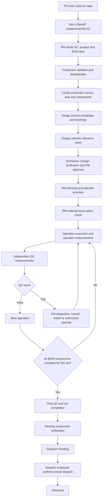
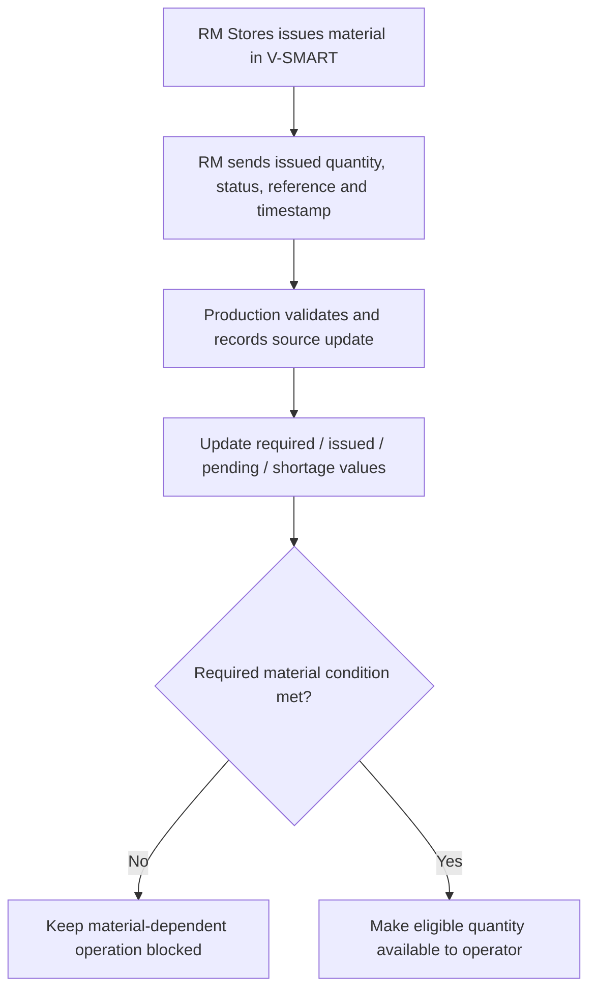
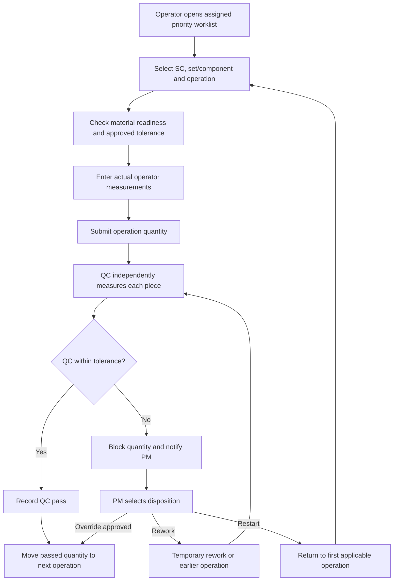
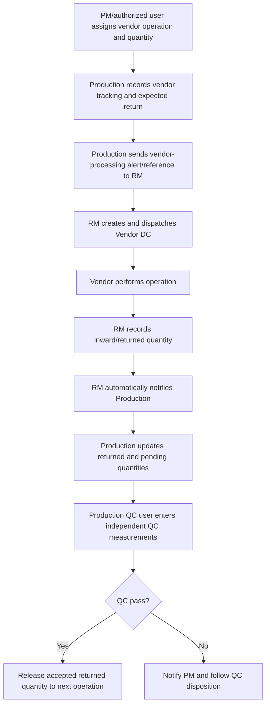
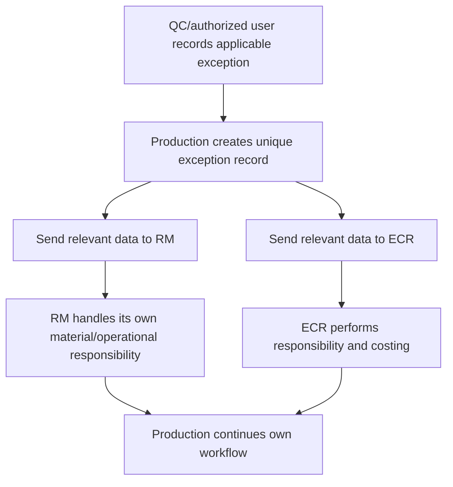
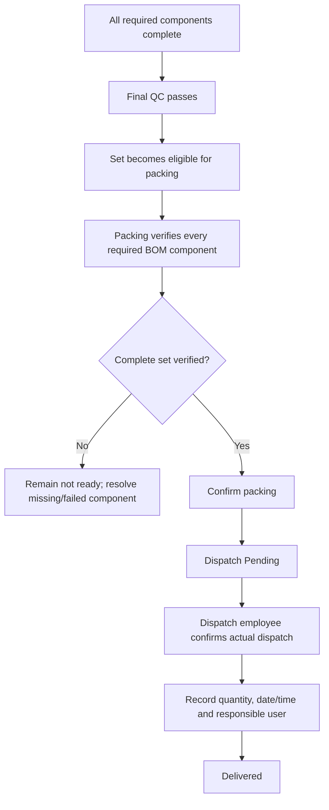
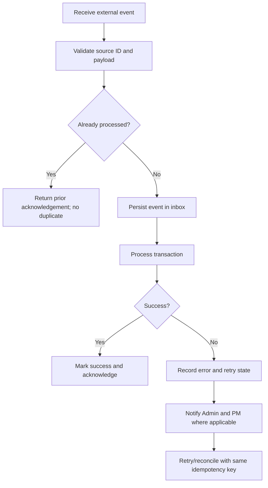

# 07 — Workflow Diagrams

Diagrams use Mermaid flowchart syntax and can be rendered in Markdown viewers that support Mermaid.

## 1. Overall PO → SC → Production → Dispatch

## 2. RM material issue readiness

## 3. Operator and QC operation loop

## 4. Tolerance revision

## 5. Vendor operation and inward

## 6. Exception communication

**Boundary:** ECR costing/responsibility results do not return to Production under the current confirmed scope.

## 7. Packing and dispatch

Partial dispatch means selected fully completed sets can be dispatched while other sets under the same SC remain in production. An incomplete set cannot be dispatched.

## 8. Integration failure and retry

## 9. Status principles
- Each quantity movement must be explicit and auditable.
- Only passed/approved quantity advances.
- Pending quantity remains at its current operation.
- Rework/restart quantity is blocked from normal progression until released.
- RM-confirmed vendor return quantity alone becomes available for internal QC.
- Packing is not Delivered; dispatch confirmation is required.
