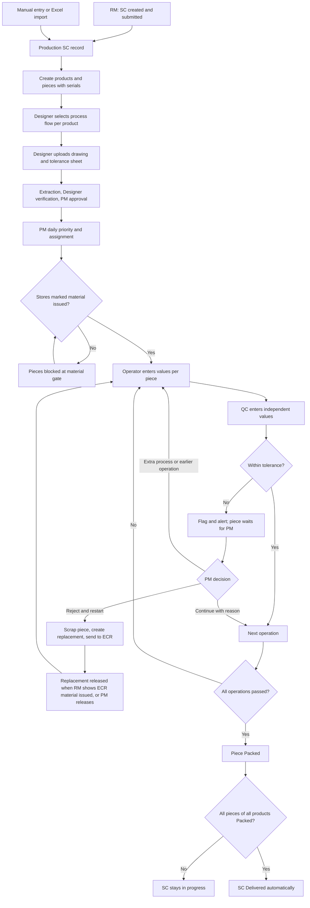
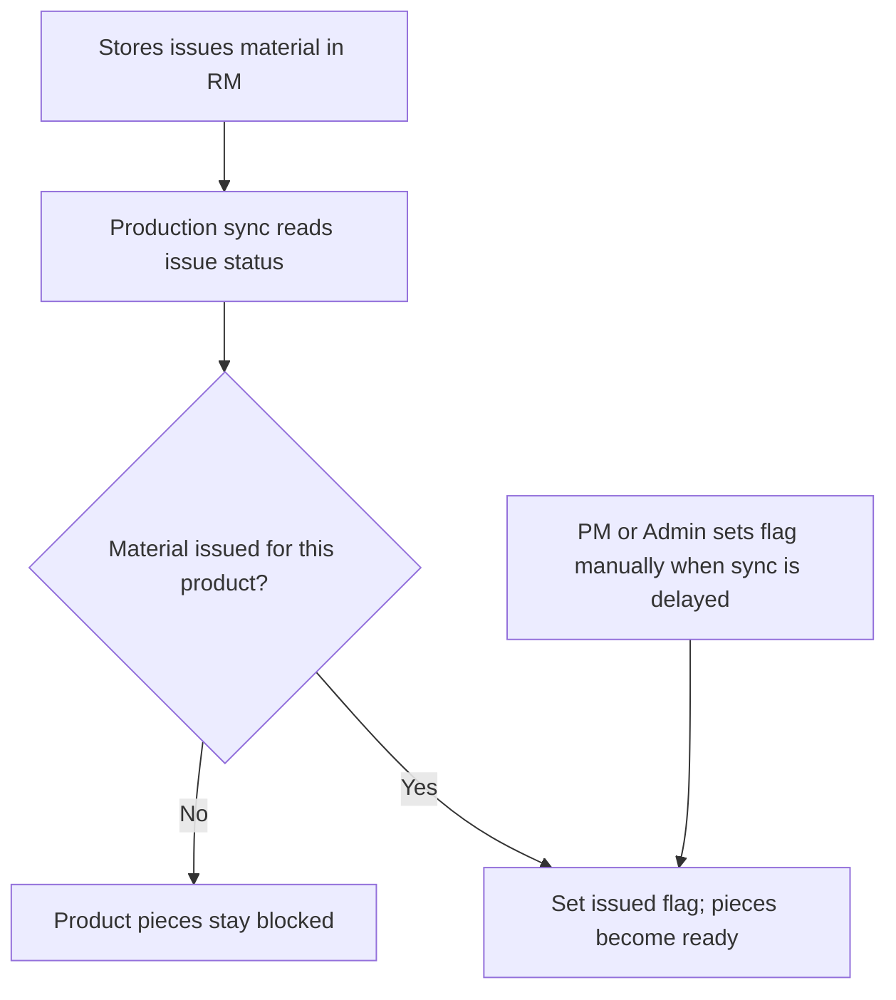
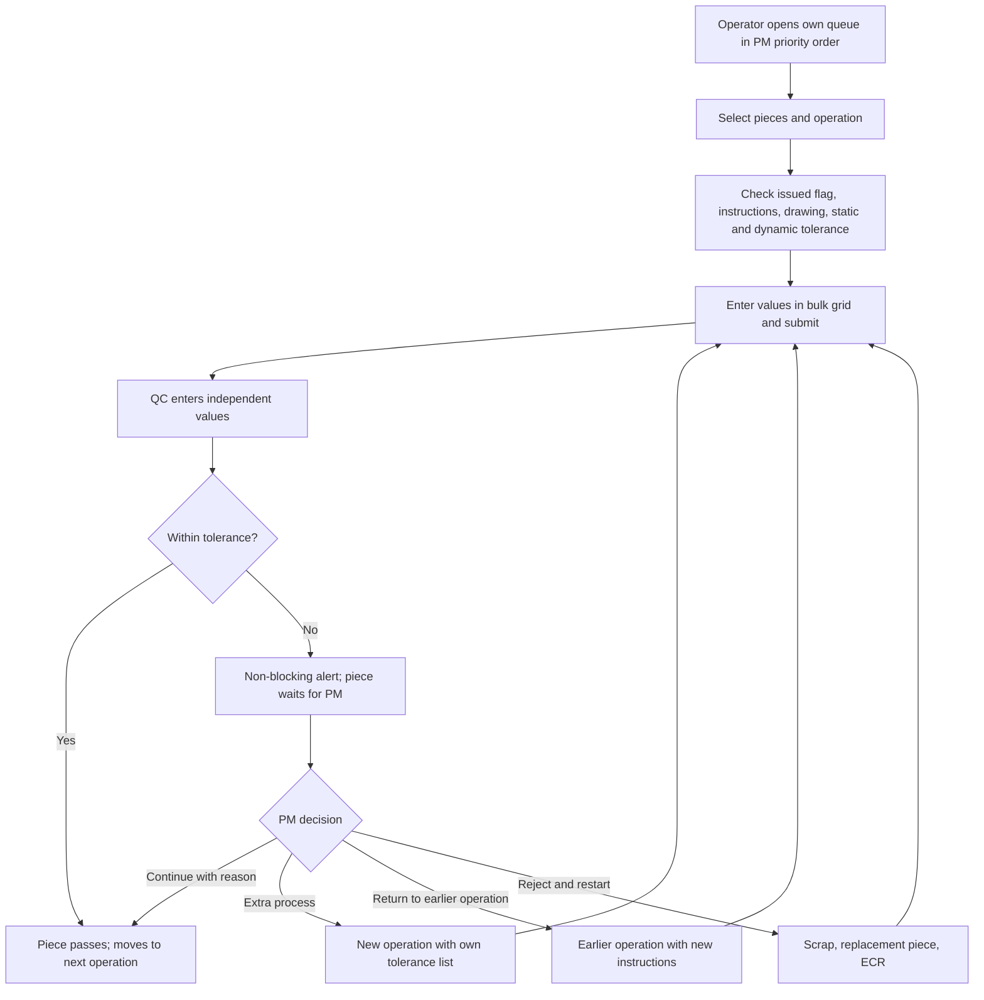
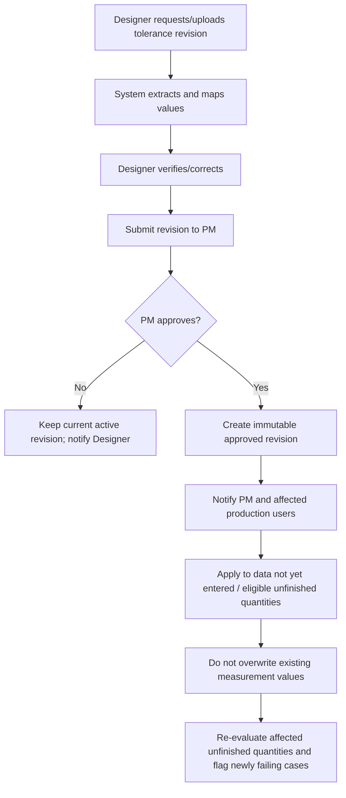
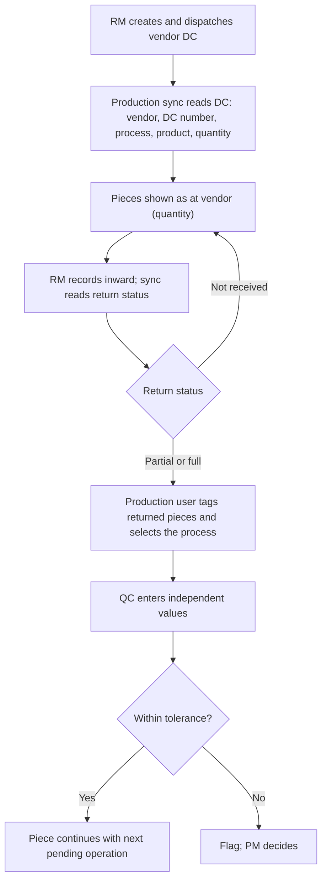
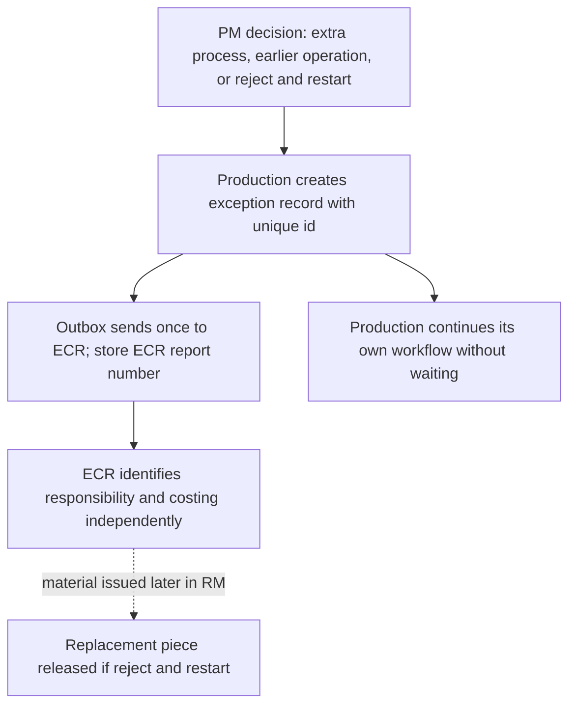
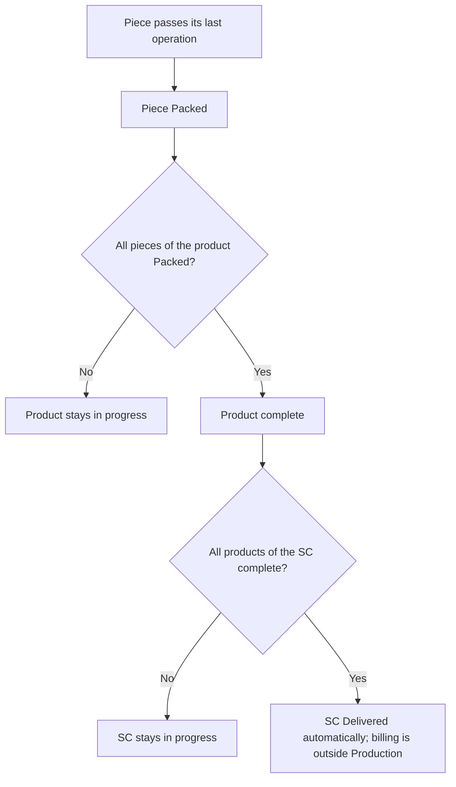
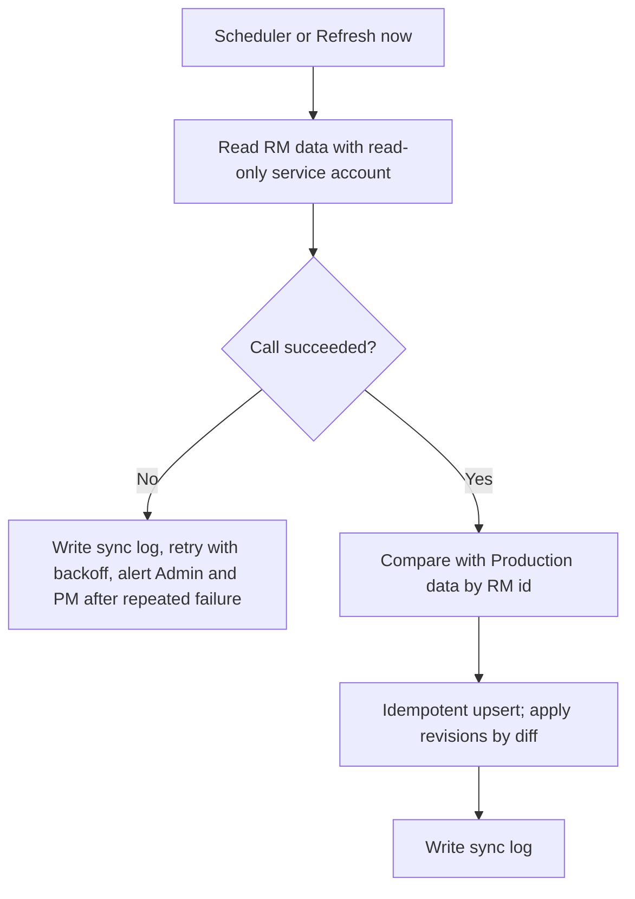

# 07 — Workflow Diagrams

Updated 2026-11-24 — decisions D-01 to D-19 (see 00_DECISION_LOG.md)

Diagrams use Mermaid flowchart syntax and can be rendered in Markdown viewers that support Mermaid.

## 1. Overall SC → Production → Delivered (replaces diagram 1)

## 2. Material-issued gate (replaces diagram 2)

## 3. Operator and QC loop (replaces diagram 3)

After an extra process or earlier-operation rework passes QC, the piece continues after the originally failed operation.

## 4. Tolerance revision

## 5. Vendor operation (replaces diagram 5)

## 6. Exception to ECR (replaces diagram 6)

Mapping: extra process → ADDITIONAL_PROCESS (sent as REWORK with a label, O-04); return to earlier operation → REWORK; reject and restart → REJECTION. Nothing is sent to RM.

## 7. Completion (replaces the packing and dispatch diagram)

Set-level completion and partial delivery are OPEN (O-03).

## 8. RM sync and failure handling (replaces diagram 8)

## 9. Status principles (replaces §9)
- Every piece status change is explicit and audited.
- Only pieces passed by QC, or continued by the PM with a reason, advance.
- Flagged pieces wait for the PM decision; other pieces keep working.
- A replacement piece is blocked until released.
- A piece is Packed when all operations pass; the SC is Delivered automatically when all products are complete.
- Quantities are always counted from piece status, never entered by hand.
