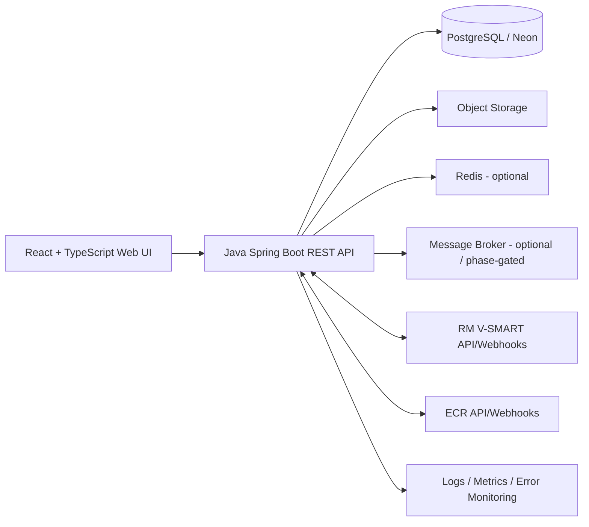

# 13 — Technology Stack and Architecture Proposal

**Decision status:** Recommended baseline, not yet a business-approved or production-frozen stack. The development-plan source confirms Render and Neon/PostgreSQL have been used in the user's environment, but says final Production stack/hosting/storage/queue/frontend sizing were not conclusively selected.

## 1. Recommended architecture
Start with a **modular monolith**, not microservices. Keep clear module boundaries and asynchronous integration adapters so services can be separated later only if scale or ownership justifies it.

## 2. Proposed stack
| Layer | Recommendation | Reason / notes |
|---|---|---|
| Frontend | React + TypeScript + Vite | Component-driven manufacturing UI and typed API contracts |
| UI styling/components | Tailwind CSS + shadcn/ui | Consistent forms, tables, dialogs and responsive worklists |
| Backend | Java 21 LTS + Spring Boot 3.x | Strong validation, security, transactions and maintainable business logic |
| API | REST + OpenAPI/Swagger | Clear RM/ECR contracts and developer testing |
| Database | PostgreSQL (Neon if operationally suitable) | Relational integrity for SC/set/component/operation lineage |
| ORM/data | Spring Data JPA + Hibernate | Standard persistence; use SQL for critical reporting/locking paths |
| Schema migration | Flyway | Versioned and repeatable database changes |
| Authentication/security | Spring Security + JWT or secure session approach | Backend-enforced RBAC; final session strategy to be selected |
| Validation | Jakarta Bean Validation | Request and domain input validation |
| Realtime UI | SSE or WebSocket | Live worklists, notifications and dashboards; choose after usage needs |
| File storage | Cloudflare R2 or S3-compatible object storage | Tolerance Excel/PDF, CAD drawings and attachments; choose one provider |
| Excel/PDF parsing | Apache POI + Apache PDFBox | Tolerance sheet extraction and document processing |
| Async processing | Durable DB inbox/outbox first; RabbitMQ if justified | Reliable RM/ECR event handling; avoid premature broker complexity |
| Cache | Redis/Upstash only if measured need | Optional caching, rate limits or ephemeral coordination; not source of truth |
| Hosting | Existing Render environment may be evaluated | Confirm region, networking, persistent storage and operational fit |
| CI/CD | GitHub + GitHub Actions | Automated build, tests and deployment |
| Containers | Docker | Reproducible dev/test/deploy |
| Backend tests | JUnit 5, Mockito, Testcontainers | Unit/integration/database tests |
| Frontend tests | Vitest, React Testing Library, Playwright | Component and end-to-end tests |
| Observability | Sentry + OpenTelemetry/log aggregation | Errors, traces, integration failures and health |

## 3. Important technology decisions still required
- Confirm whether Java/Spring Boot is the final backend or whether an existing TypeScript backend is to be reused.
- Confirm hosting topology, production region, private networking and deployment environments.
- Confirm Neon plan/connection pooling, direct vs pooled connection usage and backup/restore objectives.
- Select object storage provider, bucket access policy, encryption and retention.
- Decide whether Redis and RabbitMQ are necessary after workload measurement.
- Define real-time mechanism (SSE vs WebSocket).
- Define authentication/session expiry, password reset and account recovery.
- Set performance targets after realistic load testing.

## 4. Architecture modules
1. Identity & Access
2. PO/SC Intake
3. Product/BOM/Set/Component Traceability
4. Process Templates
5. Design Documents & Tolerance
6. Planning & Scheduling
7. Work Assignment & Operation Execution
8. Measurement & QC
9. Rework/Restart/Additional Process
10. Vendor Tracking
11. RM Material Visibility
12. RM/ECR Integration
13. Dashboard/Reporting
14. Notifications
15. Packing/Dispatch
16. Audit/Administration

## 5. Engineering guardrails
- Domain rules belong in backend services, not only frontend.
- Use database transactions and row-level locking/optimistic concurrency for quantity transitions.
- Use an inbox/outbox pattern and idempotency keys for integrations.
- Keep external RM/ECR property names in explicit adapters; never silently rename contract fields.
- Store uploaded files in object storage; store metadata, hashes, ownership and access rules in PostgreSQL.
- Keep measurements, tolerance revisions, approvals and audit records append-only where practical.
- Never use Redis as the authoritative production quantity store.
- Do not introduce microservices, AI, vector DB or LLM dependencies into this project without a separately approved scope change.
