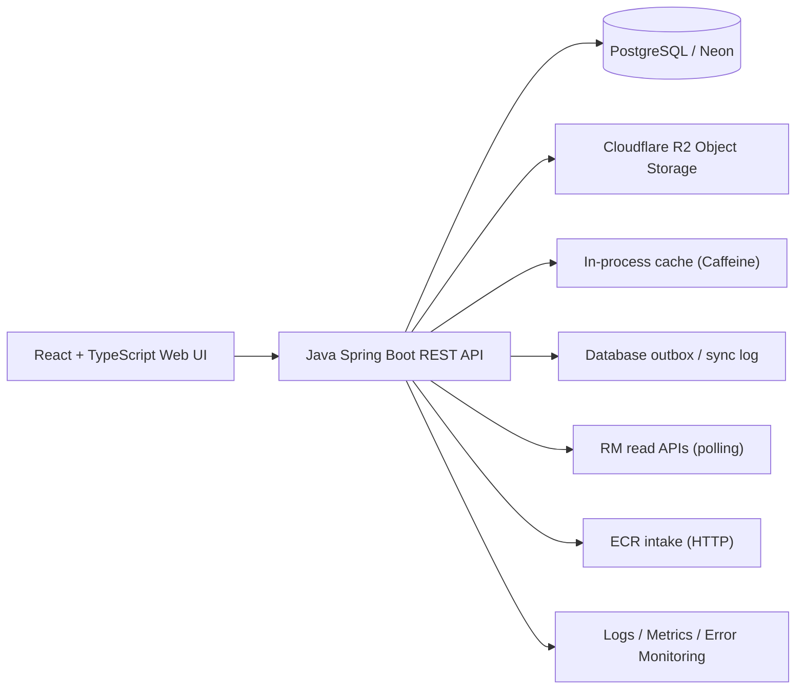

# 13 — Technology Stack and Architecture Proposal

Updated 2026-11-24 — decisions D-01 to D-19 (see 00_DECISION_LOG.md)

**Decision status:** Decided baseline (D-13); exact versions recorded in docs/decisions.md when the repo is created.

## 1. Decided architecture
Modular monolith architecture on Render with Neon Postgres and Cloudflare R2. Clear module boundaries and asynchronous database outbox for external notifications. No Redis, no RabbitMQ. (D-13)

## 2. Decided stack
| Layer | Decision | Reason / notes |
|---|---|---|
| Frontend | React + TypeScript + Vite | Component-driven manufacturing UI and typed API contracts |
| UI styling/components | Tailwind CSS + shadcn/ui | Consistent forms, tables, dialogs and responsive bulk grids |
| Backend | Java 21 LTS + Spring Boot (latest stable at project start) | Strong validation, security, transactions and modular monolith structure (D-13) |
| API | REST + OpenAPI/Swagger | Clear interface contracts and developer testing |
| Database | PostgreSQL on Neon | Serverless PostgreSQL with connection pooling; relational integrity for piece/operation lineage |
| ORM/data | Spring Data JPA + Hibernate | Standard persistence; SQL for critical reporting and locking paths |
| Schema migration | Flyway | Versioned and repeatable database migrations |
| Authentication/security | Spring Security with individual login; session/JWT strategy fixed in phase 9 | Individual employee credentials; backend-enforced RBAC (D-03) |
| Validation | Jakarta Bean Validation | Request and domain input validation |
| Realtime UI | SSE vs WebSocket (OPEN — BUSINESS DECISION REQUIRED: O-07) | Live worklists, notifications and dashboards |
| File storage | Cloudflare R2 (S3-compatible object storage) | Drawings, CAD PDF, tolerance sheets and attachments (D-13) |
| Excel/PDF parsing | Apache POI + Apache PDFBox | Tolerance sheet extraction and SC Excel import |
| Async processing | Database outbox/sync log; no RabbitMQ | Reliable ECR event dispatch and RM polling logs without broker complexity (D-13) |
| Cache | Caffeine in-process; no Redis | JVM heap LRU cache with TTL; no Redis (D-13) |
| Hosting | Docker on Render | Render Web Service (backend container) and Render Static Site (frontend) |
| Email | SMTP with database queue; Resend later if needed | Transactional notifications and alert routing (D-13) |
| CI/CD | GitHub + GitHub Actions | Automated build, tests and deployment |
| Containers | Docker | Reproducible dev/test/deploy |
| Backend tests | JUnit 5, Mockito, Testcontainers | Unit/integration/database tests |
| Frontend tests | Vitest, React Testing Library, Playwright | Component and end-to-end tests |
| Observability | Structured logs + OpenTelemetry / Sentry | Errors, traces, sync logs and health checks |

## 3. Technology decisions status
- **Closed decisions (D-13):** Java 21 + Spring Boot confirmed; Render hosting confirmed; Cloudflare R2 confirmed; Neon PostgreSQL confirmed; No Redis (Caffeine cache); No RabbitMQ (database outbox).
- **Items still open:**
  - Neon connection pool settings, direct vs pooled connection usage, and backup/restore objectives.
  - Authentication session expiry and password reset mechanism.
  - Real-time mechanism: SSE vs WebSocket (OPEN — BUSINESS DECISION REQUIRED: O-07).
  - Performance targets after realistic load testing (OPEN — BUSINESS DECISION REQUIRED: O-11).

## 4. Architecture modules
1. Identity & Access (individual login, 6 roles)
2. SC Intake (manual entry, Excel import, RM sync)
3. Product & Piece Traceability
4. Process Templates & Flow Snapshots
5. Design Documents & Tolerance Management
6. Planning, Scheduling & Daily Priority
7. Work Assignment & Operation Execution (bulk grid)
8. Measurement & QC (blind QC)
9. QC Decisions & Exceptions (4 PM outcomes)
10. Replacement Release
11. Vendor Tracking from RM DC details
12. Material Gate (issued yes/no)
13. RM Connector (read) and ECR Sender (outbox)
14. Dashboard & Reports (daily 9 AM report)
15. Notifications
16. Completion (piece Packed, SC Delivered)
17. Audit & Administration

## 5. Engineering guardrails
- Domain rules belong in backend services, not only frontend.
- RM is accessed read-only with a service account; no RM or ECR code change. (D-11)
- Quantities and statuses are derived from piece records, never edited by hand. (BR-068)
- Secrets only in environment variables; never log tokens, passwords, or internal secrets.
- Use database transactions and row-level locking (`SELECT ... FOR UPDATE SKIP LOCKED`) for outbox and piece status transitions.
- Use a database outbox pattern and idempotency keys for integrations; ECR outbox sends once and never auto-resends after an ambiguous timeout.
- Keep external RM/ECR property names in explicit adapters; verify JSON property names against live responses.
- Store uploaded files in Cloudflare R2; store metadata, hashes, ownership and access rules in PostgreSQL.
- Keep measurements, tolerance revisions, approvals and audit records append-only.
- Do not introduce microservices, Redis, RabbitMQ, Kafka, AI, vector DB or LLM dependencies into this project without a separately approved scope change.
