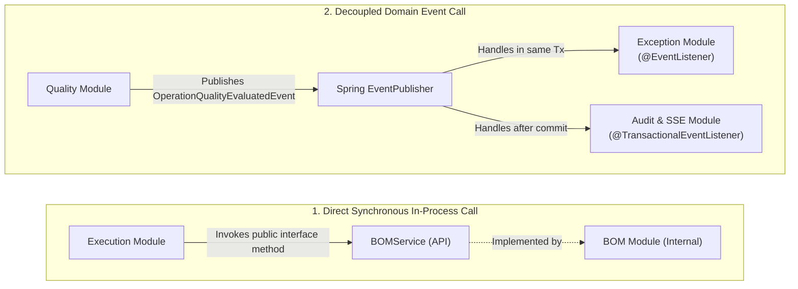

# Part 2.1 – System Architecture Design
## Document 02: Modular-Monolith Architecture & Backend Design

### 1. Architectural Philosophy: The Modular Monolith

In adherence to the approved architectural direction, Velan Production is designed as a **Modular Monolith** using **Java 21 LTS** and **Spring Boot 3.x**. 

A modular monolith delivers the structural discipline, clear domain boundaries, and loose coupling of microservices without the operational hazards of distributed transactions, network latency between internal services, dual-write failures, and complex multi-container orchestration.

```
+---------------------------------------------------------------------------------+
|                          VELAN PRODUCTION MONOLITH                              |
|                                                                                 |
|  +-------------------+  +-------------------+  +-----------------------------+  |
|  |     IAM / Auth    |  |  Order & Contract |  |     BOM & Engineering       |  |
|  +-------------------+  +-------------------+  +-----------------------------+  |
|           |                       |                           |                 |
|  +-------------------+  +-------------------+  +-----------------------------+  |
|  |    Execution      |  |  Quality Control  |  |    Exception & Rework       |  |
|  +-------------------+  +-------------------+  +-----------------------------+  |
|           |                       |                           |                 |
|  +-------------------+  +-------------------+  +-----------------------------+  |
|  |  Vendor Tracking  |  |   Dispatch & SC   |  |   Notification & Audit      |  |
|  +-------------------+  +-------------------+  +-----------------------------+  |
|                                   |                                             |
|                 +-----------------------------------+                           |
|                 |    Integration (RM & ECR Outbox)  |                           |
|                 +-----------------------------------+                           |
+---------------------------------------------------------------------------------+
                                    |
                           [ Neon PostgreSQL ]
```

---

### 2. High-Level Component & Container Architecture (C4 Level 2 & Level 3)

The following diagram illustrates the internal container and module topology of the Velan Production platform:

```mermaid
flowchart TB
    subgraph ClientLayer ["Client Layer (Single Page Application)"]
        ReactApp["React 18+ TypeScript SPA<br/>(Vite, Tailwind, React Query)"]
    end

    subgraph BackendApp ["Velan Production Application (Spring Boot 3 / Java 21)"]
        subgraph WebLayer ["API & Ingress"]
            SecurityFilter["Spring Security Filter Chain<br/>(JWT Bearer Auth & Role RBAC)"]
            RESTControllers["REST API Controllers<br/>(/api/v1/*)"]
            SSEController["SSE Notification Controller<br/>(/api/v1/notifications/stream)"]
        end

        subgraph CoreModules ["Internal Domain Modules (Modular Monolith)"]
            IAM["IAM Module<br/>(User, Role, Auth, SecurityContext)"]
            OrderMod["Order & Contract Module<br/>(PO, SC Intake, Revisions)"]
            EngMod["BOM & Engineering Module<br/>(Product, BOM, Sets, Process Templates, Tolerances)"]
            ExecMod["Production Execution Module<br/>(Piece Tracking, Serials, Operations)"]
            QCMod["Quality Control Module<br/>(Measurements, Tolerance Engine, Pass/Fail)"]
            ExMod["Exception & Rework Module<br/>(PM Dispositions, Extra Ops, Scrap, Replacements)"]
            VendorMod["Vendor Tracking Module<br/>(Vendor Processing, RM DC Status Sync)"]
            DispatchMod["Completion & Dispatch Module<br/>(Set Completeness, Packing, Dispatch Gate)"]
            AuditMod["Notification & Audit Module<br/>(Audit Trails, Domain Event Hub, SSE Publisher)"]
            IntegMod["Integration Module<br/>(RM Connector, ECR Outbox Processor)"]
        end

        subgraph InProcessInfra ["In-Process Infrastructure"]
            EventBus["Spring ApplicationEventPublisher<br/>(Synchronous & @TransactionalEventListener)"]
            CaffeineCache["Caffeine Cache Manager<br/>(Bounded In-Memory L1 Cache)"]
            OutboxWorker["Outbox Scheduled Runner<br/>(Spring @Scheduled Thread Pool)"]
        end
    end

    subgraph DataStorage ["Data & Storage Layer"]
        Postgres[("Neon PostgreSQL<br/>(ACID Transactions, Outbox Table)")]
        R2Store[("Cloudflare R2<br/>(Object Storage - CAD/Drawings)")]
    end

    subgraph RemoteSystems ["External Enterprise APIs"]
        RMSystem["RM System (V-SMART)<br/>(Read-Only REST APIs)"]
        ECRSystem["ECR System<br/>(HTTPS Intake API)"]
    end

    ReactApp -->|HTTPS REST Commands & Queries| SecurityFilter
    ReactApp -->|HTTPS Event Stream (SSE)| SSEController
    SecurityFilter --> RESTControllers
    RESTControllers --> CoreModules

    CoreModules --> EventBus
    CoreModules --> CaffeineCache
    CoreModules --> Postgres
    EngMod -.->|Generate Pre-signed URLs| R2Store
    ReactApp -.->|Direct CAD/Drawing Upload & Download| R2Store

    EventBus --> CoreModules
    EventBus --> AuditMod
    AuditMod --> SSEController

    ExMod -->|Write Outbox Record (Same DB Tx)| Postgres
    OutboxWorker -->|Poll Unsent Events| Postgres
    OutboxWorker -->|POST Outbox Event| ECRSystem

    IntegMod -->|GET Material & DC Status| RMSystem
    IntegMod --> CaffeineCache

    classDef client fill:#e0e7ff,stroke:#4338ca,stroke-width:2px;
    classDef web fill:#f8fafc,stroke:#64748b,stroke-width:2px;
    classDef module fill:#dbeafe,stroke:#1e40af,stroke-width:2px;
    classDef infra fill:#fef3c7,stroke:#b45309,stroke-width:2px;
    classDef store fill:#ecfdf5,stroke:#047857,stroke-width:2px;
    classDef ext fill:#fae8ff,stroke:#86198f,stroke-width:2px;

    class ReactApp client;
    class SecurityFilter,RESTControllers,SSEController web;
    class IAM,OrderMod,EngMod,ExecMod,QCMod,ExMod,VendorMod,DispatchMod,AuditMod,IntegMod module;
    class EventBus,CaffeineCache,OutboxWorker infra;
    class Postgres,R2Store store;
    class RMSystem,ECRSystem ext;
```

#### Diagram Explanation in Simple Language
1. **Frontend to Ingress:** The React single-page application sends all HTTPS REST requests through the Spring Security Filter Chain, which verifies JWT authentication tokens and evaluates user permissions.
2. **Domain Modules:** Inside the Spring Boot application, the business logic is cleanly partitioned into dedicated modules (Order, Engineering, Execution, Quality, Exception, Vendor, Dispatch).
3. **Module Decoupling via Event Bus:** When significant business actions happen (such as an operation passing QC or a PM declaring a piece scrapped), the originating module fires a domain event through Spring's `ApplicationEventPublisher`. Other modules listen to these events without directly coupling their code.
4. **Direct R2 Storage:** When a designer uploads a technical drawing or an inspector attaches a defect photo, the backend creates a secure pre-signed Cloudflare R2 URL. The browser uploads the file directly to R2, avoiding high memory overhead in Spring Boot.
5. **Transactional Outbox for ECR:** When a rework or rejection requires an ECR ticket, the Exception module saves the event into a local database table (`outbox_events`) in the same database transaction. A background thread polls this table and transmits it to ECR, ensuring no event is lost even if network connectivity drops.
6. **In-Process Caching:** Calls to RM (V-SMART) are cached in-memory using Caffeine so the system does not bombard the external legacy system with repetitive read requests.

---

### 3. Module Boundaries, Responsibilities, and Package Structure

To enforce encapsulation, each module follows a strict Java package structure:
```text
com.velan.production
├── [module_name]
│   ├── api/            <-- PUBLIC: Interfaces, Commands, Queries, DTOs, Domain Events
│   └── internal/       <-- PRIVATE: Entities, Repositories, Services, Controllers
```
Classes in `internal` are package-private wherever feasible. Modules can only invoke services or listen to events published in another module's `api` package.

#### 3.1 IAM Module (`com.velan.production.iam`)
* **Responsibilities:** User authentication, password encryption (Argon2 / BCrypt), JWT issuance/validation, role-based authorization (Admin, PM, Designer, Operator, QC, Management), user profile management.
* **Public API:** `AuthenticationService`, `SecurityUserContext`, `UserDTO`.
* **Database Tables Owned:** `users`, `roles`, `user_roles`.

#### 3.2 Order & Contract Module (`com.velan.production.order`)
* **Responsibilities:** PO and Subcontract (SC) intake, SC lifecycle tracking, schedule target maintenance, revision history tracking.
* **Public API:** `OrderService`, `SubcontractQueryService`, `SCRevisionCreatedEvent`.
* **Database Tables Owned:** `purchase_orders`, `subcontracts`, `sc_revisions`.

#### 3.3 BOM & Engineering Module (`com.velan.production.engineering`)
* **Responsibilities:** Product and sub-product definitions, hierarchical Bill of Materials (BOM), component-to-set ratio definitions (e.g. 2 flanges per valve set), process sequence templates, static and dynamic dimensional tolerances, technical drawing metadata linked to Cloudflare R2.
* **Public API:** `BOMService`, `ProcessTemplateService`, `ToleranceCalculationService`, `DrawingStorageService`.
* **Database Tables Owned:** `products`, `sub_products`, `bom_items`, `component_set_definitions`, `process_templates`, `process_template_steps`, `tolerance_rules`, `drawing_documents`.

#### 3.4 Production Execution Module (`com.velan.production.execution`)
* **Responsibilities:** Individual piece-level tracking, unique physical serial number generation, Piece Lifecycle State Machine (Created, In Production, Completed, Scrapped), Operation Lifecycle State Machine (Ready, Opened, Submitted, QC Pending, Passed, Failed, Bypassed, Reopened), station and operator assignment.
* **Public API:** `PieceExecutionService`, `OperationExecutionService`, `PieceStateQueryService`, `OperationStateTransitionEvent`.
* **Database Tables Owned:** `pieces`, `piece_operations`, `piece_operation_history`, `station_assignments`.

#### 3.5 Quality Control Module (`com.velan.production.quality`)
* **Responsibilities:** Independent measurement recording, operator vs. QC dual measurement intake, automated tolerance evaluation (nominal, upper, lower, dynamic formula calculation), logging calibration instruments, Pass/Fail verdicts.
* **Public API:** `QualityInspectionService`, `InspectionVerificationService`, `OperationQualityEvaluatedEvent`.
* **Database Tables Owned:** `operation_measurements`, `qc_inspections`, `measurement_values`, `inspection_attachments`.

#### 3.6 Exception & Rework Module (`com.velan.production.exception`)
* **Responsibilities:** Governs PM disposition decisions upon QC failure:
  1. *Continue with Concession:* Proceed despite deviation.
  2. *Extra Process:* Dynamically insert remediation operations (e.g., extra grinding or polishing).
  3. *Return to Earlier Operation:* Rewind piece to previous station for rework.
  4. *Reject & Scrap:* Mark physical piece permanently scrapped; spawn linked replacement piece; record parent-child replacement lineage; generate ECR outbox payload.
* **Public API:** `ExceptionDispositionService`, `ReworkRoutingService`, `ReplacementPieceService`, `ECROutboxService`.
* **Database Tables Owned:** `qc_exceptions`, `pm_dispositions`, `piece_replacement_lineage`, `outbox_events`.

#### 3.7 Vendor Tracking Module (`com.velan.production.vendor`)
* **Responsibilities:** External vendor processing tracking (e.g., heat treatment, electro-plating, special coatings). Links RM Delivery Challan (DC) tracking numbers to vendor operation steps without creating or managing inventory transactions. Reconciles physical pieces with vendor outward/inward status.
* **Public API:** `VendorTrackingService`, `VendorStatusSyncService`.
* **Database Tables Owned:** `vendor_operations`, `vendor_dc_trackers`.

#### 3.8 Completion & Dispatch Module (`com.velan.production.dispatch`)
* **Responsibilities:** Tracks component piece completion, validates BOM complete set readiness (ensuring all components for a set are 100% completed and passed), enforces partial dispatch prevention rules, oversees packing verification, records dispatch clearance and delivered status.
* **Public API:** `CompletionValidationService`, `DispatchClearanceService`, `SetReadinessQueryService`.
* **Database Tables Owned:** `assembled_sets`, `set_component_allocations`, `packing_lists`, `dispatch_clearances`.

#### 3.9 Integration Module (`com.velan.production.integration`)
* **Responsibilities:** Houses the read-only connector for RM (V-SMART) with service-account credential management; in-process Caffeine caching; the reliable Transactional Outbox background worker that dispatches ECR HTTP payloads with exponential backoff and idempotency keys; integration health logs.
* **Public API:** `RawMaterialClient`, `ECRClient`, `IntegrationHealthService`.
* **Database Tables Owned:** `integration_audit_logs`.

#### 3.10 Notification & Audit Module (`com.velan.production.audit`)
* **Responsibilities:** Listens to all domain events across all modules, persists immutable audit trails (who, what, when, previous state, new state, IP address), and pushes real-time event updates to connected browser clients via Server-Sent Events (SSE).
* **Public API:** `AuditLogService`, `SSEEventPublisherService`.
* **Database Tables Owned:** `audit_logs`, `user_notifications`.

---

### 4. Inter-Module Communication Patterns

To preserve modular independence without introducing network overhead, communication between modules is restricted to two well-defined patterns:



#### Rule 1: Synchronous API Contracts
When Module A needs a query or synchronous verification from Module B (e.g., Execution Module checking if a process template is valid before opening an operation), it injects the public Java Interface from `com.velan.production.[module].api`. Direct access to repository classes or entities of another module is strictly prohibited by architectural convention.

#### Rule 2: Decoupled Domain Events
When an action in Module A has side effects in Module B (e.g., QC fails an operation, which must trigger an Exception case and an Audit Log), Module A publishes an immutable Spring Domain Event:
```java
// Published inside Quality Control transaction
eventPublisher.publishEvent(new OperationFailedQCEvent(pieceId, operationId, failureReason, measurements));
```
* **Immediate Intra-Transaction Listeners (`@EventListener`):** Executed within the same database transaction where transactional atomicity is mandatory (e.g., locking the piece state when QC fails).
* **Post-Commit Listeners (`@TransactionalEventListener(phase = TransactionPhase.AFTER_COMMIT)`):** Executed only after the database transaction successfully commits. Used for external notifications, SSE pushes, and outbox trigger pings.

---

### 5. In-Process Caching Strategy (Caffeine)

To meet the constraint of **No Redis** while preventing unnecessary database queries and protecting the external RM (V-SMART) system from load spikes, we employ **Caffeine Cache** inside the JVM:

| Cache Name | Cached Content | Eviction Policy | TTL | Maximum Size |
| :--- | :--- | :--- | :--- | :--- |
| `rm-material-status` | Material issued status per SC/Item from V-SMART | LRU with Write Expiration | 5 minutes | 5,000 entries |
| `process-templates` | Process step definitions and sequence order | Explicit Eviction on Template Update | 60 minutes | 1,000 templates |
| `static-tolerances` | Nominal, Upper, Lower tolerance limits per dimension | Explicit Eviction on BOM Revision | 60 minutes | 10,000 rules |
| `user-permissions` | Role-permission mappings for active JWTs | LRU with Access Expiration | 15 minutes | 2,000 users |

* **Zero Network Hop:** Caffeine operates entirely in JVM heap memory, yielding sub-microsecond access times.
* **Bounded Footprint:** Every cache defines an explicit `maximumSize` to ensure JVM memory utilization remains within the container limits on Render (typically 512MB–1GB RAM).
