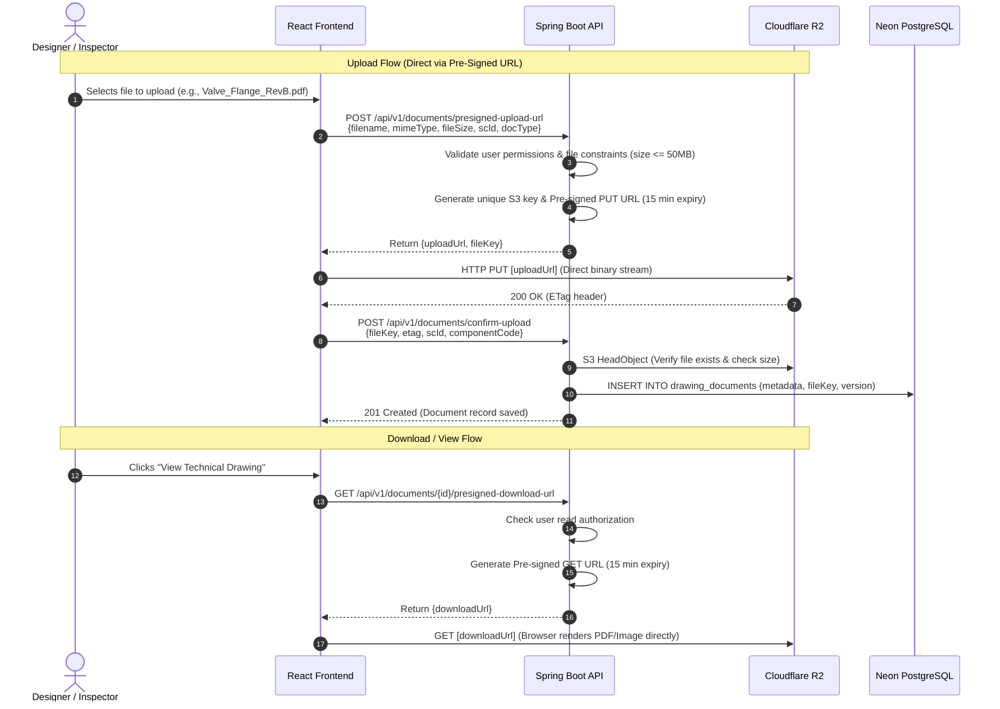

# Part 2.1 – System Architecture Design
## Document 03: Frontend and Infrastructure Architecture

### 1. Frontend Architecture (React & TypeScript)

The Velan Production client is engineered as a modern Single Page Application (SPA) utilizing **React 18+**, **TypeScript**, and **Vite**. It provides tailored, role-specific user interfaces optimized for both precision office tasks (PM, Designer, Management) and rugged shop-floor environments (Operator, QC).

```mermaid
flowchart TD
    subgraph Browser ["Web Browser Client (SPA)"]
        Router["React Router v6<br/>(Role-Based Route Guards)"]
        
        subgraph Viewports ["Role-Tailored Viewports"]
            OpView["Operator View<br/>(Touch-friendly, high contrast, barcode scan)"]
            QCView["QC View<br/>(Tolerance indicator, precision input, pass/fail)"]
            PMView["PM Cockpit<br/>(Dispositions, rework routing, dispatch gate)"]
            DesignerView["Designer Studio<br/>(BOM hierarchy, CAD/drawing viewer)"]
            MgmtView["Management Dashboard<br/>(Throughput, bottleneck heatmaps, scrap KPIs)"]
            AdminView["Admin Console<br/>(User RBAC, system config, master data)"]
        end

        subgraph ClientState ["State Management Layer"]
            ReactQuery["TanStack React Query<br/>(Server State Cache, Invalidation, Polling Fallback)"]
            ZustandStore["Zustand Store<br/>(Local UI State, Station Context, Scanner Buffer)"]
            SSEClient["SSE EventSource Client<br/>(Real-Time Notification Listener)"]
        end
    end

    subgraph BackendGateway ["Spring Boot Backend (/api/v1)"]
        REST["REST API Endpoints"]
        SSEStream["SSE Endpoint: /notifications/stream"]
    end

    subgraph Storage ["Cloudflare R2 Object Storage"]
        R2Direct["Direct Binary Upload/Download<br/>(Via Pre-signed URLs)"]
    end

    Router --> Viewports
    Viewports --> ClientState
    ReactQuery <-->|JSON Commands & Queries| REST
    SSEClient <--|Push Events (Text/Event-Stream)| SSEStream
    SSEClient -.->|Triggers Query Invalidation| ReactQuery
    Viewports <-->|Direct File Transfer| R2Direct
```

#### 1.1 Role-Tailored Viewports and UI Ergonomics
* **Operator Interface:** Designed for shop-floor touch screens and mobile tablets. Features high-contrast themes, large touch targets, station-locking mode, USB/Bluetooth barcode scanner event listeners, and simplified measurement input screens.
* **QC Inspector Interface:** Focuses on dimensional precision. Dynamically highlights nominal values and tolerance boundaries (green for in-spec, amber for warning, red for violation). Enforces mandatory non-conformance notes and defect categorization before a failure can be registered.
* **PM Cockpit:** Centralizes actionable bottlenecks. Highlights pieces stuck in QC failure awaiting disposition, provides one-click action cards (Continue, Extra Process, Return to Op, Scrap), and visualizes component set readiness percentages.
* **Designer Studio:** Tree-structured visualization of PO → SC → Product → Sub-product → BOM hierarchy. Facilitates uploading CAD/PDF drawings and setting up sequence templates and tolerance bands.
* **Management Dashboard:** High-level summary charts displaying active work-in-progress (WIP), average cycle time per operation, vendor turnaround time, and scrap loss metrics.

#### 1.2 State Management and Data Synchronization
* **Server State (TanStack Query):** Handles all asynchronous data fetching, mutation caching, and automatic garbage collection. Eliminates manual redux boilerplate and ensures consistent network retry policies.
* **Client UI State (Zustand):** Manages ephemeral UI state such as active station selection, currently active modal dialogs, and barcode scanner buffer streams.
* **Real-Time Notification Receiver (SSE):** The frontend establishes a persistent connection using the native browser `EventSource` to `/api/v1/notifications/stream`. Upon receiving a relevant domain event (e.g., `PIECE_FAILED_QC`, `RM_MATERIAL_ISSUED`), the SSE client immediately invalidates the corresponding TanStack Query cache key, triggering an instant, background UI refresh without a full page reload.

---

### 2. File Storage Architecture (Cloudflare R2)

Engineering CAD drawings, component specification sheets, material test reports, and visual QC inspection photos are stored in **Cloudflare R2**. 

Cloudflare R2 is chosen because it offers an S3-compatible API with zero egress fees and high regional availability, completely eliminating heavy binary transfer from the Spring Boot application server.



#### Storage Key Hierarchy
Objects in R2 are partitioned into deterministic, isolated paths:
```text
velan-prod/
└── tenant-default/
    └── sc-{scNumber}/
        └── comp-{componentCode}/
            ├── drawings/
            │   └── rev-{revisionId}_{timestamp}_{filename}
            └── qc-inspections/
                └── piece-{serialNumber}_op-{operationId}_{timestamp}.jpg
```

---

### 3. Database Architecture (PostgreSQL on Neon)

The system relies on a single relational **PostgreSQL** database hosted on **Neon** serverless infrastructure.

#### 3.1 Connection Management & HikariCP
Because Neon separates compute and storage and supports autosuspend/autoscaling, connection pooling must be carefully managed to prevent connection exhaustion:
* **Pooler:** HikariCP configured in Spring Boot.
* **Connection Sizing:** Default pool size bounded to 10–20 connections per container instance, preventing pool starvation during sudden concurrency spikes while remaining well within Neon's connection limits.
* **Keep-Alive & Validation:** `connectionTestQuery` and keep-alive ping set to 30 seconds to maintain warm connections through network pauses.

#### 3.2 Transaction Management & Concurrency Control
* **Default Isolation Level:** `READ_COMMITTED` for all standard operations.
* **Optimistic Locking (`@Version`):** Applied to `pieces` and `piece_operations` tables. If two operators attempt to transition the same operation simultaneously, the second transaction fails cleanly with an `OptimisticLockingFailureException`, preventing corrupted double-submissions.
* **Pessimistic Locking (`PESSIMISTIC_WRITE`):** Utilized exclusively during **Set Assembly Allocation**. When matching finished individual components into complete finished sets, the allocation routine locks the candidate component rows to ensure a component piece cannot be allocated to two sets at the same time.
* **Transactional Outbox Table:** The `outbox_events` table lives in the exact same PostgreSQL database. This allows domain state mutations (e.g., piece scrapped) and outbox event creation to commit in the exact same atomic ACID transaction, eliminating dual-write inconsistency.

---

### 4. Deployment Architecture (Independent Frontend & Backend on Render)

The frontend and backend are engineered as **two independent applications**, built and deployed separately on **Render**:

```mermaid
flowchart TD
    subgraph Repo ["GitHub Repository (velan-production)"]
        FrontendCode["frontend/ (React + TypeScript + Vite)"]
        BackendCode["backend/ (Java 21 + Spring Boot 3)"]
    end

    subgraph RenderPlatform ["Render Cloud Platform (Independent Deployments)"]
        subgraph StaticService ["Render Static Site (Frontend Application)"]
            ViteBuild["Vite Static Build Artifacts<br/>(Global CDN / Edge Distribution)"]
        end

        subgraph WebService ["Render Web Service (Backend Application)"]
            DockerContainer["Docker Container (Eclipse Temurin JRE 21 Alpine)"]
            SpringRuntime["Spring Boot 3 Modular Monolith (Port 8080)"]
        end
    end

    subgraph ManagedCloudServices ["Managed Cloud Infrastructure"]
        NeonDB[("Neon PostgreSQL<br/>(Managed Serverless)")]
        R2Bucket[("Cloudflare R2<br/>(Zero-Egress Object Storage)")]
    end

    FrontendCode -->|Independent Build & Deploy| ViteBuild
    BackendCode -->|Independent Docker Build & Deploy| DockerContainer
    DockerContainer --> SpringRuntime

    ViteBuild -->|HTTPS REST APIs & SSE (/api/v1/*)| SpringRuntime
    ViteBuild <-->|Direct CAD/Drawing Uploads & Downloads| R2Bucket
    SpringRuntime <-->|JDBC over TLS (HikariCP)| NeonDB
    SpringRuntime <-->|S3 API (Pre-Signed URL Generation)| R2Bucket
```

#### Independent Deployment Specifications:
1. **Frontend Application (Render Static Site):**
   * **Source Directory:** `frontend/`
   * **Build Command:** `npm run build` (Vite production bundle outputting to `dist/`).
   * **Runtime:** Global CDN edge distribution with rewrite rules (`/* -> /index.html`) for client-side React Router navigation.
   * **Networking:** Communicates securely with the backend API via HTTPS with CORS configuration and credentials support.
2. **Backend Application (Render Web Service):**
   * **Source Directory:** `backend/`
   * **Build:** Multi-stage Docker build utilizing Eclipse Temurin 21.
   * **Runtime:** Standalone Spring Boot 3 modular monolith running on `eclipse-temurin:21-jre-alpine`.
   * **Memory Management:** Render instances typically offer 512MB to 2GB RAM. Configured with container-aware JVM ergonomics:
     ```bash
     JAVA_OPTS="-XX:MaxRAMPercentage=75.0 -XX:+UseG1GC -XX:+ExitOnOutOfMemoryError"
     ```
   * **Health & Probes:** Spring Boot Actuator endpoints:
     * Liveness: `/actuator/health/liveness` (checks JVM responsiveness).
     * Readiness: `/actuator/health/readiness` (verifies Neon PostgreSQL connectivity and outbox worker status).
3. **Zero External Broker Dependency:** Because the design strictly forbids Redis, RabbitMQ, Kafka, and microservices, each service is self-contained and operationally resilient.
