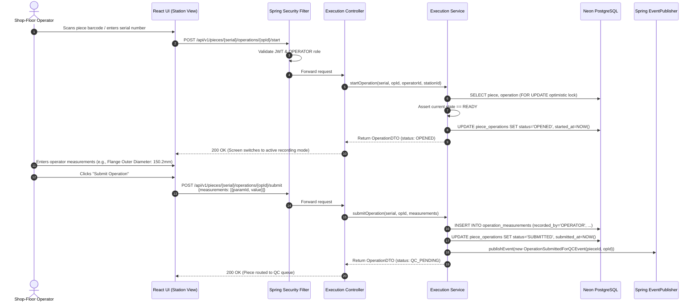
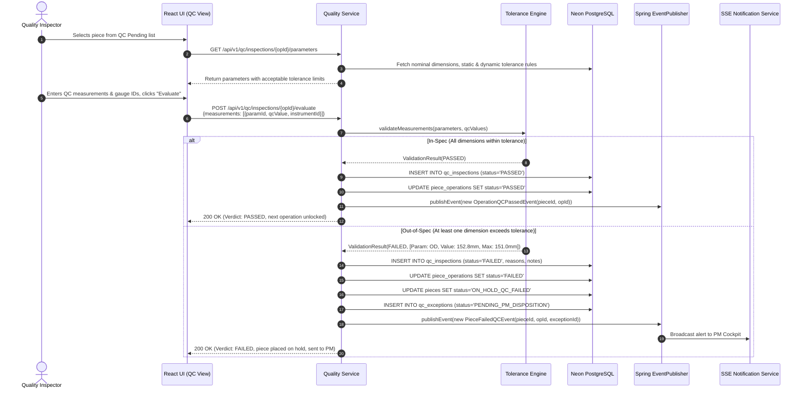
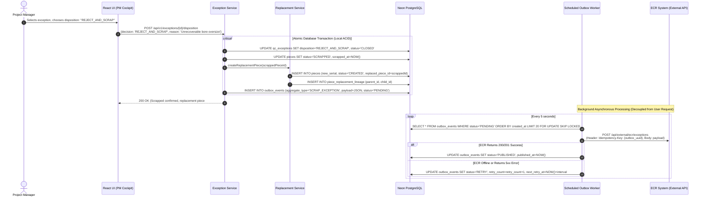
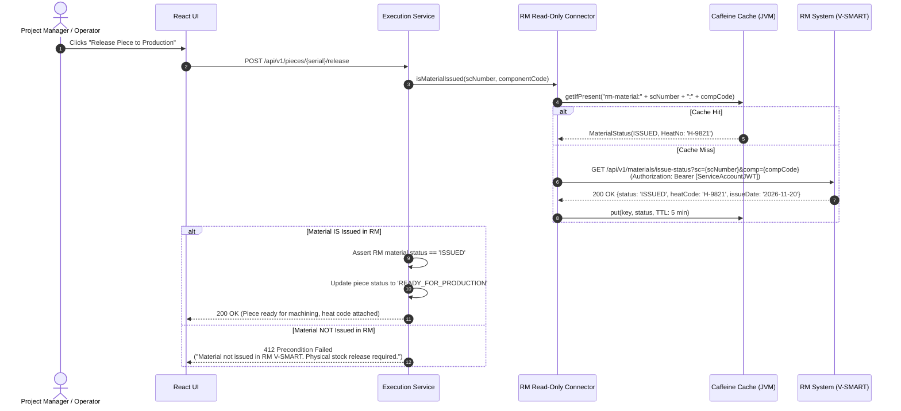
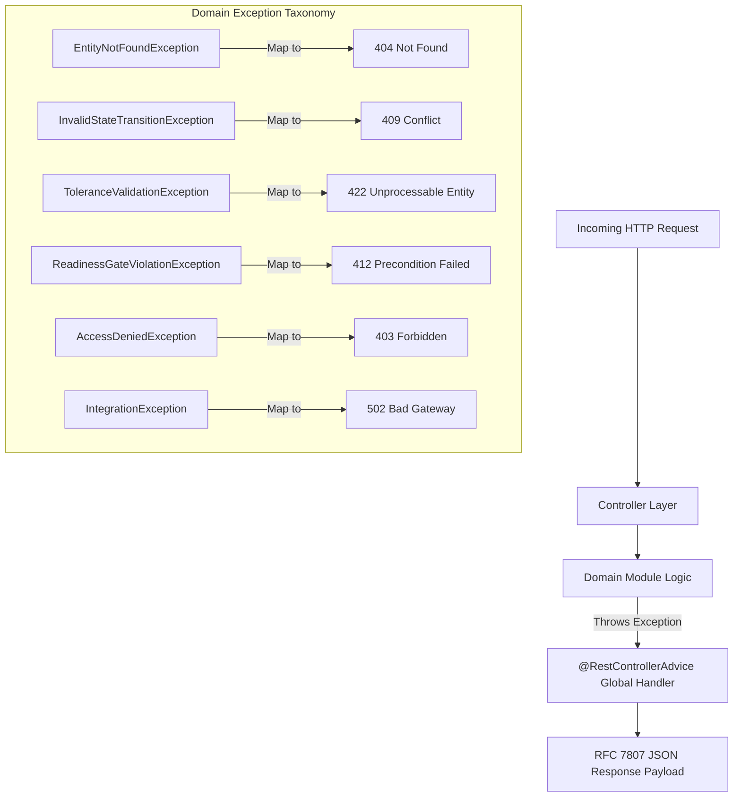

# Part 2.1 – System Architecture Design
## Document 04: Request Flows and Error-Handling Architecture

### 1. End-to-End Request and Response Flows

To illustrate how data and commands travel through the system across client, backend modules, database, and external systems, the four most critical production flows are detailed below.

---

#### 1.1 Flow 1: Operator Opens and Submits an Operation with Measurements



**Plain-Language Explanation:**
1. The operator identifies a piece at their station and opens the operation.
2. The system locks the row optimistically, verifies the operation is in a `READY` state, and updates the status to `OPENED`.
3. The operator performs machining, enters their dimensional measurements, and submits the job.
4. The system records the operator measurements, updates the status to `SUBMITTED`, flags it as `QC_PENDING`, and broadcasts an internal domain event notifying QC inspectors.

---

#### 1.2 Flow 2: QC Inspection, Automated Tolerance Validation, and Failure Branching



**Plain-Language Explanation:**
1. The QC inspector opens the piece inspection screen, which pulls the required specifications and dynamic tolerance formulas.
2. The inspector measures the physical part and enters the numbers.
3. The backend **Tolerance Engine** tests every value against nominal, upper, and lower limits (plus any dynamic formula based on mating components).
4. If everything passes, the operation is stamped `PASSED`, and the piece advances to the next step.
5. If any parameter is out of spec, the operation is stamped `FAILED`, the entire piece is placed `ON_HOLD`, an exception record is created, and an instant alert is pushed to the PM Cockpit via Server-Sent Events.

---

#### 1.3 Flow 3: PM Disposition "Reject & Scrap" and Asynchronous ECR Outbox



**Plain-Language Explanation:**
1. The PM decides that an out-of-spec piece cannot be salvaged and must be scrapped.
2. In a single, atomic database transaction:
   - The exception is closed.
   - The original physical piece is marked `SCRAPPED`.
   - A new replacement piece is instantiated with full parent-child lineage traceability.
   - An event is inserted into the local `outbox_events` table.
3. The PM immediately gets a success response without waiting for any external network call.
4. In the background, a dedicated scheduler reads the outbox table, calls ECR's intake API with an idempotency key, and records the delivery. If ECR is down, the system automatically retries with exponential backoff.

---

#### 1.4 Flow 4: RM Material Issue Readiness Gate



**Plain-Language Explanation:**
1. Before any piece can physically be cut or machined, the system checks whether raw material has been issued in RM (V-SMART).
2. It queries an in-process Caffeine cache first. If missing, it queries RM using its read-only service account.
3. If RM confirms material is issued, the piece transitions to `READY_FOR_PRODUCTION`.
4. If RM reports material has not been issued, the transition is strictly blocked, preventing unauthorized phantom production on the shop floor.

---

### 2. Error-Handling Architecture

The application adopts a standardized error-handling strategy based on **RFC 7807 (Problem Details for HTTP APIs)**.



#### 2.1 RFC 7807 Standard Error Format
All error responses from the backend return a consistent, machine-readable JSON structure:
```json
{
  "type": "https://velan-production.com/errors/tolerance-validation-failed",
  "title": "Dimensional Tolerance Validation Failed",
  "status": 422,
  "detail": "Measured value 152.8mm exceeds maximum upper tolerance limit of 151.0mm for Parameter 'Outer Flange Diameter'.",
  "instance": "/api/v1/qc/inspections/op-842/evaluate",
  "errorCode": "QC_OUT_OF_SPEC",
  "timestamp": "2026-11-24T15:30:00Z",
  "invalidParameters": [
    {
      "parameterCode": "OD_FLANGE",
      "nominal": 150.0,
      "lowerLimit": 149.0,
      "upperLimit": 151.0,
      "actualValue": 152.8,
      "deviation": 1.8
    }
  ]
}
```

#### 2.2 Domain Exception Hierarchy
Every exception thrown in business logic extends from an unchecked base class `VelanBaseException`:
* **`EntityNotFoundException` (404):** Resource does not exist (e.g., unknown piece serial, missing BOM).
* **`InvalidStateTransitionException` (409):** Action violates state machine constraints (e.g., attempting to submit an operation that is already `PASSED` or `CANCELLED`).
* **`ToleranceValidationException` (422):** Measurement evaluation failure containing granular parameter breakdown.
* **`ReadinessGateViolationException` (412):** Prerequisites not satisfied (e.g., attempting production when RM material is unissued, or attempting dispatch when a BOM set is incomplete).
* **`AccessDeniedException` (403):** Role lacks permission (e.g., Operator attempting to issue a PM disposition).
* **`IntegrationException` (502/504):** External system communication failure (e.g., RM V-SMART API unavailable).

#### 2.3 Resilient HTTP Client for RM (V-SMART)
The RM read-only connector is protected against network instability:
* **Connect Timeout:** 3 seconds.
* **Read Timeout:** 5 seconds.
* **Retry Strategy:** Max 2 retries with exponential backoff for HTTP 5xx errors or connection timeouts.
* **Graceful Degradation:** If RM is completely unreachable during non-blocking informational queries, the system serves the last cached state with a `stale: true` warning flag. For hard gating decisions (material issuance check), it safely fails closed and prompts the user to verify RM connectivity.

#### 2.4 Outbox Dead-Letter Strategy for ECR
* **Retry Cadence:** 1 min, 5 min, 15 min, 30 min, 1 hour.
* **Dead-Letter State (`DEAD_LETTER`):** If an outbox event fails 5 consecutive times, it is marked as `DEAD_LETTER`.
* **Alerting:** An alert is raised in the Admin Console, allowing the system administrator or PM to inspect the payload, review the ECR response error, and trigger a manual re-dispatch once ECR is restored.
