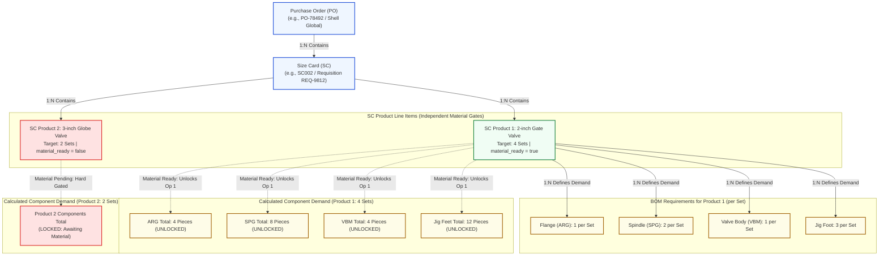
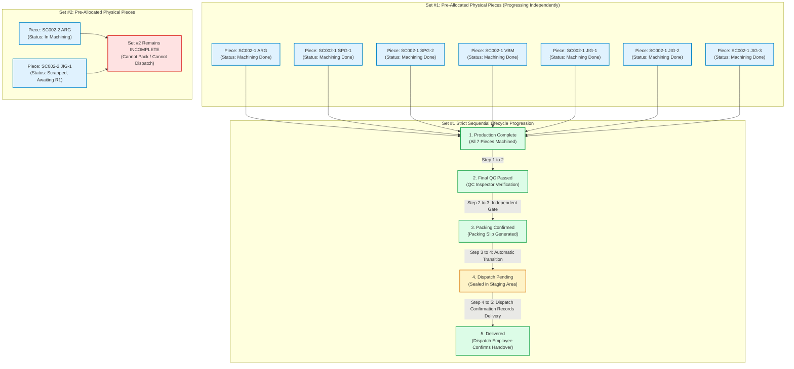
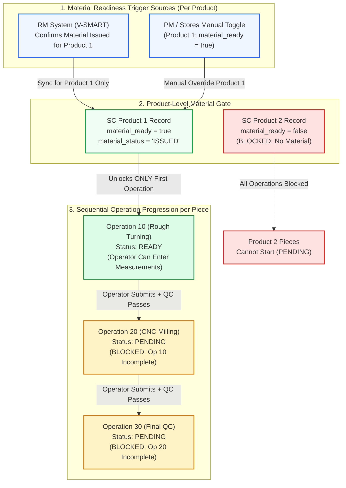

# Part 2.2 – Domain and Data Model Design
## Document 01: Manufacturing Domain Model, Hierarchy, and Piece Identity

### 1. Executive Summary

This document establishes the manufacturing domain model for the **Velan Production System**. It defines the core business hierarchy, establishes the strict conceptual boundaries separating products, sets, components, and pieces, details the deterministic set membership model, and specifies piece identification and traceability.

All definitions and structures preserve the exact terminology and rules established in **Phase 1 (BRD, SRS, Business Rules BR-004 to BR-015, Acceptance Criteria AC-002 to AC-005, and Application Master Plan)**.

---

### 2. The Manufacturing Business Hierarchy

The production lifecycle is governed by an unbroken, 10-level domain hierarchy:

```
Level 1:  Purchase Order (PO)                [Commercial Order from Customer]
           │
Level 2:  └── Size Card (SC)            [Production Work Order Header from RM / V-SMART]
               │
Level 3:      └── Subcontract Product        [Specific Product Line Item within SC with Target Sets]
                   │
Level 4:          ├── Catalog BOM / Components [Engineering BOM Ratios per Set (bom_lines)]
                   │   │
Level 5:          │   └── Sets               [Logical Assembly Units: 1 Set = 1 Finished Product Unit]
                   │       │
Level 6:          │       └── Pieces         [Individual Physical Components with Unique Serials]
                   │           │
Level 7:          │           └── Operations [Sequential Routing Steps per Piece Snapshot]
                   │               │
Level 8:          │               ├── Measurements [Dual Input: Operator Values & QC Values]
                   │               │
Level 9:          │               └── QC Records   [Independent Verifications against Tolerances]
                   │                   │
Level 10:         └─────────────────── └── Exceptions  [PM Dispositions: Continue, Extra, Return, Scrap]
```

---

### 3. Critical Domain Distinctions: SC vs. SC Product vs. Set vs. Component vs. Piece

To eliminate ambiguity across commercial orders, engineering, shop-floor execution, and quality control, these core concepts are strictly separated:

| Term | Domain Definition | Example | Database Representation |
| :--- | :--- | :--- | :--- |
| **Size Card (SC)** | The commercial production order header transmitted by RM (V-SMART). Can contain one or multiple manufactured products. | SC002 (Requisition #REQ-9812) | `subcontracts` entity |
| **SC Product (Subcontract Product)** | A distinct manufactured product line item ordered under an SC, specifying the catalog product and target set quantity. **Material readiness is tracked independently at this level.** | Line 1: 2" Class 600 Gate Valve (Target: 4 sets) | `subcontract_products` entity |
| **Main Catalog Product** | The engineering catalog definition or valve assembly specifications. | 2" Class 600 Gate Valve (Cast Steel, Flanged) | `products` entity |
| **Component (BOM Line)** | An engineering part type defined in the Bill of Materials required to assemble one unit of the product. | Flange (ARG), Spindle (SPG), Valve Body (VBM), Jig Foot | `bom_lines` entity |
| **Set** | A logical production unit representing exactly one complete assembled unit of an SC Product, requiring a specific ratio of finished components. | Set #1 of SC002 - Product 1 | `assembled_sets` entity |
| **Piece** | A concrete, physical piece of metal manufactured on the shop floor. Has a unique serial number stamped/labeled with a QR code. | `SC002-1 SPG-1` | `pieces` entity |

> [!IMPORTANT]
> **Cardinality & Independence Rules:**
> 1. An SC can contain **multiple distinct product line items** (`subcontract_products`).
> 2. **Duplicate Product Lines Permitted via Line Numbers:** Commercial subcontracts often order the same catalog product across multiple line items with different delivery schedules, target quantities, or drawing revisions. Uniqueness is enforced by `UNIQUE (sc_id, line_number)` rather than `(sc_id, product_id)`.
> 3. **Material readiness is tracked per product line item**, not as an undifferentiated whole-SC flag. If an SC contains Line 1 (Product A) and Line 2 (Product B or another batch of Product A), material issuance for Line 1 does **not** make Line 2 ready.
> 4. One Piece NEVER equals One Set (unless the product BOM explicitly requires only 1 component per set). A set is assembled and completed only when all its constituent physical component pieces have completed all required operations and passed final QC.

---

### 4. PO, SC, Multi-Product, and BOM Hierarchy Diagram

The following diagram illustrates how customer Purchase Orders, Size Cards, Subcontract Products, and Bill of Materials relate:



#### Diagram Explanation in Simple Language
* A customer **Purchase Order (PO)** can contain multiple **Size Cards (SCs)**.
* Each SC contains **one or multiple product lines** (`subcontract_products`), uniquely identified by `line_number` (`UNIQUE (sc_id, line_number)`). The same catalog product can appear on multiple distinct lines under an SC with different target quantities, delivery dates, or drawing revisions.
* Each product line tracks **independent material readiness status**. When material is issued for Line 1, only Line 1's pieces are unlocked for initial operation entry. Line 2's pieces remain locked in `PENDING` / `AWAITING_MATERIAL` until RM confirms material issue for Line 2.
* The system multiplies each product line's target set quantity by its BOM line ratios to calculate total physical piece demand.

---

### 5. Piece and Set Identity Model

#### 5.1 Business Requirement for Piece-to-Set Association
In manufacturing precision valve sets, physical components are not anonymous loose bulk parts. The business requires individual component identities to be deterministically associated with a particular set within an SC from the moment of intake:
* Component identity must clearly reflect:
  1. **SC Identity:** The Size Card to which it belongs (e.g., `SC002`).
  2. **Set Sequence:** The specific assembly set unit to which it is dedicated (e.g., `1`, `2`, `3`...).
  3. **Component Type:** The BOM part code (e.g., `ARG`, `SPG`, `VBM`, `JIG`).
  4. **Component Sequence within Set:** When a set requires multiple units of the same component (e.g., 2 Spindles per set), the individual unit index (`1`, `2`).
  5. **Replacement Lineage:** Indication of whether the piece is the original component or a replacement spawned after scrap (e.g., `-R1`, `-R2`).

#### 5.2 Illustrative Piece Identity Examples
Phase 1 discussions and business requirements illustrate labels such as:
* `SC002-1 ARG` — Flange for Set 1 of SC002.
* `SC002-1 SPG-1` and `SC002-1 SPG-2` — First and second Spindles for Set 1 of SC002.
* `SC002-2 ARG` — Flange for Set 2 of SC002.
* `SC002-1 SPG-1-R1` — Replacement piece for the first Spindle of Set 1 after the original was scrapped.

> [!IMPORTANT]
> **Serial Number Syntax Status:** The exact printed serial-number and QR label format (delimiters, spacing, prefixes) is a configuration decision requiring final business confirmation before production rollout. The underlying data model independently stores the constituent discrete fields (`sc_id`, `set_sequence_number`, `component_code`, `component_sequence_in_set`, `replacement_sequence`) so that any final string formatting pattern can be generated without altering the database schema.

#### 5.3 Deterministic Database Representation
To ensure absolute traceability and avoid conflating formatting with identity, the `pieces` entity models these attributes as distinct, indexed columns:
* `sc_id` (`UUID`, FK to `subcontracts`)
* `sc_product_id` (`UUID`, FK to `subcontract_products`, **NOT NULL**)
* `assembled_set_id` (`UUID`, FK to `assembled_sets`, **NOT NULL**)
* `set_sequence_number` (`INTEGER NOT NULL`, e.g., `1, 2, 3...`)
* `component_code` (`VARCHAR(50) NOT NULL`, e.g., `'ARG'`, `'SPG'`)
* `component_sequence_in_set` (`INTEGER NOT NULL DEFAULT 1`, e.g., `1` or `2` for multi-quantity items per set)
* `replacement_sequence` (`INTEGER NOT NULL DEFAULT 0`, `0` = original, `1` = R1, `2` = R2...)
* `serial_number` (`VARCHAR(100) UNIQUE NOT NULL`, the generated human-readable label)

---

### 6. Deterministic Set Allocation and Completion Gating

#### 6.1 Deterministic Pre-Allocation vs. Arbitrary Late-Stage Matching
* **Deterministic Allocation Rule:** Set membership is **deterministic and pre-allocated at creation time**, derived directly from the SC product quantity and approved BOM ratios.
* **No Arbitrary Assignment:** A piece must **not** be arbitrarily assigned to a set based only on completion timing. Every physical piece is assigned to its target set (`assembled_set_id`) upon intake.
* **Replacement Set Retention:** If piece `SC002-1 SPG-1` in Set 1 is scrapped, its replacement piece `SC002-1 SPG-1-R1` is born with `set_sequence_number = 1`, retaining strict deterministic set membership.

#### 6.2 Independent Component Progression
Although set membership is deterministic, physical components progress through operations **independently**:
* Spindle for Set 1 (`SC002-1 SPG-1`) can be on Operation 30 (Grinding).
* Flange for Set 1 (`SC002-1 ARG`) can be on Operation 10 (Rough Turning).
* Spindle for Set 2 (`SC002-2 SPG-1`) can be waiting for heat treatment.

#### 6.3 Set Completeness and Dispatch Lifecycle Gating

The lifecycle of an assembled set is strictly governed by sequential gates. Completion does not equate to packing, and packing does not equate to delivery.

The confirmed business workflow sequence is:
$$\text{Building} \longrightarrow \text{Production Complete} \longrightarrow \text{Final QC Passed} \longrightarrow \text{Packing Confirmed} \longrightarrow \text{Dispatch Pending} \longrightarrow \text{Delivered}$$

#### Strict Lifecycle Invariants:
1. **Production Complete:** A set transitions to `PRODUCTION_COMPLETE` only when 100% of its deterministically pre-allocated component pieces have completed all machining/processing operations (`production_completed_at`).
2. **Final QC Passed:** Final QC completion is an independent verification gate. Passing final QC does **not** mean Packed. Status moves to `FINAL_QC_PASSED` (`final_qc_passed_at`, `final_qc_passed_by`).
3. **Packing Confirmed & Dispatch Pending:** Packing verification is an independent physical step conducted by packaging personnel. Confirming packing generates a packing record (`packing_records`, `packing_confirmed_at`, `packed_by_user_id`) and automatically moves the set to `DISPATCH_PENDING` in the staging bay. Packing confirmation does **not** mean Delivered.
4. **Dispatch Confirmation Records Delivery (`DELIVERED`):** The dispatch employee explicitly confirms physical handover and dispatch from the loading dock by recording carrier, vehicle, and gate pass details (`dispatch_confirmations`). This confirmation records the delivery event, transitioning the set status to `DELIVERED`. `DELIVERED` is the single final status representing this release event.
5. **Independent Set Dispatch:** Each complete set can be packed and dispatched independently.
6. **Strict Set Completeness Gate:** Partial dispatch is permitted **only** for fully completed sets. An incomplete set (where even one component is still in machining or under rework/replacement) cannot be packed or dispatched.
7. **Billing Boundary:** Billing and financial invoice generation are strictly outside the scope of Velan Production.



#### 6.4 Independent Representation of Set Milestones and Partial Dispatch Rules
* **Independent Milestone Tracking:** To eliminate ambiguity between production completion, quality certification, packing, and dispatch, the data model avoids overloaded flags and explicitly tracks discrete milestone booleans alongside the sequential lifecycle status:
  - `is_production_complete` (`BOOLEAN`): 100% of pre-allocated component pieces have completed all manufacturing operations (`PASSED` or `CONCESSION_ACCEPTED`).
  - `is_final_qc_passed` (`BOOLEAN`): The complete assembled set has successfully passed final QC inspection.
  - `is_packed` (`BOOLEAN`): Packing personnel verified the checklist, boxed/crated the set, and sealed it.
  - `is_delivered` (`BOOLEAN`): Dispatch employee explicitly confirmed physical release and gate pass handover.
* **Allowed Partial Dispatch:** Set #1, being 100% complete and verified through Final QC (`is_final_qc_passed = true`) and Packing (`is_packed = true`), moves to `DISPATCH_PENDING` and can be physically dispatched (`is_delivered = true`, status `DELIVERED`) independently of other sets in the SC.
* **Prohibited Partial Dispatch:** Set #2, having components still in machining or under rework/replacement, cannot be packed or dispatched (`is_production_complete = false`). Partial dispatch applies strictly to **complete sets**, never to partial components or incomplete assemblies.

---

### 7. Product Material Readiness and Operation Sequencing

#### 7.1 Independent Product-Level Material Readiness Model
The data model strictly differentiates the commercial Size Card (`subcontracts`) from its constituent ordered products (`subcontract_products`):
* **Material Readiness Per Product:** Material readiness is tracked **per product line item** (`subcontract_products.material_ready`), not at the overall SC header level.
* **Multi-Product SC Independence:** If an SC contains multiple products (e.g., Product 1: 2" Gate Valve and Product 2: 3" Globe Valve), each product tracks material readiness independently.
  - When RM issues raw materials for Product 1, only Product 1's `material_ready` flag transitions to `true`.
  - Product 2 remains `material_ready = false`.
  - All physical pieces belonging to Product 1 receive operational eligibility, while pieces belonging to Product 2 remain strictly blocked.
  - The system **never** assumes the entire SC is ready when only one product has received material.
* **Dual Readiness Mechanisms:**
  1. **Manual Toggle:** PM or authorized Stores personnel can manually set `material_ready = true` for a specific `subcontract_products` line item.
  2. **Automatic RM Update:** When RM (V-SMART) emits a material issue event for that specific product/subcontract, an automated integration update sets `material_status = 'ISSUED'` and `material_ready = true` with timestamp `material_issued_at`.
* **Traceability Granularity (Pending Inspection):** The exact granularity of RM material identification (heat numbers, mill batch codes, raw-bar identifiers) is recorded as pending inspection of actual RM API responses during integration phase. The baseline data model does not make unverified assertions about RM piece-level heat codes.
* **Strict Read-Only Boundary:** Production remains strictly read-only with respect to RM stock and inventory issue transactions. Production never creates, modifies, or decrements RM stock records.

#### 7.2 Strict Separation of Material Gate and Operation Sequencing
Material readiness and operation sequencing are separate, sequential architectural gates:
1. **Material Readiness Prerequisite:** Material readiness is the mandatory precondition before shop-floor execution can begin. No operator can open a job, record time, or enter measurements for any piece whose parent product has not passed the material gate (`material_ready = false`).
2. **First Operation Unlocking (Sequence 10):**
   - When product material is confirmed ready, **only the first eligible operation** (e.g., sequence 10: Cutting or Rough Turning) transitions from `PENDING` to `READY`.
3. **Sequential Gating for Subsequent Operations:**
   - Subsequent operations (e.g., sequence 20, 30, 40...) remain strictly in `PENDING`.
   - **Operations are never made READY simultaneously.**
   - Operation 20 becomes `READY` only after Operation 10 is completed, submitted by the operator, and passes QC inspection (or receives an approved PM concession).
   - Operation 30 becomes `READY` only after Operation 20 passes its QC gate, preserving the physical manufacturing route.
4. **Hard Measurement Entry Gate:**
   - Operators cannot enter measurements for an operation unless that specific operation instance has achieved `status = 'READY'` or `'OPENED'`.
   - Any attempt to bypass the material gate or jump ahead in the operation sequence is rejected by backend business rules.



---

### 8. Confirmed Six-Role Governance Structure

The platform access governance model operates on the **six confirmed primary system roles**:

| # | System Role Code | Role Name | Primary Responsibilities & Functional Boundaries |
| :- | :--- | :--- | :--- |
| 1 | `ROLE_ADMIN` | **Admin** | System administration, user account management, role assignment, permission overrides, audit log inspection, and administrative cancellations (BR-050, BR-052). |
| 2 | `ROLE_PM` | **Production Manager (PM)** | Production planning, daily targets, SC approval, tolerance approval, exception disposition (Continue, Extra, Return, Scrap), and manual material readiness toggles (BR-034). |
| 3 | `ROLE_DESIGNER` | **Designer** | Technical drawing upload, dimensional tolerance sheet upload (Excel/PDF), and automated extraction verification (BR-023, BR-024). |
| 4 | `ROLE_OPERATOR` | **Operator** | Shop-floor operation execution, opening assigned jobs, and recording operator-tier dimensional measurements (BR-032). |
| 5 | `ROLE_QC` | **Quality Control (QC)** | Independent dimensional inspection, recording QC measurements, issuing official pass/fail verdicts, and logging non-conformance defect reports (BR-032, BR-033). |
| 6 | `ROLE_MANAGEMENT` | **Management** | Executive reporting, throughput analytics, scrap rate monitoring, export of PDF/Excel summaries, and read-only visibility across all factory operations (BR-054). |

> [!NOTE]
> Fine-grained action permissions remain fully configurable per user via `user_permission_overrides`, allowing Admins to tune access grants without modifying the core six-role architecture.
