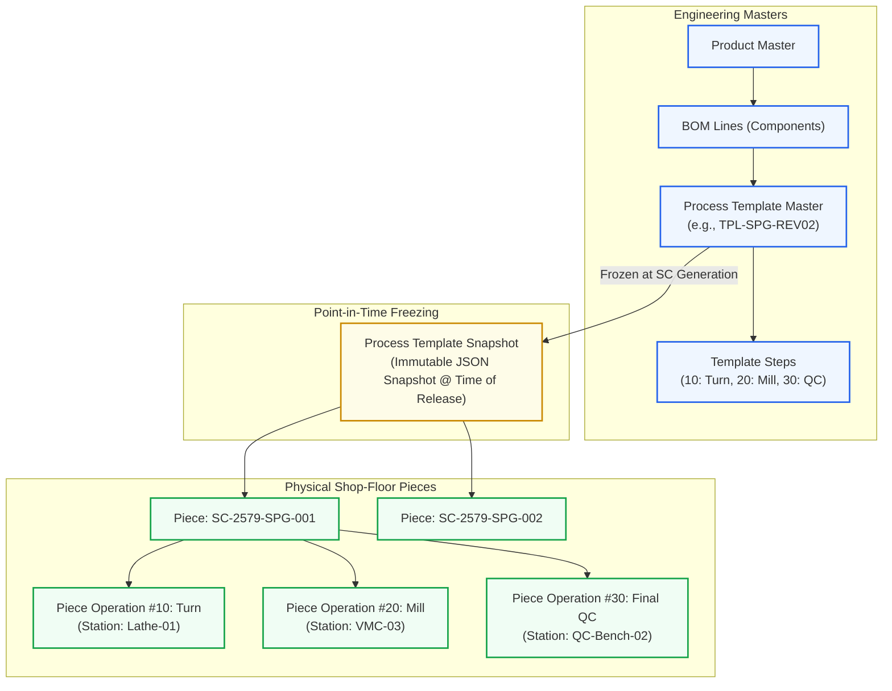
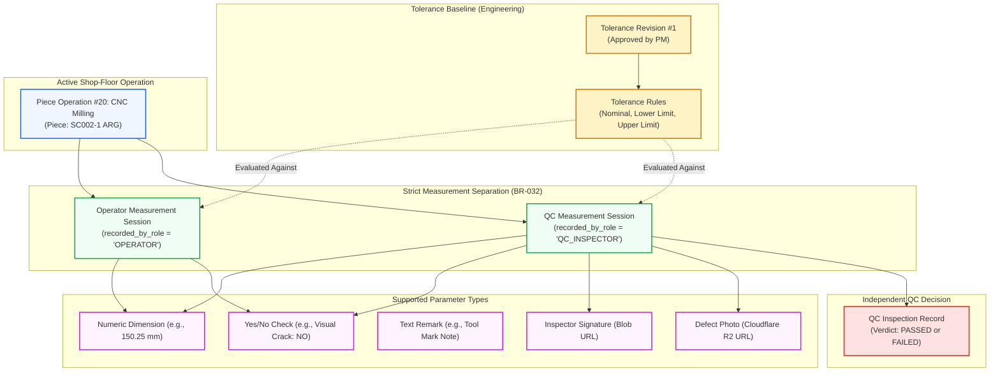
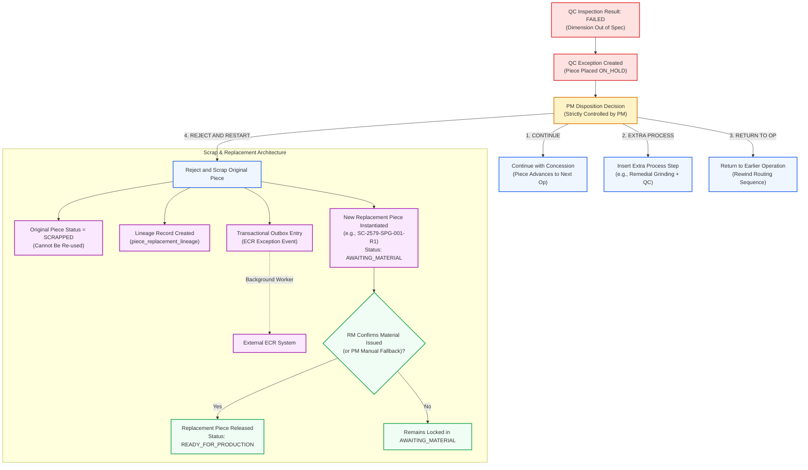
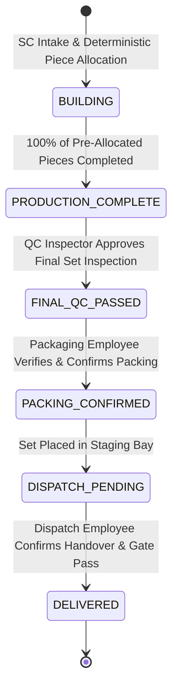
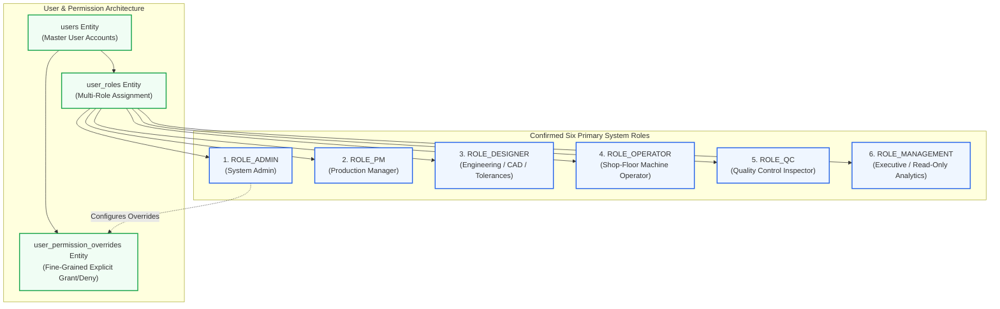

# Part 2.2 – Domain and Data Model Design
## Document 03: Relationships, Cardinality, and Sub-Domain Models

### 1. Master Relationship Catalogue and Cardinality Matrix

The following table documents all primary entity-to-entity relationships, cardinalities, and foreign key constraints across the platform:

| Source Entity | Target Entity | Cardinality | Foreign Key Column | On Delete Action | Business Context & Invariant |
| :--- | :--- | :--- | :--- | :--- | :--- |
| `purchase_orders` | `subcontracts` | `1 : N` | `subcontracts.po_id` | `RESTRICT` | A customer PO groups multiple SCs; deleting a PO with active SCs is strictly blocked. |
| `subcontracts` | `subcontract_products` | `1 : N` | `subcontract_products.sc_id` | `RESTRICT` | An SC can contain multiple ordered product line items, identified by `line_number` (`UNIQUE (sc_id, line_number)`). The same product can appear on multiple lines with different quantities or delivery dates. |
| `products` | `subcontract_products` | `1 : N` | `subcontract_products.product_id` | `RESTRICT` | Links manufactured catalog product to contract line item. A product may be referenced by multiple lines across or within SCs. |
| `products` | `bom_lines` | `1 : N` | `bom_lines.product_id` | `RESTRICT` | A product defines its multi-component BOM structure. |
| `subcontracts` | `sc_revisions` | `1 : N` | `sc_revisions.sc_id` | `CASCADE` | SC contract revisions belong entirely to the parent SC. |
| `subcontract_products` | `assembled_sets` | `1 : N` | `assembled_sets.sc_product_id` | `RESTRICT` | An SC product produces N complete assembled sets equal to `target_set_qty`. |
| `assembled_sets` | `pieces` | `1 : N` | `pieces.assembled_set_id` | `RESTRICT` | **Deterministic Set Membership:** Every physical piece is pre-allocated and bound directly to its designated set upon SC intake. |
| `subcontract_products` | `pieces` | `1 : N` | `pieces.sc_product_id` | `RESTRICT` | An SC product spawns total pieces = $\sum (\text{target\_sets} \times \text{qty\_per\_set})$. |
| `bom_lines` | `pieces` | `1 : N` | `pieces.bom_line_id` | `RESTRICT` | Every physical piece represents an instance of a specific BOM component. |
| `process_templates` | `process_template_steps` | `1 : N` | `process_template_steps.template_id` | `CASCADE` | Steps define the ordered routing of a master template. |
| `process_templates` | `process_template_snapshots` | `1 : N` | `process_template_snapshots.template_id` | `RESTRICT` | Snapshots preserve point-in-time routing rules. |
| `process_template_snapshots` | `pieces` | `1 : N` | `pieces.snapshot_id` | `RESTRICT` | Every piece binds permanently to a frozen template snapshot. |
| `pieces` | `piece_operations` | `1 : N` | `piece_operations.piece_id` | `RESTRICT` | A piece executes its sequential routing operations. |
| `piece_operations` | `operation_measurements` | `1 : N` | `operation_measurements.piece_operation_id` | `RESTRICT` | Captures separate Operator and QC measurement sessions. |
| `operation_measurements` | `measurement_values` | `1 : N` | `measurement_values.measurement_id` | `CASCADE` | Granular parameter readings for a measurement session. |
| `piece_operations` | `qc_inspections` | `1 : N` | `qc_inspections.piece_operation_id` | `RESTRICT` | Independent QC verdict logs per operation. |
| `qc_inspections` | `qc_exceptions` | `1 : 1` | `qc_exceptions.qc_inspection_id` | `RESTRICT` | A failed QC inspection automatically raises an exception case. |
| `qc_exceptions` | `pm_dispositions` | `1 : 1` | `pm_dispositions.exception_id` | `RESTRICT` | Each exception is resolved by exactly one binding PM decision. |
| `pieces` (Scrapped) | `piece_replacement_lineage` | `1 : 1` | `piece_replacement_lineage.scrapped_parent_piece_id` | `RESTRICT` | Scrapped piece points to lineage record. |
| `pieces` (Replacement) | `piece_replacement_lineage` | `1 : 1` | `piece_replacement_lineage.replacement_child_piece_id` | `RESTRICT` | Replacement piece points back to its scrapped ancestor. |
| `assembled_sets` | `set_component_allocations` | `1 : N` | `set_component_allocations.set_id` | `CASCADE` | A set allocates required finished pieces according to BOM ratios. |
| `pieces` | `set_component_allocations` | `1 : 1` | `set_component_allocations.piece_id` | `RESTRICT` | A piece can be allocated to at most one assembled set. |
| `subcontracts` | `vendor_dc_trackers` | `1 : N` | `vendor_dc_trackers.sc_id` | `RESTRICT` | External processing tracks RM DC numbers linked to the SC. |
| `departments` | `users` | `1 : N` | `users.department_id` | `SET NULL` | Employees belong to a primary department. |
| `departments` | `machines` | `1 : N` | `machines.department_id` | `RESTRICT` | Machines reside within a specific shop-floor department. |
| `users` | `user_roles` | `1 : N` | `user_roles.user_id` | `CASCADE` | User-to-role multi-role mappings. |
| `roles` | `user_roles` | `1 : N` | `user_roles.role_id` | `RESTRICT` | Roles assigned to users. |
| `users` | `user_permission_overrides` | `1 : N` | `user_permission_overrides.user_id` | `CASCADE` | Individual Admin permission overrides per user. |
| `departments` | `production_targets` | `1 : N` | `production_targets.department_id` | `SET NULL` | Department-level production throughput targets. |
| `subcontracts` | `production_targets` | `1 : N` | `production_targets.sc_id` | `CASCADE` | Contract-level production targets. |

---

### 2. Process Template and Operation Model

Process templates govern how physical components are routed through machines and departments.

#### 2.1 The Snapshot Mechanism
A common failure in manufacturing software is mutating a master template while work is already active on the shop floor. Velan Production solves this through **Template Snapshots**:
1. When an SC is approved and pieces are generated, the active version of the `process_templates` and its `process_template_steps` is serialized into an immutable record in `process_template_snapshots`.
2. Every `pieces` record holds a foreign key (`snapshot_id`) referencing that snapshot.
3. If an engineering designer creates Revision 3 of a template, existing pieces in production continue following Revision 2 without disruption.

#### Diagram Explanation in Simple Language
* Engineering sets up the master process template for a component (e.g., Spindle turning, milling, and inspection).
* When production starts for an SC, the system captures an immutable snapshot of that template.
* Every physical piece links to this snapshot and instantiates its own `piece_operations` records.
* Any future edits to the master template only affect future production runs, guaranteeing total historical stability.

---

### 3. Measurement and Quality Control Model

The quality architecture guarantees complete separation between Operator and QC Inspector inputs, supports diverse parameter data types, and prevents overwriting historical records.

#### Key Domain Rules for Measurements:
1. **Never Overwrite (BR-029):** Measurements are append-only. If an operator re-submits a corrected measurement, a new session row is created; historical rows remain intact.
2. **Never Copy (BR-032):** QC fields are never pre-populated with operator measurements. The QC Inspector must enter physical readings independently.
3. **Five Parameter Types:**
   * `NUMERIC`: Continuous dimensional data with automated tolerance evaluation ($Nominal + Lower \le Value \le Nominal + Upper$).
   * `BOOLEAN`: Discrete pass/fail or visual check attributes.
   * `TEXT`: Heat treatment batch remarks, operator notes, or hardness scale descriptions.
   * `SIGNATURE`: Digital verification signature stored in Cloudflare R2.
   * `IMAGE`: High-resolution photograph of physical surface defects or calibration setups stored in Cloudflare R2.
4. **Tolerance Revision Scope & Open Formula Question:** Tolerances are extracted from Excel/PDF sheets (Nominal, Lower, Upper limits), verified by Design, and approved by PM before activation. New approved revisions apply only to measurements not yet entered; historical measurements are never overwritten. Advanced formula-based dynamic expressions are removed from the active approved scope and flagged as an open business question pending review of actual Design files.

---

### 4. Exception, PM Disposition, and Replacement Model

When a piece fails QC inspection, it transitions immediately into the Exception and Disposition lifecycle.

#### Plain-Language Explanation of PM Dispositions:
1. **Continue (Concession Progression):**
   * **Failure Preserved:** The PM reviews the non-conforming measurement and authorizes the piece to advance on engineering concession without physical rework. The failure is **never silently converted into a pass**.
   * **Measurement Immutability:** Both operator and QC measurements in `operation_measurements` and `measurement_values` remain strictly immutable; values are never modified, overwritten, or deleted.
   * **QC Record Unchanged:** The `qc_inspections` record remains permanently marked with `verdict = 'FAILED'`.
   * **Mandatory Justification:** The PM must record an explicit, non-empty engineering rationale in `pm_dispositions.justification_notes`. The system rejects blank or whitespace entries.
   * **Audit Log Event:** The system writes an immutable audit record (`PM_DISPOSITION_CONTINUE`) to `audit_logs`, capturing the PM's user ID, timestamp (`decided_at`), exception ID, and full justification text.
   * **Operation Progression:** The failed operation status in `piece_operations` transitions from `FAILED` to **`CONCESSION_ACCEPTED`** (stamping `completed_at`).
   * **Unlocking Next Operation:** Only upon transitioning to `CONCESSION_ACCEPTED`, the next sequential operation in the routing transitions from `PENDING` to `READY` (stamping `ready_at`), enabling the downstream machine operator to open the job.
   * **Exception State:** `qc_exceptions.status` transitions to `RESOLVED_CONCESSION`, and the piece status transitions from `ON_HOLD_QC_FAILED` back to `IN_PRODUCTION`.
2. **Extra Process (Ad-Hoc Remediation):**
   * The PM dynamically inserts a new remediation step (e.g., an extra de-burring, grinding, or skimming operation, `is_extra_operation = true`) with status `READY`.
   * The original failed measurements and failure verdict remain permanently in history.
   * The remediation operation must be executed and pass its own QC inspection before the piece is permitted to return to the standard routing sequence.
   * `qc_exceptions.status` transitions to `RESOLVED_REWORK`.
3. **Return to Earlier Operation (Routing Rewind):**
   * The PM rewinds the piece back to an earlier machining step specified by `target_operation_id`.
   * All previous measurement records and failure verdicts remain permanently preserved in historical logs.
   * The target operation is reset to `READY` for rework under a new measurement iteration (`iteration_number = 2`).
   * The piece must pass all intermediate inspections again before progressing downstream.
   * `qc_exceptions.status` transitions to `RESOLVED_REWORK`.
4. **Reject and Scrap (Replacement Lineage):**
   * The physical piece is permanently stamped **`SCRAPPED`** and retired from production.
   * Historical measurements and failed QC records are retained permanently for scrap analysis and defect costing.
   * Automatically enqueues a `SCRAP_EXCEPTION` event in `outbox_events` to notify external ECR.
   * A brand new physical replacement piece is created with an updated serial number (e.g., `-R1`), inheriting the original piece's exact `assembled_set_id`, `bom_line_id`, and `set_sequence_number` to maintain deterministic set allocation.
   * **Replacement Creation vs. Replacement Release:** Instantiating the replacement piece does **not** allow machining to start immediately. The replacement piece enters the `AWAITING_MATERIAL` state and is unlocked for production **only** after RM (V-SMART) issues new raw material stock matched to the ECR report number (or via an emergency PM override).
   * `qc_exceptions.status` transitions to `RESOLVED_SCRAP`.

---

### 5. Vendor Tracking and RM DC Synchronization Model

For operations performed by outside vendors (e.g., commercial heat treatment, nitriding, phosphating):
* **Strict Boundary Invariant:** RM (V-SMART) is the sole and exclusive owner of Vendor DC creation, dispatch, inward receipt, and raw material inventory transactions. Production must not implement vendor DC transaction functionality.
* **Production Boundary:** Velan Production **does not** create Delivery Challans (DCs), log stock issues, or receipt inward goods. RM (V-SMART) remains the sole authority for DCs and inventory.
* **Production Responsibility:** Velan Production tracks which physical pieces are tagged to external vendors, maps RM's DC number to the operation instance, and reconciles returned versus pending piece balances.
* **Inward Event Trigger:** When RM Stores receives goods back from the vendor and completes an Inward Entry, RM sends a webhook/event to Velan Production. Velan Production automatically updates the `returned_qty` and makes the returned pieces available on the shop floor for **internal QC inspection**.

---

### 6. Set Lifecycle, Packing, and Dispatch Architecture

The platform enforces a strict sequential lifecycle for assembled valve sets:

$$\text{Building} \longrightarrow \text{Production Complete} \longrightarrow \text{Final QC Passed} \longrightarrow \text{Packing Confirmed} \longrightarrow \text{Dispatch Pending} \longrightarrow \text{Delivered}$$

#### Detailed State Transition Logic:
1. **`BUILDING`:** Initial status created upon SC intake. Pre-allocated physical pieces are actively undergoing sequential routing operations independently (`is_production_complete = false`, `is_final_qc_passed = false`, `is_packed = false`, `is_delivered = false`).
2. **`PRODUCTION_COMPLETE`:** Automatically triggered when 100% of pre-allocated component pieces for the set reach `status = 'COMPLETED'` (`PASSED` or `CONCESSION_ACCEPTED`). Sets `is_production_complete = true` and records timestamp `production_completed_at`.
3. **`FINAL_QC_PASSED`:** The QC Inspector performs the final visual, dimensional, and assembly verification of the completed set. Passing final QC does **not** pack the set; it sets `is_final_qc_passed = true`, moves status to `FINAL_QC_PASSED`, and records `final_qc_passed_at` and `final_qc_passed_by`.
4. **`PACKING_CONFIRMED` & `DISPATCH_PENDING`:** Packaging employees physically verify the parts checklist, box/crate the set, seal it with tamper-evident labels, and generate a packing record (`packing_records`). This sets `is_packed = true`, transitions the set status to `PACKING_CONFIRMED`, and automatically moves it to `DISPATCH_PENDING` in the warehouse staging bay, capturing `packing_confirmed_at` and `packed_by_user_id`. Confirming packing does **not** mean delivered.
5. **Dispatch Confirmation Records Delivery (`DELIVERED`):** The dispatch employee explicitly confirms physical dispatch from the loading dock by recording gate pass, carrier, vehicle, and release details (`dispatch_confirmations`). This confirmation records the delivery event, setting `is_delivered = true` and moving set status directly to `DELIVERED` (`delivered_at`, `dispatched_by_user_id`). `DELIVERED` serves as the single final status representing this release event.
6. **Partial Dispatch Permitted for Complete Sets Only:** If Set #1 of an SC product is completed and packed (`is_final_qc_passed = true`, `is_packed = true`), it can be dispatched immediately (`DELIVERED`). Set #2, having any incomplete or scrapped component awaiting replacement (`is_production_complete = false`), cannot be packed or dispatched. Partial dispatch applies strictly to **complete sets**, never to partial components.
7. **Billing External:** Billing, invoicing, and financial accounting remain strictly external to Velan Production.

---

### 7. Product Material Readiness and Operation Sequencing Model

To mirror actual factory operations and maintain clean integration boundaries with RM (V-SMART):
* **SC Header vs. Product Line Items:** The Sales Contract header (`subcontracts`) groups the commercial order. The specific manufactured products ordered are modeled as `subcontract_products`.
* **Independent Material Readiness Per Product:** Material readiness is tracked strictly at the **Product line item level** (`subcontract_products.material_ready`).
  - In multi-product SCs (e.g., SC002 containing Product 1: Gate Valve and Product 2: Globe Valve), each product tracks material readiness independently.
  - When RM confirms material issue for Product 1, only Product 1's `material_ready` flag transitions to `true`.
  - Product 2 remains `material_ready = false`.
  - Pieces belonging to Product 1 become eligible for production execution; pieces belonging to Product 2 remain locked and cannot be started.
  - The system **never** assumes the entire SC is ready when only one product has received material.
* **Dual Trigger Mechanisms:**
  1. **Manual Toggle:** PM or authorized Stores personnel can manually toggle `material_ready = true` on a specific `subcontract_products` record.
  2. **Automatic RM Issuance:** When RM emits a material issue event for that specific product/subcontract, `material_status` is updated to `'ISSUED'` and `material_ready` is automatically set to `true` with `material_issued_at`.
* **Traceability Granularity (Pending Inspection):** The exact granularity of RM material identification (heat numbers, mill batch codes, raw-bar identifiers) is recorded as pending inspection of actual RM API responses during integration phase. The baseline data model does not make unverified assertions regarding RM piece-level heat codes.
* **Separation of Material Gate and Operation Sequencing:**
  1. **Material Gate as Precondition:** Material readiness is the mandatory prerequisite before beginning production execution.
  2. **First Operation Unlocking (Sequence 10):** When material is issued for a product, **only the first eligible operation (sequence 10)** of its constituent pieces transitions from `PENDING` to `READY`.
  3. **Sequential Gating for Subsequent Operations:** Subsequent operations (sequence 20, 30...) remain strictly in `PENDING`. They transition to `READY` only sequentially after previous operation completion and QC inspection pass. **Operations are never made READY simultaneously.**
  4. **Measurement Entry Blockage:** Operators are strictly prohibited from entering measurements or logging hours before the material gate is satisfied and before that specific operation reaches `READY` or `OPENED`.
* **Strict Read-Only Boundary:** Velan Production is strictly read-only regarding RM inventory. Production never writes to RM stock, ledger, or GRN tables.

---

### 8. Access Governance and Confirmed Six-Role Structure

Velan Production enforces strict Role-Based Access Control (RBAC) across six confirmed primary system roles:

* **Multi-Role Assignment (`user_roles`):** A user account can be assigned one or more roles (e.g., an engineer can hold both `ROLE_DESIGNER` and `ROLE_PM`).
* **Configurable Permission Overrides (`user_permission_overrides`):** Admins can grant or deny specific granular action permissions (e.g., `OVERRIDE_APPROVE`, `SC_CANCEL`) to individual users without altering system roles.
