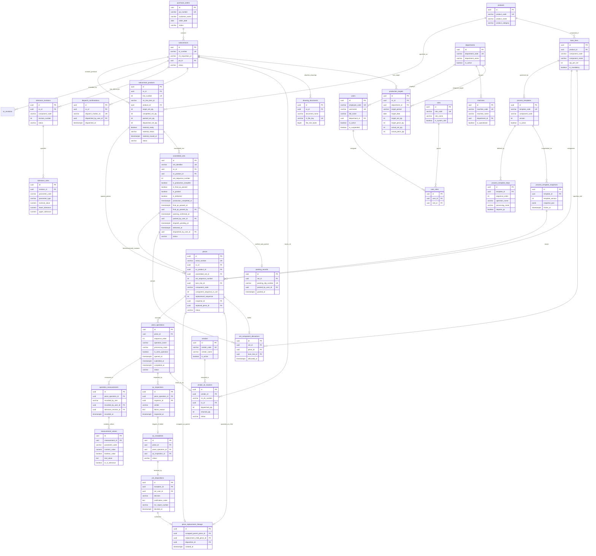

# Part 2.2 – Domain and Data Model Design
## Document 04: Comprehensive Entity-Relationship (ER) Diagram

### 1. Complete Enterprise ER Diagram

The following diagram defines the physical and logical schema design for the Velan Production platform. It illustrates the complete relational topology across the commercial, engineering, execution, quality, exception, vendor, and dispatch clusters.

---

### 2. ER Diagram Walkthrough by Domain Cluster

#### Cluster 1: Commercial Order & Hierarchy
* **`purchase_orders` → `subcontracts` → `subcontract_products` → `products`:** Groups client purchase orders into specific Size Cards. An SC can contain one or multiple manufactured product line items (`subcontract_products`), uniquely identified by `line_number` (`UNIQUE (sc_id, line_number)`). This allows the same catalog product (`product_id`) to appear on multiple distinct lines within an SC with different target quantities, specifications, or delivery schedules.
* **`subcontracts` → `sc_revisions`:** Captures contract amendments and quantity revisions emitted from RM V-SMART without losing baseline parameters.

#### Cluster 2: Engineering & Bill of Materials
* **`products` → `bom_lines`:** Defines the multi-component set ratio (e.g., 1 Valve Body, 2 Flanges, 1 Spindle, 3 Jig Feet).
* **`bom_lines` → `process_templates` → `process_template_steps`:** Masters that define the standard operational routes for each part type.
* **`process_templates` → `process_template_snapshots`:** Captures point-in-time frozen snapshots for active production pieces.
* **`subcontracts` → `tolerance_revisions` → `tolerance_rules`:** SC-specific static dimensional tolerances (nominal, lower limit, upper limit) extracted from Excel/PDF and approved by the PM. Formula-based dynamic expressions are removed from approved scope pending review of sample files.

#### Cluster 3: Shop-Floor Piece Execution
* **`subcontract_products` + `bom_lines` → `pieces`:** Generates individual physical pieces deterministically bound to their target `assembled_set_id` and numbered with SC, set sequence, component code, unit index, and replacement sequence.
* **Product Material Readiness & Sequential Operation Gating:**
  - Material readiness is tracked per product (`subcontract_products.material_ready`). In multi-product SCs, material issued for one product does not unlock unrelated products.
  - Material readiness is the mandatory prerequisite before machining can begin.
  - When material is issued for a product, **only the first eligible operation (sequence 10)** transitions to `READY`. Subsequent operations remain strictly in `PENDING` and transition to `READY` only sequentially after previous operations pass QC.
  - Measurement entry is strictly blocked until the material gate is satisfied and the operation reaches `READY` or `OPENED`.
  - The model does not make unverified assertions about RM piece-level heat codes; exact RM material traceability granularity is pending inspection of actual RM API responses.
* **`pieces` → `piece_operations`:** Sequential execution instances of operations derived from the frozen template snapshot.

#### Cluster 4: Quality Control & Exception Handling
* **`piece_operations` → `operation_measurements` → `measurement_values`:** Separate measurement sessions for Operators and QC Inspectors, retaining all readings and preventing overwrites.
* **`piece_operations` → `qc_inspections`:** Official pass/fail quality verdicts.
* **`qc_inspections` → `qc_exceptions` → `pm_dispositions`:** Out-of-spec failures place the piece on hold and escalate exclusively to the PM for disposition.
  - When PM selects **`CONTINUE`**: original measurements and the `FAILED` inspection verdict remain immutable and permanently recorded. The PM enters mandatory engineering justification notes. The operation status in `piece_operations` transitions to **`CONCESSION_ACCEPTED`** (never silently converted to `PASSED`), which unlocks the next sequential operation to `READY`.
* **`pm_dispositions` → `piece_replacement_lineage`:** Scrapping a piece spawns a child replacement piece with strict parent-child genealogy, retaining the scrapped piece's deterministic set allocation.

#### Cluster 5: Assembly, Packing, and Dispatch
* **`subcontract_products` → `assembled_sets`:** Tracks completion of logical sets based on target quantities for each ordered product line item.
* **`assembled_sets` + `pieces` → `set_component_allocations`:** Represents the deterministic pre-allocation manifest created at intake. Discrete milestone flags independently track set progression:
  - `is_production_complete`: 100% of pre-allocated pieces completed all machining operations.
  - `is_final_qc_passed`: final set inspection certified by QC.
  - `is_packed`: physical packing verified and slip generated.
  - `is_delivered`: dispatch employee confirmed vehicle gate exit.
* **Confirmed Sequential Lifecycle Progression:** `BUILDING` → `PRODUCTION_COMPLETE` → `FINAL_QC_PASSED` → `PACKING_CONFIRMED` → `DISPATCH_PENDING` → `DELIVERED`.
  - Final QC completion does not mean Packed.
  - Packing confirmation moves set to `PACKING_CONFIRMED` and `DISPATCH_PENDING`, capturing packing checklist and slip.
  - Dispatch employee explicitly confirms dispatch with gate pass / challan, and this confirmation records the delivery event, transitioning the set status to `DELIVERED`.
  - Complete sets can be dispatched independently. Partial dispatch is strictly forbidden for incomplete sets.
  - Billing is strictly external to Velan Production.

#### Cluster 6: External Processing & Infrastructure
* **`vendors` + `subcontracts` → `vendor_dc_trackers`:** Tracks pieces undergoing external vendor operations against RM Delivery Challan numbers. Production does not implement DC creation, dispatch, or inward transactions; RM remains the exclusive owner.
* **`drawing_documents`:** Links CAD blueprints and inspection diagrams to Cloudflare R2 object keys.

#### Cluster 7: IAM, Departments & Production Targets
* **`departments` → `users` + `machines`:** Factory departmental organization grouping personnel and physical machine assets.
* **`users` + `roles` → `user_roles`:** Enforces RBAC across the **six confirmed primary system roles**: `ROLE_ADMIN`, `ROLE_PM`, `ROLE_DESIGNER`, `ROLE_OPERATOR`, `ROLE_QC`, and `ROLE_MANAGEMENT`.
* **`departments` + `subcontracts` → `production_targets`:** Daily, weekly, and monthly set and piece production throughput quotas set by the PM.
