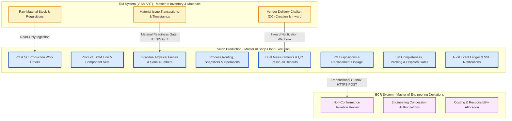

# Part 2.2 – Domain and Data Model Design
## Document 05: Integration Data Ownership and Audit Model

### 1. Enterprise Integration Data Ownership

To guarantee data consistency and prevent dual sources of truth across the factory landscape, data ownership is divided among **RM (V-SMART)**, **Velan Production**, and **ECR**:

#### Plain-Language Explanation of Integration Boundaries
1. **Raw Material (RM – V-SMART):**
   * Stays completely unchanged.
   * Controls all raw stock, inventory movements, GRNs, mill test certificates, and official Vendor Delivery Challans.
   * **Product-Level Material Scope:** RM issues raw materials associated with specific subcontract product line items (`subcontract_products` uniquely identified by `sc_id` and `line_number`). Multi-line subcontracts allow the same catalog product to appear on separate lines with distinct delivery dates, each tracking independent material readiness.
   * **Material Traceability Granularity (Pending RM API Inspection):** The exact granularity of RM raw material identification (mill heat number, heat code, raw-bar identifier) is recorded as pending inspection of actual RM API responses during integration phase. The baseline data model does not make unverified assertions about individual piece-level heat codes.
   * **Strict Read-Only Access:** Velan Production ingests material issuance events via read-only APIs or webhooks to unlock piece operations, but **never modifies, creates, or decrements RM stock records**.
2. **Velan Production:**
   * Owns everything that happens to a physical component on the factory floor: serial numbers, machine operations, measurements, QC decisions, scrap lineage, deterministic set assembly, packing verification, and dispatch confirmation.
   * Maintains product-level material readiness (`material_ready` on `subcontract_products`), settable via manual PM toggle or auto-updated from RM material issue events.
3. **Engineering Change Request (ECR):**
   * Stays completely unchanged.
   * Manages formal engineering review of defects, concession approvals, and defect costing.
   * Velan Production automatically submits exception tickets to ECR via an outbox queue, but **never calculates ECR costing internally**.

---

### 2. Conceptual Audit and Integration Data Models

To ensure 100% compliance with Phase 1 auditing and integration specifications, the data model defines concrete structures for all historical and cross-application exchanges:

#### 2.1 Audit History & User Actions (`audit_logs`)
* **Behavior:** Append-only ledger capturing every mutating action (`INSERT`, `UPDATE`, `DELETE`, `STATUS_CHANGE`, `OVERRIDE`, `CANCEL`).
* **Attributes Captured:**
  * `event_timestamp`, `user_id`, `username`, `user_role`, `client_ip`
  * `action_type` (e.g., `START_OPERATION`, `MEASUREMENT_SUBMITTED`, `QC_FAILED`, `PM_DISPOSITION_CONTINUE`, `PM_DISPOSITION_EXTRA_PROCESS`, `PM_DISPOSITION_RETURN_TO_OP`, `PM_DISPOSITION_SCRAP`, `TOLERANCE_REVISED`)
  * `entity_name`, `entity_id`
  * `previous_state` (JSONB) and `new_state` (JSONB)
* **Measurement & Failure Immutability Invariant:** Original operator measurements, QC measurements, and inspection failure verdicts (`verdict = 'FAILED'`) are **never overwritten, updated, or deleted**. When a PM dispositions an exception (e.g. `PM_DISPOSITION_CONTINUE`), the original measurements and failed verdicts remain permanently intact in historical records; the disposition records the PM's mandatory engineering justification and transitions the operation to `CONCESSION_ACCEPTED`.
* **Access Rule (BR-055):** Admin users have full access to security and administrative audit records; PM users access production-specific operational logs; operators see only their personal logged work.

#### 2.2 Template Revisions & History
* **Entities:** `process_templates` (with incrementing `version` counter) and `process_template_snapshots`.
* **Behavior:** Whenever a process template is revised by Engineering, the previous version remains immutable. Active pieces hold a direct foreign key to the snapshot captured when the SC was launched, ensuring no in-flight work is corrupted.

#### 2.3 Tolerance Revision History
* **Entities:** `tolerance_revisions` and `tolerance_rules`.
* **Behavior (BR-026, BR-028, BR-029):** Tolerance sheets uploaded by Designers must be approved by the PM before activation. Historical measurements are **never overwritten**. Completed operations retain the revision under which they were inspected; only unfinished or unentered measurements are evaluated against the new revision.

#### 2.4 RM Synchronization History (`rm_sync_history`)
* **Purpose:** Logs all read queries and webhook payloads between RM (V-SMART) and Velan Production.
* **Fields:**
  * `id` (`UUID PK`)
  * `sync_type` (`SC_IMPORT`, `MATERIAL_STATUS_POLL`, `VENDOR_INWARD_EVENT`)
  * `rm_reference_id` (SC Number, Product Line ID, or DC Number)
  * `status` (`SUCCESS`, `FAILED`)
  * `http_status_code` (`INTEGER`)
  * `payload_received` (`JSONB`)
  * `synced_at` (`TIMESTAMPTZ`)

#### 2.5 ECR Outbox Events & Response References (`outbox_events`)
* **Purpose:** Implements the Transactional Outbox pattern (ADR-02) for reliable asynchronous transmission of scrap and rework exceptions to ECR without external message brokers.
* **Fields:**
  * `id` (`UUID PK` — acts as the HTTP `Idempotency-Key`)
  * `aggregate_type` (`SCRAP_EXCEPTION`, `REWORK_EXCEPTION`)
  * `aggregate_id` (Foreign key to `qc_exceptions.id`)
  * `payload` (`JSONB` containing SC, piece serial, failed operation, measured values, PM notes)
  * `status` (`PENDING`, `PUBLISHED`, `FAILED`, `DEAD_LETTER`)
  * `retry_count` (`INTEGER DEFAULT 0`)
  * `next_retry_at` (`TIMESTAMPTZ` with exponential backoff)
  * `published_at` (`TIMESTAMPTZ`)
  * `ecr_response_reference` (`VARCHAR(100)` storing ECR ticket number returned upon HTTP 201)

#### 2.6 Vendor DC Mapping (`vendor_dc_trackers`)
* **Purpose:** Links physical piece operations to external processing delivery challans created in RM.
* **Strict Boundary Rule:** RM (V-SMART) is the sole owner of vendor DC creation, dispatch, inward receipt, and raw material inventory transactions. Production never creates or receipts DCs; it purely synchronizes and displays vendor tracking status and DC references emitted by RM.
* **Fields:**
  * `rm_dc_number`, `vendor_id`, `sc_id`
  * `dispatched_qty`, `returned_qty`, `pending_balance_qty`
  * `rm_inward_reference`, `status` (`DISPATCHED`, `PARTIALLY_RETURNED`, `FULLY_RETURNED`)

#### 2.7 Notification History (`user_notifications`)
* **Purpose:** Centralized, persistent log of in-app alerts and notifications pushed via Server-Sent Events (SSE).
* **Governance (BR-049):** Admin users configure notification policies. Ordinary users cannot disable critical operational notifications (such as QC failure alerts or material blockage notices).
