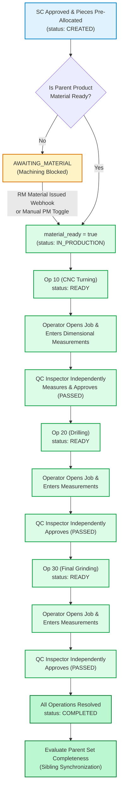
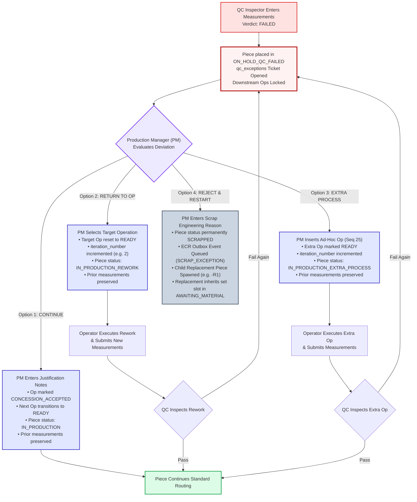
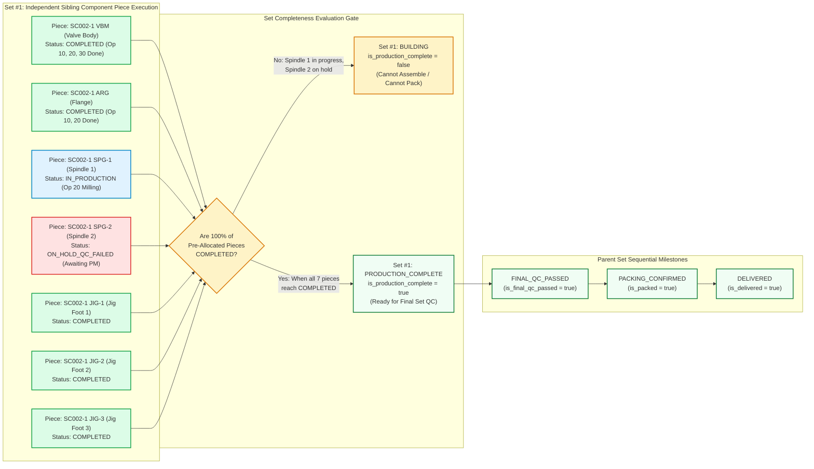

# Part 2.3 – Piece Lifecycle State Machine
## Document 03: Comprehensive Piece State Machine Diagrams

---

### 1. Complete Piece Lifecycle State Diagram

The following Mermaid state diagram specifies the complete state transition topology for physical pieces in the Velan Production platform:

```mermaid
stateDiagram-v2
    [*] --> CREATED : SC Intake & Deterministic Piece Pre-Allocation

    CREATED --> AWAITING_MATERIAL : Parent Product Material Not Ready
    CREATED --> IN_PRODUCTION : Material Already Ready at Intake

    AWAITING_MATERIAL --> IN_PRODUCTION : RM Confirms Material Issuance / PM Toggle\n(Op 10 Becomes READY)

    state IN_PRODUCTION {
        [*] --> Operation_Ready
        Operation_Ready --> Operation_Opened : Operator Opens Job
        Operation_Opened --> Operation_Submitted : Operator Enters Measurements
        Operation_Submitted --> QC_Pending : Submitted to QC Queue
        QC_Pending --> Operation_Passed : QC Approves (Within Tolerance)
        Operation_Passed --> Operation_Ready : Advance to Next Sequential Op
    }

    IN_PRODUCTION --> ON_HOLD_QC_FAILED : Operation QC Verdict = FAILED\n(Quarantine & Escalate to PM)

    state ON_HOLD_QC_FAILED {
        [*] --> Pending_PM_Review
        Pending_PM_Review --> PM_Decision_Made : PM Evaluates Concession / Rework / Scrap
    }

    ON_HOLD_QC_FAILED --> IN_PRODUCTION : 1. PM CONTINUE (Concession)\n[Op = CONCESSION_ACCEPTED; Next Op = READY]
    ON_HOLD_QC_FAILED --> IN_PRODUCTION_REWORK : 2. PM RETURN TO EARLIER OP\n[Rewind Sequence; Increment Rework Iteration]
    ON_HOLD_QC_FAILED --> IN_PRODUCTION_EXTRA_PROCESS : 3. PM EXTRA PROCESS\n[Insert Ad-Hoc Op; Increment Iteration]
    ON_HOLD_QC_FAILED --> SCRAPPED : 4. PM REJECT AND RESTART\n[Retire Piece; Trigger ECR; Spawn Replacement]

    IN_PRODUCTION_REWORK --> IN_PRODUCTION : Rework QC Passed\n(Rejoins Standard Routing)
    IN_PRODUCTION_REWORK --> ON_HOLD_QC_FAILED : Rework QC Failed Again\n(Re-escalate to PM)

    IN_PRODUCTION_EXTRA_PROCESS --> IN_PRODUCTION : Extra Process QC Passed\n(Rejoins Standard Routing)
    IN_PRODUCTION_EXTRA_PROCESS --> ON_HOLD_QC_FAILED : Extra Process QC Failed\n(Re-escalate to PM)

    IN_PRODUCTION --> COMPLETED : Final Routing Operation Passes QC\n(All Operations Resolved)

    SCRAPPED --> [*] : Permanent Immutable Retirement\n(Replacement spawns into AWAITING_MATERIAL)

    state COMPLETED {
        [*] --> Piece_Done
        Piece_Done --> Staged_For_Assembly : Staged in Assembly Area
        Staged_For_Assembly --> Set_Aggregated : All Sibling Pieces Complete
    }

    COMPLETED --> [*] : Assembled into Set for Final QC
```

---

### 2. Standard Happy-Path Execution Flow

In standard operation without quality failures, the physical piece moves linearly from intake to completion:

---

### 3. Detailed Exception Handling & PM Disposition Pathways

When an operation measurement falls outside approved tolerances, the piece is diverted into the exception handling subsystem:

---

### 4. Parallel Sibling Piece Execution vs. Set Assembly Synchronization

In a manufactured valve assembly, individual BOM components progress along independent shop-floor paths and converge only at set assembly:

