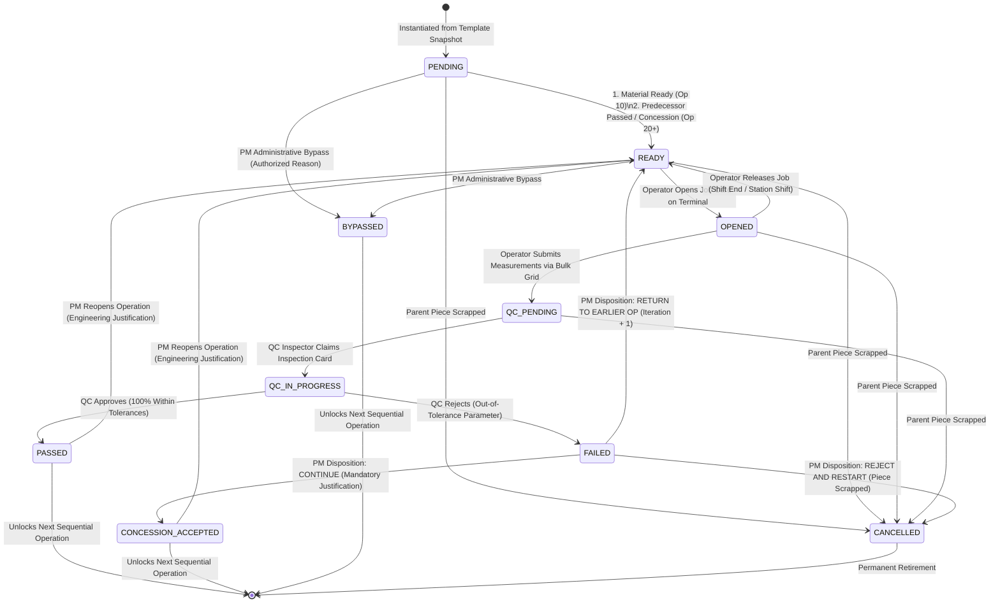
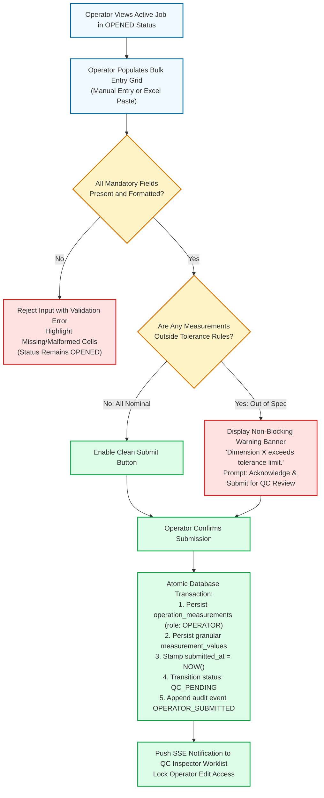
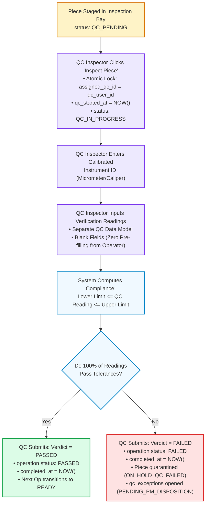
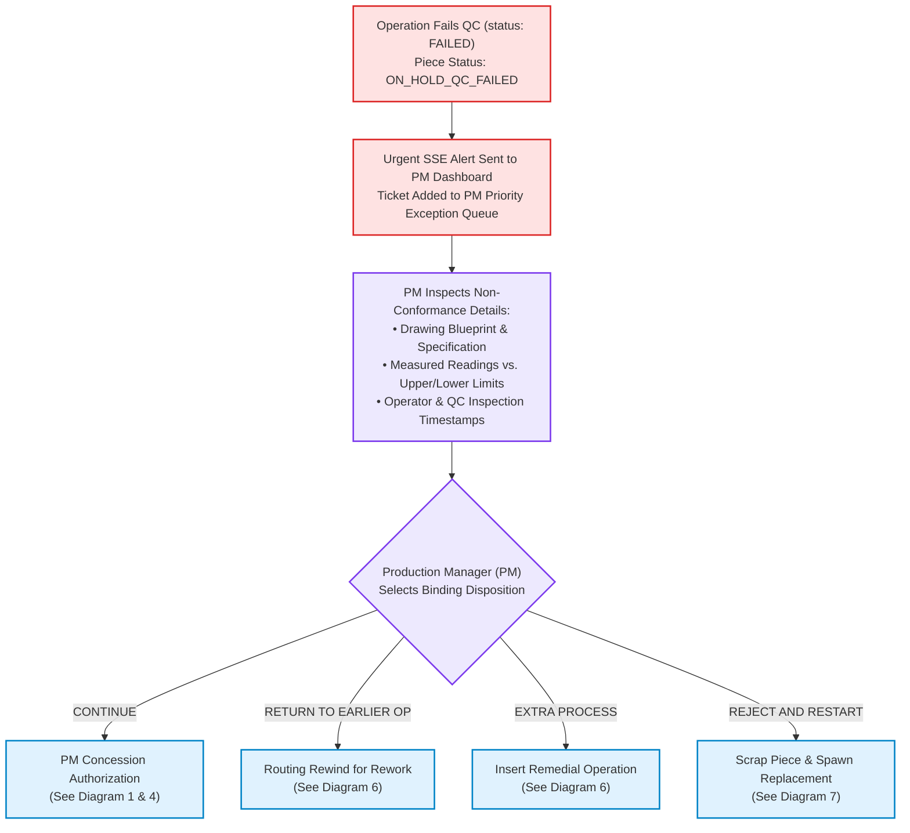
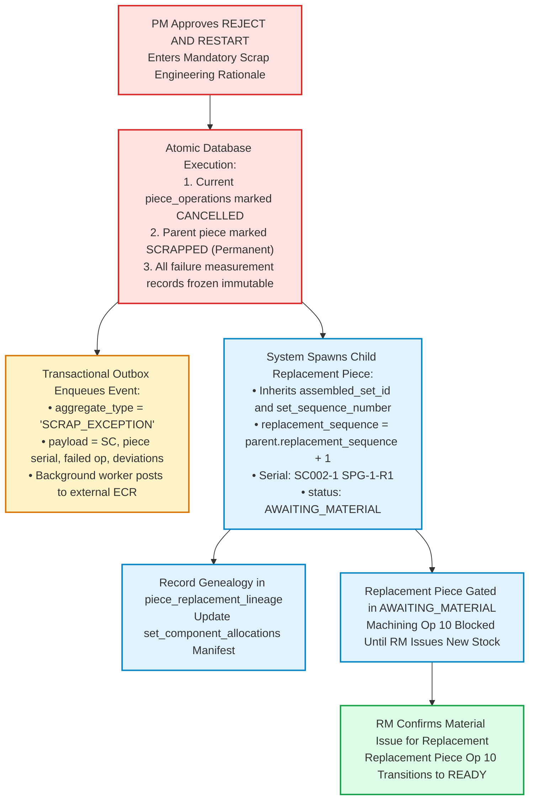
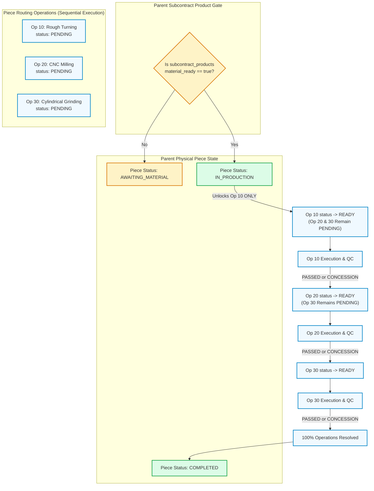
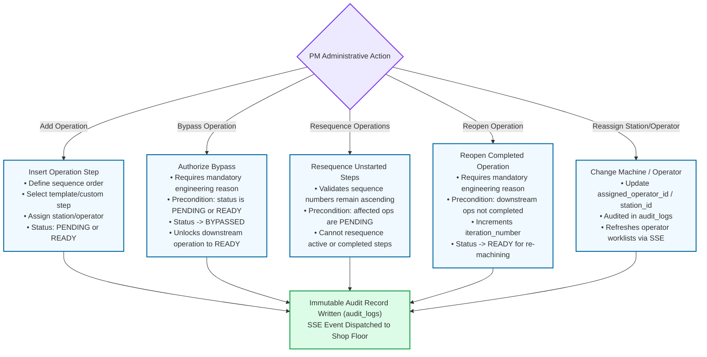

# Part 2.4 – Operation Lifecycle State Machine
## Document 03: Comprehensive Operation State Machine Diagrams

---

### Diagram 1: Complete Operation State Machine Topology

The following Mermaid state diagram captures all ten approved states and their permissible transition pathways:

---

### Diagram 2: Normal Operation Execution Flow

Linear happy-path execution of a single routing operation on the shop floor:

```mermaid
flowchart TD
    A["Predecessor Op Passed or Material Ready<br/>(status: PENDING)"] --> B["System Evaluates Preconditions<br/>• Material Gate Checked<br/>• Predecessor QC Passed"]
    B --> C["Operation Transitions to READY<br/>ready_at = NOW()<br/>Appears on Operator Priority Worklist"]
    C --> D["Operator Scans Barcode & Opens Job Card<br/>opened_at = NOW()<br/>status: OPENED"]
    D --> E["Operator Performs Machining & Enters Values<br/>• Bulk Grid Data Entry<br/>• Non-blocking Out-of-Tolerance Warnings"]
    E --> F["Operator Clicks 'Submit Operation Measurements'<br/>submitted_at = NOW()<br/>status: QC_PENDING"]
    F --> G["QC Inspector Claims Piece from Queue<br/>qc_started_at = NOW()<br/>status: QC_IN_PROGRESS"]
    G --> H["QC Inspector Records Independent Readings<br/>System Checks Compliance vs. Tolerances"]
    H --> I{"100% Within Approved<br/>Tolerance Band?"}
    I -->|Yes| J["QC Submits Verdict = PASSED<br/>completed_at = NOW()<br/>status: PASSED"]
    J --> K["System Automatically Activates<br/>Next Sequential Op to READY"]

    classDef pending fill:#e0f2fe,stroke:#0284c7,stroke-width:2px;
    classDef ready fill:#fef3c7,stroke:#d97706,stroke-width:2px;
    classDef inprog fill:#ede9fe,stroke:#7c3aed,stroke-width:2px;
    classDef qc fill:#fef9c3,stroke:#ca8a04,stroke-width:2px;
    classDef pass fill:#dcfce7,stroke:#16a34a,stroke-width:2px;

    class A pending;
    class B,C ready;
    class D,E inprog;
    class F,G,H,I qc;
    class J,K pass;
```

---

### Diagram 3: Operator Measurement Submission Flow

The operator data-entry validation, warning prompt, and submission lifecycle:

---

### Diagram 4: Independent QC Inspection Flow

Independent verification, instrument mapping, and verdict submission:

---

### Diagram 5: QC Failure to PM Disposition Flow

Exception routing and PM decision gateway:

---

### Diagram 6: EXTRA PROCESS and RETURN TO EARLIER OPERATION Flows

Remedial routing pathways:

```mermaid
flowchart TD
    subgraph ReturnFlow ["PM Disposition: RETURN TO EARLIER OPERATION (Rewind)"]
        R1["PM Selects Target Operation (e.g. Op 20)<br/>from Previous Completed Steps"] --> R2["Target Op Resets to READY<br/>• iteration_number incremented (1 -> 2)<br/>• ready_at = NOW()<br/>• Prior measurements preserved immutable"]
        R2 --> R3["Operator Machines Rework & Submits<br/>under iteration_number = 2"]
        R3 --> R4["QC Inspects Rework Measurements<br/>under iteration_number = 2"]
        R4 -->|Pass| R5["Rework Operation Certified PASSED<br/>Piece Advances to Next Op<br/>Following the Failure Point"]
        R4 -->|Fail Again| R6["Operation Fails Again (Iteration 2 FAILED)<br/>Piece Returns to ON_HOLD_QC_FAILED"]
    end

    subgraph ExtraFlow ["PM Disposition: EXTRA PROCESS (Ad-Hoc Step)"]
        E1["PM Injects New Remedial Operation<br/>(e.g. Op 25: Skim Grinding)<br/>• is_extra_operation = true<br/>• status: READY"] --> E2["Operator Executes Extra Operation<br/>status: OPENED -> QC_PENDING"]
        E2 --> E3["QC Inspects Extra Operation<br/>status: QC_IN_PROGRESS"]
        E3 -->|Pass| E4["Extra Op Certified PASSED<br/>Original Failed Op Marked Resolved<br/>Downstream Op 30 Becomes READY"]
        E3 -->|Fail Again| E5["Extra Op Fails QC<br/>Re-escalates to PM Exception Queue"]
    end

    classDef rewind fill:#fef3c7,stroke:#d97706,stroke-width:2px;
    classDef extra fill:#e0e7ff,stroke:#4338ca,stroke-width:2px;
    classDef pass fill:#dcfce7,stroke:#16a34a,stroke-width:2px;
    classDef fail fill:#fee2e2,stroke:#dc2626,stroke-width:2px;

    class R1,R2,R3,R4 rewind;
    class E1,E2,E3 extra;
    class R5,E4 pass;
    class R6,E5 fail;
```

---

### Diagram 7: REJECT AND RESTART (Scrap & Replacement) Flow

Retirement of defective piece and substitution lifecycle:

---

### Diagram 8: Sequential Operation Activation and Piece Coordination

How individual operations gate one another and coordinate with the parent piece:

---

### Diagram 9: PM Operation-Control Governance Flow

Administrative controls exercised by the Production Manager:

