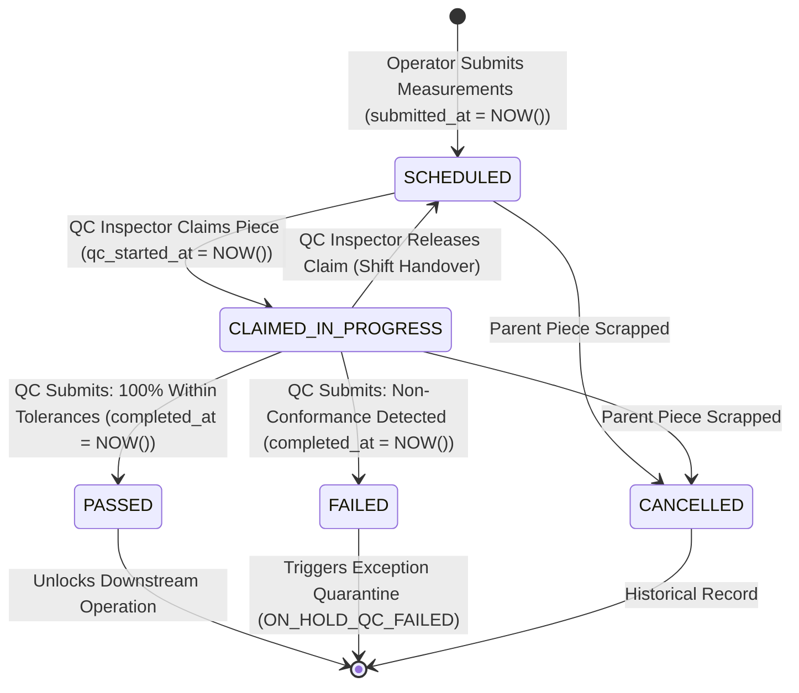

# Part 2.5 – QC and Exception State Machines
## Document 02: QC Inspection State Machine and Tolerance Revision Lifecycle

---

### 1. Dimensional Tolerances Architecture

In the manufacture of high-pressure valves, dimensions are governed by two distinct tiers of tolerance definitions:
1. **Static Baseline Tolerances:** Defined in engineering process templates (`process_template_steps`). These represent standard workshop tolerances (e.g., standard turning tolerance $\pm 0.1\text{ mm}$, drilling depth $+0.5/-0.0\text{ mm}$).
2. **SC-Specific Dynamic Tolerances:** Defined per customer contract or specific valve pressure rating (e.g., Shell / ExxonMobil contract requiring customized flange facing tolerances of $+0.02/-0.01\text{ mm}$). These are uploaded by Design engineers as Excel or PDF inspection schedules (`BR-023, BR-024`).

#### 1.1 Tolerance Sheet Upload, Extraction, and Approval Workflow
To prevent unauthorized changes while supporting rapid engineering setup, tolerance sheets follow a strict three-tier verification lifecycle (`BR-025, BR-026`):

```
+-----------------------------------------------------------------------------------------+
| STEP 1: UPLOAD (Designer)                                                               |
| • Designer uploads Excel (.xlsx) or 2D PDF drawing schedule to Cloudflare R2            |
| • System creates tolerance_revisions row (status = 'UPLOADED')                          |
+-----------------------------------------------------------------------------------------+
       │
       ▼
+-----------------------------------------------------------------------------------------+
| STEP 2: AUTOMATED EXTRACTION (System Engine)                                            |
| • Background worker parses tabular parameters, operation codes, nominals, upper/lower   |
| • Populates draft tolerance_rules records (status = 'EXTRACTED')                        |
+-----------------------------------------------------------------------------------------+
       │
       ▼
+-----------------------------------------------------------------------------------------+
| STEP 3: DESIGN VERIFICATION (Designer)                                                  |
| • Designer reviews extracted parameters side-by-side with blueprint PDF on UI grid       |
| • Designer verifies/corrects mapped operation codes, units, and upper/lower limits      |
| • Designer signs off: status = 'DESIGN_VERIFIED'                                        |
+-----------------------------------------------------------------------------------------+
       │
       ▼
+-----------------------------------------------------------------------------------------+
| STEP 4: PM APPROVAL GATE (Production Manager)                                           |
| • PM reviews revision diff against baseline contract specifications                     |
| • PM approves revision: status = 'PM_APPROVED' (Becomes active evaluation baseline)     |
| • (If rejected: PM enters reason; status = 'REJECTED'; Designer notified to upload new) |
+-----------------------------------------------------------------------------------------+
```

#### 1.2 Tolerance Application to In-Flight Work (`BR-027 to BR-031`)
When a new tolerance revision is approved after shop-floor production has already started:
* **Zero Overwrite of Completed Work (`BR-029`):** Completed operations and existing measurement values in `operation_measurements` are **never overwritten or altered**. They retain the exact tolerance revision ID under which they were inspected.
* **Application to Unentered Data (`BR-028`):** The newly approved revision applies strictly to unentered operations (status `PENDING`, `READY`, or newly opened work).
* **Evaluation of Unfinished Active Work (`BR-031`):** Operations currently in `QC_PENDING` or `QC_IN_PROGRESS` are re-evaluated against the newly approved limits. If an operator-submitted reading now falls outside the revised limits, the system flags the piece with an amber alert for QC attention.

#### 1.3 Mathematical Evaluation Model
For every measured parameter $k$, compliance is evaluated deterministically against nominal values and explicit upper/lower limits:

$$\text{Lower Limit}_k = \text{Nominal Value}_k - |\text{Lower Tolerance}_k|$$

$$\text{Upper Limit}_k = \text{Nominal Value}_k + |\text{Upper Tolerance}_k|$$

$$\text{Compliance Condition:} \quad \text{Lower Limit}_k \le \text{Measured Value}_k \le \text{Upper Limit}_k$$

* Note: Advanced formula-based mathematical expressions dependent on mating part measurements are held open as a future business consideration pending review of physical sample sheets. The active baseline strictly evaluates numerical nominal, upper, and lower limits.

---

### 2. Independent QC Inspection State Machine

An inspection session (`qc_inspections`) represents the formal, certified quality verification of an individual operation instance:



#### 2.1 Complete QC Inspection Transition Matrix

| Transition ID | Current State | Target State | Triggering Event | Authorized Role | Guard Conditions & Preconditions | Data Payload | Side Effects & Mutations |
| :--- | :--- | :--- | :--- | :--- | :--- | :--- | :--- |
| **QC-T01** | `None` | `SCHEDULED` | `OPERATOR_MEASUREMENT_SUBMITTED` | Machine Operator | 1. Operator submitted all required dimensions via bulk grid.<br/>2. Operation is `QC_PENDING`. | `piece_operation_id`, `operator_measurement_id` | Instantiates row in `qc_inspections` with `verdict = 'PENDING'`. Piece staged in QC bay. |
| **QC-T02** | `SCHEDULED` | `CLAIMED_IN_PROGRESS`| `QC_CLAIM_JOB` | QC Inspector (`ROLE_QC`) | 1. Current status is `SCHEDULED`.<br/>2. Inspector holds valid QC certification.<br/>3. Piece not claimed by another user. | `qc_user_id` | Sets `piece_operations.assigned_qc_id = qc_user_id`, sets `qc_started_at = NOW()`. Locks inspection UI. |
| **QC-T03** | `CLAIMED_IN_PROGRESS`| `SCHEDULED` | `QC_RELEASE_CLAIM` | QC Inspector (`ROLE_QC`) | 1. Inspector must release piece before entering measurements (shift end or equipment reassignment). | `release_reason` | Clears `assigned_qc_id`, resets status to `SCHEDULED`. Returns piece to general QC backlog. |
| **QC-T04** | `CLAIMED_IN_PROGRESS`| `PASSED` | `QC_SUBMIT_VERDICT_PASS` | QC Inspector (`ROLE_QC`) | 1. Calibrated instrument ID recorded.<br/>2. All mandatory QC dimensions entered.<br/>3. 100% of readings satisfy compliance formula. | Array of QC values, `calibrated_instrument_id`, `inspection_notes` | 1. Sets `qc_inspections.verdict = 'PASSED'`.<br/>2. Sets `piece_operations.status = 'PASSED'`.<br/>3. Sets `completed_at = NOW()`.<br/>4. Unlocks next sequential op to `READY`. |
| **QC-T05** | `CLAIMED_IN_PROGRESS`| `FAILED` | `QC_SUBMIT_VERDICT_FAIL` | QC Inspector (`ROLE_QC`) | 1. Calibrated instrument ID recorded.<br/>2. Independent QC readings entered.<br/>3. At least one reading violates tolerance rules. | Array of QC values, out-of-spec parameter keys, `defect_description` | 1. Sets `qc_inspections.verdict = 'FAILED'`.<br/>2. Sets `piece_operations.status = 'FAILED'`.<br/>3. Sets `pieces.status = 'ON_HOLD_QC_FAILED'`.<br/>4. Opens `qc_exceptions` ticket for PM. |
| **QC-T06** | `SCHEDULED` / `CLAIMED` | `CANCELLED` | `PARENT_PIECE_SCRAPPED` | System / PM | 1. Parent physical piece scrapped via PM `REJECT_AND_RESTART`. | `scrap_disposition_id` | Inspection cancelled. Historical partial logs preserved immutable. |

---

### 3. Calibrated Measuring Instrument Tracking

To satisfy nuclear quality assurance standards (NQA-1) and customer technical specifications:
1. **Instrument Identity Gate:** A QC Inspector cannot submit an inspection without entering or scanning the unique equipment code of the calibrated tool used (e.g., `VERNIER-DIGI-012`, `BORE-GAUGE-004`, `OPTICAL-COMP-001`).
2. **Calibration Validity Check:** The system verifies that the instrument’s calibration expiration date is greater than or equal to current timestamp (`instrument.calibration_valid_until >= NOW()`).
3. **Audit Trail:** The calibrated instrument ID is permanently stamped on the `operation_measurements` row, ensuring that if an instrument is later found to have drifted out of calibration, all valve components inspected with that tool can be recalled immediately via database query.
