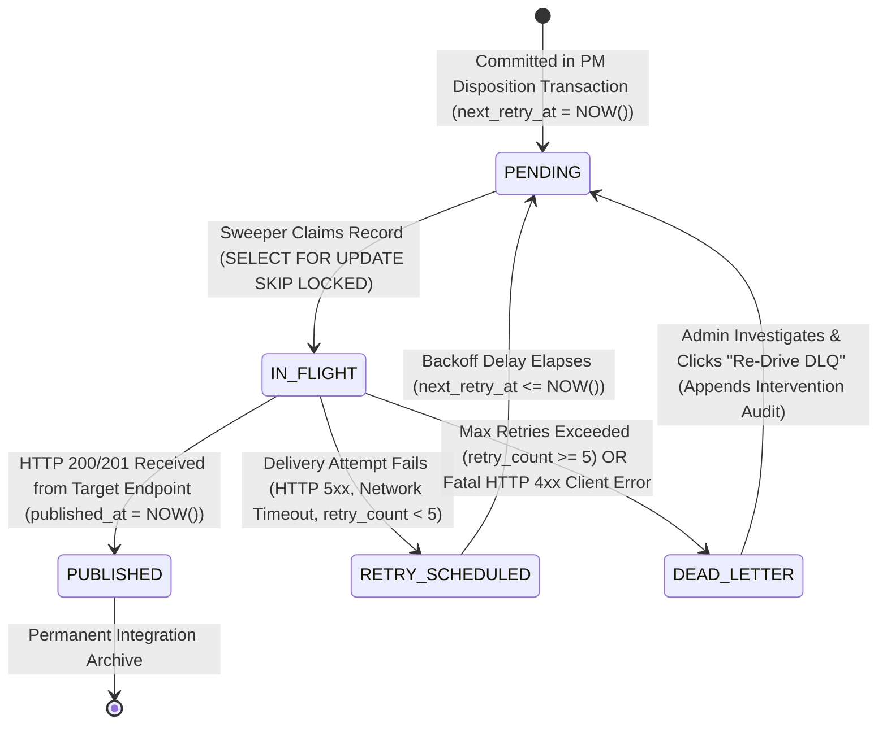

# Part 2.5 – QC and Exception State Machines
## Document 04: Exception Integration Outbox State Machine (RM & ECR Integration)

---

### 1. Enterprise Integration Boundaries & Responsibilities

In accordance with Phase 1 business boundaries (`BR-039, BR-056`), Architecture Decision Record **ADR-02**, and the approved domain data model, Velan Production interfaces with two independent external enterprise applications when quality exceptions occur:

1. **Raw Material System (RM – V-SMART)**
2. **Engineering Change Request System (ECR)**

The operational boundaries and responsibilities remain strictly separated:

```
+----------------------------------------------------------------------------------------------------+
| VELAN PRODUCTION SYSTEM (Modular Monolith)                                                         |
| • Captures operator and QC non-conformance measurements                                            |
| • PM dispositions exception: CONTINUE, RETURN TO EARLIER OP, EXTRA PROCESS, or REJECT & RESTART    |
| • Atomically inserts destination-specific outbox records into outbox_events in local Neon Postgres |
| • Background sweeper independently dispatches events via HTTPS POST with Idempotency Keys          |
| • Boundary Invariant: Production tracks event delivery status; NEVER performs RM inventory         |
|   transactions, vendor DC generation, or ECR defect cost calculations internally                   |
+----------------------------------------------------------------------------------------------------+
       │                                                                      │
       │ [HTTPS POST /api/v1/rm/exceptions]                                  │ [HTTPS POST /api/v1/ecr/intake]
       ▼                                                                      ▼
+--------------------------------------------+         +---------------------------------------------+
| RAW MATERIAL SYSTEM (RM - V-SMART)         |         | ENGINEERING CHANGE REQUEST SYSTEM (ECR)     |
| • Receives material rejection & rework     |         | • Receives scrap & non-conformance tickets  |
|   notifications                            |         | • Assigns engineering responsibility        |
| • Updates raw material heat-code ledgers   |           (machining defect vs. material porosity)    |
| • Stages and issues replacement raw stock  |         | • Calculates scrap costing and vendor debit |
| • Boundary Invariant: RM continues to own  |           chargebacks                                 |
|   all material and inventory transactions; |         | • Boundary Invariant: ECR costing results   |
|   Production does NOT perform inventory tx |           DO NOT return to Velan Production           |
+--------------------------------------------+         +---------------------------------------------+
```

#### Non-Negotiable Boundary Rules
1. **Velan Production Responsibilities:**
   * Owns piece-level tracking, operation progress, operator and QC measurements, PM dispositions, and spawning physical replacement pieces.
   * Tracks whether the required exception notifications have been queued and successfully delivered to external endpoints.
   * **Strict Exclusion:** Velan Production **never** performs RM inventory movements, stock adjustments, or Delivery Challan (DC) creation, and **never** calculates scrap financial costing or vendor chargebacks.
2. **Raw Material System (RM) Responsibilities:**
   * Receives material rejection notices (upon `REJECT_AND_RESTART`), rework advisories (upon `RETURN_TO_EARLIER_OPERATION`), and additional process notices (upon `EXTRA_PROCESS`).
   * Continues to own material stock, raw material heat-code allocation, and issuance of replacement raw stock for scrapped components.
3. **Engineering Change Request (ECR) Responsibilities:**
   * Receives defect tickets and engineering non-conformance data.
   * Investigates failure root causes, determines vendor vs. operator liability, and calculates scrap financial costing.
4. **Zero Distributed Message Brokers:**
   * In strict adherence to approved architectural constraints, **no external message brokers (no RabbitMQ, Kafka, or Redis)** are introduced.
   * All asynchronous communication is reliably governed using the **Transactional Outbox Pattern** hosted on Neon PostgreSQL (`ADR-02`).

---

### 2. Multi-Destination Transactional Outbox Pattern Architecture (ADR-02)

#### 2.1 The Dual-Write Hazard and Atomic Outbox Solution
Directly calling external HTTP APIs within a shop-floor PM disposition transaction creates a dual-write hazard: an external network timeout or service interruption could roll back a valid shop-floor decision or cause lost defect notifications.

To solve this, the **Transactional Outbox Pattern** guarantees delivery without coupling:
1. **Atomic Local Commit:** When the PM confirms a disposition, the business state mutations (piece status change, replacement piece creation, `qc_exceptions` resolution) and the corresponding notification rows in `outbox_events` are committed **within the exact same PostgreSQL ACID transaction**.
2. **Dedicated Destination Records:** If an exception requires notifying both RM and ECR (such as a scrap disposition), two distinct records are inserted:
   - One row with `destination_system = 'RM'`
   - One row with `destination_system = 'ECR'`
   Each record possesses its own unique UUID primary key, idempotency key, retry counter, scheduled execution timestamp, and transmission payload.
3. **Independent Delivery Loops:** A failure in ECR’s API does not block or delay delivery of material rejection notices to RM, and vice versa.

---

### 3. Outbox Event State Machine Topology

The lifecycle of an individual outbox record (`outbox_events.status`) explicitly distinguishes transient delivery failures from permanently terminal conditions:



#### 3.1 Step-by-Step Delivery and Retry Lifecycle

1. **Committed (`PENDING`):**
   * The event is written to `outbox_events` with `status = 'PENDING'`, `retry_count = 0`, and `next_retry_at = NOW()`.
   * It is immediately eligible for pickup by the background sweeper worker.
2. **Transmission in Progress (`IN_FLIGHT`):**
   * The background sweeper claims the record using non-blocking row locks (`SELECT ... FOR UPDATE SKIP LOCKED`).
   * The worker updates `status = 'IN_FLIGHT'` and stamps `attempt_started_at = NOW()`.
   * The worker issues an HTTPS POST request containing standard idempotency headers to the target system (RM or ECR).
3. **Successful Delivery (`PUBLISHED`):**
   * The destination endpoint returns an HTTP 2xx response (e.g., `200 OK` or `201 Created`).
   * The worker records the destination ticket/acknowledgment reference and sets `status = 'PUBLISHED'`, `published_at = NOW()`.
   * *Terminal Success:* This record is permanently archived for audit and integration verification.
4. **Transient Failure & Backoff Scheduling (`RETRY_SCHEDULED`):**
   * If delivery fails due to a network timeout, connection reset, or transient server error (`HTTP 500, 502, 503, 504`) AND `retry_count < 5`:
     - The worker increments `retry_count = retry_count + 1`.
     - The worker logs the error response in `outbox_event_attempts`.
     - The worker computes the exponential backoff delay with random jitter and updates:
       `status = 'RETRY_SCHEDULED'`, `next_retry_at = NOW() + delay`.
   * **Key Design Invariant:** `RETRY_SCHEDULED` is **not terminal**. The record remains in the database awaiting its scheduled retry window.
5. **Re-Attempt (`PENDING`):**
   * Once the backoff delay elapses (`next_retry_at <= NOW()`), the background sweeper query automatically re-selects the record (either directly querying `WHERE status IN ('PENDING', 'RETRY_SCHEDULED') AND next_retry_at <= NOW()`, or a periodic scheduler resets `RETRY_SCHEDULED` to `PENDING`).
   * The event returns to `IN_FLIGHT` for another HTTPS transmission attempt using the exact same original `Idempotency-Key`.
6. **Exhaustion & Escalation (`DEAD_LETTER`):**
   * If the event fails five consecutive attempts (`retry_count >= 5`), OR if the destination returns an unrecoverable non-retryable client error (`HTTP 400 Bad Request, 401 Unauthorized, 422 Unprocessable Entity`):
     - The record transitions to `status = 'DEAD_LETTER'`.
     - A high-priority system administrator alert is dispatched to the monitoring dashboard.
     - *Terminal Quarantine:* The event is isolated to prevent infinite loops and head-of-line blocking on the sweeper queue.
7. **Administrative Re-Drive:**
   * A system administrator reviews the quarantined event, diagnoses the network or endpoint issue, and triggers "Re-Drive DLQ".
   * **Audit Preservation Invariant:** The re-drive action appends an administrative intervention record to the audit trail (recording admin ID, timestamp, and rationale) rather than silently erasing historical attempt logs.
   * The record transitions back to `PENDING` with `next_retry_at = NOW()`.

---

#### 3.2 State Catalogue for `outbox_events`

| State Code | Meaning & Operational Context | Entry Conditions | Exit Conditions |
| :--- | :--- | :--- | :--- |
| `PENDING` | Event is committed in Postgres and ready for sweeper pickup (`next_retry_at <= NOW()`). | Inserted during PM disposition transaction; OR backoff delay elapsed from `RETRY_SCHEDULED`; OR re-driven from `DEAD_LETTER`. | Background sweeper thread claims the record via `SELECT ... FOR UPDATE SKIP LOCKED`. |
| `IN_FLIGHT` | Worker thread has claimed the event and is actively executing the HTTPS POST request to the destination API (RM or ECR) with an idempotency key. | Sweeper worker updates record: `status = 'IN_FLIGHT'`, `attempt_started_at = NOW()`. | Destination endpoint responds with HTTP success (2xx) OR delivery attempt fails. |
| `PUBLISHED` | Successfully delivered to destination endpoint and acknowledged. Response reference or ticket ID stored. | Destination responds with HTTP 200/201. `published_at = NOW()`. | *Terminal.* Retained as an immutable integration audit record. |
| `RETRY_SCHEDULED` | Delivery attempt failed due to transient network error, HTTP 503, or gateway timeout (`retry_count < 5`). Event is scheduled for another retry with exponential backoff + jitter. | HTTP transmission fails or returns 5xx error while `retry_count < 5`. Worker increments `retry_count` and calculates `next_retry_at`. | Backoff timer elapses (`next_retry_at <= NOW()`), transitioning event back to `PENDING` for another attempt. |
| `DEAD_LETTER` | Event has failed 5 consecutive attempts (or received a fatal 4xx non-retryable client error). Quarantined to prevent head-of-line blocking; raises High-Priority Admin Alert. | `retry_count >= 5` with repeated non-2xx failures, or unrecoverable client error. | System Admin investigates connectivity/endpoint, logs resolution note, and triggers "Re-Drive DLQ" (transitions to `PENDING` without overwriting historical attempt log). |

---

### 4. Sweeper Mechanics, Idempotency, and Backoff Schedule

#### 4.1 Non-Blocking Sweeper Query (`SELECT FOR UPDATE SKIP LOCKED`)
The outbox processor runs as a Spring Boot `@Scheduled` worker every 5 seconds. To support multi-instance deployment on Render without concurrency conflicts:
```sql
SELECT id, destination_system, event_type, payload_json, retry_count
FROM outbox_events
WHERE status IN ('PENDING', 'RETRY_SCHEDULED')
  AND next_retry_at <= NOW()
ORDER BY created_at ASC
LIMIT 50
FOR UPDATE SKIP LOCKED;
```
* **Thread Contention Protection:** `SKIP LOCKED` instructs Postgres to skip any rows currently locked by another worker thread or instance, providing lock-free parallel processing.

#### 4.2 HTTP Idempotency Key Architecture
To eliminate duplicate processing in RM or duplicate defect ticket generation in ECR during network timeouts:
1. Every outbox event has an immutable primary key `id` (`UUID PK`).
2. When transmitting the HTTPS payload, the HTTP client attaches standard idempotency headers:
   - `Idempotency-Key: {outbox_events.id}`
   - `X-Correlation-ID: {outbox_events.id}`
3. If an HTTP response drops after the target system processed the record, the subsequent retry transmits the exact same `Idempotency-Key`.
4. The target system recognizes the duplicate key, returns its existing reference without reprocessing, and the local event transitions cleanly to `PUBLISHED`.

#### 4.3 Exponential Backoff Schedule
When a transmission attempt fails, the retry interval increases exponentially with jitter:

$$\text{Retry Delay} = \text{Base Delay} \times 2^{\text{retry\_count}} + \text{Jitter}$$

| Attempt # | Delay Multiplier | Scheduled Wait Time | Next Action on Failure |
| :---: | :---: | :---: | :--- |
| **1** | $2^1$ | 10 seconds | Transition to `RETRY_SCHEDULED` (`next_retry_at = NOW() + 10s`) |
| **2** | $2^2$ | 30 seconds | Transition to `RETRY_SCHEDULED` (`next_retry_at = NOW() + 30s`) |
| **3** | $2^3$ | 2 minutes | Transition to `RETRY_SCHEDULED` (`next_retry_at = NOW() + 2m`) |
| **4** | $2^4$ | 10 minutes | Transition to `RETRY_SCHEDULED` (`next_retry_at = NOW() + 10m`) |
| **5** | $2^5$ | 30 minutes | Transition to `RETRY_SCHEDULED` (`next_retry_at = NOW() + 30m`) |
| **Failure > 5** | N/A | Aborted | Transition to **`DEAD_LETTER`**; notify System Administrator |

---

### 5. Outbox Event Payloads (RM and ECR Schemas)

#### 5.1 RM Material Rejection Payload Schema (`destination_system = 'RM'`)
Transmitted to RM (V-SMART) when PM confirms `REJECT_AND_RESTART`. Notifies RM of scrapped piece so RM can update material ledgers and stage replacement raw material:
```json
{
  "eventId": "a1b2c3d4-e5f6-7a8b-9c0d-1e2f3a4b5c6d",
  "destinationSystem": "RM",
  "eventType": "MATERIAL_REJECTION_NOTICE",
  "occurredAt": "2026-11-24T12:30:00Z",
  "sourceSystem": "VELAN_PRODUCTION",
  "subcontractNumber": "SC002",
  "productCode": "V-600-GATE-CS",
  "scrappedPieceSerial": "SC002-1 SPG-1",
  "assembledSetIdentifier": "SET-SC002-01",
  "componentType": "SPG",
  "rawMaterialHeatNumber": "HT-88492-CS",
  "materialGrade": "A216-WCB",
  "rejectionReason": "Casting porosity exposed during CNC turning; wall thickness below allowable minimum.",
  "replacementRequired": true,
  "replacementPieceSerial": "SC002-1 SPG-1-R1",
  "pmDisposition": {
    "pmUserId": "usr-pm-004",
    "pmName": "Rajesh Kumar",
    "decision": "REJECT_AND_RESTART",
    "decidedAt": "2026-11-24T12:28:45Z"
  }
}
```

#### 5.2 ECR Scrap Exception Payload Schema (`destination_system = 'ECR'`)
Transmitted to ECR for engineering evaluation and scrap financial costing:
```json
{
  "eventId": "b3f2e1a4-7c9d-4e8f-9a1b-2c3d4e5f6a7b",
  "destinationSystem": "ECR",
  "eventType": "SCRAP_EXCEPTION",
  "occurredAt": "2026-11-24T12:30:00Z",
  "sourceSystem": "VELAN_PRODUCTION",
  "subcontractNumber": "SC002",
  "productCode": "V-600-GATE-CS",
  "parentPieceSerial": "SC002-1 SPG-1",
  "replacementPieceSerial": "SC002-1 SPG-1-R1",
  "assembledSetIdentifier": "SET-SC002-01",
  "failedOperationSequence": 20,
  "failedOperationName": "CNC Turning",
  "failureDetails": {
    "parameterName": "Outer Diameter",
    "nominalValue": 50.00,
    "upperLimit": 50.10,
    "lowerLimit": 49.90,
    "measuredOperatorValue": 50.15,
    "measuredQCValue": 50.18,
    "instrumentId": "VERNIER-DIGI-012"
  },
  "pmDisposition": {
    "pmUserId": "usr-pm-004",
    "pmName": "Rajesh Kumar",
    "decision": "REJECT_AND_RESTART",
    "justification": "Casting porosity exposed during turning; wall thickness below minimum critical specification.",
    "decidedAt": "2026-11-24T12:28:45Z"
  }
}
```

#### 5.3 RM Rework & Extra Process Advisory Payload Schema (`destination_system = 'RM'`)
Transmitted to RM when PM confirms `RETURN_TO_EARLIER_OPERATION` or `EXTRA_PROCESS`:
```json
{
  "eventId": "e9f8a7b6-c5d4-3e2f-1a0b-9c8d7e6f5a4b",
  "destinationSystem": "RM",
  "eventType": "REWORK_ADVISORY",
  "occurredAt": "2026-11-24T14:15:00Z",
  "sourceSystem": "VELAN_PRODUCTION",
  "subcontractNumber": "SC002",
  "pieceSerial": "SC002-1 VBM",
  "assembledSetIdentifier": "SET-SC002-01",
  "componentType": "VBM",
  "rawMaterialHeatNumber": "HT-99201-SS",
  "dispositionDecision": "RETURN_TO_EARLIER_OPERATION",
  "targetOperationSequence": 20,
  "reworkIteration": 2,
  "advisoryNotes": "Component undergoing skim-cut rework to remove tool chatter marks. Material retains nominal structural dimensions."
}
```

#### 5.4 ECR Rework Notice Payload Schema (`destination_system = 'ECR'`)
Transmitted to ECR for engineering tracking when rework parameter thresholds require engineering review:
```json
{
  "eventId": "c8a1b2c3-4d5e-6f7a-8b9c-0d1e2f3a4b5c",
  "destinationSystem": "ECR",
  "eventType": "REWORK_NOTICE",
  "occurredAt": "2026-11-24T14:15:00Z",
  "sourceSystem": "VELAN_PRODUCTION",
  "subcontractNumber": "SC002",
  "pieceSerial": "SC002-1 VBM",
  "failedOperationSequence": 30,
  "failedOperationName": "Flange Facing",
  "reworkType": "RETURN_TO_EARLIER_OPERATION",
  "targetOperationSequence": 20,
  "reworkIteration": 2,
  "justification": "Skim cut required on flange face to remove tool chatter marks."
}
```
