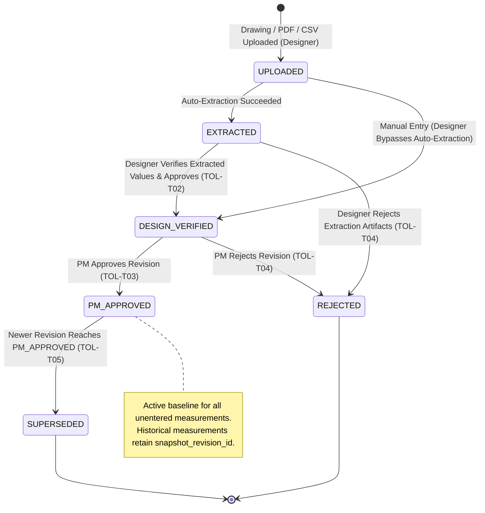
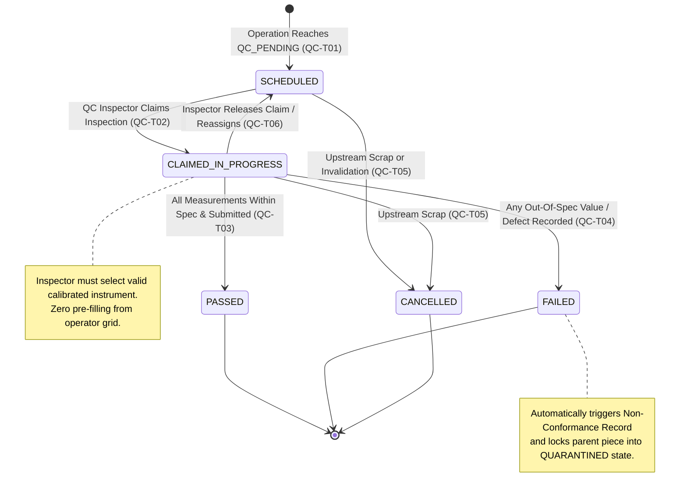
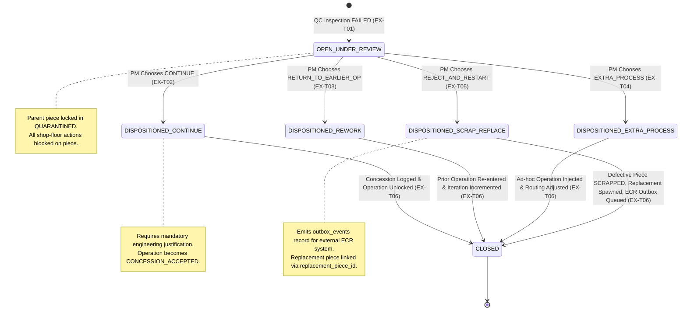
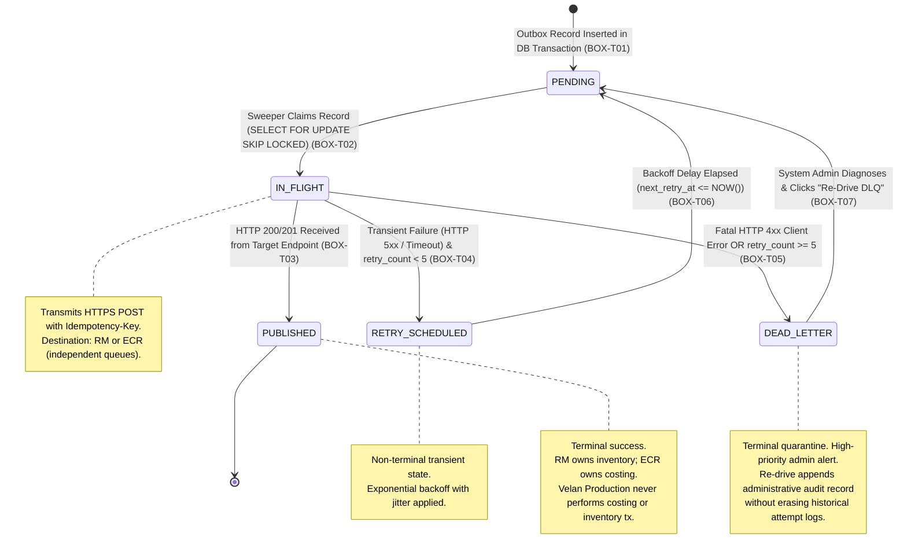
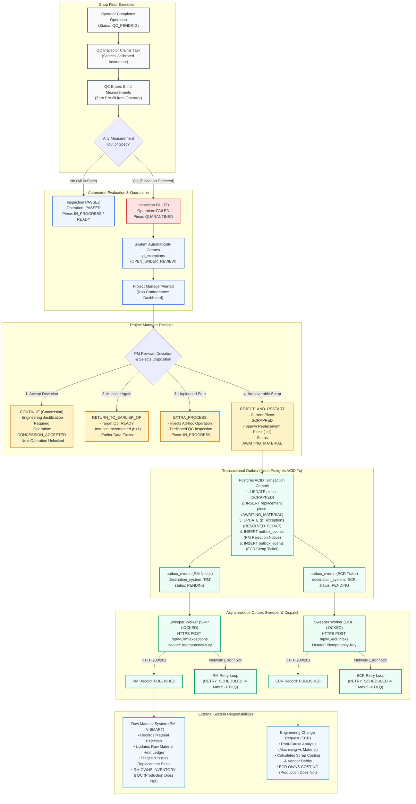
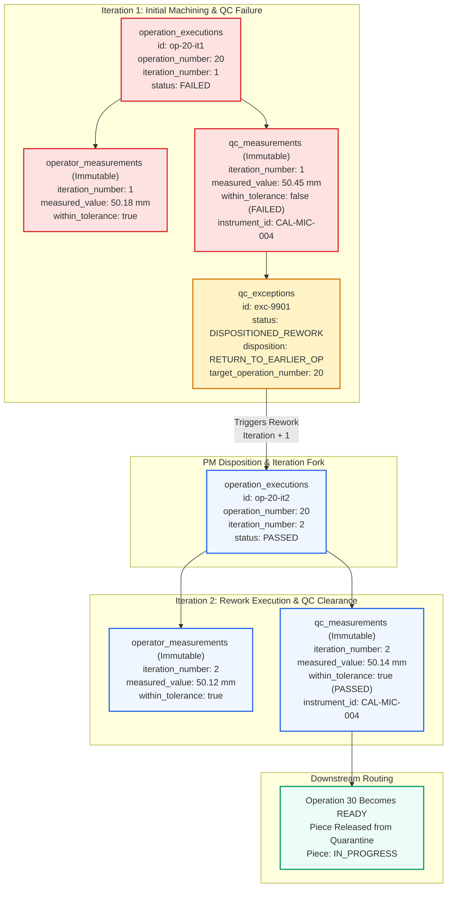

# Part 2.5 – QC and Exception State Machines: Diagrams & Traceability

## 1. Overview and Purpose

This document provides the visual state transition models, architectural flowcharts, Phase 1 business rule traceability matrices, and the open questions register for **Part 2.5 – QC and Exception State Machines**.

The state models and interaction diagrams formalize the behavior specified across:
* [01-qc-and-exception-overview-and-states.md](file:///c:/Users/Admin/OneDrive/Desktop/velan%20production/velan-production/docs/phase-2/2.5-qc-and-exception-state-machines/01-qc-and-exception-overview-and-states.md)
* [02-qc-inspection-state-machine-and-tolerances.md](file:///c:/Users/Admin/OneDrive/Desktop/velan%20production/velan-production/docs/phase-2/2.5-qc-and-exception-state-machines/02-qc-inspection-state-machine-and-tolerances.md)
* [03-exception-lifecycle-and-pm-dispositions.md](file:///c:/Users/Admin/OneDrive/Desktop/velan%20production/velan-production/docs/phase-2/2.5-qc-and-exception-state-machines/03-exception-lifecycle-and-pm-dispositions.md)
* [04-ecr-outbox-integration-state-machine.md](file:///c:/Users/Admin/OneDrive/Desktop/velan%20production/velan-production/docs/phase-2/2.5-qc-and-exception-state-machines/04-ecr-outbox-integration-state-machine.md)

---

## 2. Complete State Machine & Flow Diagrams

### Diagram 1: Tolerance Revision Lifecycle (`stateDiagram-v2`)

Formalizes the creation, verification, approval, rejection, and superseding of engineering tolerance parameter revisions (`BR-027, BR-028, BR-029`).

---

### Diagram 2: QC Inspection State Machine (`stateDiagram-v2`)

Governs the independent Quality Control verification lifecycle for each manufacturing operation iteration (`BR-030, BR-031, BR-032, BR-033`).

---

### Diagram 3: QC Exception Management & PM Disposition State Machine (`stateDiagram-v2`)

Models non-conformance lifecycle, quarantine enforcement, and the four Project Manager resolution pathways (`BR-034, BR-035, BR-036, BR-037, BR-038`).

---

### Diagram 4: Exception Integration Outbox State Machine (RM & ECR) (`stateDiagram-v2`)

Governs the reliable asynchronous dispatch of non-conformance, rework, and scrap rejection records to external enterprise systems (**Raw Material - RM** and **Engineering Change Request - ECR**) (`ADR-02, BR-039, BR-056`).

---

### Diagram 5: End-to-End QC Failure to RM & ECR Integration Flowchart (`flowchart TD`)

Illustrates the end-to-end execution sequence from shop-floor measurement rejection through PM disposition, transactional outbox dispatch, and external delivery to both RM and ECR.

---

### Diagram 6: Rework Iteration vs Measurement Immutability Data Model Flow (`flowchart TD`)

Demonstrates how multiple machining iterations maintain strictly immutable measurement histories without row overwrites (`BR-029, BR-034, BR-036`).

---

## 3. Phase 1 Business Rules Traceability Matrix

This matrix maps every Quality Control, Tolerance, Exception, and Integration business rule from Phase 1 (`08_Business_Rules.md`, `02_SRS.md`, `09_Integration_Specification.md`) to the state models, entities, and transitions designed in Part 2.5.

| Business Rule ID | Phase 1 Rule Statement Summary | Part 2.5 Design Mapping & Implementation Entity | Covered In Document & Section |
| :--- | :--- | :--- | :--- |
| **BR-023** | Mandatory Operator measurement before operation completion. Operator must record all parameters before completing an operation. | `operator_measurements` table; `OP-T04` guard requiring count of entered parameters equals active tolerance parameter count. | [02-qc-inspection-state-machine-and-tolerances.md](file:///c:/Users/Admin/OneDrive/Desktop/velan%20production/velan-production/docs/phase-2/2.5-qc-and-exception-state-machines/02-qc-inspection-state-machine-and-tolerances.md) §3.1 |
| **BR-024** | Real-time tolerance validation on entry. System must validate entered values against lower/upper limits and display immediate PASS/FAIL feedback. | `ToleranceEngine.evaluate(value, param)` with static limits (`min_value`, `max_value`) and dynamic formula evaluation. | [02-qc-inspection-state-machine-and-tolerances.md](file:///c:/Users/Admin/OneDrive/Desktop/velan%20production/velan-production/docs/phase-2/2.5-qc-and-exception-state-machines/02-qc-inspection-state-machine-and-tolerances.md) §2.3 |
| **BR-025** | Tolerance values must be configurable per product, operation, and dimension parameter. | `operation_tolerance_parameters` linked to `operation_routing_templates` and scoped by `tolerance_revisions`. | [02-qc-inspection-state-machine-and-tolerances.md](file:///c:/Users/Admin/OneDrive/Desktop/velan%20production/velan-production/docs/phase-2/2.5-qc-and-exception-state-machines/02-qc-inspection-state-machine-and-tolerances.md) §2.1 |
| **BR-026** | Operator cannot complete operation if any required measurement is missing or out-of-spec without explicit override/exception. | `OP-T04` guard fails if `has_out_of_spec_operator_reading = true`. Forces operator to adjust or abort to PM. | [02-qc-inspection-state-machine-and-tolerances.md](file:///c:/Users/Admin/OneDrive/Desktop/velan%20production/velan-production/docs/phase-2/2.5-qc-and-exception-state-machines/02-qc-inspection-state-machine-and-tolerances.md) §3.1 |
| **BR-027** | Tolerance revisions require Designer verification and PM approval before activation. | `tolerance_revisions` lifecycle: `UPLOADED` $\rightarrow$ `EXTRACTED` $\rightarrow$ `DESIGN_VERIFIED` $\rightarrow$ `PM_APPROVED`. | [02-qc-inspection-state-machine-and-tolerances.md](file:///c:/Users/Admin/OneDrive/Desktop/velan%20production/velan-production/docs/phase-2/2.5-qc-and-exception-state-machines/02-qc-inspection-state-machine-and-tolerances.md) §2.2 |
| **BR-028** | Active tolerance revision changes apply only to future/unentered operations. Completed measurements retain historical revision. | Historical measurement records store `snapshot_revision_id` and frozen parameter snapshot values. Unentered operations link to active approved revision. | [02-qc-inspection-state-machine-and-tolerances.md](file:///c:/Users/Admin/OneDrive/Desktop/velan%20production/velan-production/docs/phase-2/2.5-qc-and-exception-state-machines/02-qc-inspection-state-machine-and-tolerances.md) §2.2 |
| **BR-029** | Measurement data is strictly immutable once submitted. No updates or deletes permitted. | PostgreSQL rule/trigger blocking `UPDATE` and `DELETE` on `operator_measurements` and `qc_measurements`. Rework tracked via `iteration_number`. | [02-qc-inspection-state-machine-and-tolerances.md](file:///c:/Users/Admin/OneDrive/Desktop/velan%20production/velan-production/docs/phase-2/2.5-qc-and-exception-state-machines/02-qc-inspection-state-machine-and-tolerances.md) §3.4 |
| **BR-030** | Independent QC measurement requirement. QC must record their own measurement values independently from the operator. | `qc_measurements` stored separately from `operator_measurements`. Independent timestamp, user ID, and instrument tracking. | [02-qc-inspection-state-machine-and-tolerances.md](file:///c:/Users/Admin/OneDrive/Desktop/velan%20production/velan-production/docs/phase-2/2.5-qc-and-exception-state-machines/02-qc-inspection-state-machine-and-tolerances.md) §3.2 |
| **BR-031** | Blind QC data entry. Operator measurements must not be pre-filled or visible in QC input fields. | UI rendering specification: QC data entry form displays empty numeric fields. API returns empty measurement template. | [02-qc-inspection-state-machine-and-tolerances.md](file:///c:/Users/Admin/OneDrive/Desktop/velan%20production/velan-production/docs/phase-2/2.5-qc-and-exception-state-machines/02-qc-inspection-state-machine-and-tolerances.md) §3.2 |
| **BR-032** | Calibrated instrument tracking. QC measurements must record the instrument ID and verify instrument calibration validity. | `qc_inspections.calibrated_instrument_id`; Guard `calibration_valid_until >= NOW()` enforced before inspection claim and submission. | [02-qc-inspection-state-machine-and-tolerances.md](file:///c:/Users/Admin/OneDrive/Desktop/velan%20production/velan-production/docs/phase-2/2.5-qc-and-exception-state-machines/02-qc-inspection-state-machine-and-tolerances.md) §3.3 |
| **BR-033** | Automatic QC Pass/Fail determination based on entered values against active tolerance limits. | Automatic verdict computation: if `count(within_tolerance = false) == 0` $\rightarrow$ `PASSED`; else $\rightarrow$ `FAILED`. No manual override by QC. | [02-qc-inspection-state-machine-and-tolerances.md](file:///c:/Users/Admin/OneDrive/Desktop/velan%20production/velan-production/docs/phase-2/2.5-qc-and-exception-state-machines/02-qc-inspection-state-machine-and-tolerances.md) §3.2 |
| **BR-034** | QC failure triggers quarantine. Piece is locked in quarantine and cannot proceed until PM decision. | `QC-T04` side-effect: `pieces.status = QUARANTINED`; `qc_exceptions` created in `OPEN_UNDER_REVIEW`. Blocks all downstream routing. | [03-exception-lifecycle-and-pm-dispositions.md](file:///c:/Users/Admin/OneDrive/Desktop/velan%20production/velan-production/docs/phase-2/2.5-qc-and-exception-state-machines/03-exception-lifecycle-and-pm-dispositions.md) §2 |
| **BR-035** | Four PM disposition options: Continue (Concession), Return to earlier op (Rework), Extra process, Reject & Restart (Scrap). | `qc_exceptions.disposition` enum with exact 4 options; transitions `EX-T02`, `EX-T03`, `EX-T04`, `EX-T05`. | [03-exception-lifecycle-and-pm-dispositions.md](file:///c:/Users/Admin/OneDrive/Desktop/velan%20production/velan-production/docs/phase-2/2.5-qc-and-exception-state-machines/03-exception-lifecycle-and-pm-dispositions.md) §3 |
| **BR-036** | Concession disposition requires mandatory justification and does not overwrite QC failure record. | `EX-T02` guard checks `engineering_justification IS NOT NULL`; QC inspection remains `FAILED`; operation state becomes `CONCESSION_ACCEPTED`. | [03-exception-lifecycle-and-pm-dispositions.md](file:///c:/Users/Admin/OneDrive/Desktop/velan%20production/velan-production/docs/phase-2/2.5-qc-and-exception-state-machines/03-exception-lifecycle-and-pm-dispositions.md) §3.1 |
| **BR-037** | Rework disposition increments iteration counter and reopens target operation. | `EX-T03` creates new `operation_executions` row with `iteration_number = n + 1` and `status = READY`. Piece returns to `IN_PROGRESS`. | [03-exception-lifecycle-and-pm-dispositions.md](file:///c:/Users/Admin/OneDrive/Desktop/velan%20production/velan-production/docs/phase-2/2.5-qc-and-exception-state-machines/03-exception-lifecycle-and-pm-dispositions.md) §3.2 |
| **BR-038** | Extra process disposition injects ad-hoc operation into routing with dedicated QC inspection. | `EX-T04` inserts ad-hoc `operation_executions` with `is_extra_operation = true`, assigns sequential display order, and creates QC inspection requirement. | [03-exception-lifecycle-and-pm-dispositions.md](file:///c:/Users/Admin/OneDrive/Desktop/velan%20production/velan-production/docs/phase-2/2.5-qc-and-exception-state-machines/03-exception-lifecycle-and-pm-dispositions.md) §3.3 |
| **BR-039** | Scrap disposition marks piece SCRAPPED, spawns replacement piece, and queues dual outbox notifications to RM and ECR. | `EX-T05` marks piece `SCRAPPED`, inserts replacement piece linked by `replacement_piece_id`, and inserts two dedicated `outbox_events` rows: one for RM (`MATERIAL_REJECTION_NOTICE`) and one for ECR (`SCRAP_EXCEPTION`). | [03-exception-lifecycle-and-pm-dispositions.md](file:///c:/Users/Admin/OneDrive/Desktop/velan%20production/velan-production/docs/phase-2/2.5-qc-and-exception-state-machines/03-exception-lifecycle-and-pm-dispositions.md) §3.4, [04-ecr-outbox-integration-state-machine.md](file:///c:/Users/Admin/OneDrive/Desktop/velan%20production/velan-production/docs/phase-2/2.5-qc-and-exception-state-machines/04-ecr-outbox-integration-state-machine.md) §1 |
| **BR-054** | Full audit trail for all measurements, inspections, exceptions, and dispositions. | Immutable tables `operator_measurements`, `qc_measurements`, `qc_inspections`, `qc_exceptions`, and `audit_log` with user, timestamp, and payload snapshots. | [02-qc-inspection-state-machine-and-tolerances.md](file:///c:/Users/Admin/OneDrive/Desktop/velan%20production/velan-production/docs/phase-2/2.5-qc-and-exception-state-machines/02-qc-inspection-state-machine-and-tolerances.md) §3.4 |
| **BR-056** | Multi-destination transactional outbox for external RM and ECR integration without distributed message brokers. | ADR-02 implementation: `outbox_events` table polled via `SELECT FOR UPDATE SKIP LOCKED`, exponential backoff retry, and independent HTTPS POST delivery to RM and ECR endpoints. | [04-ecr-outbox-integration-state-machine.md](file:///c:/Users/Admin/OneDrive/Desktop/velan%20production/velan-production/docs/phase-2/2.5-qc-and-exception-state-machines/04-ecr-outbox-integration-state-machine.md) §2 |

---

## 4. Open Questions and Clarifications Register

The following items are identified during Part 2.5 design and documented for business confirmation during subsequent implementation phases:

### Question 1: Automated Drawing Extraction Reliability & Manual Fallback Threshold
* **Context:** The tolerance revision lifecycle supports automated extraction of dimensional tolerances from engineering drawings (`PDF`/`CSV`) uploaded by the Designer.
* **Question:** What is the business protocol when the automated OCR/drawing parser has partial confidence or fails to extract certain dimensions?
* **Design Assumption:** The extraction pipeline flags extracted fields as `EXTRACTED`. The Designer must manually inspect and verify 100% of the extracted values in the UI before transitioning the revision to `DESIGN_VERIFIED`. If automated extraction fails completely, the Designer can manually enter all parameters from scratch.
* **Action:** To be confirmed with engineering design leads in Phase 3.

### Question 2: Calibrated Instrument Expiration During Active Inspection
* **Context:** A QC inspection requires a valid calibrated instrument (`calibration_valid_until >= NOW()`).
* **Question:** If an instrument passes calibration validation when claimed (`CLAIMED_IN_PROGRESS`), but expires at midnight during a multi-hour or overnight inspection shift, should submission be blocked?
* **Design Assumption:** The calibration validity is re-validated at final inspection submission (`QC-T03` and `QC-T04`). If expired at submission, the system blocks completion and instructs the QC inspector to either select a freshly calibrated instrument or obtain a calibration extension.
* **Action:** Review with Quality Assurance manager during shop-floor acceptance testing.

### Question 3: Real-Time Notification Delivery Channel for PM Quarantine Alerts
* **Context:** When a QC inspection fails, a non-conformance record is generated and the piece is quarantined. The PM must be notified immediately (`BR-034`).
* **Question:** Which notification channels are required beyond the in-app Project Manager exception dashboard (e.g., Email, SMS, WhatsApp, Webhooks)?
* **Design Assumption:** The core Modular Monolith publishes an internal Spring ApplicationEvent `QcInspectionFailedEvent`. The primary notification is the real-time in-app dashboard badge and priority alert queue. Outbound email notification is an optional plugin listener.
* **Action:** Confirm notification channel requirements with business stakeholders prior to Phase 4 (PM Exception Management UI).

### Question 4: Maximum Retry Limit & Escalation for Dead-Letter Outbox Events (RM & ECR)
* **Context:** If an external endpoint (RM or ECR) is unreachable or repeatedly fails with 5xx/timeout errors, records transition to `RETRY_SCHEDULED` and attempt re-delivery up to 5 times before transitioning to `DEAD_LETTER`.
* **Question:** What is the business SLA and escalation procedure for dead-letter records, and how is manual administrative intervention audited?
* **Design Assumption:** 
  1. Dead-letter events raise a high-priority system administrator alert in the monitoring console.
  2. Shop-floor operations and physical piece replacement proceed without blocking; external synchronization status is visually flagged.
  3. When an administrator resolves the root cause and triggers "Re-Drive DLQ", the system appends an administrative intervention record to the audit trail (recording admin ID, timestamp, and diagnosis notes) rather than silently erasing historical attempt logs.
* **Action:** Validate SLA with IT infrastructure team during Phase 2.7 (Integration Architecture).
