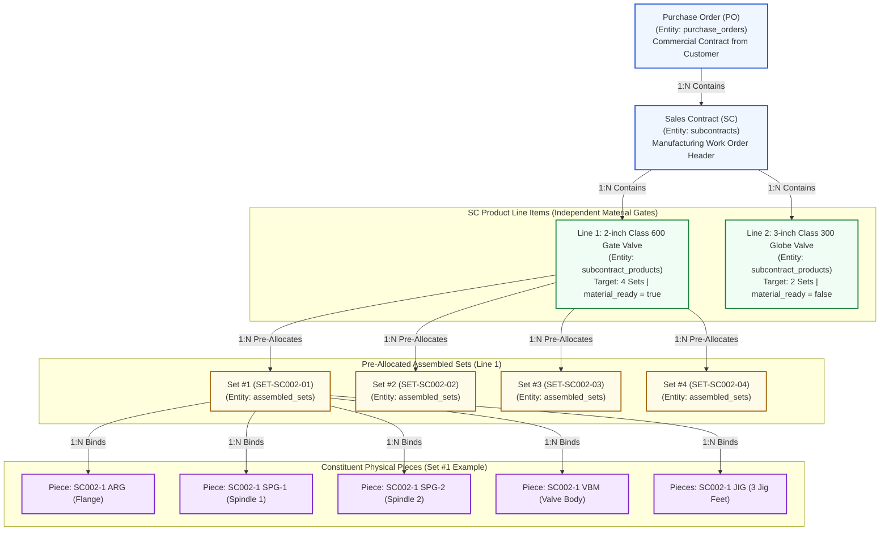

# Part 2.6 – SC and Completion State Machine
## Document 01: SC Lifecycle Overview, Intake Channels, and State Catalogue

---

### 1. Executive Summary & Objective

In the Velan Production platform, the **Sales Contract (SC)**—modeled in the database as `subcontracts`—serves as the primary commercial and manufacturing work order header. It governs the production demand received from the Raw Material (RM) system (V-SMART) or initiated directly on the shop floor. 

An SC does not represent an undifferentiated batch of bulk parts; rather, it structures work across a rigorous, multi-tier hierarchy:
$$\text{Customer Purchase Order (PO)} \longrightarrow \text{Sales Contract (SC)} \longrightarrow \text{SC Product Line Items} \longrightarrow \text{Assembled Sets} \longrightarrow \text{Physical Pieces} \longrightarrow \text{Routing Operations}$$

The primary objective of **Part 2.6 – SC and Completion State Machine** is to specify the complete, deterministic lifecycle models that govern how an SC:
1. Originates through manual entry, Excel bulk import, or automated RM synchronization.
2. Structures demand into independent product line items, configurable Bill of Materials (BOM) components, and pre-allocated sets.
3. Gates execution based on product-level raw material readiness.
4. Aggregates multi-piece and multi-operation manufacturing progress into production completeness.
5. Transitions completed sets through independent quality verification, physical packing verification, and loading dock dispatch.
6. Handles partial completion, contract quantity revisions, cancellations, and terminal delivery.

---

### 2. Domain Hierarchy & Entity Relationships

To eliminate ambiguity across commercial orders, shop-floor execution, and quality certification, the system strictly separates order headers, line items, sets, and physical pieces:



#### Core Structural Invariants:
1. **Multi-Product Line Item Support:** An SC can contain one or multiple product lines (`subcontract_products`). Uniqueness within an SC is enforced by `UNIQUE (sc_id, line_number)`. The same catalog product may appear across multiple distinct lines with differing delivery dates, quantities, or drawing revisions.
2. **Independent Product-Level Material Gate:** Raw material readiness is tracked per product line item (`subcontract_products.material_ready`). In multi-product SCs, material issued for Line 1 unlocks only Line 1's pieces; Line 2 remains strictly locked in `AWAITING_MATERIAL` until RM confirms material issue for Line 2 (`BR-009, BR-010`).
3. **Deterministic Pre-Allocation:** Sets (`assembled_sets`) and individual physical pieces (`pieces`) are instantiated and deterministically bound at the moment of SC activation. There is no unassigned floating component pool.

---

### 3. SC Creation and Intake Channels

The Velan Production platform supports three distinct, fully audited intake mechanisms:

```
+---------------------------------------------------------------------------------------------------+
| THREE SC INTAKE CHANNELS                                                                          |
+------------------------------------+--------------------------------+-----------------------------+
| 1. RM V-SMART API Sync (Automated) | 2. Manual UI Intake (Form)     | 3. Excel Bulk Import (File) |
| - Polled via Read-Only Service Acct| - PM / Admin Direct Entry      | - PM / Admin File Upload    |
| - Trigger: RM Requisition Approved | - Immediate Validation & Save  | - Multi-Row Sheet Parser    |
| - Idempotent Upsert via REST       | - Draft or Immediate Active    | - Atomic Batch Validation   |
+------------------------------------+--------------------------------+-----------------------------+
                                      │
                                      ▼
+---------------------------------------------------------------------------------------------------+
| INTAKE VALIDATION & ENRICHMENT PIPELINE                                                           |
| 1. Verify PO & SC Reference Uniqueness (UNIQUE sc_number)                                         |
| 2. Validate Catalog Product Existence & Approved BOM Lines (bom_lines)                            |
| 3. Validate Drawing Documents & Frozen Routing Snapshots (process_template_snapshots)             |
| 4. Validate Delivery Due Dates & Quantities (> 0)                                                 |
+---------------------------------------------------------------------------------------------------+
                                      │
                                      ▼
+---------------------------------------------------------------------------------------------------+
| INTAKE ACTIVATION & WORK ENTITY GENERATION                                                        |
| - Set Status: subcontracts.status = 'ACTIVE'                                                      |
| - Generate Assembled Sets (assembled_sets: 1 .. target_set_qty per product line)                  |
| - Calculate Demand & Generate Pieces (pieces bound deterministically to assembled_set_id)        |
| - Instantiate Frozen Routing Operations (piece_operations in PENDING status)                      |
| - Evaluate Initial Material Readiness (derive from RM or default to false)                        |
+---------------------------------------------------------------------------------------------------+
```

#### 3.1 Channel 1: Automated RM Requisition Synchronization (V-SMART)
* **Mechanism:** The backend integration connector polls the external Raw Material system (V-SMART) using a dedicated, read-only service account (`ROLE_RM_CONNECTOR`).
* **Trigger Event:** An approved raw material requisition (`REQ-XXXXX`) is detected via RM's `/api/v1/requisitions/approved` endpoint.
* **Payload Ingestion:**
  - Extracts commercial PO number, customer details, SC reference (`sc_number`), product line items, requested quantities, and linked drawing references.
  - Generates or links the parent `purchase_orders` record.
  - Inserts the `subcontracts` header record.
* **Idempotency & Deduplication:** The ingestion pipeline evaluates `subcontracts.sc_number`. If the SC already exists, the sync worker verifies whether changes represent a contract revision (see §3.4) or duplicate delivery, ensuring zero duplicate records.

#### 3.2 Channel 2: Manual SC Creation via Web UI
* **Mechanism:** Authorized users holding `ROLE_PM` or `ROLE_ADMIN` enter contract details directly into the Velan Production frontend.
* **Input Fields:**
  - Customer Name & Commercial PO Number (select existing or create new).
  - Internal SC Number (validated against `UNIQUE` constraint).
  - External RM Requisition Reference (optional at creation, can be linked later).
  - Target Product Selection (from approved `products` catalog).
  - Target Set Quantity (positive integer $> 0$).
  - Contractual Delivery Due Date.
* **Validation Rules:**
  - Selected product must possess an active, approved Bill of Materials (`bom_lines.is_active = true`).
  - Selected product components must have approved process routing templates.
  - If validation succeeds, user may choose **"Save as Draft"** (`status = 'DRAFT_INTAKE'`) or **"Activate Contract"** (`status = 'ACTIVE'`).

#### 3.3 Channel 3: Excel Bulk SC Import
* **Mechanism:** The PM uploads a structured spreadsheet (`.xlsx`) containing multiple contract headers, multi-product line items, and delivery schedules.
* **Workbook Layout & Validation Rules:**
  - **Header Tab (`SC_Master`):** `PO_Number`, `Customer_Name`, `SC_Number`, `Delivery_Due_Date`.
  - **Line Items Tab (`SC_Lines`):** `SC_Number`, `Line_Number`, `Product_Code`, `Target_Set_Qty`.
  - **Atomicity:** The entire workbook is parsed and validated as a single atomic transaction. If any row contains an unmapped product code, negative quantity, duplicate SC number, or missing BOM definition, the entire import is rejected with a granular error log detailing the exact sheet, row, and column of the defect.
  - **Successful Import Outcome:** Creates the PO, SC, and product lines in `DRAFT_INTAKE` or directly activates them based on user import parameters.

#### 3.4 Contract Revisions from RM (V-SMART)
In manufacturing execution, customer amendments or raw material availability frequently alter contract scope:
* **Detection:** The sync worker compares incoming RM requisition parameters against existing database records:
  - Change in target set quantity (`target_set_qty`).
  - Change in delivery due date (`delivery_due_date`).
  - Cancellation of a product line item.
* **Diff-Based Revision Logging (`sc_revisions`):** When a change is detected:
  1. The change is not applied silently.
  2. An immutable record is created in `sc_revisions` capturing `previous_target_qty`, `new_target_qty`, `revision_reason`, and timestamp.
  3. A high-priority notification is dispatched to the PM.
* **Handling Quantity Increases:**
  - If target quantity increases (e.g., from 4 sets to 6 sets), the PM approves the revision.
  - The system instantiates 2 additional `assembled_sets` (Sets #5 and #6) and generates the corresponding physical pieces bound to those sets.
  - Existing in-flight pieces (Sets #1 to #4) are completely undisturbed.
* **Handling Quantity Reductions:**
  - If target quantity decreases (e.g., from 6 sets to 4 sets), the system evaluates the production status of each set.
  - Sets that have not yet started machining (all pieces in `AWAITING_MATERIAL`) are decommissioned.
  - If work has already started on all sets, the PM must review and designate which specific set numbers are cancelled, or complete them as finished spare parts.

---

### 4. Exhaustive SC State Catalogue

The lifecycle of a Sales Contract header (`subcontracts.status`) is governed by seven distinct, mutually exclusive states:

```
[ DRAFT_INTAKE ] ──► [ ACTIVE ] ──► [ IN_PRODUCTION ] ──► [ PRODUCTION_COMPLETE ]
                          │                 │                         │
                          │                 ▼                         │
                          │      [ PARTIALLY_DELIVERED ] ◄────────────┤
                          │                 │                         │
                          │                 ▼                         ▼
                          └─────────► [ DELIVERED ] ◄─────────────────┘
                                            ▲
                                            │
                                      [ CANCELLED ] (Admin Only, from non-terminal states)
```

| State Code | State Name | Category | Detailed Description & Business Meaning |
| :--- | :--- | :--- | :--- |
| `DRAFT_INTAKE` | **Draft Intake** | Transient / Staging | The SC record has been created via manual entry or Excel import but has not yet been formally verified or activated. Sets and physical pieces have not yet been generated. Engineering drawings, BOM lines, and routing templates are being validated. |
| `ACTIVE` | **Active / Production Ready** | Operational Readiness | The SC has been formally activated by the PM (or automatically upon RM sync). Deterministic sets (`assembled_sets`) and physical pieces (`pieces`) are instantiated in the database. Routing operations are populated in `PENDING` status. The SC is awaiting raw material issuance to commence physical machining. |
| `IN_PRODUCTION` | **In Active Production** | Active Execution | Raw material readiness has been confirmed for at least one product line (`material_ready = true`), and shop-floor machining has commenced. At least one physical piece has reached `IN_PRODUCTION`, `COMPLETED`, or rework status. |
| `PRODUCTION_COMPLETE` | **Production Complete** | Manufacturing Terminal | 100% of pre-allocated pieces across 100% of product lines have completed all machining operations and 100% of assembled sets have passed Final QC inspection (`is_final_qc_passed = true`). All sets are staged in the packaging or dispatch area. |
| `PARTIALLY_DELIVERED`| **Partially Delivered** | Logistics Execution | At least one complete set has been confirmed dispatched and delivered at the loading dock (`assembled_sets.status = 'DELIVERED'`), but other complete sets remain in production, packaging, or warehouse staging. |
| `DELIVERED` | **Delivered / Closed** | Commercial Terminal | 100% of ordered sets across all product line items have been confirmed physically dispatched from the loading dock with verified gate pass and vehicle documentation. All operational obligations are fulfilled. |
| `CANCELLED` | **Cancelled** | Administrative Terminal | The Sales Contract has been formally cancelled due to customer order termination or commercial annulment. Governed exclusively by the Admin role under strict validation rules. |

---

### 5. Detailed State Specifications

#### 5.1 State: `DRAFT_INTAKE`
* **Meaning:** Staging container for commercial order details prior to shop-floor activation.
* **Entry Conditions:**
  - Manual creation form submitted with valid PO and product details.
  - Excel bulk import parser successfully loads rows into database.
* **Allowed Transitions:** $\longrightarrow$ `ACTIVE`, $\longrightarrow$ `CANCELLED`.
* **Triggering Event:** User clicks "Save Draft" or initial import file ingested.
* **Responsible Role:** `ROLE_PM`, `ROLE_ADMIN`.
* **Required Validations:** PO reference exists; product code exists in catalog; target set quantity $> 0$.
* **Automation Level:** Manual (or automatic if Excel import configured to auto-activate).
* **Audit & Notifications:** Logged in `audit_logs`. Notification to PM indicating pending draft review.

#### 5.2 State: `ACTIVE`
* **Meaning:** The contract is formally committed to manufacturing. Work breakdown structures, sets, pieces, and operations are created and locked.
* **Entry Conditions:**
  - Transitioned from `DRAFT_INTAKE` upon formal activation.
  - Created directly via automated RM Requisition synchronization.
* **Allowed Transitions:** $\longrightarrow$ `IN_PRODUCTION`, $\longrightarrow$ `CANCELLED`.
* **Triggering Event:** PM clicks "Activate Contract" or automated RM sync worker commits approved requisition.
* **Responsible Role:** `ROLE_PM`, `ROLE_ADMIN`, or System (`ROLE_RM_CONNECTOR`).
* **Required Validations:**
  - All product line items have approved BOM definitions (`bom_lines`).
  - Frozen routing templates exist (`process_template_snapshots`).
  - Drawing documents are attached in Cloudflare R2 (`drawing_documents`).
* **Entities Generated upon Entry:**
  - Generates $N$ `assembled_sets` records where $N = \sum \text{target\_set\_qty}$.
  - Generates all physical `pieces` pre-allocated to sets.
  - Generates all `piece_operations` in `PENDING` status.
* **Automation Level:** Automatic on RM sync; Manual button click on draft.
* **Audit & Notifications:** Logged in `audit_logs`. Event `SC_ACTIVATED` published. Alert to shop-floor supervisors.

#### 5.3 State: `IN_PRODUCTION`
* **Meaning:** The contract has active shop-floor work underway.
* **Entry Conditions:**
  - SC is in `ACTIVE` status.
  - At least one product line receives material confirmation (`material_ready = true`).
  - At least one operation transitions to `READY` or `OPENED`, moving its piece to `IN_PRODUCTION`.
* **Allowed Transitions:** $\longrightarrow$ `PRODUCTION_COMPLETE`, $\longrightarrow$ `PARTIALLY_DELIVERED`, $\longrightarrow$ `CANCELLED`.
* **Triggering Event:** First operation on any piece transitions to `OPENED` or `SUBMITTED`.
* **Responsible Role:** System (Automated status cascade from child pieces/operations).
* **Required Validations:** Preceding state must be `ACTIVE`.
* **Automation Level:** Fully automatic based on execution events.
* **Audit & Notifications:** Logged in `audit_logs`. Dashboard metrics updated.

#### 5.4 State: `PRODUCTION_COMPLETE`
* **Meaning:** All physical manufacturing, machining, and final quality inspections are 100% finished across all lines.
* **Entry Conditions:**
  - 100% of pre-allocated physical pieces have reached `pieces.status = 'COMPLETED'`.
  - 100% of sets have reached `assembled_sets.is_production_complete = true`.
  - 100% of sets have reached `assembled_sets.is_final_qc_passed = true`.
  - Zero pieces in `ON_HOLD_QC_FAILED`, `AWAITING_MATERIAL`, or rework.
* **Allowed Transitions:** $\longrightarrow$ `PARTIALLY_DELIVERED`, $\longrightarrow$ `DELIVERED`.
* **Triggering Event:** The final remaining set passes Final QC inspection (`final_qc_passed_at`).
* **Responsible Role:** System (Automated calculation).
* **Required Validations:** Mathematical verification: $\text{completed\_set\_qty} = \text{target\_set\_qty}$ across all lines.
* **Automation Level:** Fully automatic.
* **Audit & Notifications:** Logged in `audit_logs`. Event `SC_PRODUCTION_COMPLETED` emitted. High-priority notification to PM and Packaging team.

#### 5.5 State: `PARTIALLY_DELIVERED`
* **Meaning:** One or more complete sets have been physically dispatched, but the contract is not yet fully fulfilled.
* **Entry Conditions:**
  - SC is in `IN_PRODUCTION` or `PRODUCTION_COMPLETE`.
  - At least one set has reached `assembled_sets.status = 'DELIVERED'`.
  - At least one set remains in a non-delivered state (`BUILDING`, `PRODUCTION_COMPLETE`, `FINAL_QC_PASSED`, `PACKING_CONFIRMED`, or `DISPATCH_PENDING`).
* **Allowed Transitions:** $\longrightarrow$ `DELIVERED`, $\longrightarrow$ `CANCELLED` (for remaining incomplete sets).
* **Triggering Event:** Dispatch confirmation recorded for a subset of sets.
* **Responsible Role:** System (Automated calculation upon `dispatch_confirmations` commit).
* **Required Validations:** Dispatched sets must have valid `packing_records` and `dispatch_confirmations`.
* **Automation Level:** Fully automatic.
* **Audit & Notifications:** Logged in `audit_logs`. Daily progress report reflects partial dispatch.

#### 5.6 State: `DELIVERED`
* **Meaning:** The contract is completely fulfilled. 100% of ordered sets have left the factory.
* **Entry Conditions:**
  - 100% of ordered sets across all product line items have reached `assembled_sets.status = 'DELIVERED'`.
  - $\text{dispatched\_set\_qty} = \text{target\_set\_qty}$ for every line item.
* **Allowed Transitions:** None (Terminal state).
* **Triggering Event:** Dispatch confirmation recorded for the final remaining set(s).
* **Responsible Role:** System (Automated calculation).
* **Required Validations:** All sets have verified gate passes; zero outstanding components.
* **Automation Level:** Fully automatic.
* **Audit & Notifications:** Logged in `audit_logs`. Event `SC_FULLY_DELIVERED` emitted. Notification to PM, Management, and external systems.

#### 5.7 State: `CANCELLED`
* **Meaning:** Contract terminated administratively before complete delivery.
* **Entry Conditions:**
  - SC is in `DRAFT_INTAKE`, `ACTIVE`, `IN_PRODUCTION`, or `PARTIALLY_DELIVERED`.
* **Allowed Transitions:** None (Terminal state).
* **Triggering Event:** Admin executes cancellation with mandatory written justification.
* **Responsible Role:** `ROLE_ADMIN` exclusively (`BR-050`).
* **Required Validations:**
  - Mandatory cancellation reason provided ($> 10$ characters).
  - Cannot cancel an SC that is already `DELIVERED`.
  - If partially delivered, only undelivered sets are retired; delivered sets retain their permanent historical records.
* **Automation Level:** Manual action by Admin with confirmation modal.
* **Audit & Notifications:** Logged in `audit_logs` with admin user ID, timestamp, and justification. Broadcast notification to PM and Management.
