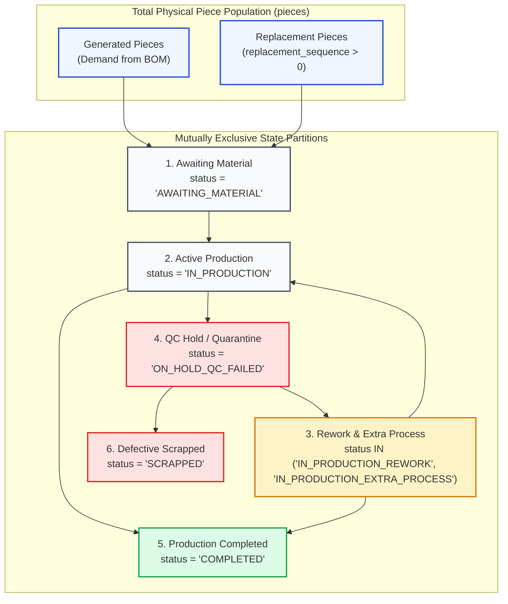

# Part 2.6 – SC and Completion State Machine
## Document 02: SC Set and Component Completion Rules

---

### 1. Executive Summary & Foundational Principles

In the Velan Production platform, an assembled set (`assembled_sets`) represents the primary physical unit of finished commercial delivery—a complete, functional industrial valve assembly (e.g., Gate Valve, Globe Valve, Cryogenic Actuated Valve) comprising a strictly defined ratio of serialized precision components.

Completion is not evaluated by subjective opinion, nor by bulk weight or anonymous tallies. It is governed by a **mathematically rigorous, multi-level aggregation engine** that evaluates the state of individual physical pieces, operations, and quality inspections.

#### Core Implementation Invariants:
1. **Deterministic Pre-Allocation Invariant (`BR-007, BR-008`):** Every physical piece is bound to a specific, numbered set (`assembled_set_id`) at the moment of SC activation. Pieces are never manufactured as unassigned floating stock and paired late-stage.
2. **Strict Component Completeness Gate (`BR-044, AC-004`):** A set can reach production completion **only when 100% of its deterministically pre-allocated component pieces have completed all machining operations and passed all required quality inspections**. If even a single component is incomplete, undergoing rework, or awaiting replacement, the parent set remains strictly incomplete.
3. **Quantity Conservation & Replacement Neutrality (`BR-005, BR-012, BR-013`):** When a defective piece is scrapped and a replacement piece is spawned, the replacement occupies the exact same component role within the designated set slot (`replaced_piece_id`). **A replacement piece never increases the contract's required set quantity or the required component demand.**
4. **Zero Tolerance for Unresolved Defects:** A piece that is in `ON_HOLD_QC_FAILED`, `IN_PRODUCTION_REWORK`, `IN_PRODUCTION_EXTRA_PROCESS`, or `SCRAPPED` can **never** be counted as completed.

---

### 2. Configurable Bill of Materials (BOM) & Set Composition Engine

The Velan Production architecture supports fully dynamic, configurable BOM set compositions. Neither component part codes, nor component ratios, nor total piece counts are ever hardcoded in application logic.

#### 2.1 Dynamic Composition Modeling
Set composition is driven dynamically by the catalog Bill of Materials entity (`bom_lines`):
$$\text{Product } P \implies \text{Set of BOM Lines } \{B_1, B_2, \dots, B_m\}$$
Where each BOM line $B_k$ specifies:
* `component_code`: Alphanumeric part identifier (e.g., `ARG`, `SPG`, `VBM`, `JIG`, `APG`, `SRG`, `EXT`).
* `component_name`: Engineering description (e.g., Flange, Spindle, Valve Body, Jig Foot).
* `quantity_per_set`: Integer quantity required per finished assembled set ($q_k \ge 1$).

#### 2.2 Concrete Composition Examples Supported

The system seamlessly evaluates diverse, real-world engineering product configurations:

| Product Model | Target Set Quantity ($Q$) | Component Part Code | Component Name | Ratio per Set ($q_k$) | Total Piece Demand per Contract ($D_k = Q \times q_k$) |
| :--- | :---: | :--- | :--- | :---: | :---: |
| **Product A: 2" Class 600 Gate Valve** | **4 Sets** | `ARG` | Flange | 1 | $4 \times 1 = \mathbf{4}$ |
| | | `SPG` | Spindle | 2 | $4 \times 2 = \mathbf{8}$ |
| | | `VBM` | Valve Body | 1 | $4 \times 1 = \mathbf{4}$ |
| | | `JIG` | Jig Foot | 3 | $4 \times 3 = \mathbf{12}$ |
| *Product A Total Demand* | | | | | **28 Physical Pieces** |
| **Product B: Actuator Assembly** | **2 Sets** | `APG` | Actuator Plate | 1 | $2 \times 1 = \mathbf{2}$ |
| | | `SRG` | Spring Return Rod | 2 | $2 \times 2 = \mathbf{4}$ |
| | | `EXT` | Body Extension | 1 | $2 \times 1 = \mathbf{2}$ |
| *Product B Total Demand* | | | | | **8 Physical Pieces** |

#### 2.3 Mathematical Formula for Total Component Demand
For any given product line item $i$ under Sales Contract $SC$:
$$D(SC_i, c) = \text{target\_set\_qty}(SC_i) \times \text{quantity\_per\_set}(c)$$
Where:
* $SC_i$ is the subcontract product line item (`subcontract_products`).
* $c$ is the BOM component line (`bom_lines`).
* $D(SC_i, c)$ is the exact number of original physical pieces generated upon SC activation.

---

### 3. Comprehensive Piece Accounting and Status Metrics

To provide real-time, tamper-evident visibility across shop-floor execution, the system maintains strict accounting metrics across all physical pieces. Every physical piece belonging to an SC product line is categorized into mutually exclusive sets:



#### 3.1 Formal Mathematical Definitions of Piece Metrics

For any product line item $SC_i$, let $\mathcal{P}(SC_i)$ denote the set of all physical pieces created under that line:

1. **Generated Demand Pieces ($\mathcal{P}_{\text{orig}}$):**
   $$\mathcal{P}_{\text{orig}} = \{p \in \mathcal{P}(SC_i) \mid p.\text{replacement\_sequence} = 0\}$$
   Count equals original engineering demand: $|\mathcal{P}_{\text{orig}}| = \sum_{c} D(SC_i, c)$.

2. **Scrapped Pieces ($\mathcal{P}_{\text{scrapped}}$):**
   $$\mathcal{P}_{\text{scrapped}} = \{p \in \mathcal{P}(SC_i) \mid p.\text{status} = \text{'SCRAPPED'}\}$$
   Permanently retired pieces that failed QC and received PM `REJECT_AND_RESTART` disposition.

3. **Replacement Pieces ($\mathcal{P}_{\text{replacement}}$):**
   $$\mathcal{P}_{\text{replacement}} = \{p \in \mathcal{P}(SC_i) \mid p.\text{replacement\_sequence} > 0\}$$
   Spawned to replace scrapped parts. Always satisfies: $|\mathcal{P}_{\text{replacement}}| = |\mathcal{P}_{\text{scrapped}}|$.

4. **Active Population ($\mathcal{P}_{\text{active}}$):**
   $$\mathcal{P}_{\text{active}} = \mathcal{P}(SC_i) \setminus \mathcal{P}_{\text{scrapped}}$$
   The current living population fulfilling the sets. Notice that:
   $$|\mathcal{P}_{\text{active}}| = |\mathcal{P}_{\text{orig}}| + |\mathcal{P}_{\text{replacement}}| - |\mathcal{P}_{\text{scrapped}}| = |\mathcal{P}_{\text{orig}}|$$
   **The active population count is conserved and never exceeds the original BOM demand.**

5. **Pieces Awaiting Material ($\mathcal{P}_{\text{awaiting\_mat}}$):**
   $$\mathcal{P}_{\text{awaiting\_mat}} = \{p \in \mathcal{P}_{\text{active}} \mid p.\text{status} = \text{'AWAITING\_MATERIAL'}\}$$
   Blocked from shop-floor machining because raw stock has not yet been issued by RM.

6. **Pieces in Active Production ($\mathcal{P}_{\text{in\_prod}}$):**
   $$\mathcal{P}_{\text{in\_prod}} = \{p \in \mathcal{P}_{\text{active}} \mid p.\text{status} = \text{'IN\_PRODUCTION'}\}$$

7. **Pieces in Remediation ($\mathcal{P}_{\text{rework}}$):**
   $$\mathcal{P}_{\text{rework}} = \{p \in \mathcal{P}_{\text{active}} \mid p.\text{status} \in \{\text{'IN\_PRODUCTION\_REWORK'}, \text{'IN\_PRODUCTION\_EXTRA\_PROCESS'}\}\}$$

8. **Pieces on QC Hold ($\mathcal{P}_{\text{hold}}$):**
   $$\mathcal{P}_{\text{hold}} = \{p \in \mathcal{P}_{\text{active}} \mid p.\text{status} = \text{'ON_HOLD_QC_FAILED'}\}$$

9. **Successfully Completed Pieces ($\mathcal{P}_{\text{completed}}$):**
   $$\mathcal{P}_{\text{completed}} = \{p \in \mathcal{P}_{\text{active}} \mid p.\text{status} = \text{'COMPLETED'}\}$$

---

### 4. Multi-Level Production Completion Rules

Completion in Velan Production is evaluated sequentially across seven strictly defined operational levels:

```
[ LEVEL 1: OPERATION COMPLETION ] (All routing steps certified PASSED or CONCESSION_ACCEPTED)
               │
               ▼
[ LEVEL 2: PIECE COMPLETION ] (100% of operations complete on physical piece; status = COMPLETED)
               │
               ▼
[ LEVEL 3: COMPONENT LINE COMPLETION ] (All required pieces for that BOM line complete in a set)
               │
               ▼
[ LEVEL 4: SET PRODUCTION COMPLETION ] (100% of pre-allocated pieces complete; is_production_complete = true)
               │
               ▼
[ LEVEL 5: SET FINAL QC CERTIFICATION ] (Independent full-assembly QC verification; is_final_qc_passed = true)
               │
               ▼
[ LEVEL 6: SC PRODUCT LINE COMPLETION ] (100% of target sets complete & QC certified for line item)
               │
               ▼
[ LEVEL 7: SC HEADER PRODUCTION COMPLETION ] (100% of lines complete; subcontracts.status = 'PRODUCTION_COMPLETE')
```

#### Level 1: Operation Completion
An individual routing operation step (`piece_operations`) on a physical piece is deemed complete if and only if its status satisfies:
$$\text{Operation Complete} \iff \text{status} \in \{\text{'PASSED'}, \text{'CONCESSION\_ACCEPTED'}\}$$
* `PASSED`: Certified within approved tolerances by an independent QC Inspector (`ROLE_QC`).
* `CONCESSION_ACCEPTED`: Authorized with written justification by the Project Manager (`ROLE_PM`) following an out-of-tolerance non-conformance (`BR-033, BR-034`).
* *Prohibition:* Operations in `PENDING`, `READY`, `OPENED`, `QC_PENDING`, `QC_IN_PROGRESS`, `FAILED`, or `CANCELLED` are incomplete.

#### Level 2: Physical Piece Completion
A physical piece (`pieces`) transitions to `COMPLETED` if and only if:
1. Every sequential routing operation in `piece_operations` generated from its frozen snapshot has reached an approved completed status (`PASSED` or `CONCESSION_ACCEPTED`).
2. There are zero active operations in `FAILED`, `QC_PENDING`, or `QC_IN_PROGRESS`.
3. There are zero unresolved exception cases in `qc_exceptions` linked to this piece.
4. The piece status is formally updated: `pieces.status = 'COMPLETED'`.

#### Level 3: Component Line Completion within a Set
Within a specific assembled set $S$, a particular component requirement $c$ is fulfilled if and only if:
$$\text{Component Complete}(S, c) \iff \forall p \in \text{AllocatedPieces}(S, c) : p.\text{status} = \text{'COMPLETED'}$$
Where $|\text{AllocatedPieces}(S, c)| = q_k$ (the approved BOM ratio).

#### Level 4: Set Production Completion (`is_production_complete = true`)
An assembled set (`assembled_sets`) reaches **Production Complete** if and only if:
$$\text{Set Production Complete}(S) \iff \forall c \in \text{BOM}(P) : \text{Component Complete}(S, c)$$
* **System Action:** The system updates `assembled_sets.is_production_complete = true` and records `assembled_sets.production_completed_at = NOW()`.
* **Status Progression:** The set transitions from `BUILDING` to `PRODUCTION_COMPLETE`.
* **Assembly Gate:** All physical components are now staged in the Final Assembly bay for full-assembly mechanical inspection.

#### Level 5: Set Final QC Certification (`is_final_qc_passed = true`)
Production completion certifies individual piece machining; it does **not** substitute for Final Quality Control.
* **Independent Inspection:** A certified QC Inspector (`ROLE_QC`) conducts a holistic physical verification of the assembled valve set:
  - Verifies serialized part stamping and visual assembly alignment.
  - Reviews complete digital traveler history (all prior QC records and PM concessions).
  - Conducts pressure testing, hydrostatic leak testing, or final functional verification as dictated by customer specifications.
* **Pass Verdict:** The inspector clicks **"Certify Final QC Pass"**.
* **System Action:**
  - `assembled_sets.is_final_qc_passed = true`
  - `assembled_sets.final_qc_passed_at = NOW()`
  - `assembled_sets.final_qc_passed_by = CurrentUser.id`
  - `assembled_sets.status = 'FINAL_QC_PASSED'`
* **Packaging Unlock:** The set is now officially eligible for physical packing verification (see Part 2.6 Document 03).

#### Level 6: SC Product Line Completion
A specific product line item (`subcontract_products`) reaches complete status if and only if:
$$\text{completed\_set\_qty} = \text{target\_set\_qty}$$
Where:
$$\text{completed\_set\_qty} = \sum \{S \in \text{Sets}(SC_i) \mid S.\text{is\_final\_qc\_passed} = \text{true}\}$$

#### Level 7: SC Header Production Completion
The overall Sales Contract header (`subcontracts`) reaches `PRODUCTION_COMPLETE` if and only if:
$$\forall i \in \text{Lines}(SC) : \text{completed\_set\_qty}(SC_i) = \text{target\_set\_qty}(SC_i)$$
The header status transitions automatically to `subcontracts.status = 'PRODUCTION_COMPLETE'`.

---

### 5. Multi-Set Progression Scenario: Completed vs. In-Flight Sets

To demonstrate the real-world operation of the set completion engine, consider an actual manufacturing shop-floor scenario under contract `SC-2579` ordering **3 Sets of 2" Class 600 Gate Valves** (BOM: 1 Flange `ARG` + 2 Spindles `SPG` + 1 Valve Body `VBM` = 4 pieces per set, total 12 pieces):

```
Contract SC-2579: 3 Valve Sets (12 Total Components)
====================================================================================================
SET #1 (SET-SC2579-01)
├── Piece 1: SC2579-1 ARG  [Flange]    --> Operations: Op10 Done, Op20 Done, Op30 Done (COMPLETED)
├── Piece 2: SC2579-1 SPG-1 [Spindle]  --> Operations: Op10 Done, Op20 Done, Op30 Done (COMPLETED)
├── Piece 3: SC2579-1 SPG-2 [Spindle]  --> Operations: Op10 Done, Op20 Done, Op30 Done (COMPLETED)
└── Piece 4: SC2579-1 VBM   [Body]     --> Operations: Op10 Done, Op20 Done, Op30 Done (COMPLETED)
    ==> ALL 4 PIECES COMPLETED!
    ==> is_production_complete = true
    ==> Final QC Inspection: PASSED by Inspector QC-04
    ==> is_final_qc_passed = true
    ==> Status: FINAL_QC_PASSED (ELIGIBLE FOR PACKING & DISPATCH!)

----------------------------------------------------------------------------------------------------
SET #2 (SET-SC2579-02)
├── Piece 5: SC2579-2 ARG  [Flange]    --> Operations: Op10 Done, Op20 Done, Op30 Done (COMPLETED)
├── Piece 6: SC2579-2 SPG-1 [Spindle]  --> Operations: Op10 Done, Op20 In Progress
├── Piece 7: SC2579-2 SPG-2 [Spindle]  --> Operations: Op10 Failed QC -> PM RETURN TO OP10 (REWORK)
└── Piece 8: SC2579-2 VBM   [Body]     --> Operations: Op10 Done, Op20 Done, Op30 Done (COMPLETED)
    ==> Piece 7 is in REWORK; Piece 6 in Machining.
    ==> is_production_complete = false
    ==> Status: BUILDING (STRICTLY BLOCKED FROM PACKING & DISPATCH!)

----------------------------------------------------------------------------------------------------
SET #3 (SET-SC2579-03)
├── Piece 9:  SC2579-3 ARG  [Flange]   --> Operations: Op10 Done, Op20 Done, Op30 Done (COMPLETED)
├── Piece 10: SC2579-3 SPG-1 [Spindle] --> Operations: Op10 Done, Op20 Done, Op30 Done (COMPLETED)
├── Piece 11: SC2579-3 SPG-2 [Spindle] --> Operations: Op10 Done, Op20 Done, Op30 Done (COMPLETED)
└── Piece 12: SC2579-3 VBM   [Body]    --> SCRAPPED on Op20!
                                        --> Spawned Replacement: SC2579-3 VBM-R1
                                        --> VBM-R1 Status: AWAITING_MATERIAL (Awaiting Raw Casting)
    ==> Piece 12 (Replacement) has not finished machining.
    ==> is_production_complete = false
    ==> Status: BUILDING (STRICTLY BLOCKED FROM PACKING & DISPATCH!)

====================================================================================================
CONTRACT SUMMARY:
Total Sets: 3 | Completed Sets: 1 | Incomplete Sets: 2
SC Header Status: IN_PRODUCTION
Operational Outcome: Set #1 can proceed immediately to Packing & Dispatch!
                     Sets #2 and #3 remain locked in production.
```

#### Key Rules Illustrated:
1. **Parallel Independent Progress:** Sibling components across sets progress independently without artificial synchronization.
2. **Deterministic Isolation:** Set #1 is not held back by Set #2's rework or Set #3's scrap. It progresses to completion autonomously.
3. **Partial Dispatch Readiness:** Because Set #1 is 100% complete and certified, it can be packed, staged, and dispatched to the customer on an urgent partial shipment, while Sets #2 and #3 remain in active production.
4. **Replacement Slot Retention:** Replacement piece `SC2579-3 VBM-R1` strictly inherited `set_sequence_number = 3`. It did not alter the set sequence or increase contract demand.
