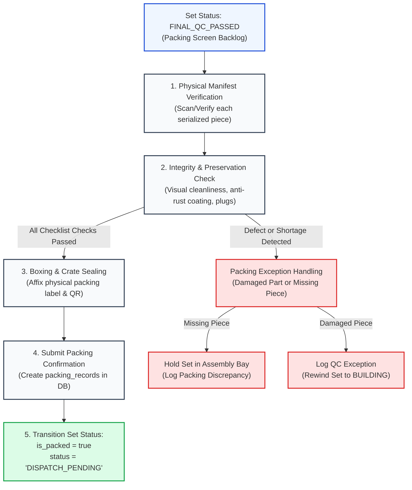
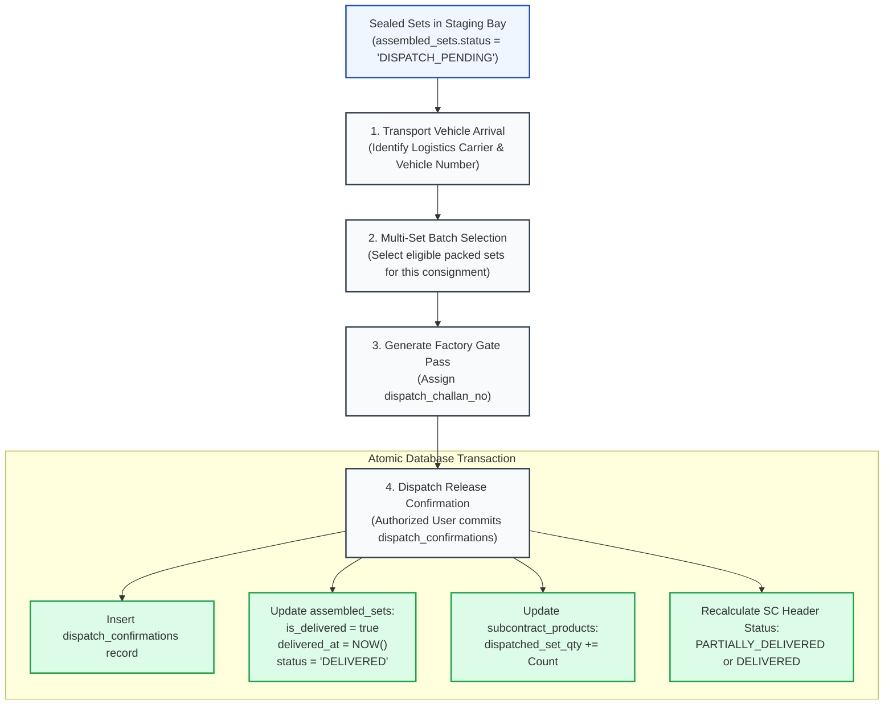

# Part 2.6 – SC and Completion State Machine
## Document 03: Packing and Dispatch State Machines

---

### 1. Executive Summary & Separation of Logistics Concerns

In precision manufacturing, packaging and shipping are critical risk boundaries. A valve assembly that has completed all machining and passed technical quality inspection cannot be treated as immediately shipped. 

To eliminate shipping errors, lost parts, and premature revenue recognition, the Velan Production platform enforces a **strict physical and logical separation between Quality Approval, Packing Verification, and Dock Dispatch Release**:

$$\text{Final QC Passed} \overset{\text{Gate 1}}{\Longrightarrow} \text{Packing Verification} \overset{\text{Gate 2}}{\Longrightarrow} \text{Dispatch Pending} \overset{\text{Gate 3}}{\Longrightarrow} \text{Dock Dispatch Confirmed} \Longrightarrow \text{Delivered}$$

#### Non-Negotiable Business Invariants:
1. **Mandatory Final QC Precondition:** A set is strictly ineligible for packing verification until it reaches `FINAL_QC_PASSED` (`is_final_qc_passed = true`).
2. **Packing Confirmation $\neq$ Delivered (`BR-046`):** Confirming packing certifies that all constituent components are verified, boxed, crated, and sealed. It transitions the set to `PACKING_CONFIRMED` and `DISPATCH_PENDING` in the warehouse staging bay. **It does NOT mean the set has left the factory or reached the customer.**
3. **Mandatory Dispatch Confirmation for Delivery (`BR-047`):** A set transitions to `DELIVERED` **only** upon explicit recording of physical loading dock release via a formal `dispatch_confirmations` record capturing carrier, vehicle number, and gate pass reference.
4. **Independent Set Dispatch (`AC-005`):** Each complete set can be packed and dispatched independently. A customer order of 5 sets can have Set #1 dispatched on Monday, Sets #2 and #3 on Wednesday, and Sets #4 and #5 the following week.
5. **Strict Set Completeness Gate:** Partial dispatch is permitted **only for fully completed sets**. Incomplete sets (where any piece is in machining, rework, or awaiting replacement) cannot be packed or dispatched.
6. **Billing Boundary:** Commercial invoicing, pricing, and freight billing are **100% external** to Velan Production. The system records physical material release only.

---

### 2. Role Permissions and the Six Established System Roles

The approved system architecture strictly preserves the **six established system roles**: `ROLE_ADMIN`, `ROLE_PM`, `ROLE_DESIGNER`, `ROLE_OPERATOR`, `ROLE_QC`, and `ROLE_MANAGEMENT`. 

To support shop-floor logistics without violating this established role boundary:
* **Packing Verification:** Executed by users granted the `PERMISSION_EXECUTE_PACKING` authority. In factory operations, this permission is assigned to designated shop-floor personnel holding `ROLE_PM`, `ROLE_ADMIN`, or certified senior operators holding `ROLE_OPERATOR`.
* **Dispatch Confirmation:** Executed by users granted the `PERMISSION_CONFIRM_DISPATCH` authority. Assigned exclusively to authorized shipping coordinators holding `ROLE_PM` or `ROLE_ADMIN`.
* **Role Integrity:** Dedicated "Stores", "Packing", or "Dispatch" employee roles do not exist as independent database roles (`D-03`). They are operational permissions mapped cleanly to the established role structure.

---

### 3. Assembled Set Lifecycle State Machine

The lifecycle of an assembled set (`assembled_sets.status`) is modeled across six sequential states, backed by four immutable milestone booleans:

```
[ BUILDING ] ──► [ PRODUCTION_COMPLETE ] ──► [ FINAL_QC_PASSED ] ──► [ PACKING_CONFIRMED ] ──► [ DISPATCH_PENDING ] ──► [ DELIVERED ]
      ▲                     │                         │                       │                         │
      │                     ▼                         │                       │                         │
      └─────── [ REWORK / REPLACEMENT HOLD ] ◄────────┴───────────────────────┴─────────────────────────┘
```

| State Code | State Name | Milestone Flags Active | Detailed Business Meaning & Operations Permitted |
| :--- | :--- | :--- | :--- |
| `BUILDING` | **Building / In Progress** | All flags `false` | Initial state upon SC activation. Constituent pieces are in machining, turning, milling, or awaiting raw material. Machining and operator data entry permitted. Packing/dispatch strictly prohibited. |
| `PRODUCTION_COMPLETE` | **Production Complete** | `is_production_complete = true` | 100% of constituent physical pieces have completed all machining operations (`PASSED` or `CONCESSION_ACCEPTED`). Physical parts are staged in the assembly bay awaiting Final QC. |
| `FINAL_QC_PASSED` | **Final QC Passed** | `is_production_complete = true`<br/>`is_final_qc_passed = true` | Independent QC Inspector verified complete mechanical assembly, reviewed traveler history, and certified compliance. Set is unlocked for physical packing. |
| `PACKING_CONFIRMED` | **Packing Confirmed** | `is_production_complete = true`<br/>`is_final_qc_passed = true`<br/>`is_packed = true` | Authorized employee physically verified BOM manifest, inspected parts for transit protection, packed crate, and generated packing slip. |
| `DISPATCH_PENDING` | **Dispatch Pending** | `is_production_complete = true`<br/>`is_final_qc_passed = true`<br/>`is_packed = true` | The sealed crate is staged in the loading dock / shipping warehouse awaiting transport vehicle arrival. |
| `DELIVERED` | **Delivered / Dispatched** | `is_production_complete = true`<br/>`is_final_qc_passed = true`<br/>`is_packed = true`<br/>`is_delivered = true` | Transport vehicle loaded, carrier gate pass recorded in `dispatch_confirmations`, and set released through factory gate. Terminal state. |

---

### 4. Packing Verification State Machine (`packing_records`)

Packing verification is governed by a dedicated physical checklist and validation lifecycle:



#### 4.1 Detailed Packing Workflow Steps:
1. **Queue Eligibility:** The packing application screen displays only sets whose status is strictly `FINAL_QC_PASSED`.
2. **Physical Manifest Verification:** The packaging employee verifies every required component against the approved BOM manifest:
   - Verifies physical serial numbers stamped on metal parts (e.g., `SC002-1 ARG`, `SC002-1 SPG-1`, `SC002-1 SPG-2`, `SC002-1 VBM`).
   - Ensures no loose or unallocated parts are included.
3. **Transit Preservation & Protection:** Verifies that flange faces are greased, plastic protective end-caps are inserted, anti-corrosion VCI paper is wrapped, and required documentation (test certificates, operating manual) is enclosed.
4. **Checklist Commitment (`packing_records`):**
   - The user records verification checklist results in JSONB format:
     ```json
     {
       "manifest_verified": true,
       "serialized_pieces_matched": ["SC002-1 ARG", "SC002-1 SPG-1", "SC002-1 SPG-2", "SC002-1 VBM"],
       "surface_protection_applied": true,
       "end_caps_fitted": true,
       "test_certificates_enclosed": true,
       "crate_seal_number": "SEAL-98421"
     }
     ```
   - System generates unique `packing_slip_number` (e.g., `PS-2026-0842`).
   - Captures `packed_by_user_id` and `packed_at = NOW()`.
5. **Set Status Advance:**
   - `assembled_sets.is_packed = true`
   - `assembled_sets.packing_confirmed_at = NOW()`
   - `assembled_sets.status = 'DISPATCH_PENDING'`
   - Updates `subcontract_products.packed_set_qty = packed_set_qty + 1`.

#### 4.2 Handling Packing Exceptions:
* **Shortage Detected:** If a physical component allocated to the set is missing from the staging tray, the packaging employee cannot proceed. The set remains in `FINAL_QC_PASSED`, and a high-priority "Component Shortage at Packing" alert is logged for the PM.
* **Damaged Component Discovered:** If a flange face is scratched or thread is dented during transit to packing:
  1. The packaging employee flags the set.
  2. A certified QC Inspector is summoned to evaluate the damage.
  3. If QC issues a `FAILED` verdict on the piece, the piece enters `ON_HOLD_QC_FAILED`.
  4. The set status rewinds from `FINAL_QC_PASSED` back to `BUILDING`.
  5. The set cannot be packed until the damaged piece is reworked or replaced.
* **Unboxing / Repacking Workflow:** If customer amends crating instructions or a sealed crate is opened for audit:
  1. Authorized PM executes **"Void Packing Slip & Repack"** with mandatory justification.
  2. The existing `packing_records` is marked `is_void = true`.
  3. `assembled_sets.is_packed` reverts to `false`.
  4. `assembled_sets.status` reverts to `FINAL_QC_PASSED`.
  5. `subcontract_products.packed_set_qty` decrements by 1.
  6. Audit event `SET_UNPACKED_FOR_REWORK` is recorded.

---

### 5. Dispatch and Delivery State Machine (`dispatch_confirmations`)

Dispatch confirmation records the physical exit of finished goods from the manufacturing facility. It is governed by a dedicated loading dock confirmation workflow:



#### 5.1 Detailed Dispatch Workflow Steps:
1. **Staging Inventory:** The Dispatch screen lists all packed crates staged in the shipping warehouse (`status = 'DISPATCH_PENDING'`).
2. **Consignment Grouping:** A dispatch consignment can contain:
   - A single set from an SC.
   - Multiple sets from the same SC (e.g., Sets #1 and #2 of SC002).
   - Multiple sets across different SCs going to the same customer/destination.
3. **Vehicle & Logistics Data Entry:**
   - Carrier Name (e.g., "VRL Logistics", "Blue Dart Surface", "Customer Dedicated Truck").
   - Vehicle Registration Number (e.g., `TN-38-AX-9182`).
   - Driver Name & Mobile Contact.
   - External Delivery Challan / Gate Pass Reference (`dispatch_challan_no`).
4. **Atomic Transaction Execution:**
   The backend executes an atomic transaction committing:
   - Inserts record into `dispatch_confirmations`.
   - For every set ID in `dispatched_set_ids`:
     - Updates `assembled_sets.is_delivered = true`.
     - Updates `assembled_sets.delivered_at = NOW()`.
     - Updates `assembled_sets.dispatched_by_user_id = CurrentUser.id`.
     - Transitions `assembled_sets.status = 'DELIVERED'`.
   - Updates `subcontract_products.dispatched_set_qty = dispatched_set_qty + COUNT(dispatched_sets)`.
   - Re-evaluates parent SC status:
     - If $\text{dispatched\_set\_qty} < \text{target\_set\_qty} \implies \mathbf{PARTIALLY\_DELIVERED}$.
     - If $\text{dispatched\_set\_qty} = \text{target\_set\_qty} \implies \mathbf{DELIVERED}$.

---

### 6. Partial Completion and Independent Set Dispatch Rules

The manufacturing shop floor frequently faces staggered completions. Velan Production handles partial completion and multi-tranche dispatches without data corruption:

#### 6.1 Multi-Set Staggered Delivery Matrix
Consider an order of 4 Sets under SC `SC-4100`:

| Set Number | Physical Machining | Final QC | Packing Status | Dispatch Status | Set Lifecycle State | Delivery Status |
| :---: | :---: | :---: | :---: | :---: | :---: | :---: |
| **Set #1** | 100% Done | Passed | Packed (`PS-101`) | Dispatched (`DC-801`) | `DELIVERED` | **Delivered to Customer** |
| **Set #2** | 100% Done | Passed | Packed (`PS-102`) | Staged at Dock | `DISPATCH_PENDING`| **Awaiting Truck** |
| **Set #3** | 100% Done | Passed | In Assembly Bay | Not Packed | `FINAL_QC_PASSED` | **Ready for Packaging** |
| **Set #4** | Spindle in Rework | Not Done | Blocked | Blocked | `BUILDING` | **In Machining (Rework)** |

#### Resulting System States:
* `subcontract_products`:
  - `target_set_qty = 4`
  - `completed_set_qty = 3` (Sets #1, #2, #3)
  - `packed_set_qty = 2` (Sets #1, #2)
  - `dispatched_set_qty = 1` (Set #1)
  - `status = 'IN_PRODUCTION'`
* `subcontracts` (Header):
  - `status = 'PARTIALLY_DELIVERED'`
* **Operational Business Impact:**
  - Customer receives Set #1 immediately to prevent construction site stoppage.
  - Set #2 can be loaded on the next available truck.
  - Set #4's rework does not hold up Set #1 or Set #2.
  - Invoicing for Set #1 can proceed in the external finance system based on the verified `dispatch_challan_no` event.
