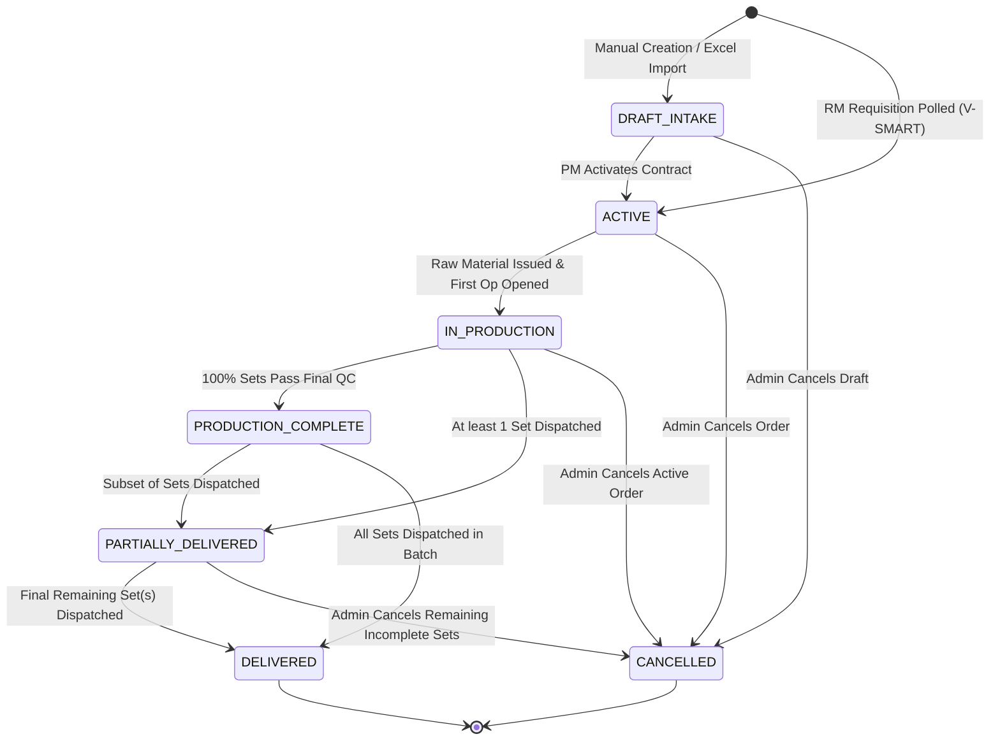
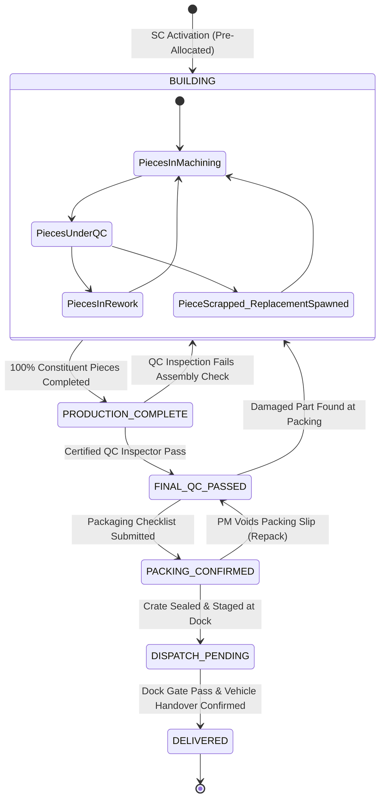
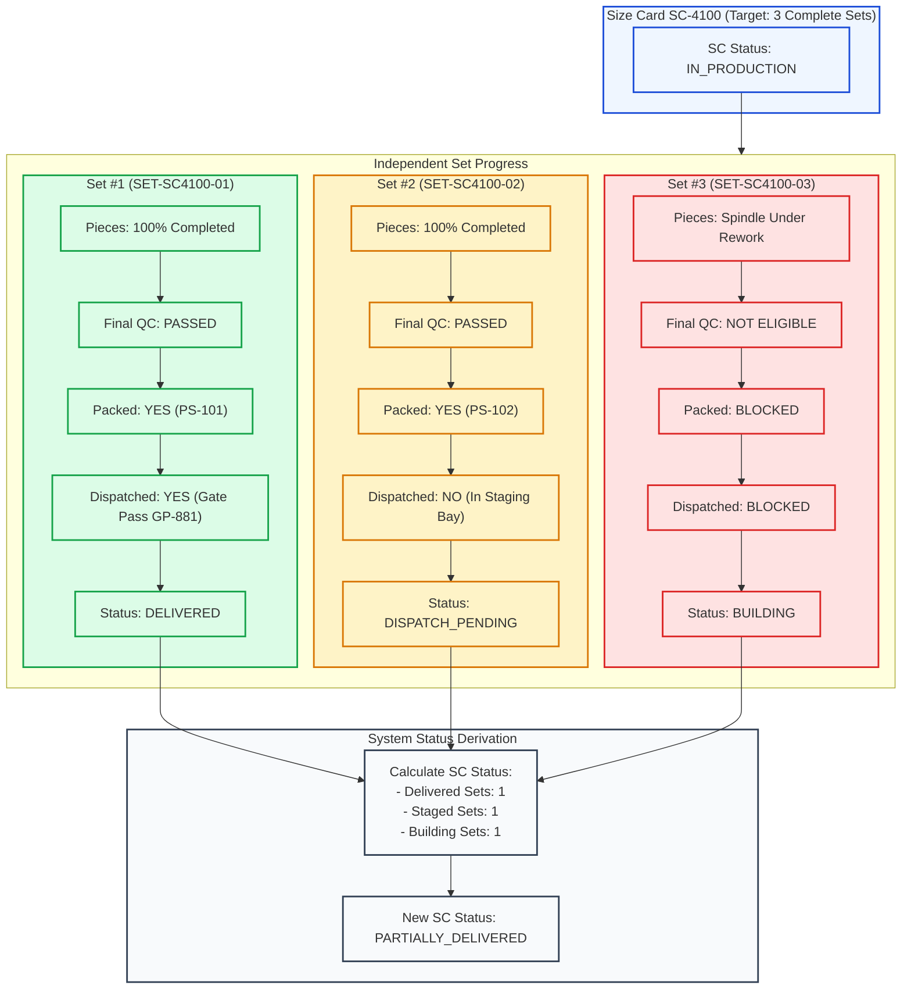
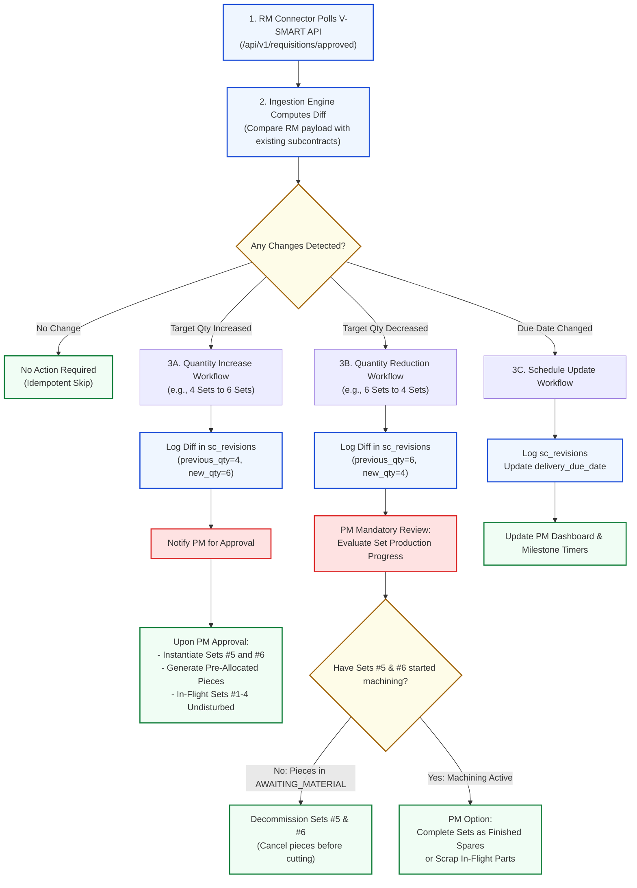

# Part 2.6 – SC and Completion State Machine
## Document 05: Visual State Models, Sequence Diagrams, and Traceability

---

### 1. Executive Summary & Visual Architecture

This document provides the complete suite of visual state models, sequence diagrams, and end-to-end traceability matrices for **Part 2.6 – SC and Completion State Machine**. 

These diagrams illustrate how commercial sales orders are ingested, how physical pieces and assembled sets are tracked through machining and quality control, how physical packing and dock release are governed, and how partial completion operates in practice.

---

### 2. Comprehensive Mermaid Visual Models

#### Diagram 1: End-to-End Size Card (SC) State Machine (`stateDiagram-v2`)



---

#### Diagram 2: Assembled Set Lifecycle Statechart (`stateDiagram-v2`)



---

#### Diagram 3: Multi-Set Partial Completion and Dispatch Flowchart (`flowchart TD`)



---

#### Diagram 4: Packing Verification and Exception Sequence Diagram (`sequenceDiagram`)

```mermaid
sequenceDiagram
    autonumber
    actor P as Packaging Employee
    actor QC as Certified QC Inspector
    participant UI as Velan Production Web UI
    participant PS as SetCompletionService
    participant DB as PostgreSQL (Neon)

    Note over P,DB: Set #1 has reached FINAL_QC_PASSED
    P->>UI: Open Packing Screen for Set #1
    UI->>DB: Query Set & Constituent Pieces
    DB-->>UI: Return 4 Pieces (All COMPLETED & Final QC Certified)
    UI-->>P: Display BOM Manifest Verification Checklist

    alt Successful Packing Verification
        P->>P: Physically verify parts, clean flange faces, fit protective caps
        P->>UI: Submit Completed Checklist (All checks passed)
        UI->>PS: confirmPacking(setId, checklistJson, userId)
        PS->>DB: INSERT INTO packing_records (set_id, packing_slip_no, checklist)
        PS->>DB: UPDATE assembled_sets SET is_packed=true, status='DISPATCH_PENDING'
        PS->>DB: UPDATE subcontract_products SET packed_set_qty = packed_set_qty + 1
        DB-->>PS: Transaction Committed
        PS-->>UI: Return Packing Slip PS-2026-0842 (Print Label)
        UI-->>P: Display Packing Confirmed; Print Crate QR Label
    else Defect or Surface Damage Discovered
        P->>P: Inspect Flange face: Discovers deep transport gouge
        P->>UI: Click "Flag Damaged Component"
        UI->>QC: Summon QC Inspector to Packaging Bay
        QC->>QC: Inspect Gouge with Depth Micrometer: Out of Tolerance
        QC->>UI: Submit QC Failure on Flange Piece
        UI->>PS: recordPackingDefect(pieceId, failureDetails)
        PS->>DB: UPDATE pieces SET status = 'ON_HOLD_QC_FAILED'
        PS->>DB: UPDATE assembled_sets SET is_final_qc_passed=false, is_production_complete=false, status='BUILDING'
        PS->>DB: INSERT INTO qc_exceptions (piece_id, failure_notes)
        DB-->>PS: Transaction Committed
        PS-->>UI: Set Rewound to BUILDING; Exception Logged for PM
        UI-->>P: Packing Aborted; Transfer Set to Quarantine Area
    end
```

---

#### Diagram 5: Loading Dock Dispatch Confirmation Sequence Diagram (`sequenceDiagram`)

```mermaid
sequenceDiagram
    autonumber
    actor D as Shipping / Dispatch Employee
    participant UI as Velan Production Web UI
    participant DS as DispatchCoordinationService
    participant DB as PostgreSQL (Neon)
    participant EXT as External Logistics / Invoicing

    Note over D,DB: Multiple sets staged in shipping bay (DISPATCH_PENDING)
    D->>UI: Open Dock Dispatch Console
    UI->>DB: Query assembled_sets WHERE status = 'DISPATCH_PENDING'
    DB-->>UI: Return Staged Sets [Set #1, Set #2]
    UI-->>D: Display Staged Consignments

    D->>UI: Select Set #1 & Set #2 for Customer Consignment
    D->>UI: Enter Logistics Details: Carrier="VRL Logistics", Vehicle="TN-38-AX-9182", GatePass="GP-90412"
    D->>UI: Click "Confirm Dock Dispatch & Gate Release"

    UI->>DS: confirmDispatch(consignmentData)
    critical Atomic Database Transaction
        DS->>DB: SELECT * FROM assembled_sets WHERE id IN (Set1, Set2) FOR UPDATE
        DS->>DB: INSERT INTO dispatch_confirmations (carrier, vehicle, gate_pass, set_ids)
        DS->>DB: UPDATE assembled_sets SET is_delivered=true, delivered_at=NOW(), status='DELIVERED'
        DS->>DB: UPDATE subcontract_products SET dispatched_set_qty = dispatched_set_qty + 2
        DS->>DS: Evaluate SC Status (Lines fulfilled vs remaining)
        DS->>DB: UPDATE subcontracts SET status = 'PARTIALLY_DELIVERED' (or 'DELIVERED')
    end
    DB-->>DS: Transaction Committed
    DS->>EXT: Emit Outbox Event DISPATCH_CONFIRMED (Payload for Gate Pass & Invoicing)
    DS-->>UI: Dispatch Confirmed Successfully
    UI-->>D: Display Gate Pass Released; Truck Cleared for Departure
```

---

#### Diagram 6: RM Requisition Revision and Quantity Reconciliation Flowchart (`flowchart TD`)



---

### 3. Phase 1 & Phase 2 Traceability Matrix

This design satisfies all requirements across Phase 1 and approved Phase 2 parts:

| Phase 1 / Phase 2 Reference | Requirement Title | Design Document Location | How Part 2.6 Fulfills the Requirement |
| :--- | :--- | :--- | :--- |
| **BRD §3 Obj. 1, D-01** | SC Intake Channels | `01-sc-lifecycle-overview-and-states.md` §3 | Covers automated RM synchronization, manual UI creation, and Excel bulk import. |
| **BRD §6, D-02** | Piece Tracking vs Sets | `02-sc-set-and-component-completion-rules.md` §2, §3 | Piece count derived dynamically from BOM line ratios; pieces pre-allocated to sets. |
| **BR-007, BR-008** | Deterministic Set Allocation | `02-sc-set-and-component-completion-rules.md` §1 | Pre-allocates pieces to sets at intake; strictly prohibits late-stage arbitrary pairing. |
| **BR-005, BR-012, BR-013** | Replacement Piece Neutrality | `02-sc-set-and-component-completion-rules.md` §1, §3 | Replacement pieces preserve parent set slot (`replaced_piece_id`) and never inflate set quantity. |
| **BR-009, BR-010, D-04** | Product-Level Material Gate | `01-sc-lifecycle-overview-and-states.md` §2 | Material readiness tracked per product line (`material_ready`); gates Op 1 for constituent pieces. |
| **BR-044, AC-004** | Production Completion Gate | `02-sc-set-and-component-completion-rules.md` §4 | Set reaches `PRODUCTION_COMPLETE` only when 100% of pre-allocated pieces are complete. |
| **BR-046, SRS FR-014** | Packing Verification Separation | `03-packing-and-dispatch-state-machines.md` §1, §4 | Final QC required before packing; packing confirmation moves set to `DISPATCH_PENDING`, not delivered. |
| **BR-047, SRS FR-014** | Dispatch Release & Delivery | `03-packing-and-dispatch-state-machines.md` §1, §5 | Dispatch requires separate confirmation (`dispatch_confirmations`) capturing carrier and gate pass. |
| **AC-005** | Independent Partial Set Dispatch | `03-packing-and-dispatch-state-machines.md` §1, §6 | Fully completed sets can be dispatched independently; incomplete sets strictly blocked. |
| **BR-050** | Administrative Cancellation | `01-sc-lifecycle-overview-and-states.md` §5.7 | Cancellation restricted exclusively to `ROLE_ADMIN` with mandatory justification. |
| **D-10** | External Commercial Billing | `03-packing-and-dispatch-state-machines.md` §1 | Commercial invoicing, pricing, and freight billing remain 100% external to Velan Production. |
| **D-03** | Six Established Roles Preserved | `03-packing-and-dispatch-state-machines.md` §2 | Strictly preserves Admin, PM, Designer, Operator, QC, and Management. Logistics tasks mapped via permissions. |
| **Part 2.2 Domain Model** | Data Model Alignment | `04-completion-calculation-and-transition-matrices.md` | Maps directly to `subcontracts`, `subcontract_products`, `assembled_sets`, `packing_records`, `dispatch_confirmations`. |
| **Part 2.3 Piece Lifecycle** | Piece State Alignment | `02-sc-set-and-component-completion-rules.md` §3, §4 | Integrates with `AWAITING_MATERIAL`, `IN_PRODUCTION`, `ON_HOLD_QC_FAILED`, `COMPLETED`, `SCRAPPED`. |
| **Part 2.4 Operation Lifecycle**| Operation State Alignment | `02-sc-set-and-component-completion-rules.md` §4 | Integrates with `PASSED`, `CONCESSION_ACCEPTED`, `FAILED`. |
| **Part 2.5 QC & Exception** | QC & PM Disposition Alignment| `02-sc-set-and-component-completion-rules.md` §4 | Connects with `qc_inspections`, `qc_exceptions`, and 4 PM dispositions (`CONTINUE`, `EXTRA`, `RETURN`, `RESTART`). |

---

### 4. Open Questions & Engineering Assumptions Register

To maintain complete architectural integrity, items are strictly segregated into confirmed rules, proposed system design, and unresolved business questions:

#### 4.1 Confirmed Business Rules (Frozen Baseline)
1. **SC as Root Header:** The Size Card (`subcontracts`) is the central operational entity governing shop-floor production.
2. **Deterministic Pre-Allocation:** Sets and constituent pieces are bound at creation time, not late-stage matched.
3. **Product-Level Material Gate:** Raw material readiness is evaluated per product line item (`subcontract_products`).
4. **Independent Set Dispatch:** Complete sets may be dispatched independently while sibling sets remain in production.
5. **Separation of Quality, Packing, and Dispatch:**
   - Production complete does not mean Final QC passed.
   - Final QC passed does not mean Packed.
   - Packing confirmed does not mean Delivered.
   - Dispatch confirmation is the sole event recording physical delivery (`DELIVERED`).
6. **Six Established Roles:** Admin, PM, Designer, Operator, QC, and Management.

#### 4.2 Proposed Technical Implementation Patterns (Designed in Part 2.6)
1. **Packaging Checklist Structure:** Modeled as structured JSONB (`packing_records.verification_checklist`) to support diverse valve types without altering database tables.
2. **Consignment Batch Dispatching:** Allowing a single `dispatch_confirmations` event to group multiple complete sets across one or multiple SCs into a single logistics gate pass.
3. **Automated Status Cascade:** Real-time event-driven calculation of SC Product and SC Header statuses from constituent set events, avoiding slow cron polling.
4. **Optimistic Locking with Fallback Row-Locking:** Using `@Version` for general state mutations and explicit `SELECT ... FOR UPDATE` during dock dispatch consignment creation.

#### 4.3 Open Questions Requiring Commercial / Operational Confirmation
1. **Open Question O-13: Packing Slip Number Formatting Convention:**
   - *Status:* `OPEN — BUSINESS DECISION REQUIRED`
   - *Description:* What is the formal numbering pattern required for physical packing slips (e.g., `PS-{YEAR}-{SEQ}` vs `PS-SC{NUMBER}-{SET}`) and should physical packing slips be printed directly from Velan Production or synchronized from an external ERP?
2. **Open Question O-14: Handover Document Requirements for Loading Dock Gate Release:**
   - *Status:* `OPEN — BUSINESS DECISION REQUIRED`
   - *Description:* What external delivery document references (e.g., SAP Delivery Challan, E-Way Bill Number, Transporter Consignment Note) are mandatory before the system allows a Dispatch Confirmation to be committed?
3. **Open Question O-15: Handling Finished Sets when Remaining Contract Quantity is Cancelled:**
   - *Status:* `OPEN — BUSINESS DECISION REQUIRED`
   - *Description:* If an SC of 5 sets has 2 sets already delivered and the customer cancels the remaining 3 sets while Set #3 is finished, does Set #3 transfer to an external finished goods inventory catalog, or does it remain attached to the cancelled SC?
