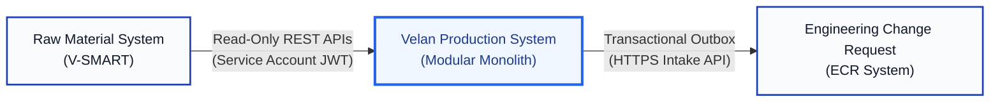

# Velan Production – Phase 2: System Design

## 1. Executive Summary

The **Velan Production System** is a dedicated manufacturing execution and shop-floor tracking application built to govern the fabrication, assembly, inspection, and delivery of precision industrial valves and engineering sets.

This directory contains the complete technical design specifications produced during **Phase 2 (System Design)**, derived directly from the frozen **Phase 1 – Requirement Analysis** and the approved 51-phase development roadmap.

---

## 2. Phase 2 Scope & Roadmap Breakdown

Phase 2 is strictly organized into eight modular, sequentially reviewed parts:

| Subpart | Title | Scope Summary | Status |
| :--- | :--- | :--- | :--- |
| **Part 2.1** | **System Architecture Design** | Overall architecture, modular monolith boundaries, C4 context & container diagrams, module communication, request flows, error handling, ADRs | **Completed (Approved)** |
| **Part 2.2** | **Domain and Data Model Design** | Domain model, ER diagram, PO/SC/Product/BOM/Piece hierarchy, component-to-set models, QC & vendor models, constraints | **Completed (Approved)** |
| **Part 2.3** | **Piece Lifecycle State Machine** | Piece creation, readiness gates, operation progression, QC decisions, rework, scrap, replacement linkage, set aggregation | **Completed (Approved)** |
| **Part 2.4** | **Operation Lifecycle State Machine** | Operation lifecycle (Ready, Opened, QC Pending, QC in Progress, Passed, Failed, Concession, Bypassed, Cancelled), operator grid, QC & PM controls | **Completed (Approved)** |
| **Part 2.5** | **QC & Exception State Machines** | Dual operator/QC measurements, static & dynamic tolerances, PM decisions, extra process, restart, RM & ECR outbox lifecycle | **Completed (Approved)** |
| **Part 2.6** | **SC & Completion State Machine** | SC intake, revision handling, piece completion, BOM completion, packing, dispatch gating, delivered status | *Pending* |
| **Part 2.7** | **Integration Architecture** | RM read-only connector, service-account security, outbox pattern for ECR, idempotency, vendor DC sync | *Pending* |
| **Part 2.8** | **Architecture Review & Sign-Off** | Comprehensive traceability matrix against Phase 1, conflict resolution, diagram verification, final sign-off | *Pending* |

---

## 3. Approved Technology Stack & Architectural Constraints

The system design strictly adheres to the following approved technology direction:

* **Backend Application:** Java 21 LTS with Spring Boot 3.x (Modular Monolith, independently built and deployed as a Docker container on Render Web Service)
* **Frontend Application:** React with TypeScript (SPA built with Vite, independently built and deployed as a Render Static Site / CDN)
* **Database:** PostgreSQL hosted on Neon (Serverless Postgres with connection pooling)
* **File Storage:** Cloudflare R2 (S3-compatible object storage for technical drawings, inspection sheets, and attachments)
* **Caching Strategy:** In-process Caffeine Cache (JVM heap, bounded LRU with TTL)
* **Deployment Model:** Independent Frontend & Backend deployments on Render
* **Explicit Exclusions:**
  * **No Redis** (no distributed in-memory cache)
  * **No RabbitMQ / Kafka** (no external asynchronous message brokers; in-process events and transactional outbox table used instead)
  * **No Microservices** (backend is strictly a single-deployable Modular Monolith)

---

## 4. Enterprise Business Boundaries

The ecosystem consists of three independent business applications:



1. **Raw Material (RM – V-SMART):**
   * Remains entirely unchanged.
   * Velan Production reads material issuance status, raw material heat numbers, and delivery challan (DC) status via read-only APIs using a dedicated read-only service account.
   * Velan Production **does not own** inventory transactions, stock movements, or vendor DC generation/receipts.
2. **Velan Production:**
   * Owns shop-floor piece-level tracking, operation progress, operator and QC measurements, process routing, PM exception resolution, replacement piece allocation, assembly completion, and dispatch verification.
3. **Engineering Change Request (ECR):**
   * Remains entirely unchanged.
   * Velan Production creates engineering non-conformance and rework exceptions and dispatches them to ECR's existing HTTP intake endpoint via a local **Transactional Outbox**.
4. **Billing & Financials:**
   * Strictly external to Velan Production.
5. **MERC & Executive Enterprise Dashboards:**
   * Integration deferred to Phase 51.

---

## 5. Directory Organization for Phase 2

```text
docs/phase-2/
├── README.md                                           <-- This roadmap & index
├── 2.1-system-architecture/
│   ├── 01-system-context-and-boundaries.md             <-- Context, C4 Level 1 & 2, boundaries & ownership
│   ├── 02-modular-monolith-architecture.md             <-- Module boundaries, internal comms, C4 Level 3
│   ├── 03-frontend-and-infrastructure-architecture.md  <-- React/TS, Neon Postgres, Cloudflare R2, Render
│   ├── 04-request-flow-and-error-handling.md           <-- Sequence diagrams, error protocols, resilience
│   ├── 05-architecture-decision-records.md             <-- Formal ADRs (ADR-01 to ADR-08)
│   └── 06-open-questions-and-assumptions.md            <-- Checkpoint questions and Phase 1 traceability
├── 2.2-domain-data-model/
│   ├── 01-domain-model-and-hierarchy.md                <-- Business hierarchy, piece identity & set ratios
│   ├── 02-entity-catalogue-and-attributes.md           <-- Exhaustive entity catalogue & field definitions
│   ├── 03-relationships-and-cardinality.md             <-- Relationships, cardinality & sub-domain models
│   ├── 04-complete-er-diagram.md                       <-- Complete Mermaid ERD and cluster walkthrough
│   ├── 05-integration-ownership-and-audit-model.md     <-- Data ownership matrix, audit & outbox models
│   └── 06-constraints-indexing-and-questions.md        <-- Constraints, partial indexing, concurrency & questions
├── 2.3-piece-lifecycle-state-machine/
│   ├── 01-piece-lifecycle-overview-and-states.md       <-- Scope, domain principles & exhaustive state catalogue
│   ├── 02-piece-state-transitions-and-events.md        <-- Permissible transitions, events, guards & mutations
│   ├── 03-piece-state-machine-diagrams.md              <-- Complete Mermaid state diagrams & execution flows
│   ├── 04-exception-handling-rework-and-replacement.md <-- Concessions, rework iterations, scrap & lineage
│   └── 05-set-coordination-and-traceability.md         <-- Set aggregation, partial dispatch & Phase 1 matrix
├── 2.4-operation-lifecycle-state-machine/
│   ├── 01-operation-lifecycle-overview-and-states.md   <-- Purpose, principles & exhaustive 10-state catalogue
│   ├── 02-operation-state-transitions-and-events.md    <-- 15-transition matrix, guards, side-effects & locks
│   ├── 03-operation-state-machine-diagrams.md          <-- 9 Mermaid diagrams (state, flows, QC, PM controls)
│   ├── 04-operator-execution-qc-and-pm-dispositions.md <-- Operator grid, QC lifecycle & 4 PM dispositions
│   └── 05-operation-controls-timing-and-traceability.md<-- PM controls, lead times, concurrency & Phase 1 matrix
└── 2.5-qc-and-exception-state-machines/
    ├── 01-qc-and-exception-overview-and-states.md       <-- Four sub-domain state catalogues & lifecycle principles
    ├── 02-qc-inspection-state-machine-and-tolerances.md <-- Tolerances, independent QC state machine & instruments
    ├── 03-exception-lifecycle-and-pm-dispositions.md    <-- Non-conformance lifecycle & 4 PM dispositions
    ├── 04-ecr-outbox-integration-state-machine.md       <-- RM & ECR boundaries, transactional outbox & retry backoff
    └── 05-qc-exception-diagrams-and-traceability.md     <-- 6 Mermaid diagrams, Phase 1 matrix & open questions
```
