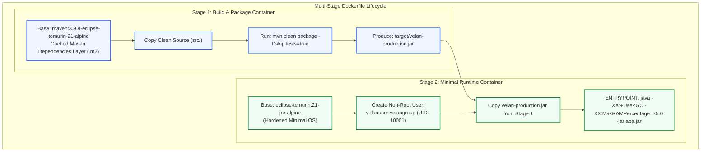

# Part 3.1 — Technology Specification and Environments
## Document 04: Dependency Management, Security Scanning, and Build Policy

---

### 1. Confirmed Rules (Frozen Baseline)
* **Zero Speculative Dependencies:** No library may be introduced without direct functional justification against Phase 1 requirements or Phase 2 approved state machines.
* **Prohibited Technology Enforcement (`BR-058, D-13`):** Pull Requests introducing Redis, RabbitMQ, Kafka, microservice frameworks, or AI/LLM SDKs must be rejected automatically.
* **Hermetic & Reproducible Builds:** Builds must be 100% reproducible across local developer machines, GitHub Actions CI runners, and Render build containers.
* **Deterministic Version Pinning:** Floating versions, dynamic ranges (`latest`, `1.x`, `^`, `~` in lockfiles), and unverified third-party repositories are strictly prohibited in production builds.

---

### 2. Dependency Ingestion and Governance Rules

Before any new third-party dependency is added to `pom.xml` or `package.json`:

#### 2.1 Formal Ingestion Approval Workflow
1. **Architectural Review:** The developer must justify why existing standard library or Spring Boot / React primitives cannot fulfill the requirement.
2. **License Compatibility Check:**
   - **Permitted Licenses:** Apache 2.0, MIT, BSD-2-Clause, BSD-3-Clause, ISC.
   - **Restricted / Review Required:** LGPL 2.1/3.0 (allowed only as dynamically linked JARs; requires legal sign-off).
   - **Strictly Prohibited:** GPL v2/v3, AGPL, SSPL, or commercial proprietary licenses requiring runtime fees.
3. **Automated Vulnerability Gate:**
   - The dependency must possess zero known Critical or High severity Common Vulnerabilities and Exposures (CVEs) on the National Vulnerability Database (NVD).

#### 2.2 Automated Security Scanning Tooling
The continuous integration pipeline (`GitHub Actions`) enforces automated vulnerability and license scanning:
* **Backend Security Scanning:**
   - **OWASP Dependency-Check Maven Plugin:** Scans all transitive and direct Java dependencies against the NVD during `mvn verify`. Fails the build if any CVSS score $\ge 7.0$ (High/Critical) is detected.
   - **Snyk CLI / GitHub Dependabot:** Automated weekly vulnerability alerts and automated pull requests for security patches.
* **Frontend Security Scanning:**
   - **`npm audit` (Strict Mode):** Executes during CI build (`npm audit --audit-level=high`).
   - **License-Checker:** Automated CI script validating that all transitive npm dependencies conform to approved open-source licenses.

---

### 3. Dependency Management Standards

#### 3.1 Backend: Spring Boot Bill of Materials (BOM) & Maven Wrapper
* **Centralized Dependency Management:** The root `pom.xml` relies on `spring-boot-dependencies` (or `spring-boot-starter-parent`) as the central Bill of Materials (BOM).
* **Zero Explicit Versions on Managed Artifacts:** Direct dependencies managed by the Spring Boot BOM (e.g., Hibernate, Spring Security, Jackson, HikariCP, PostgreSQL Driver, JUnit, Mockito) must omit explicit `<version>` tags, allowing the tested and verified BOM to govern transitive compatibility.
* **Explicit Versioning for Standalone Libraries:** Standalone libraries not covered by the Spring Boot BOM (e.g., Flyway, Springdoc OpenAPI, Apache POI, Apache PDFBox, AWS S3 SDK, ArchUnit, Sentry) must define explicit, immutable version properties in the `<properties>` block of `pom.xml`.
* **Maven Wrapper (`mvnw`):** Developers and CI runners must execute builds exclusively via the committed Maven Wrapper (`./mvnw`). The wrapper version is pinned to **Maven 3.9.9** with a cryptographically verified SHA-256 distribution checksum (`.mvn/wrapper/maven-wrapper.properties`).

#### 3.2 Frontend: Strict Lockfile Policy
* **Lockfile Commitment:** `package-lock.json` must be committed to Git and updated exclusively via `npm install <pkg>@<exact-version>`.
* **CI Clean Installs:** GitHub Actions and Render Static Site build pipelines must execute `npm ci` rather than `npm install`, guaranteeing byte-for-byte deterministic dependency trees.
* **Engine Pinning:** Root `package.json` specifies strict engine compatibility:
   ```json
   "engines": {
     "node": ">=22.14.0",
     "npm": ">=10.9.0"
   }
   ```

---

### 4. Containerization and Base Image Policy

All Docker containers deployed to Render Web Services must adhere to strict security hardening and reproducibility policies:



#### 4.1 Base Image Standards
1. **Multi-Stage Build Requirement:** Build tools (compilers, Maven caches, source code) are discarded in Stage 1. Only the compiled JAR is copied to Stage 2.
2. **Hardened Minimal Base Images:**
   - **Backend Runtime:** `eclipse-temurin:21-jre-alpine` (or Debian slim). Must not contain compilers, debugging shells, or unnecessary system utilities.
   - **Frontend Build:** `node:22-alpine` (or `node:24-alpine`).
3. **Non-Root Execution:** The application container must never run as `root`. The Dockerfile must explicitly create a dedicated system user (e.g., `velanuser:10001`) and drop privileges prior to starting the JVM.
4. **Pinned Image Digests:** Base image declarations in production Dockerfiles should reference immutable image digest SHAs (e.g., `eclipse-temurin:21-jre-alpine@sha256:...`) to prevent silent upstream image mutations.

---

### 5. Upgrade Cadence & Vulnerability Response SLA

* **Quarterly Dependency Audit:** Scheduled review of all minor library updates during planned maintenance windows.
* **Security Patch SLA:**
   - **Critical CVE (CVSS 9.0–10.0):** Patch evaluated, tested, and deployed within **48 hours**.
   - **High CVE (CVSS 7.0–8.9):** Patch evaluated, tested, and deployed within **7 calendar days**.
   - **Medium/Low CVE:** Addressed during standard quarterly maintenance sprints.
* **Testing Requirement:** Upgrades must pass 100% of the automated JUnit unit tests, Testcontainers integration suite, ArchUnit boundary rules, and Playwright E2E tests before production deployment.

---

### 6. Technical Assumptions
1. **ASSUMPTION:** Render automatically routes external HTTPS ingress to internal container port `8080`.
2. **ASSUMPTION:** Setting `-XX:MaxRAMPercentage=75.0` reserves 25% of the Render container memory for operating system overhead and off-heap Caffeine cache buffers.

---

### 7. Open Questions
* **O-BLD-01:** Will Velan IT require private Maven/npm artifact proxies (e.g., internal Nexus / Artifactory) or will Render and GitHub Actions pull directly from Maven Central and npmjs.org? (Documented in Document 05).
