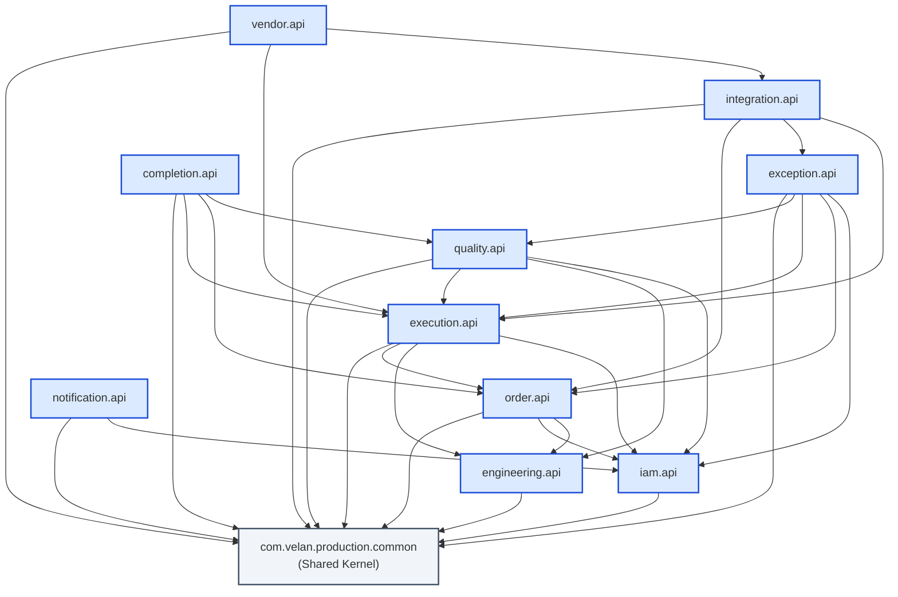

# Part 3.2 — Backend Architecture and Coding Standards
## Document 01: Module Structure, Packaging Layout, and ArchUnit Dependency Rules

---

### 1. Confirmed Rules (Frozen Baseline)
* **Modular Monolith Pattern (`ADR-01`):** Velan Production is architected as a single deployable modular monolith in Java 21 / Spring Boot. No microservices (`ADR-01`), no distributed network latency between stations, and no distributed two-phase commit transactions.
* **Prohibited Infrastructure (`D-13`):** No Redis (`ADR-03`), no RabbitMQ or Kafka (`ADR-02`), and no external message brokers. In-process Caffeine caches and PostgreSQL transactional outbox tables provide caching and asynchronous event delivery.
* **Encapsulation & Package Boundaries (`ADR-01`):** Domain modules must be strictly decoupled. Cross-module calls must route exclusively through public facade interfaces in `api` packages or domain events. Direct cross-module persistence entity and repository access is forbidden.

---

### 2. Proposed Design: The 11 Domain Modules and Packaging Standards

#### 2.1 The 11 Core Domain Modules
The backend monolith is partitioned into 11 discrete business and infrastructure modules under root package `com.velan.production`:

| # | Module Name | Package Path | Primary Business Domain & Ownership | Public Exported Facade(s) |
|---|---|---|---|---|
| 1 | **IAM** | `com.velan.production.iam` | User identity, password hashing, JWT issuance, 6 confirmed roles, RBAC evaluation | `AuthenticationFacade`, `UserContextFacade`, `UserDTO` |
| 2 | **Order** | `com.velan.production.order` | Commercial Purchase Orders, SC intake (RM sync, manual, Excel), revision history | `OrderQueryFacade`, `SCIntakeCommandFacade`, `SCEvent` |
| 3 | **Engineering**| `com.velan.production.engineering`| Products, BOMs, component set ratios, process templates, tolerances, CAD metadata | `BOMQueryFacade`, `TemplateFacade`, `ToleranceCalculationFacade`|
| 4 | **Execution** | `com.velan.production.execution` | Individual piece physical tracking, serial generation, operation lifecycle, station jobs| `PieceCommandFacade`, `OperationExecutionFacade`, `PieceDTO` |
| 5 | **Quality** | `com.velan.production.quality` | Independent blind QC inspections, tolerance compliance engine, pass/fail verdicts | `QualityInspectionFacade`, `ToleranceValidationFacade` |
| 6 | **Exception** | `com.velan.production.exception` | QC exception tickets, 4 PM dispositions, rework iteration routing, scrap replacement | `ExceptionDispositionFacade`, `ReworkRoutingFacade` |
| 7 | **Vendor** | `com.velan.production.vendor` | RM Delivery Challan tracking (read-only), vendor process returns, inward QC readiness | `VendorTrackingFacade`, `RMDeliveryChallanFacade` |
| 8 | **Completion**| `com.velan.production.completion` | Set assembly completeness, final QC verification, packing, dispatch staging bays | `SetCompletionFacade`, `PackingConfirmationFacade` |
| 9 | **Notification**| `com.velan.production.notification`| Internal domain event hub, audit trail generation, SSE push streams to terminals | `NotificationPublisherFacade`, `AuditTrailFacade` |
| 10 | **Integration**| `com.velan.production.integration` | RM REST read-only connector, ECR HTTPS outbox worker, external anti-corruption layers | `RMConnectorService`, `ECROutboxProcessor` |
| 11 | **Common** | `com.velan.production.common` | Shared kernel: base error codes, exceptions, Clock, audit annotations, paging DTOs | `ClockConfig`, `ErrorCode`, `VelanException`, `PageResponse` |

---

#### 2.2 Standard Package Layout Inside Every Module
Every domain module follows a mandatory, uniform two-tier package structure:

```text
com.velan.production.<module_name>
├── api/                           <-- PUBLIC EXPORTED CONTRACTS (Cross-Module Visible)
│   ├── command/                   <-- Inbound Command DTOs (Java Records)
│   ├── query/                     <-- Query Request & Response DTOs (Java Records)
│   ├── event/                     <-- Immutable Domain Events (Java Records)
│   └── facade/                    <-- Public Java Interface Facades
└── internal/                      <-- PRIVATE IMPLEMENTATION (Module-Internal Only)
    ├── domain/                    <-- JPA Entities, Value Objects, State Machine Enums
    ├── repository/                <-- Spring Data JPA Repositories (Package-Private)
    ├── service/                   <-- Domain Services & Facade Implementations
    ├── controller/                <-- Spring MVC REST Controllers (@RestController)
    ├── mapper/                    <-- MapStruct Mappers (Entity <-> Record DTO)
    └── listener/                  <-- Spring Event Listeners (@TransactionalEventListener)
```

#### 2.3 Public vs. Internal Visibility Rules
1. **Public Contracts (`api/`):** Contains only Java interfaces, record DTOs, and immutable domain events. Classes in `api` may be referenced by other modules.
2. **Private Internals (`internal/`):** All classes within `internal/` must be package-private wherever the framework allows. Public access is strictly forbidden for entities, repositories, and internal services.
3. **Zero Cross-Module Entity Sharing:** A module must never import a JPA `@Entity` from another module. All inter-module communication exchanges DTO records.

---

#### 2.4 Allowed Dependency Graph
Inter-module dependencies must form a strict Direct Acyclic Graph (DAG). Circular dependencies between modules will fail the build:



---

#### 2.5 Inter-Module Communication Mechanisms
Modules communicate through two explicit mechanisms:
1. **Synchronous Direct Invocations via Facade Interfaces:**
   - Used for immediate transactional validations or lookups within the same HTTP thread.
   - Example: `execution.internal.service` injects `engineering.api.facade.ToleranceCalculationFacade` to compute tolerance limits before storing operator measurements.
2. **Decoupled Asynchronous Events via Spring Event Publisher:**
   - Used for side effects, downstream state unlocks, and notifications.
   - Mechanism: Originating service calls `ApplicationEventPublisher.publishEvent(new OperationQCPassedEvent(...))`.
   - Consumer executes inside `@TransactionalEventListener(phase = TransactionPhase.AFTER_COMMIT)`.

---

### 3. Prescriptive ArchUnit Rule Catalogue

The following 14 architectural rules must be codified into `com.velan.production.architecture.ArchitectureEnforcementTest` using **ArchUnit 1.4.0+** and run during `./mvnw verify`:

#### Rule 1: Module Encapsulation Invariant (`ARCH-01`)
* **Prescription:** Code in module `X` must never import classes from `com.velan.production.Y.internal..*` where `X != Y`.
* **ArchUnit Rule:**
  ```java
  noClasses().that().resideInAPackage("..production.(*)..")
      .should().dependOnClassesThat()
      .resideInAPackage("..production.(*).internal..")
      .where(targetPackageNotMatchingSourcePackage());
  ```

#### Rule 2: Controller-to-Repository Isolation (`ARCH-02`)
* **Prescription:** Controllers must never directly inject or call Spring Data repositories. Controllers must call service facades.
* **ArchUnit Rule:**
  ```java
  noClasses().that().resideInAPackage("..internal.controller..")
      .should().dependOnClassesThat().resideInAPackage("..internal.repository..");
  ```

#### Rule 3: Mandatory Controller Authorization Annotation (`ARCH-03`)
* **Prescription:** Every public method on every `@RestController` must have an explicit `@PreAuthorize` or `@Secured` annotation enforcing RBAC.
* **ArchUnit Rule:**
  ```java
  methods().that().areDeclaredInClassesThat().areAnnotatedWith(RestController.class)
      .and().arePublic()
      .should().beAnnotatedWith(PreAuthorize.class);
  ```

#### Rule 4: Zero Entity Leakage in Controller Signatures (`ARCH-04`)
* **Prescription:** Controller request bodies and return types must never be JPA `@Entity` classes; they must be Java records in `api` or DTO packages.
* **ArchUnit Rule:**
  ```java
  methods().that().areDeclaredInClassesThat().areAnnotatedWith(RestController.class)
      .should().haveRawReturnType(not(annotatedWith(Entity.class)))
      .andShould().notHaveRawParameterTypes(whereAny(annotatedWith(Entity.class)));
  ```

#### Rule 5: Integration Internals Isolation (`ARCH-05`)
* **Prescription:** No domain module may depend on HTTP client adapters, REST templates, or internal models of the `integration` module.
* **ArchUnit Rule:**
  ```java
  noClasses().that().resideOutsideOfPackage("..production.integration..")
      .should().dependOnClassesThat().resideInAPackage("..production.integration.internal..");
  ```

#### Rule 6: Cross-Module Communication via Facade or Event Only (`ARCH-06`)
* **Prescription:** Cross-module service dependencies must target interfaces located strictly within an `.api.facade` or `.api.event` package.

#### Rule 7: Transaction Demarcation in Service Layer Only (`ARCH-07`)
* **Prescription:** `@Transactional` annotations must reside on methods in `.service.` or `.facade.` implementations, never on controllers or repository interfaces.
* **ArchUnit Rule:**
  ```java
  methods().that().areAnnotatedWith(Transactional.class)
      .should().beDeclaredInClassesThat().resideInAPackage("..service..");
  ```

#### Rule 8: Repository Naming and Interface Inheritance (`ARCH-08`)
* **Prescription:** All repository classes must reside in an `internal.repository` package, end with the suffix `Repository`, and extend `org.springframework.data.repository.Repository`.

#### Rule 9: DTO Immutability (`ARCH-09`)
* **Prescription:** All classes in `..api.command..`, `..api.query..`, and `..api.event..` must be Java `record` types or final immutable classes with private final fields and zero setters.

#### Rule 10: Entity State Mutation Encapsulation (`ARCH-10`)
* **Prescription:** Domain aggregates must not expose public `setStatus(...)` setters. State transitions must occur through explicit domain methods (e.g., `operation.recordOperatorSubmission(...)`).

#### Rule 11: Transactional Outbox Isolation (`ARCH-11`)
* **Prescription:** Direct writing to `outbox_events` is restricted to authorized domain event outbox publishers.

#### Rule 12: Zero Cyclic Package Dependencies (`ARCH-12`)
* **Prescription:** The monolithic package hierarchy must contain zero cyclic slices across all top-level module packages.
* **ArchUnit Rule:**
  ```java
  slices().matching("com.velan.production.(*)..").should().beFreeOfCycles();
  ```

#### Rule 13: Immutability of Append-Only Records (`ARCH-13`)
* **Prescription:** Repositories for append-only entities (`operation_measurements`, `qc_inspections`, `pm_dispositions`, `audit_logs`, `tolerance_revisions`) must not declare `delete`, `deleteAll`, or update methods.

#### Rule 14: Prohibition of External Network Calls in Transactions (`ARCH-14`)
* **Prescription:** Methods annotated with `@Transactional` must not invoke HTTP clients (`RestTemplate`, `RestClient`, `WebClient`), AWS SDK clients, or `JavaMailSender`.

---

### 4. Technical Assumptions
1. **ASSUMPTION:** Spring Security `@EnableMethodSecurity` will be active in Spring Boot 3.x/4.x to support `@PreAuthorize("hasRole('ROLE_PM')")` checks across all controller endpoints.
2. **ASSUMPTION:** ArchUnit rules will be bound to Maven build phases via `./mvnw test-compile` and `./mvnw test` to prevent code reviews on non-compliant code.

---

### 5. Open Questions
* **O-MOD-01:** Should `completion` and `vendor` modules maintain distinct database schemas within Neon PostgreSQL (e.g., `schema = 'completion'`), or share the public schema with table-prefix naming conventions? (Documented in Document 06).
