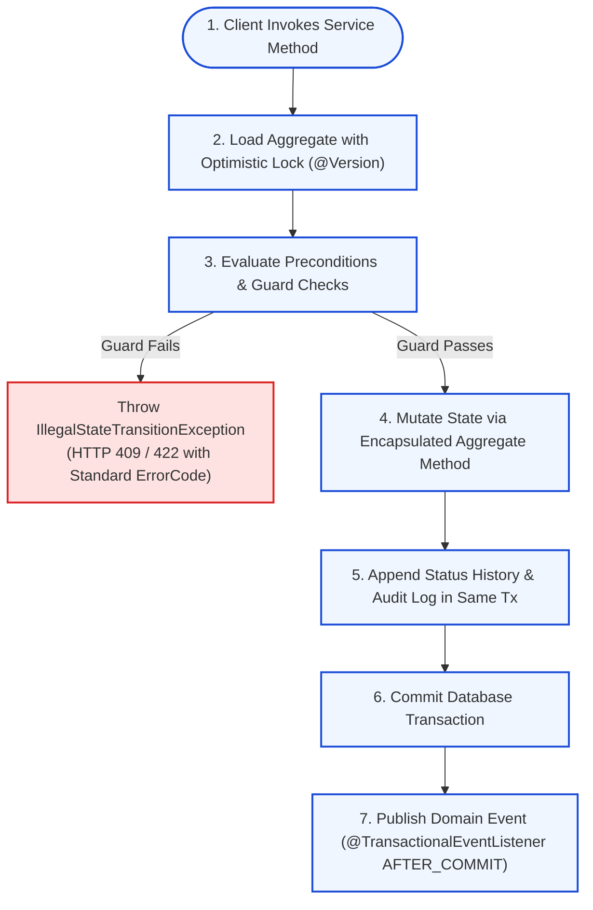

# Part 3.2 — Backend Architecture and Coding Standards
## Document 02: Domain Services, State Machine Pattern, and Append-Only Protection

---

### 1. Confirmed Rules (Frozen Baseline)
* **Single Source of State Mutations (`BR-013, BR-068`):** Every piece, operation, QC verdict, exception, and contract header must exist in exactly one status at any given time. Status changes must never be performed via direct SQL updates or generic setters.
* **Append-Only Immutability (`D-06, BR-032, BR-049`):** Measurements (operator and QC), QC inspection results, PM disposition records, tolerance revisions, and audit logs are strictly append-only. They must never be updated or deleted in code or persistence.
* **Separation of Measurements (`D-06`):** Operator measurements and QC inspection measurements are recorded in distinct entities. QC measurement fields must never be pre-filled with operator values.
* **PM-Only Exception Authority (`D-07`):** When an operation fails QC, the piece is quarantined. Only the PM can issue an approved disposition: `CONTINUE` (mandatory reason), `EXTRA_PROCESS`, `RETURN_TO_EARLIER_OPERATION`, or `REJECT_AND_RESTART`.

---

### 2. Proposed Design: The Unified State Machine Pattern

All 10 state machines defined in Parts 2.3–2.6 follow a single, standardized, deterministic implementation pattern in the backend.

#### 2.1 The Seven-Step State Machine Execution Flow
Every state transition must execute through a designated **Domain Service** adhering to seven atomic steps within a single `@Transactional` method:



1. **State & Event Enums:** Defined explicitly as immutable Java enums with uppercase identifiers.
2. **Transition Matrix Enforcement:** The aggregate root encapsulates a transition validation matrix. If a requested transition is not declared valid from the aggregate's current state, transition execution halts immediately.
3. **Precondition Guard Checks:** Guard predicates test data readiness (e.g. `material_ready == true`, preceding operation `PASSED`, non-empty PM justification notes).
4. **Encapsulated Mutation (No Public Setters):** Public setters like `setStatus(...)` are prohibited. The aggregate exposes intention-revealing methods (e.g., `operation.recordOperatorSubmission(operatorId, values)`).
5. **Atomic Status History:** An immutable history row (e.g. `piece_operation_history`) capturing `old_status`, `new_status`, `changed_by`, `reason`, and `timestamp` is inserted within the same database transaction.
6. **Audit Trail Generation:** An `audit_logs` record is appended within the same transaction.
7. **Post-Commit Domain Events:** Side-effect events (unlocking downstream operations, pushing SSE alerts) are fired after database commit using Spring's `@TransactionalEventListener(phase = TransactionPhase.AFTER_COMMIT)`.

---

#### 2.2 Standard Code Pattern (Prescriptive Example)

The following snippet demonstrates the standard pattern applied to Operation execution:

```java
package com.velan.production.execution.internal.service;

import com.velan.production.common.error.ErrorCode;
import com.velan.production.common.exception.IllegalStateTransitionException;
import com.velan.production.execution.api.event.OperationStatusChangedEvent;
import com.velan.production.execution.internal.domain.PieceOperation;
import com.velan.production.execution.internal.domain.OperationStatus;
import com.velan.production.execution.internal.domain.PieceOperationHistory;
import com.velan.production.execution.internal.repository.PieceOperationHistoryRepository;
import com.velan.production.execution.internal.repository.PieceOperationRepository;
import lombok.RequiredArgsConstructor;
import org.springframework.context.ApplicationEventPublisher;
import org.springframework.stereotype.Service;
import org.springframework.transaction.annotation.Transactional;

import java.time.Clock;
import java.time.Instant;
import java.util.UUID;

@Service
@RequiredArgsConstructor
public class OperationDomainService {

    private final PieceOperationRepository operationRepository;
    private final PieceOperationHistoryRepository historyRepository;
    private final ApplicationEventPublisher eventPublisher;
    private final Clock clock;

    @Transactional
    public void submitOperatorJob(UUID operationId, UUID operatorId, String notes) {
        // 1. Load aggregate with optimistic locking (@Version)
        PieceOperation op = operationRepository.findById(operationId)
            .orElseThrow(() -> new IllegalStateTransitionException(
                ErrorCode.OPERATION_NOT_FOUND, "Operation not found: " + operationId));

        // 2. Precondition & Guard Evaluation
        if (op.getStatus() != OperationStatus.OPENED) {
            throw new IllegalStateTransitionException(
                ErrorCode.INVALID_OPERATION_TRANSITION,
                "Cannot submit operation in status: " + op.getStatus() + ". Expected: OPENED.");
        }

        OperationStatus oldStatus = op.getStatus();
        Instant now = Instant.now(clock);

        // 3. Encapsulated State Mutation
        op.markSubmitted(operatorId, now);
        operationRepository.save(op);

        // 4. Record Status History in same transaction
        PieceOperationHistory history = PieceOperationHistory.builder()
            .operationId(op.getId())
            .pieceId(op.getPieceId())
            .oldStatus(oldStatus)
            .newStatus(OperationStatus.QC_PENDING)
            .changedByUserId(operatorId)
            .changeReason(notes)
            .recordedAt(now)
            .build();
        historyRepository.save(history);

        // 5. Fire Domain Event for downstream processing after commit
        eventPublisher.publishEvent(new OperationStatusChangedEvent(
            op.getId(), op.getPieceId(), oldStatus, OperationStatus.QC_PENDING, operatorId, now));
    }
}
```

---

### 3. State Machine Mapping Catalogue (The 10 State Machines)

Every state machine from Phase 2 maps to an aggregate, domain service, and transition reference:

| # | State Machine Name | Owning Module | Target Entity (Aggregate Root) | Phase 2 Transition Spec | Forbidden Transition Exception & Error Code |
|---|---|---|---|---|---|
| 1 | **Piece Lifecycle** | `execution` | `Piece` | Part 2.3 (`02-piece-state-transitions...`) | `IllegalStateTransitionException`<br/>`INVALID_PIECE_TRANSITION` |
| 2 | **Operation Lifecycle** | `execution` | `PieceOperation` | Part 2.4 (`02-operation-state-transitions...`) | `IllegalStateTransitionException`<br/>`INVALID_OPERATION_TRANSITION` |
| 3 | **QC Inspection Lifecycle** | `quality` | `QCInspection` | Part 2.5 (`02-qc-inspection-state-machine...`) | `QualityInspectionException`<br/>`INVALID_QC_STATE_TRANSITION` |
| 4 | **PM Exception Disposition** | `exception` | `QCException` | Part 2.5 (`03-exception-lifecycle-and-pm...`) | `ExceptionDispositionException`<br/>`INVALID_DISPOSITION_TRANSITION` |
| 5 | **ECR Outbox Event** | `integration` | `OutboxEvent` | Part 2.5 (`04-ecr-outbox-integration...`) | `OutboxTransitionException`<br/>`INVALID_OUTBOX_STATE_TRANSITION` |
| 6 | **Scrap Replacement Lineage** | `execution` | `PieceReplacementLineage`| Part 2.5 (`03-exception-lifecycle-and-pm...`) | `ReplacementLineageException`<br/>`REPLACEMENT_BLOCKED_UNRELEASED` |
| 7 | **Sales Contract Header** | `order` | `Subcontract` | Part 2.6 (`01-sc-lifecycle-overview...`) | `ContractTransitionException`<br/>`INVALID_CONTRACT_STATUS_TRANSITION` |
| 8 | **SC Product Line Item** | `order` | `SubcontractProduct` | Part 2.6 (`01-sc-lifecycle-overview...`) | `ContractLineTransitionException`<br/>`INVALID_LINE_STATUS_TRANSITION` |
| 9 | **Assembled Set Lifecycle** | `completion` | `AssembledSet` | Part 2.6 (`02-sc-set-and-component...`) | `SetTransitionException`<br/>`INVALID_SET_STATUS_TRANSITION` |
| 10| **Packing & Dispatch Gate** | `completion` | `AssembledSet` | Part 2.6 (`03-packing-and-dispatch...`) | `DispatchGateException`<br/>`SET_NOT_READY_FOR_DISPATCH` |

---

### 4. Code Protection of Append-Only Records

To satisfy data integrity rules (`D-06, BR-032, BR-049`), the following entities are **permanently append-only**:
1. `operation_measurements` and `measurement_values`
2. `qc_inspections`
3. `pm_dispositions`
4. `tolerance_revisions`
5. `audit_logs`

#### 4.1 Architectural Protection Mechanisms in Java
1. **Zero Mutating Setters:** Entities declare private final or package-private attributes without public setters for recorded data. Fields are assigned strictly upon instantiation via factory methods or builders.
2. **Restricted Repository Contracts:** Repositories for these entities extend a restricted base repository or explicitly omit `delete`, `deleteAll`, `deleteById`, and custom `UPDATE` JPQL queries:
   ```java
   public interface OperationMeasurementRepository extends Repository<OperationMeasurement, UUID> {
       OperationMeasurement save(OperationMeasurement measurement);
       Optional<OperationMeasurement> findById(UUID id);
       List<OperationMeasurement> findByPieceOperationId(UUID opId);
       // ZERO delete or update methods declared
   }
   ```
3. **Database-Level Revocation:** Flyway migrations establish restrictive database privileges, revoking `UPDATE` and `DELETE` on append-only tables for standard runtime application roles.

---

### 5. Completion Logic Pattern (Open Conflicts C-1 and C-2)

#### 5.1 Pattern Structure
The completion calculation cascades upward when child records reach terminal states:
```text
Piece Passed Op Last -> [Evaluate Sibling Pieces] -> Set Complete -> [Evaluate Sets] -> Product Complete -> SC Complete
```
* **Event-Driven Cascade:** When a piece operation passes QC, an asynchronous post-commit listener evaluates parent aggregate completion counters.
* **Optimistic Locking Guard:** Parent updates apply `@Version` checks to prevent race conditions during concurrent sibling piece completions.

#### 5.2 Mandatory Open Designation
* **Conflict C-1 is OPEN:** Decision `D-10` specifies that when all operations on all pieces pass, the SC becomes `Delivered` automatically without packing or dispatch screens/statuses/roles. Conversely, Phase 2 Parts 2.2 and 2.6 specify multi-component assembled sets, physical packing checklists, staging bays (`DISPATCH_PENDING`), and dock gate releases (`dispatch_confirmations`).
* **Conflict C-2 is OPEN:** Piece count derivation (RM quantity per product vs BOM ratio $\times$ target sets).
* **Rule:** The state machine pattern provides the structural framework, but the concrete completion trigger remains **OPEN** awaiting owner decision. Code must not silently enforce either completion model.

---

### 6. Technical Assumptions
1. **ASSUMPTION:** Spring Data `@TransactionalEventListener` with default `fallbackExecution = false` guarantees that events are only processed if the enclosing database transaction commits successfully.
2. **ASSUMPTION:** PostgreSQL row-level advisory locks or optimistic locking (`@Version`) provides sufficient concurrency protection without deadlocks during concurrent piece status updates.

---

### 7. Open Questions
* **O-STM-01:** Should status-history tables (`piece_operation_history`, `piece_history`) be partitioned by month in PostgreSQL to maintain query performance as history grows over millions of operations? (Documented in Document 06).
