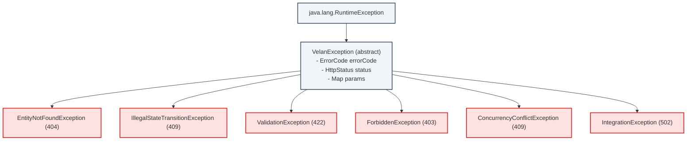

# Part 3.2 — Backend Architecture and Coding Standards
## Document 04: Coding Conventions, Layering, and Quality Governance

---

### 1. Confirmed Rules (Frozen Baseline)
* **Deterministic Decimal Precision (`SKILLS.md §4.2`):** Every dimensional measurement and tolerance limit must be modeled as `BigDecimal` on the backend and string/decimal-safe on the frontend. Floating-point types (`float`, `double`) are strictly forbidden.
* **UTC Time Storage (`SKILLS.md §4.2`):** Every timestamp must be stored in UTC (`TIMESTAMPTZ` in PostgreSQL, `java.time.Instant` in Java) and serialized as ISO-8601 strings in REST interfaces.
* **Deny-by-Default Authorization (`SKILLS.md §1`):** Every controller method must declare an explicit security check. Unauthenticated or unannotated endpoints are prohibited.
* **No Swallowed Exceptions (`SKILLS.md §4.2`):** Catching exceptions without re-throwing or translating to structured domain error codes is forbidden.

---

### 2. Proposed Design: Coding Conventions and Layering Standards

#### 2.1 DTOs as Immutable Java Records
1. **Mandatory Record Syntax:** All inbound commands, outbound query payloads, and domain events must be defined as Java `record` types (native to Java 21 LTS):
   ```java
   public record SubmitMeasurementsCommand(
       @NotNull UUID operationId,
       @NotNull UUID operatorId,
       @NotEmpty List<@Valid MeasurementEntryDTO> measurements,
       String remarks
   ) {}
   ```
2. **Advantages:** Guarantees absolute immutability, provides canonical constructors with compact validation, eliminates boilerplate getter/setter code, and prevents entity mutation leaks.

---

#### 2.2 Entity-to-DTO Mapping Strategy: MapStruct
* **Selected Tool:** **MapStruct 1.6.x** (`org.mapstruct:mapstruct`).
* **Architectural Justification:**
  1. **Zero Reflection Overhead:** MapStruct generates pure Java mapping code during compile time (`javac`), guaranteeing sub-nanosecond transformation performance with zero JVM runtime reflection.
  2. **Compile-Time Safety:** Configured with `unmappedTargetPolicy = ReportingPolicy.ERROR`. If an entity attribute is added without updating the mapper, the Maven build fails at compile time.
  3. **Seamless Spring Integration:** Uses `@Mapper(componentModel = "spring")`, allowing mappers to be injected cleanly into domain services.

---

#### 2.3 Request Validation with Jakarta Bean Validation
1. **Validation Boundaries:** Controller endpoints execute pre-flight validation on incoming records using `@Valid`:
   ```java
   @PostMapping("/{serial}/operations/{opId}/submit")
   @PreAuthorize("hasRole('ROLE_OPERATOR')")
   public ResponseEntity<OperationResponseDTO> submitJob(
       @PathVariable String serial,
       @PathVariable UUID opId,
       @Valid @RequestBody SubmitMeasurementsCommand command) { ... }
   ```
2. **Prescriptive Annotations:**
   - Numbers & Quantities: `@NotNull`, `@Positive`, `@DecimalMin("0.001")`.
   - Text & Codes: `@NotBlank`, `@Size(min = 2, max = 100)`, `@Pattern(...)`.
   - Collections: `@NotEmpty`, `@Size(max = 100)`.

---

#### 2.4 Exception Hierarchy and Unified Error Translation
All exceptions inherit from an abstract domain root `VelanException`:



#### Global REST Error Response Contract (`RFC 7807` Aligned)
The global `@RestControllerAdvice` translates all exceptions into a standard JSON record:
```json
{
  "timestamp": "2026-11-26T10:00:00Z",
  "status": 422,
  "errorCode": "OUT_OF_TOLERANCE_FAILURE",
  "message": "Measured dimension 152.800 mm exceeds allowable upper limit 151.000 mm.",
  "path": "/api/v1/qc/inspections/OP-1002/evaluate",
  "details": {
    "parameter": "Flange Outer Diameter",
    "measuredValue": "152.800",
    "upperLimit": "151.000",
    "lowerLimit": "149.000"
  }
}
```

---

#### 2.5 Time and Clock Rules
1. **Injectable Clock Invariant:** Services must never call `Instant.now()` or `LocalDate.now()` directly. Services must inject `java.time.Clock`:
   ```java
   private final Clock clock;
   Instant now = Instant.now(clock);
   ```
2. **Testability:** Allows unit tests to pin time deterministically via `Clock.fixed(...)`.
3. **Storage & Serialization:**
   - PostgreSQL column type: `TIMESTAMPTZ`.
   - Storage format: UTC (`Instant`).
   - REST payload format: ISO-8601 string (`yyyy-MM-dd'T'HH:mm:ss'Z'`).
   - Shop-floor presentation: Converted to Asia/Kolkata (`IST`, UTC+5:30) on frontend viewports.

---

#### 2.6 BigDecimal and Scale Rules for Dimensional Measurements
1. **Floating Point Prohibition:** `float` and `double` are forbidden across all entities, DTOs, and services.
2. **Measurement Scale & Rounding:**
   - **Linear Dimensions (Metric mm):** Scale = 3 (e.g. `150.250`), `RoundingMode.HALF_UP`.
   - **Angles & Degrees:** Scale = 2 (e.g. `45.00`).
   - **Quantities & Counts:** Integer (BigInteger or Integer) or Scale = 0.
3. **Database Column Type:** `NUMERIC(12, 3)` for dimensions; `NUMERIC(10, 2)` for general ratios.

---

#### 2.7 JSON Serialization Standards
* **REST APIs:** Standard `camelCase` for JSON keys (matching Spring Boot Jackson defaults). Dates formatted as ISO-8601 strings.
* **Database JSONB Columns:** Standard `snake_case` properties inside PostgreSQL `jsonb` payloads (e.g., `snapshot_json`, `payload`).

---

#### 2.8 Null Safety and Optional Rules
1. **Repository & Service Returns:** Use `Optional<T>` only for single-object queries that may not return a result.
2. **Forbidden Usages of Optional:**
   - Never use `Optional` as a method parameter.
   - Never use `Optional` as an entity field.
   - Never wrap collections in `Optional`.
3. **Collection Returns:** Query methods returning lists or sets must never return `null`. They must return `List.of()` or an empty unmodifiable collection.

---

#### 2.9 Project Lombok Policy
To prevent Hibernate proxy corruption, cyclic recursions, and dirty-checking defects:

| Annotation | Policy | Permitted Scope | Architectural Justification |
|---|---|---|---|
| `@Getter` | **Permitted** | Entities, DTOs, Services | Eliminates boilerplate getters without side effects. |
| `@Setter` | **Restricted** | Non-entity classes | Package-private setters permitted only when factory methods cannot apply. |
| `@Builder` | **Permitted** | DTO records, History rows | Facilitates immutable construction. |
| `@RequiredArgsConstructor` | **Permitted** | Spring Services, Controllers | Standard dependency injection via constructor. |
| `@Data` | **STRICTLY FORBIDDEN** | JPA `@Entity` classes | Overrides `equals`/`hashCode` based on mutable fields; breaks Hibernate entity identity and dirty checking. |
| `@EqualsAndHashCode` | **STRICTLY FORBIDDEN** | JPA `@Entity` classes | Causes infinite recursion on bidirectional relationships; corrupts HashSet/HashMap membership when IDs are generated. |
| `@ToString` | **STRICTLY FORBIDDEN** | JPA `@Entity` classes | Triggers lazy-loading exceptions or infinite recursion during logging. |

---

#### 2.10 Logging Standards
1. **SLF4J Logger:** Private static final `org.slf4j.Logger log = LoggerFactory.getLogger(...)` or `@Slf4j`.
2. **Structured MDC Logging:** Key operations must populate Mapped Diagnostic Context (MDC):
   - `correlationId` (UUID tracking request flow)
   - `userId` (authenticated employee code)
   - `pieceSerial` (active physical serial number)
   - `scNumber` (parent contract reference)
3. **Strict Secrets & PII Prohibition:**
   - **FORBIDDEN:** Logging passwords, JWT tokens, pre-signed R2 URLs, `x-internal-secret` headers, employee home addresses, or phone numbers.

---

#### 2.11 Naming Conventions
* **Packages:** Lowercase, dot-separated, singular (e.g. `com.velan.production.execution.internal.service`).
* **Classes:** PascalCase nouns (e.g. `PieceExecutionService`, `OperationMeasurementRepository`).
* **Methods:** camelCase verbs (e.g. `submitOperatorJob`, `evaluateQCTolerance`).
* **Test Classes:**
  - Unit tests: `<TargetClass>Test` (e.g. `OperationDomainServiceTest`).
  - Integration tests: `<TargetClass>IT` (e.g. `PieceExecutionIT`).
* **Test Method Syntax:** `methodName_givenCondition_shouldExpectedBehavior()`  
  (e.g., `submitJob_givenOperationReady_shouldTransitionToQCPending()`).

---

#### 2.12 Code Formatting, Static Analysis, and Javadoc
1. **Tooling (Names Only):**
   - Formatter: **Spotless** configured with `google-java-format`.
   - Linter: **Checkstyle** enforcing Google Java style guidelines.
   - Bug Detection: **SpotBugs** with `findsecbugs` security plugin.
   - Architecture Testing: **ArchUnit**.
2. **Javadoc Requirements:**
   - Mandatory on all public interfaces in `api/facade/`.
   - Mandatory reference to controlling business rules using standard tags:
     ```java
     /**
      * Submits operator measurements and advances operation to QC_PENDING.
      *
      * @see "BR-032 (Operator and QC measurement separation)"
      * @see "D-06 (Independent QC values)"
      */
     ```

---

### 3. Technical Assumptions
1. **ASSUMPTION:** Spring Boot 3.x/4.x default Jackson configuration serializes `Instant` as standard UTC ISO-8601 strings when `spring.jackson.serialization.write-dates-as-timestamps = false`.
2. **ASSUMPTION:** MapStruct annotation processor executes prior to Lombok during `javac` compilation without annotation processing order conflicts.

---

### 4. Open Questions
* **O-COD-01:** Should decimal tolerance deviations be displayed on the shop-floor UI in fractional notation (e.g. $\pm 1/16"$) for legacy imperial drawings, or strictly converted to millimeters? (Documented in Document 06).
