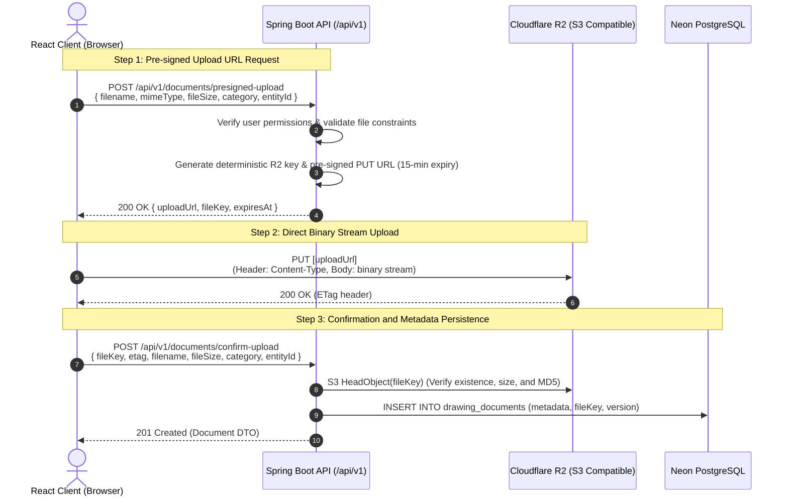

# Part 3.4 — API Standards
## Document 04: File Transfers, Real-Time SSE Streams, and OpenAPI Specifications

---

### 1. Confirmed Rules

#### 1.1 Direct-to-Cloudflare R2 File Transfer Flow (ADR-05)
To preserve application server memory and eliminate network egress fees on Render, binary files (CAD files, technical drawings, inspection photos) are transferred directly between the client browser and **Cloudflare R2** via pre-signed URLs.



1. **Step-by-Step Upload Flow:**
   * **Step 1 (Pre-signed Upload Request):** Client calls `POST /api/v1/documents/presigned-upload`. Backend authorizes request, generates a deterministic S3 key, signs a pre-signed `PUT` URL with a **15-minute expiration** window, and returns `{ uploadUrl, fileKey, expiresAt }`.
   * **Step 2 (Direct Binary Upload):** Client browser streams the binary file directly to Cloudflare R2 using `PUT` with the exact `Content-Type` header specified in Step 1. R2 responds with `200 OK` and an `ETag` checksum.
   * **Step 3 (Upload Confirmation):** Client calls `POST /api/v1/documents/confirm-upload` providing the `fileKey` and `etag`.
   * **Step 4 (Validation & Metadata Record):** Backend issues an AWS S3 SDK `HeadObject` call against Cloudflare R2 to verify file existence and match size/content-type. Upon successful validation, it persists the document metadata in PostgreSQL and returns `201 Created`.
2. **Download & View Flow:**
   * Client calls `GET /api/v1/documents/{documentId}/presigned-download-url`.
   * Backend verifies read permissions for the document's parent entity.
   * Backend generates an AWS S3 SDK pre-signed `GET` URL with a **15-minute expiration** window.
   * Client renders the PDF/image directly in the browser viewer from Cloudflare R2.
3. **Storage Key Deterministic Partitioning:**
   ```text
   velan-prod/
   └── tenant-default/
       └── {module}/
           └── {entityId}/
               └── {uuid}_{timestamp}_{sanitized-filename}
   ```
4. **File Constraints:**
   * Allowed MIME types: `application/pdf`, `image/jpeg`, `image/png`, `application/dxf`, `application/dwg`.
   * Executable files (`.exe`, `.sh`, `.bat`), macros, and scripts are strictly prohibited.

#### 1.2 Server-Sent Events (SSE) Conventions (ADR-06)
1. **Endpoint Path:** `GET /api/v1/notifications/stream`
2. **Authentication:**
   * Browser native `EventSource` does not support custom request headers. Clients authenticate by passing an ephemeral SSE ticket acquired immediately beforehand:
     - `POST /api/v1/auth/sse-ticket` $\to$ returns `{ sseTicket: "<short-lived-uuid>" }` (valid for 30 seconds, single use).
     - `GET /api/v1/notifications/stream?ticket={sseTicket}`
   * Modern clients utilizing `@microsoft/fetch-event-source` may optionally send the standard `Authorization: Bearer <jwt>` header.
3. **Event Envelope Format:**
   All SSE messages broadcast over the wire must follow the structured SSE envelope:
   ```text
   id: 8f9a2b1c-4d5e-6f7a-8b9c-0d1e2f3a4b5c
   event: QC_FAILED_ALERT
   data: {"pieceId":"p-1024","serialNumber":"V-1024-001","operationId":"op-02","defectCategory":"DIMENSION_OVERSIZE","timestamp":"2026-11-26T04:30:00.000Z"}
   ```
4. **Standard Event Names:**
   * `PIECE_STATUS_CHANGED`: Shop-floor piece progressed to next operation.
   * `QC_INSPECTION_PENDING`: New operation submitted by operator awaiting QC review.
   * `QC_FAILED_ALERT`: Out-of-spec measurement recorded; triggers PM Cockpit alert.
   * `RM_MATERIAL_ISSUED`: Raw material issue confirmed by RM; unlocks operator station.
   * `ECR_DISPATCH_COMPLETED`: External ECR report delivery finalized.
5. **Heartbeat Protocol:**
   * Server sends a heartbeat comment `:keepalive\n\n` or named event `event: heartbeat\ndata: {}\n\n` every **20 seconds**.
   * Prevents proxy timeouts, Cloudflare 100-second idle drops, and Render load-balancer disconnects.
6. **Reconnection & Last-Event-ID:**
   * Client automatically includes `Last-Event-ID` header on reconnect.
   * Backend maintains an in-memory circular ring buffer of recent events (last 100 events per tenant) to replay events missed during transient network drops.
7. **Connection Management:**
   * Maximum **3 concurrent SSE connections per user ID**. Excess connection attempts terminate the oldest connection to prevent connection leakage.

---

### 2. Proposed Design

#### 2.1 OpenAPI 3.1 & TypeScript Client Generation
1. **OpenAPI Generation:**
   * Backend uses `springdoc-openapi-starter-webmvc-ui` (v2.8.5) generating OpenAPI 3.1 at `/v3/api-docs`.
   * Endpoints are organized into OpenAPI Tags matching core modules:
     - `auth`, `order`, `planning`, `execution`, `quality`, `exception`, `document`, `notification`, `admin`, `integration`.
   * Security Scheme: `BearerAuth` (HTTP Bearer JWT) declared globally.
   * DTO properties include descriptive `@Schema(example = "...", description = "...")` annotations.
2. **TypeScript Type Generation Pipeline:**
   * Tool: **`openapi-typescript`** (v7.x).
   * Script in `frontend/package.json`:
     ```json
     {
       "scripts": {
         "api:fetch-spec": "curl -s http://localhost:8080/v3/api-docs -o ./openapi.json",
         "api:generate-types": "openapi-typescript ./openapi.json -o ./src/api/generated/schema.d.ts"
       }
     }
     ```
   * Generated types feed TanStack Query hooks, ensuring 100% end-to-end compile-time type safety between Spring Boot DTOs and React components.
3. **CI Breaking Change Detection:**
   * CI build pipelines execute automated diff checks on the OpenAPI contract to prevent accidental breaking changes between releases.
   * Approved Tool Names:
     - **`oasdiff`** (CLI tool for OpenAPI specification diffing and breaking change detection).
     - **`openapi-diff`** (OpenAPI specification comparison utility).
     - **`optic`** (API contract monitoring and linting tool).

---

### 3. Technical Assumptions
1. **ASSUMPTION:** The maximum single file size limit for Cloudflare R2 uploads is **50 MB**; larger CAD packages must be compressed before upload.
2. **ASSUMPTION:** Cloudflare R2 S3 API credentials (`R2_ACCESS_KEY_ID`, `R2_SECRET_ACCESS_KEY`, `R2_ENDPOINT`) are provided via environment variables in Render.
3. **ASSUMPTION:** Browser native `EventSource` reconnection logic handles exponential backoff if the backend is temporarily restarting.

---

### 4. Open Questions
* **C-1 (Completion Workflow Model):** SSE notification events for loading dock gate releases and staging bay clearances remain conditioned on Conflict C-1.
* **C-3 (The "SC" Terminology Problem):** Document storage paths referencing `sc-{scNumber}` vs `po-{poNumber}` remain subject to final terminology resolution.
