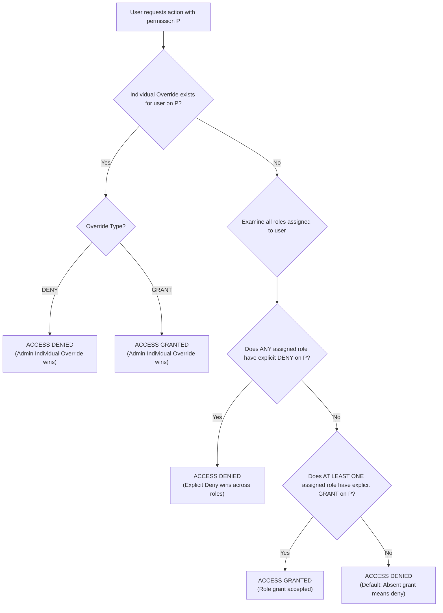

# Part 3.5 — Security, RBAC, Audit and Logging Standards
## Document 02: Role-Based Access Control (RBAC) and Master Permission Catalogue

---

### 1. Confirmed Rules

#### 1.1 The Six System Roles (D-03)
The system is built on **strictly six primary roles**:
1. **`ROLE_ADMIN` (Administrator):** User lifecycle, custom roles, permission overrides, audit log review, record cancellation/deletion.
2. **`ROLE_PM` (Production / Project Manager):** Production scheduling, work assignments, tolerance revision approval, QC failure dispositions (4 outcomes), manual material gate release.
3. **`ROLE_DESIGNER` (Design Engineer):** BOM and CAD drawings, process routing selection, tolerance definitions.
4. **`ROLE_OPERATOR` (Shop-Floor Operator):** Station operation execution, barcode scanning, operator dimensional measurement entry via grid.
5. **`ROLE_QC` (Quality Control Inspector):** Independent dimensional verification measurements, instrument calibration tracking, pass/fail verdicts.
6. **`ROLE_MANAGEMENT` (Executive / Plant Leadership):** Read-only dashboards, production throughput metrics, scrap reports, 9 AM executive summaries.

* **Strict Role Boundary:** Stores, Packing, Dispatch, Vendor Coordinator, and Department Head are **not** roles (D-03). Actions related to these domains are represented strictly as fine-grained permissions or managed in RM.

#### 1.2 Permission Code Format
* Format: **`MODULE:ACTION`** in `UPPER_SNAKE_CASE` (e.g. `EXECUTION:OPERATION_START`, `QUALITY:INSPECTION_SUBMIT`, `EXCEPTION:DISPOSITION_APPLY`).

#### 1.3 Prescriptive Permission Evaluation Algorithm (D-03, BR-052, BR-053)
When an authenticated user attempts an action requiring permission `P`:

1. **Rule 1 (Admin Individual Override):** If an individual permission override exists for the user on permission `P`:
   * If override is `DENY` $\to$ **DENY immediately**.
   * If override is `GRANT` $\to$ **GRANT immediately**.
2. **Rule 2 (Explicit Deny Wins Across Roles):** If no individual override exists, inspect all roles assigned to the user:
   * If **any** assigned role explicitly defines `DENY` for `P` $\to$ **DENY immediately**.
3. **Rule 3 (Role Grant):** If no assigned role denies `P`, and **at least one** assigned role grants `P` $\to$ **GRANT**.
4. **Rule 4 (Default Closed):** If neither an individual override nor any assigned role grants `P` $\to$ **DENY** (BR-052).

#### 1.4 Data Model Needs (Conceptual Description)
The relational persistence schema requires six tables (modeled in words):
* **`users`:** Core employee identity, credentials, active status, locked flags.
* **`roles`:** Stores the 6 primary system roles and any Admin-defined custom roles.
* **`permissions`:** Master catalogue of unique `MODULE:ACTION` codes, module groupings, and human descriptions.
* **`role_permissions`:** Junction mapping roles to permissions with `grant_type` (`GRANT` or `DENY`).
* **`user_role_assignments`:** Maps users to one or more roles with assignment timestamps and assigning admin ID.
* **`user_permission_overrides`:** Stores user-specific overrides (`GRANT` or `DENY`) with mandatory `reason` text and granting admin ID (BR-053).

#### 1.5 Permission Caching and Eviction
1. **Cache Layer:** Resolved user permission sets are cached in Caffeine under key `user-permissions:{userId}`.
2. **TTL:** Bounded to **15 minutes**.
3. **Immediate Cache Eviction:** Cache entries for a user are evicted synchronously whenever:
   * The user's role assignments are modified.
   * An individual permission override is added, updated, or removed.
   * Any role definition assigned to the user has its permissions modified.
   * The user is suspended or deactivated.

---

### 2. Master Permission Catalogue

| Module | Permission Code | Description |
|:---|:---|:---|
| **AUTH** | `AUTH:LOGIN` | Authenticate into application |
| **AUTH** | `AUTH:PASSWORD_RESET` | Initiate password reset |
| **ORDER** | `ORDER:SC_VIEW` | View Size Cards and product lines |
| **ORDER** | `ORDER:SC_CREATE` | Create Size Card manually |
| **ORDER** | `ORDER:SC_IMPORT` | Bulk import Size Cards via Excel |
| **ORDER** | `ORDER:SC_RELEASE` | Release contract products to production |
| **PLANNING** | `PLANNING:TEMPLATE_VIEW` | View process routing templates |
| **PLANNING** | `PLANNING:TEMPLATE_CREATE` | Create routing template draft |
| **PLANNING** | `PLANNING:TEMPLATE_EDIT` | Edit draft routing template |
| **PLANNING** | `PLANNING:TEMPLATE_APPROVE`| Approve and lock routing template version |
| **PLANNING** | `PLANNING:STATION_MANAGE` | Configure work stations |
| **PLANNING** | `PLANNING:PRIORITY_MANAGE` | Set daily operator priority worklist |
| **EXECUTION** | `EXECUTION:PIECE_VIEW` | View piece lifecycle and worklist |
| **EXECUTION** | `EXECUTION:PIECE_RELEASE` | Release piece after RM material check |
| **EXECUTION** | `EXECUTION:OPERATION_START` | Start an operation (READY $\to$ OPENED) |
| **EXECUTION:MEASUREMENT_SUBMIT**| `EXECUTION:MEASUREMENT_SUBMIT` | Record operator measurements |
| **EXECUTION** | `EXECUTION:MATERIAL_OVERRIDE`| Manually toggle RM material-issued flag |
| **QUALITY** | `QUALITY:INSPECTION_VIEW` | View QC inspection queue |
| **QUALITY** | `QUALITY:INSPECTION_EVALUATE` | Record QC measurements & pass/fail verdict |
| **QUALITY** | `QUALITY:TOLERANCE_VIEW` | View product dimensional tolerances |
| **QUALITY** | `QUALITY:TOLERANCE_IMPORT` | Upload tolerance specifications |
| **QUALITY** | `QUALITY:TOLERANCE_APPROVE` | Approve revised tolerance specifications |
| **EXCEPTION** | `EXCEPTION:VIEW` | View QC exceptions and failure cockpit |
| **EXCEPTION** | `EXCEPTION:DISPOSITION_APPLY`| Record PM disposition (Continue, Extra, Return, Scrap) |
| **DOCUMENT** | `DOCUMENT:VIEW` | View and download CAD/PDF drawings |
| **DOCUMENT** | `DOCUMENT:UPLOAD` | Upload technical drawings and revisions |
| **NOTIFICATION**| `NOTIFICATION:STREAM` | Connect to real-time SSE stream |
| **NOTIFICATION**| `NOTIFICATION:MANAGE` | Configure user notification policies |
| **INTEGRATION**| `INTEGRATION:RM_QUERY` | Query RM V-SMART material status |
| **INTEGRATION**| `INTEGRATION:OUTBOX_MANAGE` | Monitor and retry ECR outbox events |
| **ADMIN** | `ADMIN:USER_MANAGE` | Create, edit, and suspend users |
| **ADMIN** | `ADMIN:ROLE_MANAGE` | Create and configure custom roles |
| **ADMIN** | `ADMIN:OVERRIDE_MANAGE` | Grant or deny individual permission overrides |
| **ADMIN** | `ADMIN:AUDIT_VIEW_ALL` | View complete system and security audit logs |
| **ADMIN** | `ADMIN:RECORD_CANCEL` | Cancel or soft-delete business records (BR-050) |
| **DISPATCH** | `DISPATCH:SET_VIEW` | View assembled component sets *(OPEN: C-1)* |
| **DISPATCH** | `DISPATCH:PACK_CREATE` | Record packing checklist *(OPEN: C-1)* |
| **DISPATCH** | `DISPATCH:GATE_RELEASE` | Confirm loading dock gate release *(OPEN: C-1)* |

---

### 3. Default Role-to-Permission Matrix

Derived strictly from Phase 1 `06_Role_Matrix.md`:

| Permission Code | Admin | PM | Designer | Operator | QC | Management | Dependency |
|:---|:---:|:---:|:---:|:---:|:---:|:---:|:---:|
| `ORDER:SC_VIEW` | GRANT | GRANT | GRANT | GRANT (own) | GRANT (qc) | GRANT | None |
| `ORDER:SC_CREATE` | GRANT | GRANT | GRANT | DENY | DENY | DENY | None |
| `ORDER:SC_IMPORT` | GRANT | GRANT | GRANT | DENY | DENY | DENY | None |
| `ORDER:SC_RELEASE` | GRANT | GRANT | DENY | DENY | DENY | DENY | None |
| `PLANNING:TEMPLATE_VIEW` | GRANT | GRANT | GRANT | GRANT (own) | GRANT (qc) | GRANT | None |
| `PLANNING:TEMPLATE_CREATE` | GRANT | GRANT | GRANT | DENY | DENY | DENY | None |
| `PLANNING:TEMPLATE_APPROVE`| GRANT | GRANT | DENY | DENY | DENY | DENY | None |
| `PLANNING:PRIORITY_MANAGE` | GRANT | GRANT | DENY | DENY | DENY | DENY | None |
| `EXECUTION:PIECE_VIEW` | GRANT | GRANT | GRANT | GRANT | GRANT | GRANT | None |
| `EXECUTION:OPERATION_START`| DENY | DENY | DENY | GRANT | DENY | DENY | None |
| `EXECUTION:MEASUREMENT_SUBMIT`| DENY | DENY | DENY | GRANT | DENY | DENY | None |
| `EXECUTION:PIECE_RELEASE` | GRANT | GRANT | DENY | DENY | DENY | DENY | None |
| `EXECUTION:MATERIAL_OVERRIDE`| GRANT | GRANT | DENY | DENY | DENY | DENY | None |
| `QUALITY:INSPECTION_VIEW` | GRANT | GRANT | GRANT | DENY | GRANT | GRANT | None |
| `QUALITY:INSPECTION_EVALUATE`| DENY | DENY | DENY | DENY | GRANT | DENY | None |
| `QUALITY:TOLERANCE_VIEW` | GRANT | GRANT | GRANT | GRANT | GRANT | GRANT | None |
| `QUALITY:TOLERANCE_IMPORT` | GRANT | GRANT | GRANT | DENY | DENY | DENY | None |
| `QUALITY:TOLERANCE_APPROVE`| GRANT | GRANT | DENY | DENY | DENY | DENY | None |
| `EXCEPTION:VIEW` | GRANT | GRANT | GRANT | DENY | GRANT | GRANT | None |
| `EXCEPTION:DISPOSITION_APPLY`| GRANT | GRANT | DENY | DENY | DENY | DENY | None |
| `DOCUMENT:VIEW` | GRANT | GRANT | GRANT | GRANT | GRANT | GRANT | None |
| `DOCUMENT:UPLOAD` | GRANT | GRANT | GRANT | DENY | DENY | DENY | None |
| `INTEGRATION:OUTBOX_MANAGE`| GRANT | GRANT | DENY | DENY | DENY | DENY | None |
| `ADMIN:USER_MANAGE` | GRANT | DENY | DENY | DENY | DENY | DENY | None |
| `ADMIN:ROLE_MANAGE` | GRANT | DENY | DENY | DENY | DENY | DENY | None |
| `ADMIN:OVERRIDE_MANAGE` | GRANT | DENY | DENY | DENY | DENY | DENY | None |
| `ADMIN:AUDIT_VIEW_ALL` | GRANT | DENY | DENY | DENY | DENY | DENY | None |
| `ADMIN:RECORD_CANCEL` | GRANT | DENY | DENY | DENY | DENY | DENY | None |
| `DISPATCH:SET_VIEW` | GRANT | GRANT | DENY | DENY | DENY | GRANT | Open (C-1) |
| `DISPATCH:PACK_CREATE` | GRANT | GRANT | DENY | DENY | DENY | DENY | Open (C-1) |
| `DISPATCH:GATE_RELEASE` | GRANT | GRANT | DENY | DENY | DENY | DENY | Open (C-1) |

---

### 4. Proposed Design

#### 4.1 Automated RBAC Testing Matrix
Every REST endpoint must be verified by automated Spring Boot integration tests (`@SpringBootTest` with `@WithMockUser`):
* The test suite iterates over all 6 roles against every endpoint, asserting:
  - Permitted roles receive `200 OK` or `201 Created`.
  - Non-permitted roles receive `403 Forbidden`.
* An explicit test verifies the evaluation order:
  - User with Role Grant + Individual Deny Override $\to$ `403 Forbidden`.
  - User with Role Deny + Individual Grant Override $\to$ `200 OK`.
  - User with Two Roles (one Grant, one Deny) without override $\to$ `403 Forbidden`.

---

### 5. Technical Assumptions
1. **ASSUMPTION:** Spring Security `@PreAuthorize("hasAuthority('MODULE:ACTION')")` evaluates permissions on service interfaces prior to transaction commit.
2. **ASSUMPTION:** Individual permission overrides are rare and bounded (< 100 per tenant), ensuring high hit-rates in the Caffeine cache.

---

### 6. Open Questions
* **C-1 (Completion Workflow Model):** Permissions `DISPATCH:SET_VIEW`, `DISPATCH:PACK_CREATE`, and `DISPATCH:GATE_RELEASE` remain strictly conditional on the resolution of Conflict C-1.
