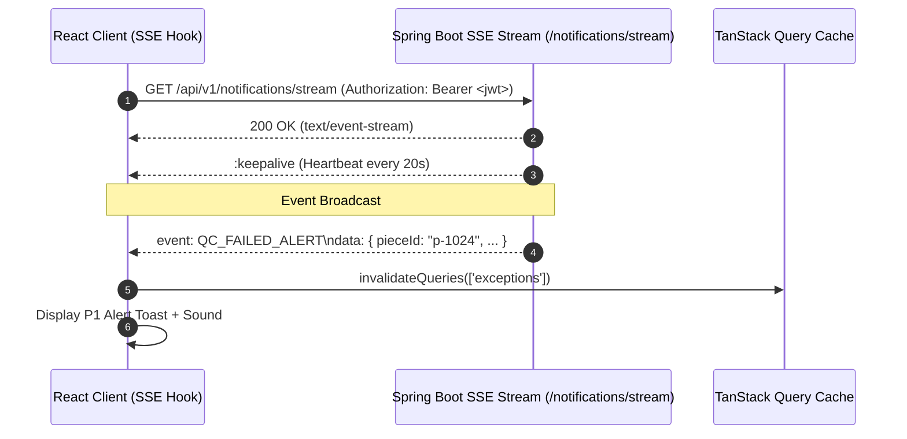

# Part 3.6 — Frontend Standards
## Document 04: Real-Time SSE Client, Permission-Driven Routing, and Notifications

---

### 1. Confirmed Rules

#### 1.1 Permission-Driven UI Access Rule (Zero Role Checks)
* **Core Architectural Invariant:** UI navigation menus, route guards, and action buttons must be driven **strictly by fine-grained permission codes** (`MODULE:ACTION`) returned by the backend in the user's session profile.
* **Prohibition of Role Names:** Checking hardcoded role strings (e.g. `if (user.role === 'OPERATOR')` or `user.roles.includes('ROLE_PM')`) is **strictly prohibited** in frontend components.
* *Rationale:* The application supports dynamic RBAC and individual admin overrides (D-03). A user assigned `ROLE_OPERATOR` might have an individual grant for `PLANNING:TEMPLATE_VIEW` or a deny on `EXECUTION:OPERATION_START`. Only evaluating permission codes guarantees 100% authorization consistency with the Spring Security backend.

#### 1.2 Route Guard Component Architecture
Protected routes are guarded by a declarative `<RequirePermission>` component in `src/app/router.tsx`:

```tsx
export function RequirePermission({
  permission,
  children,
}: {
  permission: string;
  children: React.ReactNode;
}) {
  const { hasPermission, isAuthenticated, isLoading } = useAuth();

  if (isLoading) return <LoadingSpinner />;
  if (!isAuthenticated) return <Navigate to="/login" replace />;
  if (!hasPermission(permission)) return <PermissionDeniedView requiredPermission={permission} />;

  return <>{children}</>;
}
```

#### 1.3 Permission-Aware Sidebar & Menu Rendering
Navigation links in the sidebar are generated dynamically by filtering against the user's active permission set:

```typescript
export const navigationItems: NavItem[] = [
  { label: 'Orders & Contracts', path: '/orders', permission: 'ORDER:SC_VIEW' },
  { label: 'Process Planning', path: '/planning', permission: 'PLANNING:TEMPLATE_VIEW' },
  { label: 'Shop-Floor Execution', path: '/execution', permission: 'EXECUTION:PIECE_VIEW' },
  { label: 'Quality Control Bay', path: '/quality', permission: 'QUALITY:INSPECTION_VIEW' },
  { label: 'PM Exception Cockpit', path: '/exceptions', permission: 'EXCEPTION:VIEW' },
  { label: 'System Administration', path: '/admin', permission: 'ADMIN:USER_MANAGE' },
  { label: 'Assembled Sets', path: '/dispatch/sets', permission: 'DISPATCH:SET_VIEW' }, // Open (C-1)
];
```

#### 1.4 In-App Permission Gate Component
For granular action buttons, a `<PermissionGate>` wrapper conditionally renders or disables controls:

```tsx
<PermissionGate permission="EXECUTION:MEASUREMENT_SUBMIT" fallback={<Tooltip content="Missing permission to submit measurements" />}>
  <Button onClick={handleSubmit}>Submit Operation</Button>
</PermissionGate>
```

---

### 2. Proposed Design

#### 2.1 Real-Time Server-Sent Events (SSE) Client
The frontend connects to `/api/v1/notifications/stream` using `@microsoft/fetch-event-source` (providing standard Bearer token authorization and robust reconnection):



1. **Reconnection & Last-Event-ID:**
   * Upon network interruption, the client reconnects automatically with exponential backoff (`1s`, `2s`, `4s`, `8s`, max `30s`).
   * Automatically transmits the `Last-Event-ID` header so the backend replays missed messages from its circular buffer.
2. **Lifecycle & Cleanup:**
   * Managed via an `AbortController`. When the user logs out or closes the app, `abortController.abort()` cleanly closes the HTTP socket, preventing leaked connections on Render.
3. **Event-to-Query Invalidation Matrix:**

| SSE Event Name | Triggering Business Action | Invalidate TanStack Query Keys | UI Response |
|:---|:---|:---|:---|
| `PIECE_STATUS_CHANGED` | Piece progressed to next operation | `pieceKeys.lists()`, `pieceKeys.detail(id)` | Updates station worklists |
| `QC_INSPECTION_PENDING` | Operator submitted operation | `qcInspectionKeys.pending()` | Increments QC pending badge |
| `QC_FAILED_ALERT` | QC evaluated out-of-spec measurement | `exceptionKeys.lists()` | P1 sound + PM Cockpit banner |
| `RM_MATERIAL_ISSUED` | Raw material issued in RM (V-SMART) | `pieceKeys.all`, `orderKeys.detail(id)` | Unlocks operator "Start" button |
| `ECR_DISPATCH_COMPLETED`| Asynchronous ECR outbox delivery | `integrationKeys.outbox()` | Updates outbox event status |

#### 2.2 Session Expiry & 401 Interception
* When an access token expires during active user operation, the Axios interceptor executes an automatic background refresh.
* If the refresh fails (refresh token expired after 7 days), the auth store sets `user = null`, closes the active SSE stream, and redirects the browser to `/login?session_expired=true`.

#### 2.3 React Error Boundary Architecture
* Top-level and route-level `<ErrorBoundary>` wrappers catch unhandled JavaScript runtime exceptions.
* A friendly crash view displays a technical summary with the request `correlationId` and a "Reload Section" button, preventing full white-screen crashes.

#### 2.4 Notification Centre Drawer
* Accessible via a bell icon in the top header displaying an unread badge counter.
* Slide-over drawer lists recent notifications grouped by date and severity.
* P1 alerts (`QC_FAILED_ALERT`) trigger an audible chime and a non-dismissible persistent alert banner until acknowledged by the PM.

---

### 3. Technical Assumptions
1. **ASSUMPTION:** `@microsoft/fetch-event-source` manages HTTP/2 persistent streaming through Render edge proxies without socket drops.
2. **ASSUMPTION:** Browser audio alerts comply with browser autoplay policies by requiring at least one initial user interaction with the page before audio playback.

---

### 4. Open Questions
* **C-1 (Completion Workflow Model):** Navigation link `/dispatch/sets` and permissions `DISPATCH:SET_VIEW`, `DISPATCH:PACK_CREATE`, and `DISPATCH:GATE_RELEASE` remain strictly conditional on Conflict C-1.
