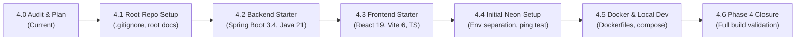

# Velan Production — Phase 4.0: Pre-flight Decisions and Repository Audit Report

**Date:** 2026-11-26  
**Phase:** 4.0 — Pre-flight Decisions and Repository Audit  
**Author:** AI Agent (Antigravity)  
**Status:** COMPLETE — AWAITING OWNER REVIEW & APPROVAL BEFORE PHASE 4.1  
**Target Repository:** `velan-production`  

---

## A. Executive Summary

This pre-flight audit report establishes the operational baseline and execution readiness for **Phase 4: Create Project** of the Velan Production monorepo. In accordance with the mandatory instructions of Phase 4.0, this phase is strictly an audit, inspection, and planning exercise. **Zero application code, zero build files, zero dependency installations, zero database migrations or connections, and zero docker artifacts have been created or modified.**

### Summary of Audit Findings
1. **Repository Baseline:** The repository `velan-production` is on branch `main`, cleanly synchronized with `origin/main`, with a clean working tree. The repository holds all approved Phase 1, Phase 2, and Phase 3 documentation, the root `SKILLS.md` operating manual, the root `README.md`, and `.github/pull_request_template.md`. Foundation folders (`backend/`, `frontend/`) and root configuration files (`.gitignore`, `docker-compose.yml`) do not yet exist, consistent with starting Phase 4.
2. **Architecture Baseline & Owner Approvals:** The repository architecture decision **O-FE-01 is confirmed RESOLVED** by the project owner: One single Git repository (monorepo) hosting independent `/backend` and `/frontend` applications, deployed independently on Render (Render Web Service for Backend, Render Static Site for Frontend `dist/`). All strict architecture boundaries remain intact (no microservices, no Redis, no Kafka, no RabbitMQ, no external distributed cache, no direct writes to RM).
3. **Skills Inventory:** The root `SKILLS.md` operating manual was reviewed completely. Relevant agent skills (`architecture-patterns`, `react-nextjs-development`, `code-showcase-react-ui-patterns`, `react-state-management`, `api-designer`, `database-migrations-sql-migrations`, `accidental-data-loss-prevention`) were inspected and catalogued. Java/Spring Boot and Docker have no standalone agent skills installed and are governed by Phase 3 standards and root `SKILLS.md`.
4. **Development Environment Readiness:** Node.js (v24.16.0), npm (11.13.0), and Git (2.54.0) are installed and fully compatible. Java (JDK 21), Maven, and Docker/Docker Compose are not currently detected on the system PATH. Windows Package Manager (`winget`) is available for local provisioning. These missing host binaries are non-blocking for Phase 4.1 (Root Repository Setup), but JDK 21/Maven must be provisioned before building Phase 4.2 (Backend Starter), and Docker must be provisioned before Phase 4.5 (Docker Local Dev).
5. **Phase 4 Readiness:** The sub-phase execution plan for Phases 4.1 through 4.6 is fully specified with explicit scopes, file deliverables, verification commands, and risk mitigations. The project is **READY WITH NON-BLOCKING ISSUES** to proceed to Phase 4.1 upon owner approval.

---

## B. Repository Audit

### 1. Current Directory Tree
```text
velan-production/
├── .git/                                (Git repository metadata)
├── .github/
│   └── pull_request_template.md         (Phase 3.8 PR checklist template)
├── docs/
│   ├── phase-1/                         (Phase 1 Requirements: 00_DECISION_LOG through 15)
│   ├── phase-2/                         (Phase 2 System Design: 2.1 through 2.6)
│   ├── phase-3/                         (Phase 3 Standards: 3.1 through 3.8, README, Report)
│   ├── updates/                         (Progress logs, reviews, update reports)
│   └── PROJECT_CONTEXT_FOR_CLAUDE.md    (Authoritative master handoff context)
├── README.md                            (Top-level repository overview)
└── SKILLS.md                            (Agent operating manual v1.0)
```
*(Total tracked non-git files across documentation and templates: 125 files)*

### 2. Existing Project Files
- `SKILLS.md`: Agent operating manual defining domain rules, 5-link consistency chain, verification commands, and stop-and-ask triggers.
- `README.md`: High-level project charter and index to documentation.
- `.github/pull_request_template.md`: Enforced PR template created in Phase 3.8.
- `docs/PROJECT_CONTEXT_FOR_CLAUDE.md`: Master architectural and domain reference.
- `docs/phase-1/**`: Approved requirement specifications (SRS, BRD, Role Matrix, Acceptance Criteria, Master Plan).
- `docs/phase-2/**`: Approved system designs (ADRs, Domain Model, State Machines 2.3 to 2.6).
- `docs/phase-3/**`: Approved technical standards (Stack, Backend, Database, API, Security, Frontend, Integration, Quality).

### 3. Git Branch and Working Tree Status
- **Current Branch:** `main`
- **Upstream Tracking:** Up to date with `origin/main`
- **Working Tree:** Clean (no untracked files, no staged or unstaged modifications)
- **Last Commit:** `daf3941` — `feat(docs): complete Phase 3 - Technical Specification and Architecture Standards (Parts 3.1 - 3.8)`

### 4. Existing Changes That Must Be Preserved
- All Phase 1, Phase 2, and Phase 3 specifications and reports.
- Root `SKILLS.md` and `README.md`.
- `.github/pull_request_template.md`.
- No files may be reset, discarded, overwritten, or cleaned.

### 5. Missing Foundation Files (Expected for Phase 4)
- `backend/` directory: Not yet created (to be initialized in Phase 4.2).
- `frontend/` directory: Not yet created (to be initialized in Phase 4.3).
- `.gitignore` (root): Not yet created (to be established in Phase 4.1).
- `docker-compose.yml`: Not yet created (to be established in Phase 4.5).
- `.env.example`: Not yet created (to be established in Phase 4.1 / 4.4).

---

## C. Skills Audit

### 1. Root `SKILLS.md` Location and Review Status
- **Location:** `c:\Users\Admin\OneDrive\Desktop\velan production\velan-production\SKILLS.md`
- **Review Status:** READ COMPLETELY (318 lines).
- **Core Governance Enforced:**
  - Non-negotiable domain rules (6 roles only, individual login, RM read-only, piece-level tracking, append-only measurements, 4 QC actions only).
  - Explicit stack boundaries (Java 21, Spring Boot 3.4.x, React 19, Vite 6, PostgreSQL 16 on Neon, Cloudflare R2, Render, Docker, Caffeine cache; **NO Redis, NO RabbitMQ, NO Kafka, NO microservices**).
  - Zero-error verification standards and definition of done.

### 2. Relevant Agent Skills Installed in Environment

| Skill Name | Path | Purpose in Phase 4 | Reading Status |
|---|---|---|---|
| `architecture-patterns` | `C:\Users\Admin\.agents\skills\architecture-patterns\SKILL.md` | Clean Architecture, Modular Monolith boundaries, layered package structure | READ COMPLETELY |
| `react-nextjs-development` | `C:\Users\Admin\.agents\skills\react-nextjs-development\SKILL.md` | React 19 project scaffolding, Vite, TypeScript configuration, component architecture | READ COMPLETELY |
| `react-state-management` | `C:\Users\Admin\.agents\skills\react-state-management\SKILL.md` | Zustand and TanStack Query setup patterns | READ COMPLETELY |
| `code-showcase-react-ui-patterns` | `C:\Users\Admin\.agents\skills\code-showcase-react-ui-patterns\SKILL.md` | UI states (empty, loading, error) and component patterns | READ COMPLETELY |
| `api-designer` | `C:\Users\Admin\.agents\skills\api-designer\SKILL.md` | REST API standards, endpoint design, and envelope structure | READ COMPLETELY |
| `database-migrations-sql-migrations` | `C:\Users\Admin\.agents\skills\database-migrations-sql-migrations\SKILL.md` | Connection pool boundaries and migration standards (informing Phase 4.4 separation) | READ COMPLETELY |
| `accidental-data-loss-prevention` | `C:\Users\Admin\.gemini\config\skills\accidental-data-loss-prevention\SKILL.md` | Safety enforcement against destructive file/database operations | READ COMPLETELY |

### 3. Missing or Inaccessible Skills
- **Dedicated Spring Boot / Java Backend Skill:** NOT INSTALLED in agent skills catalog. Governed authoritatively by `docs/phase-3/3.1-technology-specification/01-technology-stack-and-versions.md`, `docs/phase-3/3.2-backend-standards/01-module-structure-and-dependency-rules.md`, and root `SKILLS.md`.
- **Dedicated Docker / Containerization Skill:** NOT INSTALLED in agent skills catalog. Governed authoritatively by `docs/phase-3/3.1-technology-specification/02-environments-and-hosting.md`, `04-dependency-and-build-policy.md`, and `docs/phase-3/3.8-quality-process/03-code-review-and-definition-of-done.md`.
- *Finding:* No invented skills were used. Project-level Phase 3 standards provide complete, prescriptive requirements covering all Java/Spring Boot and Docker implementations.

---

## D. Documentation Audit

### 1. Phase 1 Documents Reviewed
- `docs/phase-1/00_DECISION_LOG.md`: Decisions D-01 through D-19; Open items O-01 through O-12.
- `docs/phase-1/02_SRS.md`: Functional boundaries, piece-level tracking, material issue gate.
- `docs/phase-1/06_Role_Matrix.md`: 6 authorized roles (Admin, PM, Designer, Operator, QC, Management).
- `docs/phase-1/08_Business_Rules.md`: Business rules catalogue `BR-001` through `BR-070` (63 active rules, 7 marked `[REMOVED]` per `D-10`/`O-03`).
- `docs/phase-1/09_Integration_Specification.md`: Audited RM endpoints and ECR intake schema.
- `docs/phase-1/10_Acceptance_Criteria.md`: User acceptance criteria and verification expectations.
- `docs/phase-1/15_Application_Master_Plan.md`: 51-phase development roadmap.

### 2. Phase 2 Documents Reviewed
- `docs/phase-2/2.1-system-architecture/`: `ADR-01` to `ADR-08`; modular monolith, independent Render deployments, Neon PostgreSQL.
- `docs/phase-2/2.2-domain-data-model/`: Relational schema, append-only measurement design, outbox pattern.
- `docs/phase-2/2.3` to `2.6`: 10 lifecycle state machines.

### 3. Phase 3 Documents Reviewed
- `docs/phase-3/3.1-technology-specification/01-technology-stack-and-versions.md`: Approved technologies and versions.
- `docs/phase-3/3.1-technology-specification/02-environments-and-hosting.md` & `03-environment-configuration.md`: Render service models (Web Service for backend, Static Site for frontend), R2, and Neon pooled (`-pooler`) vs direct connection configuration (both on port `5432`).
- `docs/phase-3/3.2-backend-standards/01-module-structure-and-dependency-rules.md`: Backend package structure `com.velan.production`, modular monolith `api/` vs `internal/` boundaries.
- `docs/phase-3/3.3-database-and-naming-conventions/02-schema-and-data-type-conventions.md` & `03-flyway-and-migration-standards.md`: PostgreSQL 16 types, non-native enum standard, and Flyway direct compute connection rule (port `5432`).
- `docs/phase-3/3.4-api-standards/01-rest-conventions-and-envelope.md` & `02-error-handling-and-error-catalogue.md`: REST API envelope `ApiResponse<T>` and standardized `ApiErrorResponse` (`{ code, message, details, timestamp, path, correlationId }`).
- `docs/phase-3/3.6-frontend-standards/01-project-structure-and-conventions.md`: React 19, Vite 6, TypeScript strict configuration (`noUncheckedIndexedAccess`).
- `docs/phase-3/3.8-quality-process/01-testing-standards.md` & `03-code-review-and-definition-of-done.md`: Build validation gates and Definition of Done.

### 4. Important Architecture Decisions Identified for Phase 4
- **`O-FE-01` (Monorepo) & `D-13` (Deployment):** Single Git repository with two independent apps: `/backend` and `/frontend`. Backend runs as Render Web Service; Frontend runs as Render Static Site (`dist/`).
- **`D-13` (No External Messaging/Cache):** In-process Caffeine only. Database outbox pattern. No Redis, RabbitMQ, Kafka.
- **Neon Connection Separation:** Both pooled and direct Neon endpoints listen on standard port `5432` (corrected in Phase 4.7 from earlier erroneous `:6543` drafts). Application runtime uses the `-pooler` hostname (`ep-<id>-pooler.<region>.aws.neon.tech:5432`, PgBouncer Transaction Mode). Schema migrations (Flyway in Phase 7) require the direct hostname (`ep-<id>.<region>.aws.neon.tech:5432`). In Phase 4, connectivity verification checks raw connectivity without creating schema or tables.

### 5. Conflicts and Ambiguities Found
- No new conflicts were introduced.
- Open conflicts **C-1** (Completion model), **C-2** (Piece count source), and open items **O-01 through O-12** remain OPEN as required. None of these block Phase 4 project creation.

---

## E. Development Environment Audit

The host environment was inspected using CLI checks on Windows:

| Tool | Required Version / Standard | Detected Version | Compatibility Status | Action / Readiness Status |
|---|---|---|---|---|
| **Git** | 2.40+ | `git version 2.54.0.windows.1` | **COMPATIBLE** | PASS. Installed and operational. |
| **Node.js** | 20.x or 22.x+ (LTS) | `v24.16.0` | **COMPATIBLE** | PASS. Node 24 supports Vite 6 & React 19. |
| **npm** | 10.x+ | `11.13.0` | **COMPATIBLE** | PASS. Compatible with Node 24 and lockfile v3. |
| **Java JDK** | Java 21 (LTS) | Not detected on PATH | **INCOMPATIBLE / MISSING** | **NON-BLOCKING for 4.1**. Must install JDK 21 (e.g. Temurin 21 via `winget`) prior to Phase 4.2. |
| **Maven** | 3.9.x+ | Not detected on PATH | **MISSING HOST BINARY** | **NON-BLOCKING for 4.1**. In Phase 4.2, Maven Wrapper (`mvnw`) will be provided in `/backend` or Maven installed via `winget`. |
| **Docker** | Docker 24.x+ / Desktop | Not detected on PATH | **INCOMPATIBLE / MISSING** | **NON-BLOCKING for 4.1-4.4**. Required prior to Phase 4.5 (Docker Local Dev). |
| **Docker Compose** | v2.20+ | Not detected on PATH | **INCOMPATIBLE / MISSING** | **NON-BLOCKING for 4.1-4.4**. Required prior to Phase 4.5. |
| **Windows Package Manager** | System utility | `winget.exe` detected | **AVAILABLE** | Utility available for provisioning JDK 21 and Docker when authorized. |

*Safety rule confirmed:* No software installations or upgrades were performed during Phase 4.0.

---

## F. Approved Architecture Summary

```text
                                 +---------------------------------------+
                                 |        velan-production Monorepo      |
                                 +-------------------+-------------------+
                                                     |
                         +---------------------------+---------------------------+
                         |                                                       |
                         v                                                       v
        +---------------------------------+                     +---------------------------------+
        |            backend/             |                     |            frontend/            |
        |  Java 21, Spring Boot 3.4.x     |                     |  React 19, Vite 6, TypeScript   |
        |  Maven (mvnw), Modular Monolith |                     |  Tailwind CSS, Zustand, Query   |
        +----------------+----------------+                     +----------------+----------------+
                         |                                                       |
                         v (Render Web Service)                                  v (Render Static Site)
        +---------------------------------+                     +---------------------------------+
        |       Render Web Service        | <=== REST / SSE === |        Render Static Site       |
        |    (Production / Staging API)   |                     |     (Production / Staging CDN)  |
        +----------------+----------------+                     +---------------------------------+
                         |
           +-------------+-------------+
           |                           |
           v (:5432 -pooler Pooled)    v (:5432 Direct - Flyway)
+-------------------------------------------------------------------------+
|                         Neon PostgreSQL 16                              |
|  (Runtime -pooler PgBouncer :5432  |  Admin/Migration Direct :5432)     |
+-------------------------------------------------------------------------+
```

### Key Architectural Boundaries
1. **Repository:** One single monorepo hosting `/backend`, `/frontend`, `docs/`, `.github/`, `.gitignore`, `README.md`, `docker-compose.yml`.
2. **Deployments:** Independent builds and deployments on Render:
   - Backend: Docker/Native Java 21 on Render Web Service.
   - Frontend: Node build (`dist/`) published to Render Static Site.
3. **Communication:** Frontend communicates with backend exclusively over HTTPS REST APIs (`/api/v1`) and Server-Sent Events (SSE). No server-side rendering (SSR), no monolithic frontend serving from Spring Boot static resources.
4. **Data Layer:** PostgreSQL 16 hosted on Neon. Strict separation of pooled endpoint (`-pooler` hostname, port `5432`, PgBouncer Transaction Mode) for application connections and direct endpoint (non-pooler hostname, port `5432`) for schema migrations.
5. **Strict Prohibitions:**
   - NO Microservices (Modular Monolith only).
   - NO Redis.
   - NO RabbitMQ or Kafka.
   - NO external distributed caches (Caffeine in-process only).
   - NO writes to RM (RM is strictly read-only).
   - NO premature business logic or tables in Phase 4.

---

## G. Phase 4 Sub-Phase Execution Plan

The execution of Phase 4 is organized into six distinct sub-phases (4.1 to 4.6), respecting all phase boundaries.



---

### Phase 4.1 — Root Repository Setup

- **Objective:** Establish the approved monorepo root structure, root `.gitignore`, environment template, and update root `README.md`.
- **Exact Scope:**
  - Create root `.gitignore` combining Java/Maven, Node/Vite, Docker, IDE, and OS ignore patterns.
  - Create root `.env.example` defining placeholder variables for backend and frontend.
  - Update root `README.md` to document the monorepo structure, prerequisites, and Phase 4 status.
  - Verify `.github/pull_request_template.md` integration.
- **Expected Deliverables:**
  - `.gitignore` (root)
  - `.env.example` (root)
  - `README.md` (updated)
- **Relevant Skills & Docs:**
  - `docs/phase-3/3.1-technology-specification/02-environments-and-hosting.md`
  - `docs/phase-3/3.8-quality-process/02-git-workflow-and-release.md`
- **Dependencies:** None (Git and Node already available).
- **Validation Commands:**
  - `git status --ignored` (verify proper ignore rules)
  - Check that no sensitive patterns (`.env`, `target/`, `node_modules/`) can be tracked.
- **Acceptance Criteria:**
  - Root `.gitignore` correctly ignores `target/`, `node_modules/`, `dist/`, `.env`, `.idea/`, `.vscode/`.
  - `.env.example` contains all required configuration keys without real credentials.
- **Potential Risks:**
  - Accidental inclusion of sensitive or local files. Mitigated by strict `.gitignore`.
- **Explicit Exclusions:** No backend or frontend code, no Dockerfiles, no database connections.

---

### Phase 4.2 — Backend Starter Project

- **Objective:** Create the minimal compilable Spring Boot 3.4.x and Maven backend starter in `/backend`.
- **Exact Scope:**
  - Initialize `/backend` directory.
  - Provide Maven build descriptor `backend/pom.xml` with approved parent (`spring-boot-starter-parent 3.4.x`), Java 21 compiler target, and foundational starters (`spring-boot-starter-web`, `spring-boot-starter-actuator`, `spring-boot-starter-validation`).
  - Provide Maven wrapper scripts (`mvnw`, `mvnw.cmd`, `.mvn/wrapper/`).
  - Implement base Spring Boot application class `com.velan.production.VelanProductionApplication`.
  - Provide minimal `backend/src/main/resources/application.yml` with basic application name and actuator health defaults.
  - Provide minimal test class `VelanProductionApplicationTests` to verify application context loading.
- **Expected Deliverables:**
  - `backend/pom.xml`
  - `backend/mvnw`, `backend/mvnw.cmd`, `backend/.mvn/wrapper/*`
  - `backend/src/main/java/com/velan/production/VelanProductionApplication.java`
  - `backend/src/main/resources/application.yml`
  - `backend/src/test/java/com/velan/production/VelanProductionApplicationTests.java`
- **Relevant Skills & Docs:**
  - `architecture-patterns` (`C:\Users\Admin\.agents\skills\architecture-patterns\SKILL.md`)
  - `docs/phase-3/3.1-technology-specification/01-technology-stack-and-versions.md`
  - `docs/phase-3/3.2-backend-standards/01-module-structure-and-dependency-rules.md`
  - Root `SKILLS.md`
- **Dependencies:** JDK 21 must be installed on the host machine prior to compiling.
- **Validation Commands:**
  - `cd backend && ./mvnw -B clean compile` (or `mvnw.cmd clean compile`)
  - `cd backend && ./mvnw -B test`
- **Acceptance Criteria:**
  - Backend compiles without warnings or errors.
  - Context loading test passes.
  - Spring Boot version strictly 3.4.x; Java target strictly 21.
- **Potential Risks:**
  - Host JDK not yet configured. Mitigated by installing JDK 21 beforehand.
- **Explicit Exclusions:** No domain entities, no database tables, no Flyway migrations, no business logic, no full package tree (reserved for Phase 5).

---

### Phase 4.3 — Frontend Starter Project

- **Objective:** Create the minimal buildable React 19, Vite 6, and TypeScript frontend starter in `/frontend`.
- **Exact Scope:**
  - Initialize `/frontend` directory.
  - Provide `frontend/package.json` with React 19, React DOM 19, Vite 6, TypeScript, Tailwind CSS, Lucide React, and basic dev dependencies.
  - Configure `frontend/vite.config.ts` with React plugin and path alias `@` -> `/src`.
  - Configure `frontend/tsconfig.json` and `tsconfig.node.json` with strict TypeScript settings (`noUncheckedIndexedAccess: true`, `strict: true`).
  - Configure Tailwind CSS (`tailwind.config.ts`, `postcss.config.js`, `src/index.css`).
  - Create minimal `frontend/index.html` and entry files `frontend/src/main.tsx`, `frontend/src/App.tsx`.
  - Add basic health/welcome banner component.
- **Expected Deliverables:**
  - `frontend/package.json`, `package-lock.json`
  - `frontend/vite.config.ts`, `frontend/tsconfig.json`, `frontend/tsconfig.app.json`, `frontend/tsconfig.node.json`
  - `frontend/tailwind.config.ts`, `frontend/postcss.config.js`
  - `frontend/index.html`
  - `frontend/src/main.tsx`, `frontend/src/App.tsx`, `frontend/src/index.css`
- **Relevant Skills & Docs:**
  - `react-nextjs-development` (`C:\Users\Admin\.agents\skills\react-nextjs-development\SKILL.md`)
  - `code-showcase-react-ui-patterns` (`C:\Users\Admin\.agents\skills\code-showcase-react-ui-patterns\SKILL.md`)
  - `docs/phase-3/3.1-technology-specification/01-technology-stack-and-versions.md`
  - `docs/phase-3/3.6-frontend-standards/01-project-structure-and-conventions.md`
- **Dependencies:** Node.js v24.16.0 & npm 11.13.0 (already installed and verified).
- **Validation Commands:**
  - `cd frontend && npm ci`
  - `cd frontend && npm run typecheck`
  - `cd frontend && npm run build` (verifies `dist/` production bundle output)
- **Acceptance Criteria:**
  - Clean `npm ci` with zero high/critical vulnerabilities.
  - TypeScript strict compile passes without error (`tsc --noEmit`).
  - Vite build successfully outputs static assets into `dist/`.
- **Potential Risks:**
  - React 19 peer dependency mismatches with third-party libraries. Mitigated by keeping starter dependencies minimal and aligned with Phase 3 specifications.
- **Explicit Exclusions:** No business screens, no mock API responses, no complex store logic (Phase 5/8).

---

### Phase 4.4 — Initial Neon Connectivity

- **Objective:** Configure environment variable templates and database configuration profiles for Neon PostgreSQL without creating schema, tables, or running migrations.
- **Exact Scope:**
  - Add PostgreSQL driver (`org.postgresql:postgresql`) and HikariCP connection configuration to `backend/pom.xml` / `application.yml`.
  - Configure profile-driven JDBC URLs distinguishing Neon Pooled (`-pooler`, `:5432`) for application runtime and Neon Direct (`:5432`) for administrative/migration use.
  - Configure connection pool properties appropriate for Neon (HikariCP `max-lifetime: 600000`, `keepalive-time: 60000`, small pool size 5-10 for serverless safety).
  - Provide a standalone, non-migrating connection test utility or profile to verify connectivity against a provided test database URL when supplied.
- **Expected Deliverables:**
  - Updated `backend/src/main/resources/application.yml` with datasource profiles.
  - `backend/src/main/resources/application-local.yml` template.
  - Updated root `.env.example` with `DATABASE_URL` (pooled) and `DATABASE_DIRECT_URL` (direct).
- **Relevant Skills & Docs:**
  - `database-migrations-sql-migrations` (`C:\Users\Admin\.agents\skills\database-migrations-sql-migrations\SKILL.md`)
  - `docs/phase-3/3.1-technology-specification/01-technology-stack-and-versions.md`
  - `docs/phase-3/3.1-technology-specification/02-environments-and-hosting.md` & `03-environment-configuration.md`
  - `docs/phase-3/3.3-database-and-naming-conventions/02-schema-and-data-type-conventions.md`
- **Dependencies:** Phase 4.2 completed.
- **Validation Commands:**
  - `cd backend && ./mvnw test -Dtest=VelanProductionApplicationTests` (with inactive/mock datasource or test profile to ensure context loads without hardcoded database).
- **Acceptance Criteria:**
  - Clear architectural separation between pooled (`-pooler`, `:5432`) and direct (non-pooler, `:5432`) connection settings.
  - ZERO tables, ZERO schema modifications, ZERO Flyway migrations executed.
- **Potential Risks:**
  - Attempting to connect to Neon without valid credentials in CI/local. Mitigated by keeping datasource lazy or profile-guarded so build succeeds without active network database.
- **Explicit Exclusions:** No Flyway migrations, no JPA entities, no DDL scripts, no production database mutations.

---

### Phase 4.5 — Docker and Local Development

- **Objective:** Create independent container configurations for backend and frontend, and a unified `docker-compose.yml` for local multi-container development.
- **Exact Scope:**
  - Create `backend/Dockerfile` using multi-stage build (Eclipse Temurin 21 JDK builder -> Eclipse Temurin 21 JRE runtime, non-root user).
  - Create `frontend/Dockerfile` using multi-stage build (Node 22 builder -> Nginx Alpine runtime serving `dist/`).
  - Create root `docker-compose.yml` defining `backend`, `frontend`, and optional local `postgres` services for completely offline development, with proper port mapping and network bridges.
  - Provide `docker-compose.override.yml.example` for local developer overrides.
  - Document local startup commands in `README.md`.
- **Expected Deliverables:**
  - `backend/Dockerfile`, `backend/.dockerignore`
  - `frontend/Dockerfile`, `frontend/nginx.conf`, `frontend/.dockerignore`
  - `docker-compose.yml` (root)
  - `docker-compose.override.yml.example`
- **Relevant Skills & Docs:**
  - `docs/phase-3/3.1-technology-specification/02-environments-and-hosting.md` & `04-dependency-and-build-policy.md`
  - `docs/phase-3/3.8-quality-process/03-code-review-and-definition-of-done.md`
- **Dependencies:** Phase 4.2 and Phase 4.3 completed; Docker Desktop installed on host.
- **Validation Commands:**
  - `docker compose config` (validates syntax without daemon if docker CLI available)
  - `docker compose build` (when Docker engine is running)
- **Acceptance Criteria:**
  - Backend and frontend images build independently.
  - Multi-stage builds produce lightweight, non-root runtime containers.
  - Ports match standards (Backend: 8080, Frontend: 3000 / 80, Local DB: 5432).
- **Potential Risks:**
  - Large container build sizes. Mitigated by `.dockerignore` and multi-stage Alpine/JRE images.
- **Explicit Exclusions:** No production secrets embedded, no cloud deployment scripts, no Render API interactions.

---

### Phase 4.6 — Phase 4 Validation and Closure

- **Objective:** Execute full end-to-end build, lint, typecheck, container configuration, and documentation verification across the entire Phase 4 deliverable set.
- **Exact Scope:**
  - Execute full backend build: `./mvnw -B clean verify`.
  - Execute full frontend check: `npm ci && npm run typecheck && npm run build`.
  - Validate root `.gitignore` against generated build artifacts (`target/`, `dist/`, `node_modules/`).
  - Validate linking chain from Phase 3 standards to Phase 4 starter files.
  - Author Phase 4 Completion Report (`docs/phase-4/Phase_4_Closure_Report.md`).
- **Expected Deliverables:**
  - Clean verification logs.
  - `docs/phase-4/Phase_4_Closure_Report.md`.
  - Updated `README.md` reflecting completed project setup.
- **Relevant Skills & Docs:**
  - Root `SKILLS.md` Section 4 & 13.
  - `docs/phase-3/3.8-quality-process/05-phase-3-closure.md`.
- **Dependencies:** Phases 4.1 through 4.5 completed.
- **Validation Commands:**
  - Backend: `./mvnw -B verify`
  - Frontend: `npm run typecheck && npm run build`
  - Git: `git status` clean, no untracked artifacts.
- **Acceptance Criteria:**
  - Zero build errors, zero compiler warnings, zero untracked artifacts.
  - Full self-review checklist completed.
- **Potential Risks:**
  - Build warnings or leftover test artifacts.
- **Explicit Exclusions:** No premature transition to Phase 5 before owner review.

---

## H. Blockers and Risks

### 1. Blocking Issues for Phase 4 Implementation
- **Java JDK 21 Missing on Host PATH:**
  - *Status:* Blocking for Phase 4.2 (Backend Starter compilation).
  - *Action:* Install JDK 21 (e.g. `winget install EclipseAdoptium.Temurin.21.JDK` or Microsoft OpenJDK 21) before starting Phase 4.2.
- **Docker Missing on Host PATH:**
  - *Status:* Blocking for Phase 4.5 (Docker verification).
  - *Action:* Install Docker Desktop (e.g. `winget install Docker.DockerDesktop`) before Phase 4.5.

### 2. Non-Blocking Issues
- **Missing Standalone Maven on Host:**
  - Non-blocking because Phase 4.2 will generate the official Maven Wrapper (`mvnw` / `mvnw.cmd`) inside `/backend`, allowing builds without a global Maven installation once JDK 21 is present.
- **Open Conflict C-1 (Completion Model):**
  - Non-blocking for Phase 4. Affects Phase 25+ (Packing/Dispatch/Delivery).
- **Open Conflict C-2 (Piece Count Source):**
  - Non-blocking for Phase 4. Affects Phase 7/11 (Domain entities and piece generation).
- **Open Conflict C-3 (RM/ECR Audited Names):**
  - Non-blocking for Phase 4. Affects Phase 15/28 (Integration adapters).
- **Open Decisions O-01 through O-12:**
  - Non-blocking for Phase 4. All stay OPEN per decision log rules.

### 3. Version Conflicts & Architecture Ambiguities
- **None.** Technology versions are strictly harmonized with Phase 3 standards: Java 21, Spring Boot 3.4.x, React 19, Vite 6, TypeScript 5.x, Tailwind CSS, PostgreSQL 16.

### 4. Required Owner Decisions
- Approval of this Phase 4.0 Pre-flight Audit Report to proceed with Phase 4.1 (Root Repository Setup).
- Authorization to install JDK 21 on the Windows host when transitioning to Phase 4.2.

---

## I. Phase 4.0 Acceptance Checklist

| Requirement ID | Audit Requirement | Status | Evidence / Verification |
|---|---|---|---|
| **REQ-4.0-01** | Root `SKILLS.md` located and read completely | **PASS** | File read at `c:\Users\Admin\OneDrive\Desktop\velan production\velan-production\SKILLS.md` (318 lines). Operating rules verified. |
| **REQ-4.0-02** | Relevant agent skills identified and read | **PASS** | `architecture-patterns`, `react-nextjs-development`, `react-state-management`, `code-showcase-react-ui-patterns`, `database-migrations-sql-migrations`, `accidental-data-loss-prevention` inspected and catalogued. |
| **REQ-4.0-03** | Phase 1, 2, and 3 documentation reviewed | **PASS** | All specifications, ADRs, and Phase 3 standard documents reviewed. |
| **REQ-4.0-04** | Existing Git repository inspected | **PASS** | Inspected via CLI. Clean working tree, branch `main`, 125 tracked documentation files. |
| **REQ-4.0-05** | Development environment audited | **PASS** | Git (2.54.0), Node (v24.16.0), npm (11.13.0) PASS. Java, Maven, Docker identified as missing on host PATH. |
| **REQ-4.0-06** | Approved architecture rules confirmed | **PASS** | Monorepo structure confirmed; independent Render deployments confirmed; strict exclusions (no Redis/Kafka/microservices) maintained. |
| **REQ-4.0-07** | O-FE-01 resolved decision respected | **PASS** | Monorepo layout documented; decision not reopened. |
| **REQ-4.0-08** | Open conflicts (C-1, C-2, C-3, O-xx) preserved | **PASS** | Recorded as OPEN; no unilateral decisions made. |
| **REQ-4.0-09** | Phase 4 sub-phase plan prepared (4.1–4.6) | **PASS** | Complete plan detailed in Section G with deliverables, validation commands, risks, and exclusions. |
| **REQ-4.0-10** | Strict Phase 4.0 restrictions maintained | **PASS** | Zero application code written, zero build files created, zero DB connections, zero dependency installations. |

---

## J. Final Recommendation

### Status: **READY WITH NON-BLOCKING ISSUES**

### Conclusion & Justification:
1. **Architectural & Planning Readiness (100% Ready):**
   - The repository architecture is confirmed (Monorepo with independent Render Web Service and Static Site deployments).
   - The roadmap and scope boundaries between Phase 4 (Create Project) and later phases (Phase 5 Folder Structure, Phase 6 Config, Phase 7 DB, Phase 8 Foundation) are clear and enforced.
   - The sub-phase execution plan for Phases 4.1 through 4.6 is thoroughly specified.
2. **Environment Considerations (Non-blocking for Phase 4.1):**
   - Phase 4.1 (Root Repository Setup: `.gitignore`, `.env.example`, `README.md`) requires only Git and text editing, which are fully operational.
   - Prior to Phase 4.2 (Backend Starter), JDK 21 must be provisioned on the host.
   - Prior to Phase 4.5 (Docker Local Dev), Docker Desktop must be provisioned on the host.

**Recommended Next Step:**
Await project owner approval of this report, then proceed directly to **Phase 4.1 — Root Repository Setup**.
