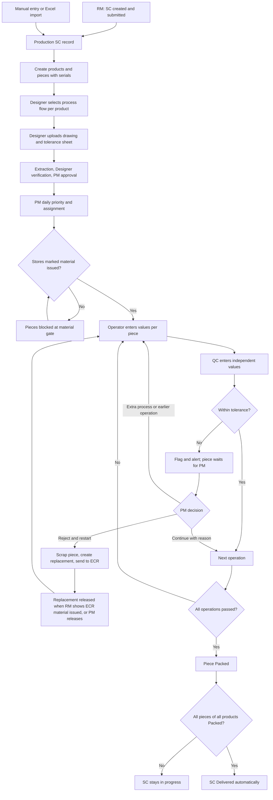
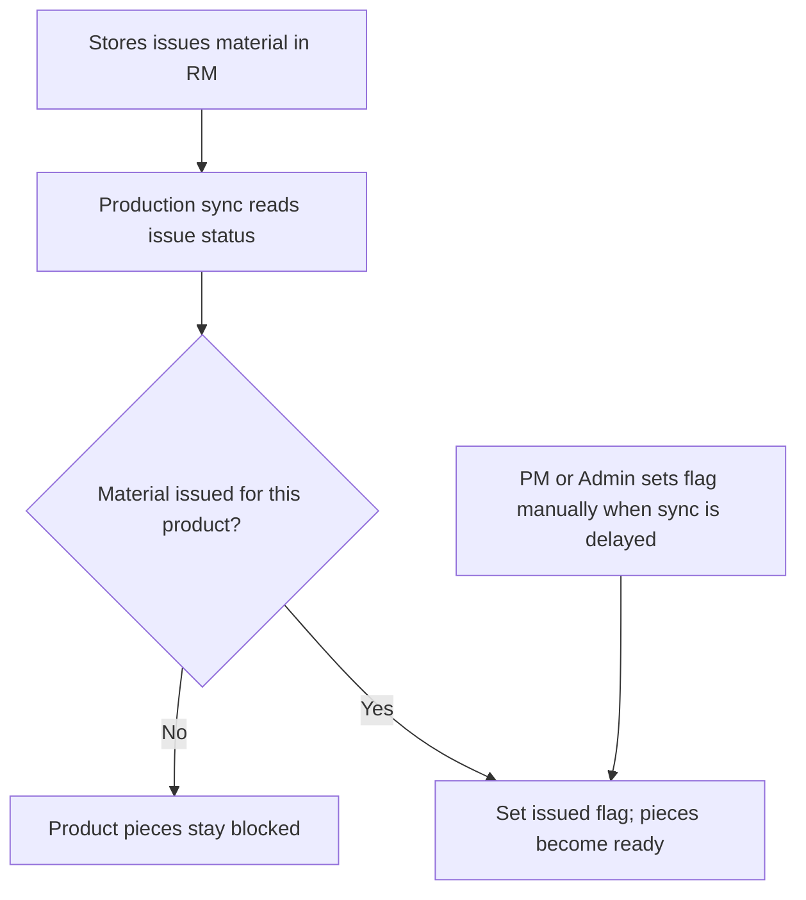
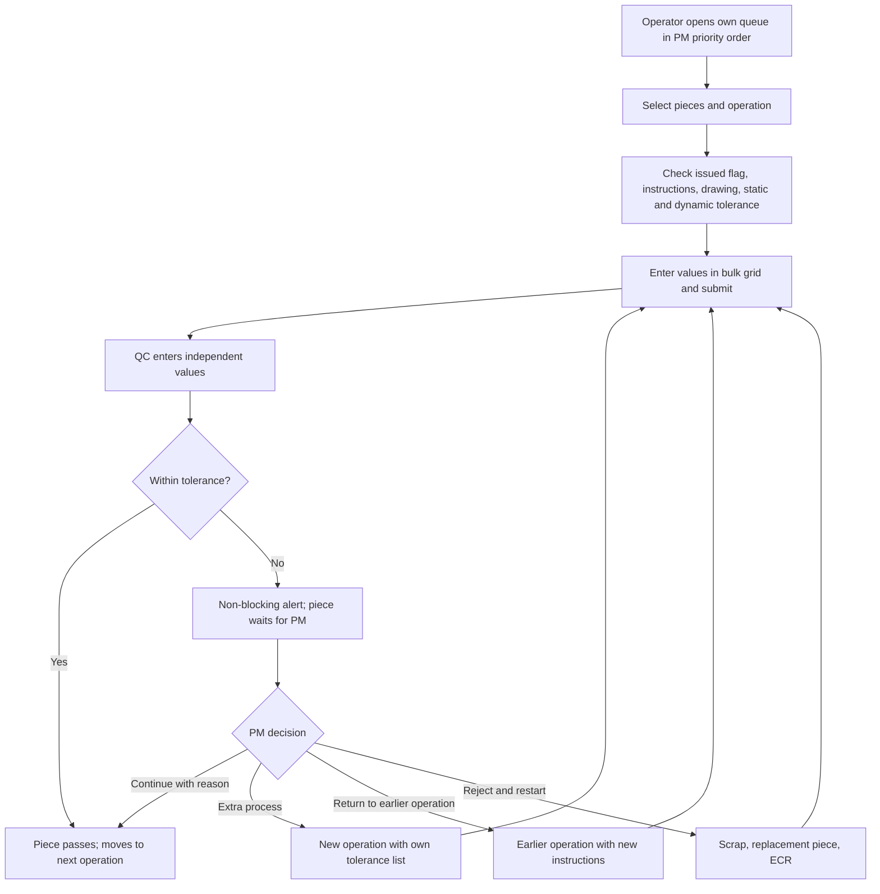
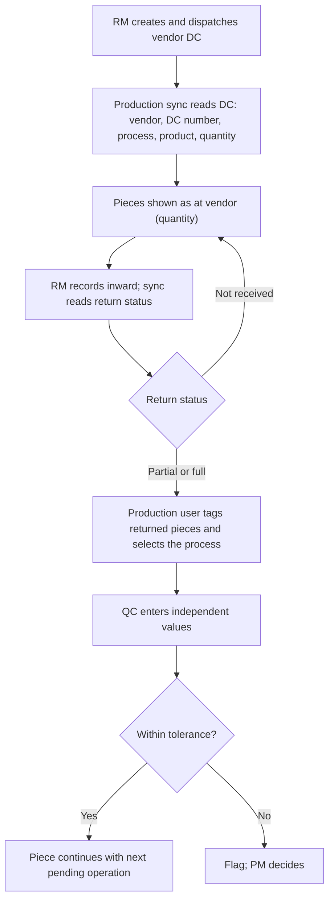
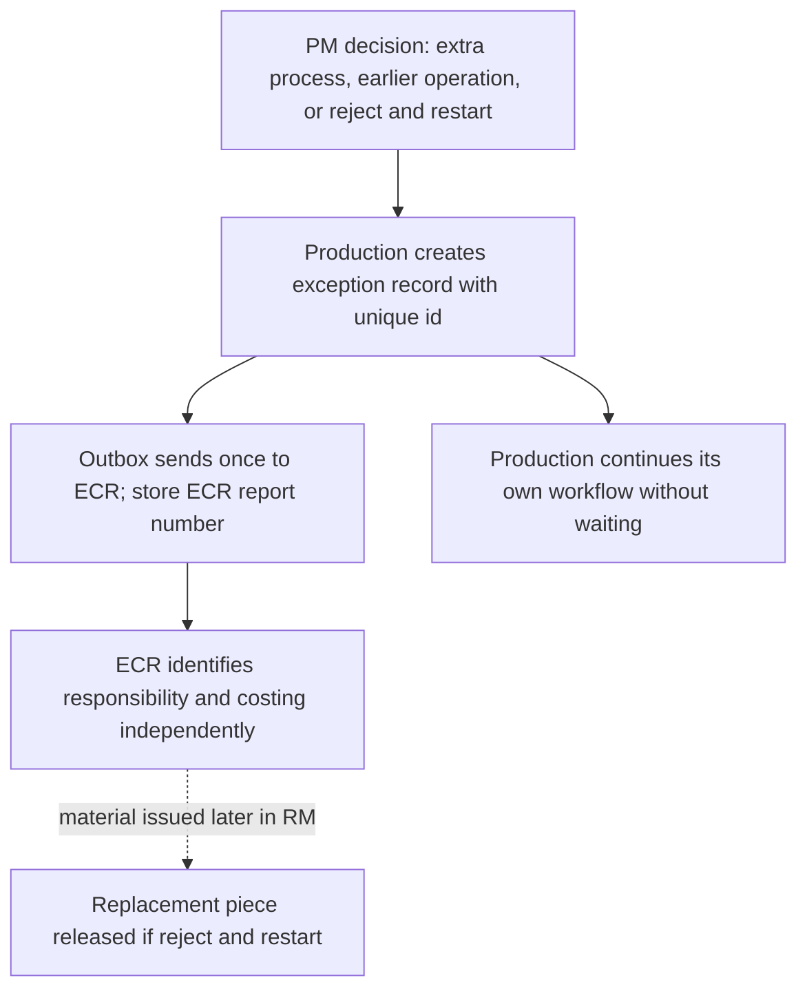
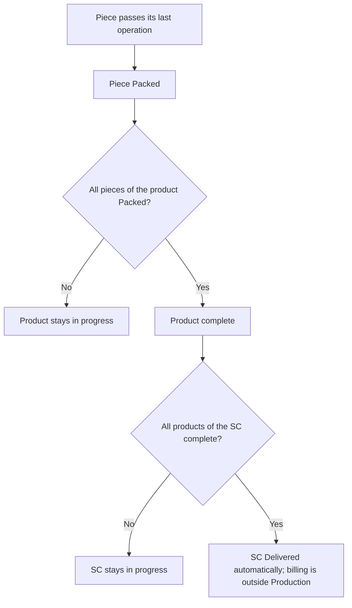
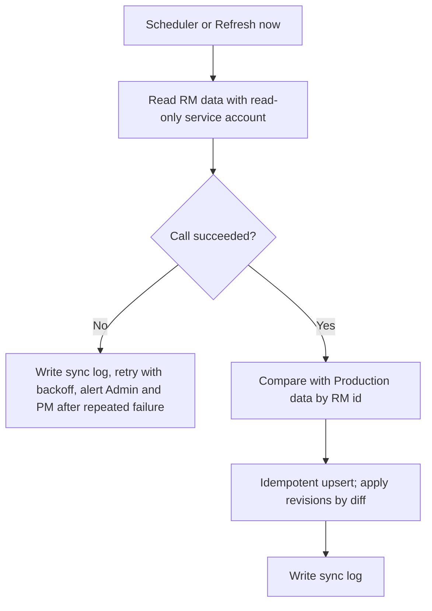

# Velan Production — Documentation Update Pack (2026-11-24)

**Purpose:** one file with every change needed to bring the 15 existing documents (and the README) in the repository up to date with the confirmed decisions.

**How to read it**
- PART 00 is the decision log. It overrides any conflicting statement in documents 01–15.
- PART 01–15 are the changes for each document, in the same order as the originals. PART 16 is the README.
- In the tables: **Edit** = change the existing text; **Replace** = rewrite that section; **Remove** = delete (record it as removed in the change note); **Add** = new item; **Keep** = leave unchanged.
- D-xx = confirmed decision. O-xx = open item; keep these marked `OPEN` in the documents and never turn them into requirements.
- Do not invent requirements. If something in this pack is unclear or does not match the document, list it in the report instead of guessing.

**Contents**
00 Decision Log · 01 BRD · 02 SRS · 03 Application Scope · 04 Feature List · 05 User Stories · 06 Role Matrix · 07 Workflow Diagrams · 08 Business Rules · 09 Integration Specification · 10 Acceptance Criteria · 11 End-to-End Workflow · 12 Requirement Analysis · 13 Tech Stack · 14 SKILLS.md · 15 Application Master Plan · 16 README

---

# PART 00 — Decision Log

**Date:** 2026-11-24  
**Rule:** these decisions override the conflicting statements in files 01–15. The `*_UPDATES.md` files reference the IDs below (D-xx = confirmed, O-xx = open).

## A. Confirmed decisions

| ID | Decision |
|---|---|
| D-01 | **Root record:** the SC created in RM (SC number). One Production SC record per RM SC. SCs can also be created in Production by **manual entry** and **Excel import**; both stay permanently, also after RM integration. |
| D-02 | **Tracking:** individual **piece** tracking. Piece count per product = the quantity RM sends for that product (one RM line per product; SRG is a set = 2 numbers and RM already sends the number; e.g. APG 50 means 100 SRG). Proposed serial: `SC-2579-APG-001` (see O-02). |
| D-03 | **Roles (6):** Admin, PM, Designer, Operator, QC, Management (dashboard view). RBAC rules unchanged (Admin override, deny wins, no grant = deny). Packing, Dispatch, Stores, Vendor Coordinator and Department Head are **not** roles. **Individual login** per employee. |
| D-04 | **Material gate:** Stores marks material issued in RM; Production only needs issued yes/no per product. Until the RM sync is live, PM/Admin sets the flag manually. Operators cannot start or enter data until it is set. |
| D-05 | **Vendor:** RM creates, dispatches and inwards the DC. Production does not choose the vendor, does not alert RM, and tracks **no vendor dates**. Production records DC details (vendor, DC number, process name, product, quantity) and whether the return is received / partial / not received. After return, QC enters values; pieces are tagged to the return at inward. A returned piece may complete any pending operation (usually the next); in-house operations stay sequential. |
| D-06 | **QC:** required on every process; QC enters independent values; operator and QC values are stored separately. RM's own DC QC gate stays in RM and only records the received quantity to close the DC; all measurements are recorded in Production only. |
| D-07 | **QC decision:** a flagged piece waits for the PM. Options: **CONTINUE** (mandatory reason), **EXTRA PROCESS**, **RETURN TO EARLIER OPERATION**, **REJECT AND RESTART**. Flags raise non-blocking alerts. There is no separate override request/approval workflow; an "override" is the PM choosing CONTINUE with a reason. |
| D-08 | **Reject and restart:** the piece is scrapped (history kept); a **replacement piece with a new serial linked to the old one** is created and starts at operation 1. It is blocked until RM shows the ECR material as issued (matched by ECR report number) or the PM releases it manually. |
| D-09 | **Exceptions go only to ECR** (not to RM). ECR returns only an acknowledgement (report number). No costing/responsibility returns. Production never waits for ECR. |
| D-10 | **Completion:** a piece is **Packed** when all its operations are passed; a product is complete when all its pieces are Packed; the **SC becomes Delivered automatically** when all products are complete. No packing/dispatch screens, statuses, roles or dispatch confirmation. Billing is outside Production. |
| D-11 | **Integration is built inside the flow, not at the end.** *(Proposed, confirm in O-04)* Production reads RM through its existing read APIs with a read-only service account (polling + "refresh now") and sends exceptions to ECR's existing intake. RM and ECR code stay unchanged; the earlier outbox work is parked on branch `integration-prep` as reference only. |
| D-12 | **MERC and Velan Dashboard:** read access only, later; write access only if required in future. |
| D-13 | **Stack:** Java 21 + Spring Boot, React + TypeScript + Vite, PostgreSQL on Neon, Cloudflare R2, Docker on Render, GitHub Actions, SMTP email. **No Redis** (in-process Caffeine cache). **No RabbitMQ** (database outbox/inbox). |
| D-14 | **Parameters:** types numeric, yes/no, text, signature, image. Tolerance Excel carries SC number, product name and operation values (format TBD). Machine and operator are fixed per operation; a vendor may occasionally do a process. |
| D-15 | **Planning:** the PM daily priority list per operator **and** the full scheduling / capacity / forecast engine are both in scope. |
| D-16 | **Operator UX:** no start/stop buttons; time comes from ready / opened / submitted timestamps. Operators pick pieces from their own queue (no scanning) and enter values in a bulk grid (rows = pieces). |
| D-17 | **Go-live:** new SCs only; an in-progress SC is imported only when the PM asks. |
| D-18 | **Unchanged from the documents:** notification settings are Admin-only; deletion/cancellation is Admin-only; final acceptance by PM or Admin. |
| D-19 | **Rework** supports both extra process (new operation with its own tolerance list) and return to an earlier operation with new instructions; after QC pass the piece continues after the originally failed operation. |

## B. Open items

| ID | Open item |
|---|---|
| O-01 | Source of the delivery/due date (RM `purchase_orders.reference_date` vs manual/Excel per SC). Scheduling priority depends on it. |
| O-02 | Confirm the piece serial format. |
| O-03 | **Set concept.** The documents define set-level completion and partial dispatch of complete sets. Confirmed rule D-10 completes the SC when all products are complete. Decide whether "set" remains as a grouping (e.g. per SC target quantity) or the SC is the only delivery unit. |
| O-04 | Confirm D-11 (RM read-only polling, ECR existing intake, ADDITIONAL_PROCESS sent to ECR as REWORK with a label). |
| O-05 | SC cancellation / quantity reduction after work has started. |
| O-06 | Excel formats: SC import sheet and tolerance sheet. |
| O-07 | Real-time mechanism: SSE vs WebSocket. |
| O-08 | QR codes and scanning are removed from the baseline (operators pick from their queue). Confirm they stay out. |
| O-09 | Credential type and minimum length for shop-floor roles. |
| O-10 | Final status vocabulary and reason master. |
| O-11 | Backup, retention and performance targets. |
| O-12 | Who may edit process templates (assumed Admin/PM; Designer selects only). |

---

# PART 01 — BRD updates

Refs: D-xx / O-xx from `00_DECISION_LOG.md`.

| Section | Change |
|---|---|
| Header / Status | Add: "Updated 2026-11-24 with decisions D-01 to D-19." |
| §1 Purpose | Replace the last clause "...packing and dispatch confirmation" with "...vendor-operation tracking and automatic completion (Packed, then SC Delivered). Billing is outside Production." (D-10) |
| §3 Obj. 1 | "Receive SC data from RM automatically, and also allow manual SC entry and Excel import." (D-01, D-11) |
| §3 Obj. 3 | "Track every **piece** individually and calculate product and SC completion from piece status." (D-02) |
| §3 Obj. 6 | Add "PM daily priority list per operator" before "plan capacity". (D-15) |
| §3 Obj. 8 | Add "...including replacement pieces with linked serials." (D-08) |
| §3 Obj. 9 | "Show pieces processed by vendors and whether the return is received; all DC transactions stay in RM." (D-05) |
| §3 Obj. 10 | "Show whether Stores has issued material (issued yes/no per product)." (D-04) |
| §3 Obj. 11 | "Send rework, rejection and additional-process information to **ECR**." (remove RM) (D-09) |
| §3 Obj. 12 | Replace with "Complete automatically: piece Packed → product complete → SC Delivered." (D-10) |
| §3 new Obj. 14–15 | "Reduce operator data-entry effort (bulk grid, no start/stop)." (D-16) / "Let the PM add a process to a piece after a mistake without a slow rework tab." |
| §4 Included | **Add:** manual SC entry, Excel SC import, PM daily priority, bulk measurement entry, PM QC decisions, replacement pieces, daily 9 AM report. **Remove:** QR labels/scanning (O-08), vendor alert to RM, RM material shortage/issue-timing analytics (keep only the issued flag and issue time if RM supplies it), packing verification, Dispatch Pending, dispatch confirmation, Production-to-RM exception communication. |
| §4 Excluded | **Add:** packing/dispatch screens, QR/scanning (deferred), writes to RM. **Change** "MERC and Velan Dashboard integrations" to "MERC/Velan Dashboard: none now; read access later; write only if required in future." (D-12) |
| §5 table, RM row | "Receives from RM (read): SC, product quantities, material-issued flag, vendor DC details and return status. Production sends nothing to RM." |
| §5 table, ECR row | "Receives exception information from Production; returns only an acknowledgement/report number. Costing/responsibility stays in ECR." |
| §6 Product and set model | **Replace** with the piece model: SC → products (one RM line per product) → pieces. Piece count = RM quantity for the product (SRG already counted in numbers). Serial proposed `SC-2579-APG-001` (O-02). Mark "set completion / partial dispatch of complete sets" as **OPEN (O-03)**. Remove the SC002 ARG/SPG/VBM/Jig-feet example or label it "illustrative only". |
| §7 Users | "Confirmed roles: **Admin, PM, Designer, Operator, QC, Management**." Packing/dispatch tasks are removed. (D-03) |
| §8 Lifecycle | Replace with: "SC from RM, manual entry or Excel → products and pieces → process flow and tolerance → PM priority → material issued gate → operator values → QC values → PM decision on flags → vendor pieces tracked via RM DC details → all operations passed: Packed → all pieces Packed: SC Delivered automatically." |
| §9 Outcomes | Remove "Packed status and Delivered status are distinct" and "No incomplete BOM set can be packed/dispatched". Change "Vendor pending/returned quantities reconcile with RM inward information" to "Vendor return status (received/partial/not received) matches RM." Add "Every piece has a complete history including replacements." |
| §10 Assumptions | Close: ID of RM source, roles, vendor flow, delivered rule. Keep open: O-01, O-02, O-03, O-05, O-06, O-11. |
| §11 Approval | Unchanged. |

---

# PART 02 — SRS updates

| Item | Change |
|---|---|
| §2 Actors | Add **Designer** (selects process flow per product, uploads drawings and tolerance sheets). Remove "Design-side actors remain in RM". (D-03) |
| FR-001 | Roles = six (D-03). Add: individual login per employee; credential minimum length configurable (O-09). Keep RBAC rules, suspension and audit. |
| FR-002 | **Replace** with: (a) RM sync: Production polls RM's existing read APIs with a read-only service account and has a "refresh now" action; (b) manual SC entry; (c) Excel SC import with validation, preview and import audit. One Production SC per RM SC; dedupe by RM SC id and SC number; apply RM revisions by diff on each poll; new SCs only at go-live, in-progress SC imported on PM request (D-17). Remove "manual provisional entry only if RM unavailable". |
| FR-003 | Hierarchy becomes SC → product → piece. **Remove** QR labels, scanning and QR search (O-08). Search by PO, SC, product, piece serial. Keep lineage; add `replaced_piece_id` for replacement pieces. |
| FR-004 | **Replace** "BOM and set calculation" with "Piece generation": pieces per product = RM quantity; serial per piece; flow snapshot per product. Set completion is **OPEN (O-03)**. |
| FR-005 | Add: Designer selects the process flow per product; fixed machine and operator (or allowed vendor) per operation; five parameter types; flow is snapshotted per product so later template changes never alter existing work (D-14). |
| FR-006 | Replace "Design/Designer" wording with the **Designer** role. Keep extraction, verification and PM approval. Add: tolerance sheet carries SC number, product name and operation values (O-06). |
| FR-007 | Add the **PM daily priority list per operator**; keep scheduling, capacity, calendar, bottlenecks, 7/15/30-day forecast and targets (D-15). Due date is optional until O-01 is resolved. |
| FR-008 | Replace "start/end times" with ready / opened / submitted timestamps; no start/stop buttons. Operators pick pieces from their own queue. Keep PM add/bypass/resequence/reopen with reasons. |
| FR-009 | **Replace** with the material gate: RM sync (or PM/Admin manually) sets issued yes/no per product; pieces are blocked until set. Remove shortage analytics. |
| FR-010 | Entry per piece in a bulk grid (rows = pieces, columns = parameters) with paste from Excel; five parameter types incl. signature and image. |
| FR-011 | QC required on every process. QC flags; **PM decides** (D-07). Remove "override request/approval" as a separate workflow. |
| FR-012 | Four decisions: CONTINUE (reason), EXTRA PROCESS, RETURN TO EARLIER OPERATION, REJECT AND RESTART (scrap + replacement piece, D-08). Send exceptions **to ECR only** (D-09). |
| FR-013 | **Replace**: Production reads RM DC details (vendor, DC number, process name, product, quantity) and return status (received / partial / not received). No vendor selection, no alert to RM, no dates. After return, a Production user tags returned pieces and selects the process; QC enters values. |
| FR-014 | **Replace** "Packing and dispatch" with "Completion": Packed when all operations pass; product complete when all pieces Packed; SC Delivered automatically (D-10). |
| FR-015 | Dashboard: remove "packing-ready" and "dispatch-pending"; add machines in use, vendors, out-of-tolerance values, SCs near completion, rejection quantity, planned vs actual. Add the daily 9 AM report (Excel + charts). Keep Admin-only notification settings. |
| FR-016 | Unchanged. |
| §4 NFR | Add: RM/ECR calls are read-only except ECR exception send; polling interval configurable; ECR sends through a Production outbox with at-most-once guarantee; in-process cache (no Redis). Replace "durable inbox/outbox" for RM with "sync log + idempotent upsert". |
| §5 Entities | **Remove:** component lineage as sets, QR labels, packing_confirmations, dispatch_confirmations, vendor_tracking with dates. **Add:** products, pieces, replaced_piece link, flow snapshot per product, qc_decisions (4 outcomes), exception_records with ECR report number, vendor_batches (+ pieces), daily_priority, import_batches, material_issued flag. |

---

# PART 03 — Application Scope updates

| Section | Change |
|---|---|
| §2 In-scope modules | **Edit** item 2 → "SC intake: RM sync (read), manual entry, Excel import; production record creation." **Edit** item 3 → "Product and piece hierarchy (PO → SC → product → piece)." **Remove** item 4 QR/scanning (keep unique piece serials and search). **Edit** item 7 → "PM daily priority, calendar, capacity, forecast and work allocation." **Edit** item 11 → "Quantity splitting, extra process, return to earlier operation, reject and restart, replacement pieces." **Edit** item 12 → "Vendor tracking from RM DC details and return status (received/partial/not received); no vendor dates." **Edit** item 13 → "Material-issued flag per product (RM sync or manual)." **Edit** item 14 → "Production-to-ECR exception sending." **Remove** item 16 packing verification / Dispatch Pending / dispatch confirmation; **add** "Automatic completion: Packed, SC Delivered." **Add** "Daily 9 AM report; reconciliation of Production against RM and ECR." |
| §3 Out of scope | **Add:** QR codes/scanning (deferred, O-08), packing and dispatch screens/roles, Production-to-RM messages, any write to RM, vendor selection in Production. **Change** "MERC or Velan Dashboard integrations" to "none now; read access later; write only if required in future (D-12)". |
| §4 Responsibility matrix | RM "Vendor DC dispatch/inward" row: Production "Reads DC details and return status; no alerts to RM". "Exception costing" row: Production "Sends exception to ECR; stores ECR report number". "Packing/dispatch status" row: replace with "Completion (Packed/Delivered): Production, automatic". Add row "Material issued: RM owns; Production reads yes/no or PM sets manually". |
| §5 Boundary rules | Remove "Packing and dispatch are distinct..." Add: "A piece is Packed when all operations pass; the SC is Delivered automatically when all products are complete." Add: "Production does not write to RM. It writes to ECR only to send exceptions." Keep "No ECR costing returned". |
| §6 Scope-change control | Unchanged. |

---

# PART 04 — Feature List updates

| ID | Action | New wording / note |
|---|---|---|
| FEAT-001 | Edit | "Individual login per employee, sessions, login history." |
| FEAT-002 | Edit | "**Six** roles (Admin, PM, Designer, Operator, QC, Management), custom roles, multi-role, action permissions, user overrides." |
| FEAT-004 | Edit | "SC intake from RM sync; also manual entry and Excel import (see FEAT-042, FEAT-043)." |
| FEAT-005 | Edit | "RM sync log, refresh now, retry, failed-sync alerts; ECR outbox status." |
| FEAT-006 | Edit | "PO → SC → product → piece." |
| FEAT-007 | Remove / O-03 | "Per-set records" — keep only if the set concept is confirmed. |
| FEAT-008 | Edit | "Unique piece serial with link to product; replacement pieces linked to the scrapped piece." |
| FEAT-009 | Remove | QR labels and scanning (O-08). Keep manual search. |
| FEAT-011 | Edit | "Templates with fixed machine/operator or vendor per operation; Designer selects the flow; flow snapshot per product." |
| FEAT-013/014/015/016 | Edit | Replace "Design" with "Designer"; keep extraction, verification, PM approval and revision rules. |
| FEAT-018 | Edit | "PM daily priority list per operator." |
| FEAT-020 | Edit | "Operation execution with ready/opened/submitted timestamps; no start/stop buttons." |
| FEAT-021 | Edit | "Piece status counts (pending, ready, submitted, QC, flagged, at vendor, packed); no manual quantity buckets." |
| FEAT-022 | Edit | "Material-issued flag per product (RM sync or manual); blocks the product's pieces until set." |
| FEAT-023 | Edit | "Operator values per piece in a bulk grid; five parameter types." |
| FEAT-024 | Edit | "QC values on every process, independent of operator values." |
| FEAT-025 | Edit | "Flag raises a non-blocking alert; the piece waits for the PM decision." |
| FEAT-026 | Remove | Separate override workflow. Replaced by CONTINUE with reason (new FEAT-044). |
| FEAT-027 | Edit | "Extra process, or return to an earlier operation with new instructions." |
| FEAT-028 | Edit | "Reject and restart: scrap, replacement piece with a new linked serial, starting at operation 1." |
| FEAT-029 | Edit | "Extra process (new operation with its own tolerance list); QC mandatory." |
| FEAT-030 | Edit | "Vendor tracking from RM DC details: vendor, DC number, process, product, quantity; shows pieces at vendor. No dates." |
| FEAT-031 | Edit | "RM return status (received/partial/not received) read by Production; pieces tagged on return; QC enters values." |
| FEAT-032 | Edit | "Send REWORK, REJECTION and additional-process exceptions to ECR; store the ECR report number; Production never waits." |
| FEAT-033 | Remove | Production-to-RM exception integration (D-09). |
| FEAT-034 | Edit | Dashboard: machines, vendors, out-of-tolerance, near-complete SCs, rejection quantity, planned vs actual. |
| FEAT-036 | Keep | Admin-managed notification settings. |
| FEAT-039 | Remove | Packing. Replaced by FEAT-045. |
| FEAT-040 | Remove | Dispatch confirmation. Replaced by FEAT-045. |
| FEAT-041 | Keep | Admin-only cancellation/deletion. |
| FEAT-042 | **Add** | Manual SC entry (SC, PO, customer, products, quantities, optional due date). |
| FEAT-043 | **Add** | Excel SC import with validation, preview and audit trail. |
| FEAT-044 | **Add** | PM QC decision: CONTINUE (reason), EXTRA PROCESS, RETURN TO EARLIER OPERATION, REJECT AND RESTART. |
| FEAT-045 | **Add** | Automatic completion: Packed, product complete, SC Delivered. |
| FEAT-046 | **Add** | Bulk entry grid with paste from Excel. |
| FEAT-047 | **Add** | Replacement piece release (RM ECR material issued, or PM manual release). |
| FEAT-048 | **Add** | Daily 9 AM report (Excel + charts). |
| FEAT-049 | **Add** | Reconciliation screen: Production vs RM and ECR. |
| FEAT-050 | **Add** | Import of an in-progress SC on PM request. |
| Feature exclusions | Edit | Add "no QR/scanning, no packing/dispatch screens, no writes to RM". |

---

# PART 05 — User Stories updates

## Add a Designer section (role D-03)
- **DSG-US-001:** As Designer, I want to enter an SC manually or import it from Excel so that an SC can start without waiting for RM.
- **DSG-US-002:** As Designer, I want to select the process flow for each product so that every product follows the correct operations.
- **DSG-US-003:** As Designer, I want to upload drawings and the tolerance sheet, verify extracted values and submit them to the PM.

## Admin
Keep ADM-US-001 to 006. Edit ADM-US-001: "...including individual login credentials."

## PM
- PM-US-001: change to "...appear automatically (RM sync) or after manual/Excel entry".
- PM-US-002: add "...and define each operator's daily priority list".
- **Replace** PM-US-005: "As PM, I want flagged pieces to wait for my decision (CONTINUE with reason, EXTRA PROCESS, RETURN TO EARLIER OPERATION, REJECT AND RESTART) so that failed work has a controlled path."
- **Remove** PM-US-007 (separate override approval). Add: "As PM, I want to continue a flagged piece with a mandatory reason."
- PM-US-008: change to "...see which pieces are at a vendor and whether the return is received".
- **Add** PM-US-010: "As PM, I want to set the material-issued flag manually if the RM sync is delayed."
- **Add** PM-US-011: "As PM, I want to release a replacement piece manually if RM has not yet shown the ECR material issued."
- **Add** PM-US-012: "As PM, I want to import an in-progress SC from RM when I decide."

## Operator
- OP-US-002: "...select pieces from my own queue" (no scanning).
- OP-US-003: "...prevent data entry until Stores has marked material issued."
- **Add** OP-US-007: "As Operator, I want to enter values for many pieces in one grid and paste from Excel so that data entry is quick."
- OP-US-005: "...submit only pieces that are ready at the current operation."

## QC
- QC-US-005: **remove** (override request). 
- QC-US-006: "...pieces returned from a vendor appear for inspection after the return is marked received/partial."
- **Add** QC-US-008: "As QC, I want to inspect every process and enter values independently."

## Management
Keep MGT-US-001 to 004. Edit MGT-US-001: remove "packing and dispatch" and add "machines, vendors, out-of-tolerance values, rejection quantity". Add MGT-US-005: "As Management, I want a daily 9 AM report in Excel with charts."

## Packing and dispatch
**Remove** PK-US-001, PK-US-002, DSP-US-001, DSP-US-002 and the section note. Add: "As PM/Management, I want Packed and Delivered to be set automatically from piece completion."

## Acceptance note
Add negative tests: material not issued, replacement piece not released, duplicate ECR send, RM revision after submit.

---

# PART 06 — Role Matrix updates

| Section | Change |
|---|---|
| §1 title | "Confirmed primary roles: **Admin, PM, Designer, Operator, QC, Management**." |
| §1 table | **Add column "Designer".** Designer: create/edit SC (manual, Excel), select process flow per product, upload drawings and tolerance sheets, verify extraction, view active values; cannot approve tolerance, edit templates, enter operator/QC values or decide QC flags. |
| §1 rows | **Edit** "QC failure disposition / rework routing" → PM decides; QC flags. **Remove** rows "Override approval", "Packing confirmation", "Dispatch confirmation". **Add** rows: "Set material-issued flag (manual)": Admin, PM. "Release replacement piece (manual)": PM. "Import in-progress SC from RM": PM, Admin. "Enter SC manually / Excel import": Designer, PM, Admin. "Daily priority list": PM. "View integration/sync status": Admin, PM. **Edit** "Vendor tracking" → read RM DC details; Production user tags returned pieces; QC enters values. **Edit** "Manage process templates": Admin/PM (O-12). |
| §2 RBAC rules | Unchanged. |
| §3 Suspension | Unchanged. |
| §4 Approval authority | Remove "QC ... override approval". Add "PM decides flagged pieces; a continue decision requires a reason." |
| §5 Role naming note | Replace with: "Design is a primary role (Designer). Stores, Packing, Dispatch, Vendor Coordinator and Department Head are not roles; Stores actions stay in RM." |

---

# PART 07 — Workflow Diagrams updates

Replace diagrams 1, 2, 3, 5, 6, 7 and 8 with the versions below. Diagram 4 (tolerance revision) stays; change "Design" to "Designer" in its labels. Replace the §9 "Status principles" with the list at the end.

## 1. Overall SC → Production → Delivered (replaces diagram 1)

## 2. Material-issued gate (replaces diagram 2)

## 3. Operator and QC loop (replaces diagram 3)

After an extra process or earlier-operation rework passes QC, the piece continues after the originally failed operation.

## 5. Vendor operation (replaces diagram 5)

## 6. Exception to ECR (replaces diagram 6)

Mapping: extra process → ADDITIONAL_PROCESS (sent as REWORK with a label, O-04); return to earlier operation → REWORK; reject and restart → REJECTION. Nothing is sent to RM.

## 7. Completion (replaces the packing and dispatch diagram)

Set-level completion and partial delivery are OPEN (O-03).

## 8. RM sync and failure handling (replaces diagram 8)

## 9. Status principles (replaces §9)
- Every piece status change is explicit and audited.
- Only pieces passed by QC, or continued by the PM with a reason, advance.
- Flagged pieces wait for the PM decision; other pieces keep working.
- A replacement piece is blocked until released.
- A piece is Packed when all operations pass; the SC is Delivered automatically when all products are complete.
- Quantities are always counted from piece status, never entered by hand.

---

# PART 08 — Business Rules updates

## Modified rules
| ID | New wording |
|---|---|
| BR-001 | A submitted RM SC creates a Production record through the RM sync; a Designer/PM/Admin can also create an SC by manual entry or Excel import. |
| BR-003 | Duplicate sync, import or entry must not create duplicate SCs, products or pieces (dedupe on RM SC id and SC number). |
| BR-004 | Preserve PO → SC → product → piece relationships. |
| BR-006 | Piece count per product is the quantity RM supplies for that product (SRG already counted in numbers); never hard-code product composition. |
| BR-007 | Every piece has a unique serial (proposed `SC-2579-APG-001`, O-02). |
| BR-009 | Pieces progress independently. |
| BR-011 | A piece retains its own operation and measurement history. |
| BR-012 | A replacement piece gets a new serial linked to the scrapped piece; serials are never reused or erased. |
| BR-013 | Piece statuses must conserve quantity: every piece is in exactly one status at any time. |
| BR-015 | Only pieces passed by QC, or continued by the PM with a reason, advance. |
| BR-018 | The process flow is snapshotted per product; template revisions never alter existing work. |
| BR-021 | Pieces of a product cannot start or take data entry until the material-issued flag is set (RM sync or manual by PM/Admin). |
| BR-022 | Record the RM issue reference and time when RM supplies them. |
| BR-025 | Designer verifies extracted values before submission. |
| BR-033 | A QC flag raises a non-blocking alert; the flagged piece waits and the PM decides. |
| BR-034 | **Replace:** a PM CONTINUE decision requires a mandatory reason; it never changes the original measurement. |
| BR-037 | Reject and restart scraps the piece and creates a replacement piece that starts at operation 1; history is preserved. |
| BR-039 | ECR owns responsibility and costing; Production sends exceptions to ECR only and stores the returned report number. |
| BR-040 | RM owns vendor DC creation, dispatch and inward; Production reads DC details and return status only. |
| BR-041 | Only pieces covered by an RM return status of received or partial are eligible for QC after vendor return. |
| BR-043 | A partial return leaves the remaining pieces at the vendor. |
| BR-057 | MERC and Velan Dashboard: no integration now; read access later; write only if required in future. |

## Removed rules
BR-005 (set quantity; see O-03), BR-008 (set completion), BR-010 (partial dispatch of sets), BR-045, BR-046, BR-047, BR-048 (packing, Dispatch Pending, dispatch confirmation, partial dispatch).

## Unchanged rules
BR-002, BR-014, BR-016, BR-017, BR-019, BR-020, BR-023, BR-024, BR-026 to BR-032, BR-035, BR-036, BR-038, BR-042, BR-044, BR-049 to BR-056, BR-058.

## New rules
| ID | Rule |
|---|---|
| BR-059 | A piece becomes Packed automatically when all its operations are passed. |
| BR-060 | A product is complete when all its pieces are Packed; the SC becomes Delivered automatically when all products are complete. Billing is outside Production. |
| BR-061 | A replacement piece is blocked until RM shows the ECR material as issued (matched by ECR report number) or the PM releases it manually with a reason. |
| BR-062 | Each exception is sent to ECR once; Production never waits for ECR and never auto-resends after an ambiguous timeout. |
| BR-063 | Manual, Excel and RM-sourced SCs follow identical rules after creation. |
| BR-064 | RM revisions after submit (quantity changes, deleted lines) are applied by diff and audited. |
| BR-065 | A piece returned from a vendor may complete any pending operation (usually the next); in-house operations stay sequential. |
| BR-066 | QC is required on every operation. |
| BR-067 | Production never writes to RM; it writes to ECR only to send exceptions. |
| BR-068 | Quantities and statuses are derived from piece records, never edited by hand. |
| BR-069 | An in-progress SC is imported from RM only when the PM requests it. |
| BR-070 | An extra process creates a new operation with its own tolerance list; after QC pass the piece continues after the originally failed operation. |

---

# PART 09 — Integration Specification updates

**Replace the whole document body with the structure below.** The audits of the live RM and ECR code (2026-11-24) now provide real endpoint and entity names, so "TBD — do not guess" is replaced by the tables here. **Rule that stays:** JSON property names in API responses (which may differ from database column names) must be confirmed by calling the live endpoints as the first task of phase 13; mark them "VERIFY" until then.

## 1. Approach (D-11, pending O-04)
- RM is read only. Production polls RM's existing read APIs with a read-only service account, plus a "refresh now" action. No RM code change.
- ECR receives exceptions through its existing intake. No ECR code change.
- Production never sends anything to RM.
- Integration is built in the flow: RM connector (phase 13), ECR sender (14), SC intake from RM (18), material gate (22), ECR sending (31), replacement release (32), vendor from RM (35), reconciliation (42).

## 2. Data flows (replaces the event catalogue)
| ID | Flow | Direction | Mechanism |
|---|---|---|---|
| INT-001 | SC, PO, customer, product lines and quantities | RM → Production | Poll; idempotent upsert; revisions by diff |
| INT-002 | Material issued yes/no per product | RM → Production | Poll material issues |
| INT-009 | Vendor DC details and return status | RM → Production | Poll DCs |
| INT-010 | ECR material issued (for replacement release) | RM → Production | Poll ECR issues |
| INT-006/007/008 | REJECTION, REWORK, ADDITIONAL_PROCESS exceptions | Production → ECR | Outbox; HTTP POST once |
| INT-003/004/005 | Exceptions to RM | — | **Removed** (D-09) |

## 3. RM read endpoints (all need a JWT; use a service account)
`GET /api/sc`, `/api/sc/:id`, `/api/sc/traceability/:poNumber`, `/api/rm`, `/api/rm/:id`, `/api/rm/stores/queue`, `/api/material-issues`, `/api/material-issues/:id`, `/api/production/receipts`, `/api/delivery-challans`, `/api/delivery-challans/:id`, `/api/delivery-challans/movements`, `/api/ecr-issues` (Stores/Production/Admin roles).

## 4. RM field mapping (database names from the audit; API property names: VERIFY)
| RM source | RM field | Production field | Note |
|---|---|---|---|
| `sales_order_components` | `id`, `sc_number`, `po_id`, `product_name`, `target_quantity`, `status`, `drawing_number` | `sc.external_ref`, `sc.sc_number`, … | `status`: DRAFT, SUBMITTED, STORES_PENDING, PARTIALLY_ISSUED, ISSUED, IN_PRODUCTION, ADDITIONAL_REQUEST, COMPLETED, CLOSED, REJECTED. Only intake when submitted. |
| `purchase_orders` | `po_number`, `reference_date`, `external_reference`, `customer_id` | `sc.po_number`, optional due date | `reference_date` as delivery date is O-01. |
| `customers` | `code`, `name` | `sc.customer` | |
| `rm_requests` | `id`, `sc_id`, `status`, `revision_number`, `submitted_at` | revision tracking | RmRequestStatus: DRAFT, SUBMITTED, REVIEWED, COMPLETED, REJECTED. |
| `rm_items` (one per product, D-02) | `id`, `part_name`, `part_number`, `material`, `material_type`, `grade`, `size`, `quantity`, `weight_unit` | `sc_product.external_ref`, name, quantity | `quantity` = piece count. Lines can be edited by Admin or hard-deleted after submit: the sync must diff every poll. |
| `material_issue_items` | `rm_item_id`, `quantity_issued` | `sc_product.material_issued` | Issued = sum(quantity_issued) per `rm_item_id`; issued yes/no rule to be fixed in phase 22 (assumed: any issue = yes; O-10). |
| `delivery_challans` | `id`, `challan_number`, `type`, `status`, `vendor_id`, `process_name`, `sc_id` | `vendor_batch` | Read only `type = PRODUCTION_PROCESS_OUTWARD`. Number format `SDC/YYYY/####`. |
| `delivery_challan_items` | `id`, `part_name`, `quantity_dispatched`, `actual_received_qty` | `vendor_batch` quantities | **No `rm_item_id`**: match by SC + `part_name`; unmatched lines go to a manual "map this line" screen. `part_number` is overwritten with the SC code, so never match on it. |
| Return status | derived | received / partial / not received | `actual_received_qty` = 0 → not received; < dispatched → partial; ≥ dispatched → received. Do **not** use the DC `status` (after dock receipt it is always PARTIALLY_RETURNED until RM's QC closes it). |
| `ecr_material_pending` | `ecr_id`, `report_number`, `type`, `sc_number`, `component`, `quantity_affected`, `status`, `issued_at` | replacement release | `status`: PENDING, ISSUED. Match `report_number` with the stored ECR report number. |

## 5. Production → ECR
- `POST {ECR_API_URL}/api/internal/rm-intake`, header `x-internal-secret` (value from the Render environment, never in code or logs).
- Request fields: `type` (REWORK or REJECTION), `scNumber`*, `poNumber`*, `component`*, `quantityAffected`* (integer ≥ 1), `defectDescription`*, `raisedByName`*, and optional `stageOfFailure`, `errorType`, `operatorName` (not persisted by ECR), `reworkDescription`, `rejectionDescription`, `rejectionProcessTemplate`, `rejectionFailedStage`, `rejectionStageCosts`, `costEstimation`, `lossEstimation`, `alternativeNotes`. (* required)
- ADDITIONAL_PROCESS is sent as REWORK with the text "[ADDITIONAL PROCESS]" at the start of `defectDescription` (O-04).
- Put the Production exception id in `defectDescription` (for example "Ref PRD-EXC-000123") so a report can be matched manually.
- Response `{reportId, reportNumber}`; store `reportNumber` on the exception. ECR creates the report in status PENDING_ACCOUNTS_REVIEW.
- **Idempotency:** ECR only has a 10-minute in-memory duplicate cache. The Production outbox sends once (PENDING → SENDING → SENT) and never auto-resends after an ambiguous timeout; it flags the item for Admin to check ECR.
- `poNumber` is required by ECR, so Production must hold the PO number on every SC (manual and Excel entry included).

## 6. Reliability and security (replaces §8)
- Sync log table per poll: started, finished, counts, errors; idempotent upserts by RM ids.
- Retry with bounded backoff; alert Admin and PM after repeated failures; "refresh now" for users with permission.
- Read-only service account for RM; secrets in environment variables; never log tokens or secrets.
- Reconciliation screen (phase 42): SCs missing in either side, quantity mismatches, unsent or ambiguous ECR exceptions.

## 7. Exact field checklist (replaces §9)
Keep the checklist columns. Fill them in phase 13 from live responses. Rows above marked "VERIFY" are not final.

## 8. Excluded (replaces §10)
No Production-to-RM messages, no stock or DC transactions, no ECR cost return, no billing, no MERC/Velan Dashboard integration now (read later, D-12).

---

# PART 10 — Acceptance Criteria updates

| AC | Action | Change |
|---|---|---|
| AC-001 | Edit | "Given a valid RM SC (read by the sync), manual SC or Excel row, then exactly one Production SC is created with its source reference. Invalid input creates nothing active. Repeated polls or imports create no duplicates." |
| AC-002 | Edit | "...hierarchy PO → SC → product → piece is correctly linked and searchable by PO, SC, product and serial." |
| AC-003 | **Replace** | "Given an SC with APG quantity 50 and SRG quantity 100, when pieces are generated, then 50 APG and 100 SRG pieces exist, each with a unique serial linked to its product." |
| AC-004 | **Replace** | "Given a product with several pieces, when only some are Packed, the product stays in progress. When all are Packed the product is complete. When all products are complete the SC becomes Delivered automatically." (set-level wording pending O-03) |
| AC-005 | Remove | Partial dispatch of sets (O-03). |
| AC-006 | Edit | "Given Stores has not marked material issued, pieces of that product cannot start or take data entry. When RM shows issued (or PM/Admin sets the flag) they become ready." |
| AC-007 | Edit | "Given 10 pieces at an operation, when 2 pass, 1 is flagged and 7 are pending, the counts reconcile to 10 and only the 2 advance." |
| AC-008 | Keep | |
| AC-009 | Edit | "Given a QC value is outside tolerance, then an alert is raised, the piece waits, and only the PM can choose CONTINUE (reason), EXTRA PROCESS, RETURN TO EARLIER OPERATION or REJECT AND RESTART." |
| AC-010 | Keep | Replace "Design" with "Designer". |
| AC-011 | Edit | "Reject and restart scraps the piece, creates a replacement piece with a new linked serial at operation 1, keeps all history, and blocks the replacement until released. After an extra process or earlier-operation rework passes QC, the piece continues after the originally failed operation." |
| AC-012 | Keep | |
| AC-013 | **Replace** | "Given RM shows a vendor DC with 10 pieces and a return of 6, then Production shows 6 returned and 4 at vendor, the user tags 6 pieces, and QC enters values for them. Production creates no DC and sends nothing to RM." |
| AC-014 | Edit | "Given a PM decision creates an exception, then the outbox sends it to ECR exactly once, stores the ECR report number, and Production neither waits for nor receives costing." |
| AC-015, 016, 017 | Keep | |
| AC-018 | **Replace** | "Given a piece passes its last operation, it becomes Packed automatically; no packing or dispatch action exists." |
| AC-019 | Edit | "Given an RM poll fails, then retries create no duplicates and the sync log shows the failures." |
| AC-020 | Keep | Remove packing/dispatch totals. |
| AC-021 | **Add** | Manual SC entry and Excel import validate, preview and create the same records as the RM sync; Excel import is audited. |
| AC-022 | **Add** | Bulk grid: 20 pieces can be entered in one grid and pasted from Excel; out-of-tolerance cells are highlighted; values are saved even when outside tolerance. |
| AC-023 | **Add** | Replacement piece is released automatically when RM shows the matching ECR report as ISSUED, or manually by the PM with a reason. |
| AC-024 | **Add** | If RM deletes or changes a line after submit, the sync applies the change by diff and the audit shows it; work already done is never deleted. |
| AC-025 | **Add** | Designer can enter SC and select flows but cannot approve tolerance or decide QC flags. |
| AC-026 | **Add** | PM daily priority list orders each operator's queue; operators see only their own pieces. |
| AC-027 | **Add** | The 9 AM daily report is generated in Excel with charts and matches dashboard totals. |
| AC-028 | **Add** | Ambiguous ECR send (timeout) is not re-sent automatically and appears for Admin review. |

---

# PART 11 — End-to-End Workflow updates

| Stage | Change |
|---|---|
| Stage 1 | Add: "An SC can also be entered manually or imported from Excel by the Designer/PM/Admin." |
| Stage 2 | Replace steps 1–6: Production's sync reads the submitted SC through RM's read APIs (or the user enters/imports it); it matches by RM id; creates SC, products (one per RM line) and pieces (quantity per product) with serials; keeps RM ids; applies RM revisions by diff. Remove QR creation. |
| Stage 3 | "Designer selects the process flow per product (fixed machine and operator per operation); the flow is snapshotted." Replace "Design" with "Designer". |
| Stage 4 | Add: "PM sets each operator's daily priority list." Keep capacity and forecast. |
| Stage 5 | Replace: "Stores issues material in RM. Production reads the issue status (or PM/Admin sets the flag manually). Until the product is marked issued, its pieces are blocked." Remove timing/shortage details. |
| Stage 6 | "Operator picks pieces from the own queue, sees instructions, drawing and both tolerances, and enters values in a bulk grid. No start/stop buttons; timestamps are ready, opened, submitted." |
| Stage 7 | "QC enters independent values on every process. Out of tolerance raises a non-blocking alert and the piece waits for the PM." |
| Stage 8 | Replace: PM chooses CONTINUE (reason), EXTRA PROCESS, RETURN TO EARLIER OPERATION or REJECT AND RESTART. Reject and restart scraps the piece and creates a replacement piece (new linked serial) that starts at operation 1 after release. Exceptions go to ECR only, once, and the ECR report number is stored. |
| Stage 9 | Replace: RM creates and dispatches the DC. Production reads vendor, DC number, process, product and quantity, and later the return status (received / partial / not received). A Production user tags the returned pieces and selects the process; QC enters values. No vendor selection, no alert to RM, no dates. |
| Stage 10 | Replace: "A piece becomes Packed when all its operations pass. A product completes when all its pieces are Packed. The SC becomes Delivered automatically when all products complete. Billing is outside Production." |
| Stage 11 | Remove "packing-ready, dispatch-pending"; add machines, vendors, out-of-tolerance values, near-complete SCs, rejection quantity, and the daily 9 AM report. |

---

# PART 12 — Requirement Analysis updates

| Section | Change |
|---|---|
| Header / source basis | Add: "Updated 2026-11-24 with decisions D-01 to D-19 (see 00_DECISION_LOG.md); RM and ECR code audits." |
| §2 Boundaries | Replace: RM is read by Production; Production sends exceptions to ECR only; nothing is sent to RM. MERC/Velan Dashboard: read later. |
| §3 Roles | Six roles incl. **Designer**. Remove the sentence on final role/action permissions being open except O-12. |
| §4 Hierarchy | PO → SC → product → piece. The screenshot hierarchy stays as the RM view. |
| §5 Set/component identity | **Replace** with the piece model (D-02) and proposed serial; mark set concept O-03. Remove the `SC002-1 ARG` label discussion. |
| §6 Material readiness | Replace with the issued yes/no gate (D-04). |
| §7 Tolerance and measurements | Add five parameter types; bulk grid entry; Designer role. |
| §8 QC and exceptions | Replace with D-06, D-07, D-08, D-19. |
| §9 Vendor processing | Replace with D-05. |
| §10 Packing and dispatch | Replace with D-10. |
| §12 Conflict table | **Replace** rows: (1) Packing → Delivered: now **Packed automatically, SC Delivered automatically; no dispatch step** (supersedes the "Dispatch Pending" row). (2) Roles: six roles incl. Designer. (3) Vendor: RM creates DC; Production reads details and return status; no alert to RM, no dates. (4) ECR/RM exceptions: ECR only. (5) Override: PM decides, CONTINUE with reason. (6) QR/scanning removed. (7) Redis/RabbitMQ removed. Keep the notification and tolerance rows. |
| §13 Open items | Close: 1 (field names, now from the audits; VERIFY response shapes), 3 (material granularity: per product yes/no), 6 (rejection = scrap + replacement), 9 (roles). Keep: 2 (serial, O-02), 4 (SC cancellation, O-05), 5 (replace with: manual and Excel are permanent), 7 (parameter detail, O-06), 8 (O-10), 10 (O-11). Add O-01, O-03, O-04, O-07, O-08, O-09, O-12. |
| §14 Source fidelity | Replace: "RM and ECR field names come from code audits of the live apps (2026-11-24). API property names must still be verified against live responses." |

---

# PART 13 — Tech Stack updates

| Section | Change |
|---|---|
| Header | Replace "Recommended baseline, not yet approved" with "Decided baseline (D-13); exact versions recorded in docs/decisions.md when the repo is created." |
| §1 Diagram | Remove the Redis and Message Broker nodes; add "In-process cache (Caffeine)" and "Database outbox/sync log". Replace "RM API/Webhooks" with "RM read APIs (polling)" and "ECR intake (HTTP)". |
| §2 Table | Backend: "Java 21 LTS + Spring Boot (latest stable at project start)". Auth: "Spring Security with individual login; session/JWT strategy fixed in phase 9". Cache: "Caffeine in-process; no Redis". Async: "Database outbox/sync log; no RabbitMQ". Hosting: Render + Neon + Cloudflare R2 confirmed. Email: "SMTP with database queue; Resend later if needed". Realtime: SSE vs WebSocket stays O-07. |
| §3 Decisions still required | Close: Java/Spring Boot, hosting, object storage, Redis/RabbitMQ. Keep: pool settings for Neon, auth session expiry and password reset, performance targets (O-11), SSE vs WebSocket (O-07). |
| §4 Modules | Rename "Packing/Dispatch" → "Completion"; "RM/ECR Integration" → "RM Connector (read) and ECR Sender"; "RM Material Visibility" → "Material Gate". Add "Intake (manual/Excel/RM)", "Daily Priority". |
| §5 Guardrails | Keep all. Add: "RM is accessed read-only with a service account; no RM or ECR code change." "Quantities and statuses are derived from piece records." "Secrets only in environment variables." |

---

# PART 14 — SKILLS.md updates

| Section | Change |
|---|---|
| §1 Mission | Replace "ends with actual dispatch confirmation" with "ends when the SC is Delivered automatically". Add "Do not modify the RM or ECR code bases." |
| §2 Source-of-truth | Add `00_DECISION_LOG.md` as item 1 (above approved documents); open items O-xx must stay marked `OPEN`. |
| §3 Non-negotiable rules | **Replace** these bullets: set completion and partial dispatch (→ product/SC completion from pieces, O-03); packing/dispatch (→ "A piece is Packed when all operations pass; the SC is Delivered automatically; no packing or dispatch screens"); material gate (→ issued flag); QC failure (→ "flag alerts; the piece waits; the PM decides: CONTINUE with reason, EXTRA PROCESS, RETURN TO EARLIER OPERATION, REJECT AND RESTART"); restart (→ scrap + replacement piece with linked serial); RM inward (→ "Production reads RM DC details and return status"). **Add:** "Exceptions go to ECR only." "Production never writes to RM." "Six roles." "Individual login." "Manual entry and Excel import stay permanent." "No QR/scanning in the baseline." |
| §4 Architecture | Add: "No Redis, no RabbitMQ; use Caffeine and a database outbox." |
| §5 Data integrity | Replace "quantity buckets" wording with "derive counts from piece status; every piece is in one status at any time". Add: "Replacement pieces get new serials; never reuse serials." |
| §6 Integration | Replace with: "Use the read-only RM service account and existing RM read endpoints; use ECR's existing intake; verify JSON property names against live responses (VERIFY items in document 09); never send to RM; ECR outbox sends once and never auto-resends after an ambiguous timeout." |
| §8 UI | Replace "Packing and dispatch must be separate screens" with "No packing or dispatch screens". Add: "Operator entry is a bulk grid." "No start/stop buttons." |
| §9 Testing | Add tests: replacement release, ECR once-only send, RM revision by diff, material gate. |
| §11 Forbidden shortcuts | Replace "No automatic Delivered status on packing alone" with "No manual editing of Packed or Delivered; they are derived". Add "No writes to RM", "No auto-resend to ECR after ambiguous timeout", "No matching DC lines by part number (overwritten by RM)". |

---

# PART 15 — Application Master Plan updates

| Section | Change |
|---|---|
| §1 Product definition | Replace "records packing plus actual dispatch" with "completes automatically to Delivered". |
| §2 Boundaries | Inputs from RM: SC, PO, customer, product lines and quantities, material issued yes/no, vendor DC details and return status, ECR material issue status (all read). Outputs to RM: **none**. Outputs to ECR: exceptions. |
| §3 Modules | 3.2 add manual entry, Excel import, RM sync; 3.3 piece model, no QR; 3.4 add Designer flow selection and snapshot; 3.6 add PM daily priority; 3.7 bulk grid, no start/stop; 3.8 PM decision with four outcomes, replacement piece; 3.9 vendor from RM DC details, no dates; 3.10 material gate only; 3.11 RM connector (read) + ECR sender; 3.13 **replace** with "Completion (Packed, Delivered)". |
| §4 Data model | Replace sets/components/QR with products, pieces (with `replaced_piece_id`), flow snapshot, qc_decisions, exception_records (ECR report number), vendor_batches (+ pieces), daily_priority, import_batches, sync_log, ecr_outbox. Remove packing_checks, packing_confirmations, dispatch_confirmations, integration_inbox for RM. |
| §5 Status model | Candidate piece states: Pending, Ready (material issued), Submitted, QC Pending, Flagged (waiting PM), At Vendor, Passed (per operation), Scrapped, Packed. Product: In progress, Complete. SC: In progress, Delivered, Cancelled. Final list in phase 2 (O-10). |
| §6 Phases | **Replace Phases 0–8 with the 51-phase plan** (below). |
| §7 Testing | Add replacement release, ECR once-only send, RM revision diff, Excel import. |
| §9 Risks | Add: RM line edited/deleted after submit; DC lines without `rm_item_id`; ECR intake without persistent dedupe; polling delay. |

## Replacement for §6 — 51 phases
**A Planning:** 1 Requirement analysis · 2 System design · 3 Standards and tech spec.  
**B Foundation:** 4 Create project · 5 Folder structure · 6 Configuration · 7 Database design · 8 Backend foundation.  
**C Security and master data:** 9 Authentication (individual login) · 10 Users and employees · 11 RBAC (6 roles) · 12 Master data.  
**D Integration adapter:** 13 RM read connector · 14 ECR sender.  
**E Production core:** 15 Process templates · 16 SC intake manual · 17 SC intake Excel · 18 SC intake from RM · 19 Piece generation · 20 Files and drawings · 21 Dynamic tolerance · 22 Material-issued gate · 23 PM daily priority · 24 Work assignment and worklists.  
**F Execution:** 25 Operator execution · 26 Tolerance validation · 27 QC module · 28 QC decision · 29 Extra process and return to earlier operation · 30 Rejection and restart · 31 ECR exception sending · 32 Replacement release · 33 PM operation controls · 34 Vendor tracking manual · 35 Vendor tracking from RM · 36 Completion engine.  
**G Management and UI:** 37 Notifications · 38 Email · 39 Dashboard · 40 Reports and 9 AM report · 41 Scheduling, targets, forecast · 42 Reconciliation · 43 Frontend pages per role · 44 Frontend and API connection.  
**H Quality and release:** 45 Security and audit hardening · 46 Performance · 47 Testing · 48 Documentation · 49 CI/CD, deployment, backup · 50 Monitoring and maintenance.  
**I Later:** 51 MERC and Velan Dashboard read access (write only if needed).

---

# PART 16 — README updates

1. Replace the intro sentence with: "Read `00_DECISION_LOG.md` first; it overrides conflicting statements in files 01–15."
2. Add row **0 — `00_DECISION_LOG.md` — Confirmed decisions and open items**.
3. Change the purpose text of file 04 to "Feature inventory (IDs FEAT-001 to FEAT-050)", file 06 to "Six roles", file 09 to "RM read / ECR send interface requirements", file 15 to "Modules, data domains and the 51-phase plan".
4. Replace "Important notes" bullets: remove "Packing and dispatch are separate; only dispatch marks Delivered" and add "Delivered is automatic when all products are complete (D-10)". Replace the RM/ECR field-name note with "Field names come from code audits (2026-11-24); JSON property names must be verified against live responses."
5. Remove the stray `\n` after the table row for file 15.
6. Plan new documents for phase 2: `16_State_Machines.md` (piece, operation, QC decision, SC), `17_Data_Model_ERD.md`, `18_Integration_Adapter_Design.md`, `19_Architecture.md`.

## How to apply
Open each original file next to its `*_UPDATES.md`, apply the rows in order, keep the original IDs where the table says Keep/Edit, and add new IDs where it says Add. Then set each file's header to "Updated 2026-11-24 — decisions D-01 to D-19".
